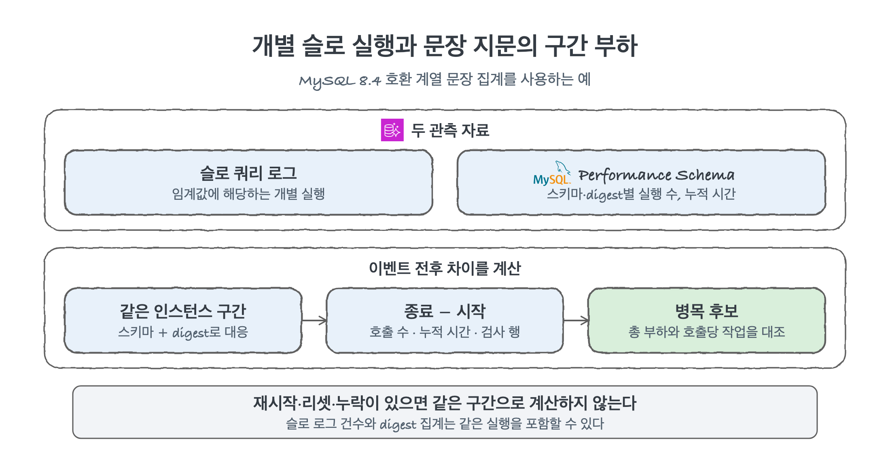

# Aurora MySQL Slow Query Observability and Workload Windows

슬로 쿼리 로그에서 개별 실행을 확인하고, Performance Schema의 문장 지문 통계에서 이벤트 구간의 호출과 비용을 계산한다. SQL은 [공통 실습 환경](01_event_readiness_and_local_mysql_lab.md)과 같은 MySQL 8.4를 기준으로 한다.

## 1. 슬로 로그와 누적 집계의 용도

슬로 로그는 `long_query_time`과 최소 검사 행 수 같은 조건을 통과한 개별 실행을 보여 준다. 문장 지문 집계는 활성화된 계측 범위에서 호출 수, 총 시간과 검사 행을 누적한다. 짧은 쿼리가 자주 실행돼 총 부하가 커지는 경우는 집계에서 먼저 찾을 수 있다. 운영 로그의 SQL 값에는 민감한 데이터가 들어갈 수 있으므로 수집 범위와 접근 권한을 정한다. [MySQL 슬로 로그](https://dev.mysql.com/doc/refman/8.4/en/slow-query-log.html) · [문장별 집계](https://dev.mysql.com/doc/refman/8.4/en/performance-schema-statement-summary-tables.html)

## 2. 쿼리 정규화와 지문으로 유형 묶기

인스턴스 내부의 문장 집계는 `SCHEMA_NAME`과 `DIGEST`를 기준으로 묶인다. 리터럴 값만 다른 쿼리는 하나의 지문으로 집계될 수 있다. 동일 지문이라도 바인딩 값 분포에 따라 실행 비용이 다를 수 있다. 용량을 초과해 지문이 NULL인 합산 행은 별도로 보고하고 개별 지문 순위에서 제외한다. `QUERY_SAMPLE_TEXT`와 정규화된 `DIGEST_TEXT`의 노출 범위도 구분한다. [Performance Schema 지문](https://dev.mysql.com/doc/refman/8.4/en/performance-schema-statement-digests.html)

## 3. 누적 통계에서 이벤트 창의 차이 계산하기

같은 인스턴스, 동일 시간대, 같은 통계 세대에서 창 전후의 카운터 차이를 구한다. 실습은 같은 연결에서 실행하며, 시간대와 첫 관측 시각 `FIRST_SEEN` 및 카운터 감소를 확인한다. 운영에서는 수집 대상 인스턴스, 서버 재시작이나 통계 초기화 이력, 수집 누락도 별도로 기록한다. 카운터가 다시 커졌다고 같은 세대임을 보장하지 않는다. [문장 집계 컬럼과 초기화](https://dev.mysql.com/doc/refman/8.4/en/performance-schema-statement-summary-tables.html)

```sql
SET SESSION time_zone = '+00:00';

SELECT id FROM aurora_my_orders WHERE request_id = 'seed-41';

CREATE TEMPORARY TABLE aurora_my_digest_before AS
SELECT SCHEMA_NAME, DIGEST, FIRST_SEEN, COUNT_STAR,
       SUM_TIMER_WAIT, SUM_ROWS_EXAMINED
FROM performance_schema.events_statements_summary_by_digest
WHERE SCHEMA_NAME = DATABASE() AND DIGEST IS NOT NULL;

SELECT id FROM aurora_my_orders WHERE request_id = 'seed-42';
SELECT id FROM aurora_my_orders WHERE request_id = 'seed-43';

WITH delta AS (
    SELECT a.DIGEST,
           CAST(a.COUNT_STAR AS DECIMAL(30,0)) - b.COUNT_STAR AS calls,
           CAST(a.SUM_TIMER_WAIT AS DECIMAL(30,0)) - b.SUM_TIMER_WAIT AS total_ps,
           CAST(a.SUM_ROWS_EXAMINED AS DECIMAL(30,0)) - b.SUM_ROWS_EXAMINED AS examined
    FROM performance_schema.events_statements_summary_by_digest AS a
    JOIN aurora_my_digest_before AS b
      ON a.SCHEMA_NAME = b.SCHEMA_NAME AND a.DIGEST = b.DIGEST
     AND a.FIRST_SEEN = b.FIRST_SEEN
)
SELECT DIGEST, calls, ROUND(total_ps / 1000000000, 3) AS total_ms,
       ROUND(total_ps / NULLIF(calls, 0) / 1000000000, 3) AS mean_ms,
       examined
FROM delta
WHERE calls > 0 AND total_ps >= 0 AND examined >= 0
ORDER BY total_ms DESC;
```

카운터가 피코초 단위이므로 10억으로 나눠 밀리초를 구한다. 이 조회는 창 양쪽에 남은 항목만 계산한다. 신규 지문과 초과 집계의 크기도 함께 기록한다. [Performance Schema 타이머](https://dev.mysql.com/doc/refman/8.4/en/performance-schema-timing.html)

## 4. 실행 시간, 호출량, 검사 행 수 읽기

전체 DB 부담을 보려면 구간 총 시간, 요청 지연을 설명하려면 실행당 평균과 로그의 느린 개별 실행을 함께 본다. 호출량이 늘었는지, 한 번 실행할 때 더 많은 행을 검사하는지 구분한다. 검사 행 수는 반환 행 수나 디스크 읽기 수와 다르므로 실행 계획의 접근 경로와 대기 유형을 대조한다. [MySQL EXPLAIN](https://dev.mysql.com/doc/refman/8.4/en/explain.html)



그림의 근거 · [MySQL 슬로 쿼리 로그](https://dev.mysql.com/doc/refman/8.4/en/slow-query-log.html) · [MySQL 문장 Digest 집계](https://dev.mysql.com/doc/refman/8.4/en/performance-schema-statement-summary-tables.html)

## 5. 분석 이력과 담당 서비스 연결하기

조사 결과에 인스턴스·스키마·지문, 시작·종료 시각, 배포 버전, 서비스 팀, 대표 계획을 기록한다. 동일 지문을 여러 서비스가 사용할 수 있으므로 앱 추적과 계정·라우팅 정보를 이용해 호출 경로를 확인한다. 수정 후 같은 서비스와 관측 조건의 창에서 효과를 다시 비교한다.
