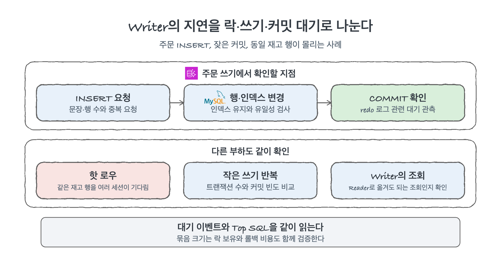

# Aurora MySQL Writer DB Load and Write-Path Diagnostics

Writer의 DB Load가 늘면 CPU가 실제로 바빠졌는지, 쓰기와 커밋이 무엇을 기다리는지 본다.

## 1. CPU, 락, I/O, 커밋 대기 나누기

Database Insights에서 Writer의 DB Load를 대기별로 분할하고 Top SQL을 함께 본다. 행 락 대기라면 차단 트랜잭션, 읽기 I/O라면 비교할 조회의 접근 경로, redo flush 계열 대기라면 커밋 횟수와 쓰기량을 확인한다. 대기 이벤트 이름은 Aurora MySQL 엔진 버전에 맞춰 해석한다. [Aurora MySQL 대기 이벤트](https://docs.aws.amazon.com/AmazonRDS/latest/AuroraUserGuide/AuroraMySQL.Reference.Waitevents.html) · [redo log flush 대기](https://docs.aws.amazon.com/AmazonRDS/latest/AuroraUserGuide/ams-waits.io-redologflush.html)

## 2. 주문·응모 INSERT 집중 진단하기

동일 유일 키의 중복 요청과 신규 INSERT를 분리해 집계한다. INSERT는 기본·보조 인덱스 갱신, FK 검사, redo 기록을 수반할 수 있다. 생성하는 행 수, 인덱스 수, 요청별 트랜잭션 경계를 함께 본다. 요청 유일 키와 커밋 결과 조회를 사용해 응답 유실 후 같은 주문을 다시 만드는 일을 막는다. [InnoDB 문장별 잠금](https://dev.mysql.com/doc/refman/8.4/en/innodb-locks-set.html)

## 3. 작은 쓰기와 잦은 커밋을 줄이기

업무상 허용되면 여러 행을 한 INSERT나 작은 트랜잭션으로 묶어 커밋 횟수를 줄인다. 특히 배치의 단건 자동 커밋과 묶음 처리에서 행 수, 지연, 읽기 경로의 복제 지연을 함께 측정한다. 청크가 커지면 락 보유와 실패 시 재처리 범위가 커질 수 있다. [MySQL 배치 처리와 트랜잭션 크기](../mysql/48_batch_processing_and_transaction_sizing.md)

```sql
START TRANSACTION;

INSERT INTO aurora_my_orders (request_id, product_id, status)
VALUES ('batch-101', 1, 'PENDING'), ('batch-102', 2, 'PENDING');

COMMIT;
```

위 예제는 [공통 실습 데이터](01_event_readiness_and_local_mysql_lab.md)에서 한 번 실행한다. 이미 반영된 요청의 재시도에서 중복 키가 나면 롤백 후 저장된 결과를 확인한다.

## 4. 재고나 쿠폰 한 행에 집중되는 쓰기

다음 UPDATE는 재고가 남았을 때만 한 건을 차감한다. 성공한 차감만 주문 생성의 다음 단계로 넘긴다. 차감과 발급 기록을 함께 보장해야 하면 한 트랜잭션에 두고 요청·발급의 유일 키를 유지한다. 동일 행의 쓰기는 직렬화하므로, 실행 수를 줄이고 락 구간을 줄인 뒤에도 남는 대기를 측정한다. [MySQL 핫 로우와 쿠폰](../mysql/54_mysql_hot_rows_and_concurrency_control_patterns.md)

```sql
UPDATE aurora_my_inventory
SET available = available - 1
WHERE product_id = 1 AND available > 0;

SELECT ROW_COUNT() AS rows_changed;
```

## 5. Writer로 유입된 조회 찾기

Writer의 Top SQL에서 읽기 쿼리를 찾아 API 경로와 풀 설정을 대조한다. 쓰기 직후 최신 확인처럼 Writer가 필요한 조회를 별도로 기록한다. 느슨한 최신성을 허용하는 순위나 목록은 Reader 연결로 보내되, 새 연결과 실제 인스턴스 분포를 검증한다. 변경 뒤 Writer 부하와 Reader의 복제 지연을 함께 본다. [Aurora 엔드포인트](https://docs.aws.amazon.com/AmazonRDS/latest/AuroraUserGuide/Aurora.Overview.Endpoints.html)



그림의 근거 · [AWS Aurora MySQL 대기 이벤트](https://docs.aws.amazon.com/AmazonRDS/latest/AuroraUserGuide/AuroraMySQL.Reference.Waitevents.html) · [AWS Aurora MySQL redo flush 대기](https://docs.aws.amazon.com/AmazonRDS/latest/AuroraUserGuide/ams-waits.io-redologflush.html) · [MySQL 문장 Digest 집계](https://dev.mysql.com/doc/refman/8.4/en/performance-schema-statement-summary-tables.html)
