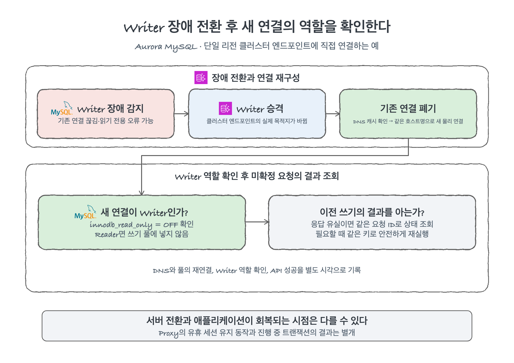

# Aurora MySQL Replica Lag, DDL, and Writer Failover

주문 직후 조회의 최신성, Reader 지연, 이벤트 중 변경 작업, Writer 장애 전환 후 연결 복구를 각각 확인한다.

## 1. 주문 직후 읽기 최신성 확보하기

Writer의 주문 커밋 직후에는 해당 변경이 Reader에 아직 반영되지 않아 주문이 보이지 않을 수 있다. 바로 확인해야 하는 주문·결제 상태는 Writer에서 조회하거나 읽기가 요구하는 버전 이상인지 확인한다. Reader에서 주문이 보이지 않으면 부재로 확정하기 전에 최신 상태를 확인하는 경로를 둔다. 일반 목록까지 Writer로 옮기면 쓰기 경로의 연결과 작업량이 늘 수 있다. [Aurora 복제](https://docs.aws.amazon.com/AmazonRDS/latest/AuroraUserGuide/Aurora.Replication.html) · [Aurora Reader 엔드포인트](https://docs.aws.amazon.com/AmazonRDS/latest/AuroraUserGuide/Aurora.Endpoints.Reader.html)

## 2. Reader 지연과 자원 부족을 같은 창에서 확인하기

연결 요청이 실제 도착한 Reader의 `AuroraReplicaLag`, CPU, 메모리, 연결 수, DB Load를 같은 구간에서 확인한다. `AuroraReplicaLag`의 단위는 밀리초다. Writer의 쓰기량, 인스턴스별 쿼리 부하, 연결 쏠림을 대조한다. 다른 환경에 별도로 연결한 binlog 복제 지연과 동일하게 해석하지 않는다. 목표를 벗어난 Reader를 쓰는 경로는 최신성 요구에 맞춰 제한한다. [Aurora CloudWatch 복제 지표](https://docs.aws.amazon.com/AmazonRDS/latest/AuroraUserGuide/Aurora.AuroraMonitoring.Metrics.html)

## 3. 이벤트 중 DDL과 메타데이터 락

앞선 트랜잭션이 공유 메타데이터 락을 보유하면 ALTER가 배타 락을 기다리고 이후 SELECT도 대기할 수 있다. `sys.schema_table_lock_waits`와 `performance_schema.metadata_locks`에서 대상 테이블과 차단 연결을 확인한다. 온라인 DDL이어도 메타데이터 락이 필요하다. 배포용 세션에 짧은 `lock_wait_timeout`을 두고 대상 정의에 맞는 알고리즘을 사전 검증한다. [MySQL 온라인 DDL의 메타데이터 락](https://dev.mysql.com/doc/refman/8.4/en/innodb-online-ddl-performance.html) · [메타데이터 락 실습](../mysql/53_mysql_metadata_locks_and_online_ddl.md)

## 4. 대량 수정·삭제 배치의 충돌 줄이기

대상 PK 범위를 고정하고 작은 청크마다 커밋한다. 같은 행을 여러 순서로 잠그는 작업을 피하고, FK 검사나 연쇄 삭제가 만드는 추가 변경도 본다. 청크 중단 시 재개 키와 업무 반영 상태를 함께 확인한다. 아래 실습은 [공통 데이터](01_event_readiness_and_local_mysql_lab.md)에서 기존 주문 100건만 대상으로 보관 상태를 갱신한다. 단일 배치 워커의 예다.

```sql
CREATE TABLE aurora_my_batch_progress (
    job_name VARCHAR(40) PRIMARY KEY,
    last_id BIGINT NOT NULL,
    upper_id BIGINT NOT NULL
) ENGINE = InnoDB;

INSERT INTO aurora_my_batch_progress VALUES ('archive-paid', 0, 100);

START TRANSACTION;

SELECT last_id, upper_id INTO @last_id, @upper_id
FROM aurora_my_batch_progress
WHERE job_name = 'archive-paid'
FOR UPDATE;

SET @through_id = LEAST(@last_id + 25, @upper_id);

UPDATE aurora_my_orders
SET status = 'ARCHIVED'
WHERE id > @last_id AND id <= @through_id AND status = 'PAID';

SET @changed = ROW_COUNT();

UPDATE aurora_my_batch_progress
SET last_id = @through_id
WHERE job_name = 'archive-paid';

COMMIT;

SELECT @through_id AS last_committed_id, @changed AS changed_rows;
```

다음 청크에서는 START TRANSACTION부터 반복한다. 수정 수가 0이어도 현재 PK 범위에 대상 행이 없을 수 있으므로 종료 조건은 `last_id = upper_id`다. 해당 범위의 상태가 나중에 바뀌는 경우는 후속 재탐색 정책으로 처리한다. 대상 행 변경과 체크포인트는 함께 커밋되거나 롤백된다. [MySQL UPDATE](https://dev.mysql.com/doc/refman/8.4/en/update.html) · [배치 트랜잭션 크기](../mysql/48_batch_processing_and_transaction_sizing.md)

## 5. Writer 장애 전환 뒤 연결 복구하기

단일 리전 Aurora MySQL에서 애플리케이션이 클러스터 엔드포인트에 직접 접속하는 경우의 복구 순서다.

1. 재접속에는 같은 클러스터 엔드포인트 호스트명을 사용한다. 새 Writer가 승격되면 이 호스트명이 가리키는 IP가 바뀐다. 이전 IP가 계속 조회되면 클라이언트의 DNS 캐시와 TTL을 확인한다. [Aurora 클러스터 엔드포인트](https://docs.aws.amazon.com/AmazonRDS/latest/AuroraUserGuide/Aurora.Endpoints.Cluster.html)
2. Writer 풀에서 끊겼거나 이전 Writer에 남은 연결을 폐기하고 새 물리 연결을 연다. 풀에 연결을 반환하는 동작만으로는 새 Writer에 연결됐는지 확인할 수 없다. [Aurora 장애 전환과 기존 연결](https://docs.aws.amazon.com/AmazonRDS/latest/AuroraUserGuide/rds-proxy.howitworks.html)
3. 새 쓰기 연결에서 `SHOW GLOBAL VARIABLES LIKE 'innodb_read_only'`를 실행한다. `OFF`면 Writer, `ON`이면 Reader다. Reader로 연결되면 그 연결을 쓰기 풀에서 제외하고 엔드포인트와 DNS를 다시 확인한다. [Aurora MySQL 인스턴스 역할 확인](https://docs.aws.amazon.com/AmazonRDS/latest/AuroraUserGuide/AuroraMySQL.BestPractices.html)
4. 전송한 쓰기나 `COMMIT`의 응답을 받지 못했다면 새 Writer에서 기존 멱등 키로 처리 상태를 조회한다. 다시 실행해야 할 때는 같은 키를 사용하고 서비스의 중복 방지 규칙을 적용한다. [AWS 멱등 재시도 설계](https://aws.amazon.com/builders-library/making-retries-safe-with-idempotent-APIs/)

새 연결 확보, Writer 역할 확인, 주문 API 성공 시점을 각각 기록한다.

RDS Proxy를 사용하면 유휴 클라이언트 연결은 유지될 수 있고, 전환 시 실행 중인 SQL이나 트랜잭션은 중단될 수 있다. [RDS Proxy 장애 전환](https://docs.aws.amazon.com/AmazonRDS/latest/AuroraUserGuide/rds-proxy.howitworks.html)



그림의 근거 · [AWS Aurora 클러스터 엔드포인트](https://docs.aws.amazon.com/AmazonRDS/latest/AuroraUserGuide/Aurora.Endpoints.Cluster.html) · [AWS RDS Proxy 장애 전환](https://docs.aws.amazon.com/AmazonRDS/latest/AuroraUserGuide/rds-proxy.howitworks.html) · [AWS Aurora MySQL 연결 역할 확인](https://docs.aws.amazon.com/AmazonRDS/latest/AuroraUserGuide/AuroraMySQL.BestPractices.html) · [AWS 멱등 재시도](https://aws.amazon.com/builders-library/making-retries-safe-with-idempotent-APIs/)
