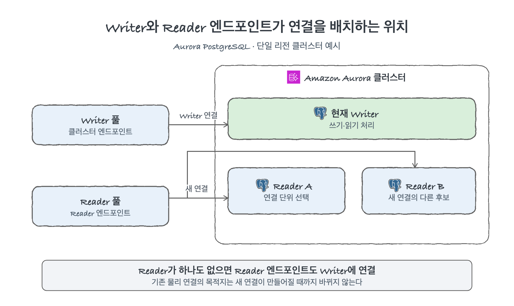

# Aurora PostgreSQL Event Readiness and Local Lab Setup

쿠폰 오픈처럼 짧은 시간에 요청이 몰리는 이벤트 전에 사용자 영향, Writer·Reader 부하, 커넥션 경로를 확인한다. SQL 실습은 격리된 PostgreSQL 18을 사용하며, Aurora 지표와 라우팅은 별도의 운영 관측으로 확인한다.

## 1. 쿠폰 오픈 10분 전 확인할 지표

주문·쿠폰 API의 요청률, 5xx 비율, p95 응답 시간, 성공·중복·품절 건수를 보고한다. DB는 Writer와 Reader를 인스턴스별로 나눠 CPU, DB Load와 주요 대기, 연결 수, Reader 지연을 본다. 애플리케이션 풀에서는 사용 중인 연결, 대기 요청, 대여 실패를 확인한다. 모니터링 시각과 집계 주기를 통일하고 배포나 배치의 예정 시각을 표시한다. [Aurora CloudWatch 지표](https://docs.aws.amazon.com/AmazonRDS/latest/AuroraUserGuide/Aurora.AuroraMonitoring.Metrics.html) · [Aurora DB Load](https://docs.aws.amazon.com/AmazonRDS/latest/AuroraUserGuide/USER_PerfInsights.Overview.ActiveSessions.html)

## 2. Reader 주소를 써도 Writer로 연결되는 경우

Aurora 클러스터 엔드포인트는 Writer에 연결한다. Reader 엔드포인트는 새 연결을 사용 가능한 Aurora Replica로 분산한다. Replica가 없으면 Reader 엔드포인트도 Writer에 연결된다. 주소나 애플리케이션 데이터소스 이름만으로 실제 목적지를 판단하지 말고, 풀을 얻은 실제 연결에서 현재 역할을 확인한다. 트랜잭션에서 이미 빌린 Writer 연결로 후속 SELECT가 실행되는지도 확인한다. [Aurora 연결 관리](https://docs.aws.amazon.com/AmazonRDS/latest/AuroraUserGuide/Aurora.Overview.Endpoints.html) · [Reader 엔드포인트](https://docs.aws.amazon.com/AmazonRDS/latest/AuroraUserGuide/Aurora.Endpoints.Reader.html)

```sql
SELECT current_database(), pg_is_in_recovery(),
       current_setting('transaction_read_only') AS transaction_read_only;
```

`transaction_read_only`는 현재 트랜잭션의 설정이라 Writer에서도 켜질 수 있다. Aurora 운영 지표와 대조할 때는 연결 대상 인스턴스 식별자도 기록한다. [Aurora PostgreSQL 함수](https://docs.aws.amazon.com/AmazonRDS/latest/AuroraUserGuide/Appendix.AuroraPostgreSQL.Functions.html)



그림의 근거 · [AWS Aurora 클러스터 엔드포인트](https://docs.aws.amazon.com/AmazonRDS/latest/AuroraUserGuide/Aurora.Endpoints.Cluster.html) · [AWS Aurora Reader 엔드포인트](https://docs.aws.amazon.com/AmazonRDS/latest/AuroraUserGuide/Aurora.Endpoints.Reader.html)

## 3. 로컬 PostgreSQL 초기화하기

폐기 가능한 로컬 PostgreSQL 18의 실습 DB를 사용한다. Docker 예에서는 네트워크를 끄고 컨테이너 안에서 접속한다. `pg_stat_statements`는 서버 시작 시 로드하고 사용할 DB에 확장을 만든다. [PostgreSQL 공식 Docker 이미지](https://hub.docker.com/_/postgres) · [pg_stat_statements 설정](https://www.postgresql.org/docs/18/pgstatstatements.html)

```sh
docker run -d --rm --network none --name aurora-pg-lab -e POSTGRES_PASSWORD=lab-only -e POSTGRES_DB=aurora_lab postgres:18 -c shared_preload_libraries=pg_stat_statements
docker exec -it aurora-pg-lab psql -U postgres -d aurora_lab
```

서버가 준비되면 다음 SQL을 실행한다. 다음 문서의 SQL은 이 두 테이블을 재사용한다. 실습을 모두 마친 뒤 `docker stop aurora-pg-lab`으로 컨테이너를 종료한다.

```sql
CREATE EXTENSION IF NOT EXISTS pg_stat_statements;

CREATE TABLE aurora_lab_inventory (
    product_id integer PRIMARY KEY,
    available integer NOT NULL CHECK (available >= 0)
);

CREATE TABLE aurora_lab_orders (
    id bigint GENERATED ALWAYS AS IDENTITY PRIMARY KEY,
    request_id text NOT NULL UNIQUE,
    product_id integer NOT NULL REFERENCES aurora_lab_inventory(product_id),
    status text NOT NULL DEFAULT 'PENDING',
    created_at timestamptz NOT NULL DEFAULT now()
);

INSERT INTO aurora_lab_inventory VALUES (1, 10000), (2, 10000);

INSERT INTO aurora_lab_orders (request_id, product_id, status, created_at)
SELECT 'seed-' || g, 1 + g % 2,
       CASE WHEN g % 5 = 0 THEN 'PAID' ELSE 'PENDING' END,
       TIMESTAMPTZ '2025-01-01 00:00:00+00' + g * interval '1 minute'
FROM generate_series(1, 1000) AS s(g);
```

## 4. 평시 기준선 만들기

같은 인스턴스 유형과 시간 단위로 평시 요청량, API 지연, DB Load, 커넥션 수, 대기 이벤트, 복제 지연을 기록한다. 평일 피크나 예정된 배치가 있다면 같은 조건의 창과 비교한다. 기준선에 사용한 릴리스, 풀 크기, 인스턴스 수와 데이터 분포도 남긴다.

## 5. 부하 시험의 제한과 중단 조건

격리한 시험 환경에서 낮은 부하부터 단계적으로 올린다. 단계마다 요청 상한과 시간 상한을 정하고, 예를 들어 연속된 관측 창에서 API 오류율 또는 복제 지연이 실험 목표를 넘으면 부하 발생기를 먼저 멈춘다. 중단 기준은 실제 서비스가 허용하는 지연과 오류 예산에서 정한다. 중단 후에는 새 요청을 차단한 시각과 대기·오류가 회복된 시각을 함께 기록한다.
