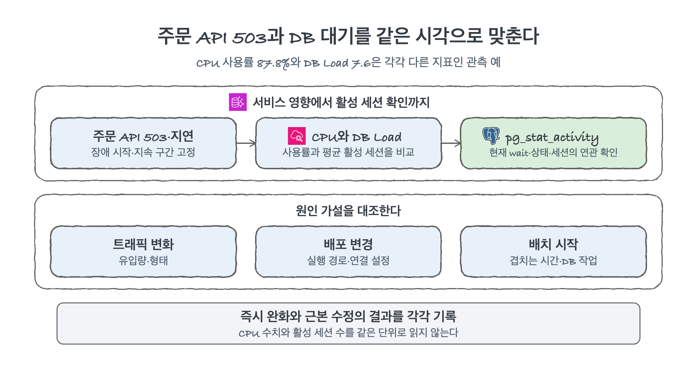

# The First Five Minutes of Aurora PostgreSQL Incident Triage

주문 API의 오류와 DB의 상태를 같은 시간축에 두고, 현재 대기 원인과 즉시 조치할 범위를 확인한다.

## 1. 주문 API 503과 DB 지표의 시간 맞추기

API 로그와 CloudWatch, Database Insights를 같은 UTC 구간에 맞춘다. 503을 낸 계층이 로드 밸런서인지 애플리케이션인지 먼저 찾는다. 같은 분 단위 구간에서 요청량, DB 지연, 풀 획득 실패, Writer·Reader의 부하를 비교한다. 그래프의 집계 방식과 인스턴스 차원도 같아야 한다. 지표가 동시에 변했다는 사실은 조사 순서를 정하는 근거다. [Aurora CloudWatch 지표](https://docs.aws.amazon.com/AmazonRDS/latest/AuroraUserGuide/Aurora.AuroraMonitoring.Metrics.html)

## 2. CPU 87.8%와 DB Load 7.6 읽기

`CPUUtilization`은 인스턴스 CPU 사용 비율이다. DB Load는 평균 활성 세션 수(AAS)이며 CPU를 쓰는 세션과 잠금·I/O 등을 기다리는 세션을 포함한다. 예를 들어 8 vCPU에서 DB Load 7.6 중 대부분이 잠금이면 CPU 사용률 수치와 별개로 차단 세션부터 확인한다. DB Load의 CPU 부분과 vCPU 기준선은 참고할 수 있지만 CPU 사용률처럼 백분율로 읽지 않는다. [Aurora DB Load와 AAS](https://docs.aws.amazon.com/AmazonRDS/latest/AuroraUserGuide/USER_PerfInsights.Overview.ActiveSessions.html) · [Aurora CPU 대기 지표](https://docs.aws.amazon.com/AmazonRDS/latest/AuroraUserGuide/apg-waits.cpu.html)

## 3. pg_stat_activity로 지금 기다리는 작업 보기

```sql
SELECT pid, application_name, state, wait_event_type, wait_event,
       now() - xact_start AS transaction_age,
       CASE WHEN state = 'active' THEN now() - query_start END AS query_age,
       pg_blocking_pids(pid) AS blockers
FROM pg_stat_activity
WHERE datname = current_database() AND pid <> pg_backend_pid()
  AND (state IN ('active', 'idle in transaction') OR xact_start IS NOT NULL)
ORDER BY xact_start NULLS LAST;
```

`state`와 `wait_event`는 독립이다. 활성 문장도 락을 기다릴 수 있다. 대기 이벤트가 NULL인 한 번의 관측만으로 CPU가 원인이라고 단정하기 어렵다. 위 조회는 현재 접속한 인스턴스의 스냅샷이므로 Writer와 Reader를 각각 본다. 다른 역할의 상세 활동이 보이지 않으면 모니터링 계정의 권한을 확인한다. [PostgreSQL pg_stat_activity](https://www.postgresql.org/docs/18/monitoring-stats.html) · [Aurora 대기 이벤트](https://docs.aws.amazon.com/AmazonRDS/latest/AuroraUserGuide/AuroraPostgreSQL.Tuning.concepts.summary.html)

## 4. 배포, 배치, 트래픽 변경 대조하기

오류 시작 앞뒤의 릴리스, 데이터소스 설정, 스케줄 작업, 캐시 만료, 파트너 트래픽 변화를 시간순으로 놓는다. 해당 경로의 `application_name`, 쿼리 지문, 인스턴스별 연결 수를 대조한다. 예를 들어 결제 API만 느린 상황과 Reader 랭킹 호출이 전반적으로 증가한 상황은 완화 대상이 다르다.

## 5. 즉시 완화와 원인 수정 분리하기

먼저 승인된 방법으로 문제 경로의 부하를 줄이고, 조치 전후의 오류율과 대기량을 확인한다. 배치를 멈췄다면 재개 위치와 상태를 기록한다. 이후 재현한 계획, 트랜잭션 경계, 연결 분배를 근거로 수정한다. 어떤 조치가 효과 있었는지 구분할 수 있도록 변경 시각과 관측 결과를 같이 남긴다.



그림의 근거 · [AWS Aurora CloudWatch 지표](https://docs.aws.amazon.com/AmazonRDS/latest/AuroraUserGuide/Aurora.AuroraMonitoring.Metrics.html) · [AWS DB Load와 활성 세션](https://docs.aws.amazon.com/AmazonRDS/latest/AuroraUserGuide/USER_PerfInsights.Overview.ActiveSessions.html) · [PostgreSQL pg_stat_activity](https://www.postgresql.org/docs/18/monitoring-stats.html#MONITORING-PG-STAT-ACTIVITY-VIEW)
