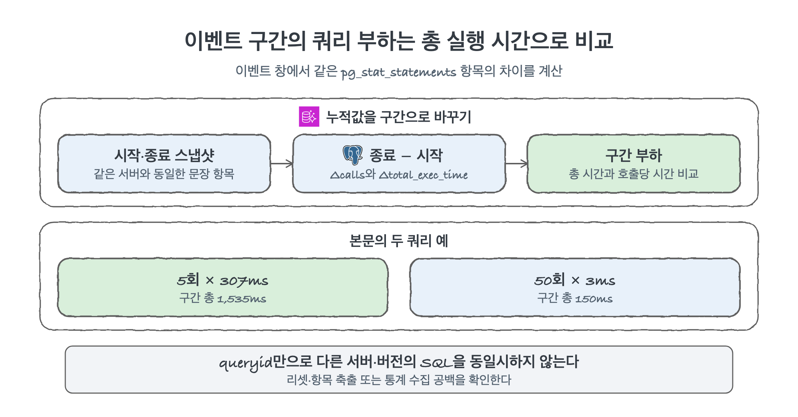

# Aurora PostgreSQL Query Observability and Event-Window Analysis

느린 개별 실행은 로그로 확인하고, 반복되는 쿼리의 누적 비용은 `pg_stat_statements`에서 같은 구간을 잘라 비교한다. SQL 예제는 [01번 로컬 실습 DB](01_event_readiness_and_local_postgresql_lab.md)에서 실행한다.

## 1. 슬로 로그와 pg_stat_statements 선택하기

`log_min_duration_statement`는 기준보다 오래 걸린 문장의 실행 시점과 시간을 로그에 남길 때 사용한다. `pg_stat_statements`는 정규화된 문장별로 실행 수와 총 시간, 행 수를 집계해 자주 실행되는 짧은 SQL도 드러낸다. 로그 수집 범위와 인스턴스별 집계 범위를 함께 기록한다. 로그에는 민감한 쿼리 값이 들어갈 수 있으므로 접근 권한과 보존 기간을 정한다. [PostgreSQL 문장 로깅](https://www.postgresql.org/docs/18/runtime-config-logging.html) · [pg_stat_statements](https://www.postgresql.org/docs/18/pgstatstatements.html)

## 2. queryid로 리터럴만 다른 문장 묶기

`queryid`는 정규화된 문장의 해시다. 동일 인스턴스의 동일 DB·역할·최상위 문장 여부까지 포함해 집계 키로 사용한다. 의미상 같은 SQL이라도 객체가 다르면 다른 식별자가 될 수 있고, 주요 버전을 바꾼 뒤 같은 ID가 유지된다고 전제하지 않는다. 대표 SQL의 텍스트만으로 바인딩 분포나 실행 계획 차이를 알 수는 없다. 원본 비교가 필요한 경우 민감한 값은 별도로 처리한다. [PostgreSQL queryid와 통계 키](https://www.postgresql.org/docs/18/pgstatstatements.html)

## 3. 누적 통계에서 이벤트 구간만 잘라내기

같은 인스턴스와 연결 대상에서 창의 시작과 끝을 스냅샷으로 남긴다. 새로 생긴 항목, 제거된 항목, 재시작이나 초기화로 세대가 바뀐 항목은 별도로 표시한다. 아래 로컬 PostgreSQL 18 예제는 같은 세션에서 임시 테이블을 사용한다. Aurora에서는 설치한 확장 버전에 따라 `stats_since`의 사용 가능 여부를 먼저 확인한다. [PostgreSQL 통계 항목 수명과 초기화](https://www.postgresql.org/docs/18/pgstatstatements.html)

```sql
CREATE TEMP VIEW event_query_counters AS
SELECT p.dbid, p.userid, p.toplevel, p.queryid,
       p.stats_since, p.calls, p.total_exec_time,
       i.stats_reset, i.dealloc,
       pg_postmaster_start_time() AS server_started_at
FROM pg_stat_statements AS p
CROSS JOIN pg_stat_statements_info AS i
WHERE p.dbid = (SELECT oid FROM pg_database WHERE datname = current_database());

SELECT id FROM aurora_lab_orders WHERE request_id = 'seed-41';
CREATE TEMP TABLE event_queries_before AS TABLE event_query_counters;

SELECT id FROM aurora_lab_orders WHERE request_id = 'seed-42';
SELECT id FROM aurora_lab_orders WHERE request_id = 'seed-43';
CREATE TEMP TABLE event_queries_after AS TABLE event_query_counters;

SELECT a.queryid, a.userid, a.toplevel,
       a.calls - b.calls AS calls_in_window,
       round((a.total_exec_time - b.total_exec_time)::numeric, 3) AS total_ms_in_window,
       round(((a.total_exec_time - b.total_exec_time)
             / NULLIF(a.calls - b.calls, 0))::numeric, 3) AS mean_ms_in_window,
       a.dealloc <> b.dealloc AS entries_evicted_in_window
FROM event_queries_after AS a
JOIN event_queries_before AS b USING (dbid, userid, toplevel, queryid)
WHERE a.server_started_at = b.server_started_at
  AND a.stats_reset IS NOT DISTINCT FROM b.stats_reset
  AND a.stats_since IS NOT DISTINCT FROM b.stats_since
  AND a.calls > b.calls AND a.total_exec_time >= b.total_exec_time
ORDER BY total_ms_in_window DESC;
```

이 쿼리는 시작과 끝에 모두 남아 있는 같은 세대의 항목만 비교한다. `dealloc` 차이는 전체 집계에서 이탈한 항목이 있을 수 있다는 표시다. 새로 생긴 항목까지 포함한 전체 부하를 계산했다고 해석하지 않는다.

## 4. 5회 실행된 307ms와 50회 실행된 3ms 비교하기

307ms가 실행당 평균이면 5회 누적은 1,535ms다. 3ms가 실행당 평균인 다른 쿼리는 50회 누적 150ms다. 누적 실행 시간 기준으로는 첫 번째가 먼저지만 주문 실패와 잠금 전파를 설명하는지가 처리 순서에도 영향을 준다. 단일 최대 시간과 평균은 별개이며, 누적 실행 시간은 CPU 시간으로 읽지 않는다. [Aurora 쿼리와 대기 분석](https://docs.aws.amazon.com/AmazonRDS/latest/AuroraUserGuide/USER_PerfInsights.Overview.ActiveSessions.html)



그림의 근거 · [PostgreSQL pg_stat_statements](https://www.postgresql.org/docs/18/pgstatstatements.html)

## 5. 다음 이벤트에서 같은 쿼리가 돌아오는지 추적하기

쿼리 지문과 함께 서비스, 릴리스, 접속 인스턴스, 대표 실행 계획, 대표 데이터 범위를 기록한다. 다음 이벤트의 같은 길이 구간에서 호출 수, 실행당 시간, 총 시간, 읽은 행을 비교한다. 호출량 증가와 실행당 비용 증가에 다른 조치를 적용한다. 이미 개선한 문장이 재발했다면 인덱스·데이터 분포뿐 아니라 앱이 이전 SQL 경로로 돌아갔는지도 확인한다.
