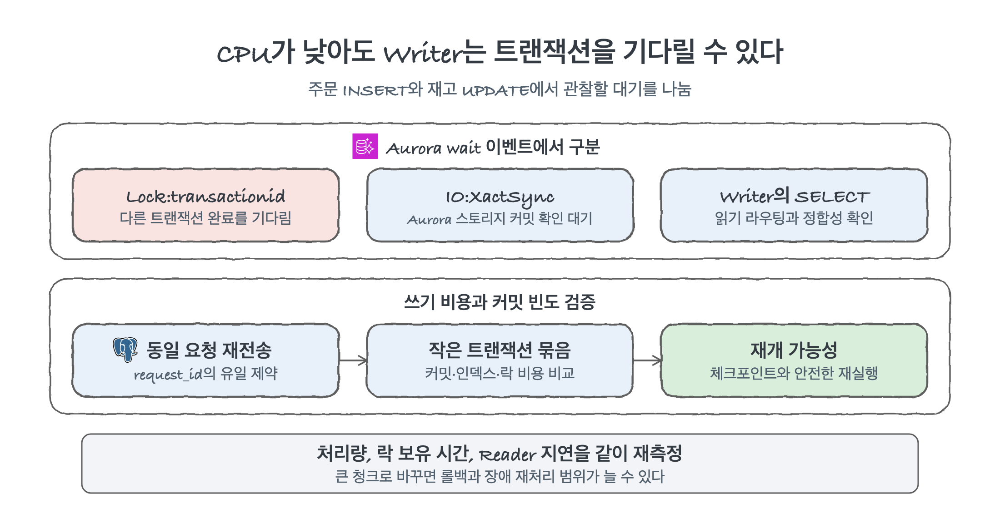

# Aurora PostgreSQL Writer Load and Write-Path Diagnostics

Writer가 느려졌을 때 CPU와 대기 유형을 나눠 읽고, 주문 삽입과 커밋, 재고 한 행의 경합, 읽기 라우팅을 각각 확인한다.

## 1. CPU가 낮은 Writer의 대기 유형 확인하기

CPU가 낮고 DB Load가 높다면 세션이 무엇을 기다리는지 본다. 예를 들어 `Lock:transactionid`는 다른 트랜잭션 종료에 대한 대기와 관련되고 `IO:XactSync`는 Aurora 스토리지의 커밋 확인과 관련된다. 오래 열린 트랜잭션의 보유 락과 커밋 빈도를 대조해 각각의 원인을 좁힌다. [Aurora Lock:transactionid](https://docs.aws.amazon.com/AmazonRDS/latest/AuroraUserGuide/apg-waits.locktransactionid.html) · [Aurora IO:XactSync](https://docs.aws.amazon.com/AmazonRDS/latest/AuroraUserGuide/apg-waits.xactsync.html)

## 2. 주문 INSERT가 몰릴 때 보는 비용

INSERT는 테이블 쓰기 외에 인덱스 유지, 유일성 검사, FK 참조 검사와 WAL 생성이 동반될 수 있다. 문장 수와 트랜잭션 수, 행당 인덱스 개수, 커밋 대기와 중복 요청 비율을 같이 본다. 잘못된 경로의 재전송과 실제 신규 주문을 분리해 측정한다. 동일 요청은 DB의 유일 키로 판정하고, 어떤 결과를 다시 반환할지 정한다. [PostgreSQL INSERT와 충돌 처리](https://www.postgresql.org/docs/18/sql-insert.html)

## 3. 한 건씩 커밋하는 배치 줄이기

행별 자동 커밋은 행 수만큼 트랜잭션을 끝낸다. 업무상 허용된다면 여러 행을 한 문장 또는 작은 트랜잭션에 묶어 커밋 횟수를 줄인다. 청크가 너무 크면 락 보유, 롤백, 재처리, Reader 지연이 커질 수 있다. 작업과 같은 트랜잭션에서 재개 지점을 확정하거나 이미 반영된 작업을 안전하게 판정한다. [Aurora 커밋 대기](https://docs.aws.amazon.com/AmazonRDS/latest/AuroraUserGuide/apg-waits.xactsync.html)

아래 실습은 [공통 주문 테이블](01_event_readiness_and_local_postgresql_lab.md)에 같은 요청을 중복 삽입할 때 충돌 기준을 명시한다. 결과를 저장해야 하는 업무에서는 충돌한 행의 기존 상태를 별도로 읽어 반환한다.

```sql
BEGIN;

INSERT INTO aurora_lab_orders (request_id, product_id)
VALUES ('batch-101', 1), ('batch-102', 2)
ON CONFLICT (request_id) DO NOTHING;

COMMIT;
```

## 4. 인기 상품 한 행에 집중되는 UPDATE

조건 검사와 재고 차감을 한 문장에 묶으면 값 덮어쓰기를 방지할 수 있다. 같은 상품의 쓰기는 여전히 동일 행에서 직렬화한다. 영향을 받은 행이 없으면 부족 또는 대상 부재를 처리한다. 차감이 성공했을 때만 주문을 기록하는 업무라면 같은 트랜잭션에서 커밋하고 유일한 요청 키로 중복을 막는다. [PostgreSQL 격리와 동시 UPDATE](https://www.postgresql.org/docs/18/transaction-iso.html)

```sql
UPDATE aurora_lab_inventory
SET available = available - 1
WHERE product_id = 1 AND available > 0
RETURNING available;
```

## 5. Writer로 새는 읽기 확인하기

Writer에서 실행되는 SELECT의 `application_name`, 호출 경로, 쿼리 지문을 확인한다. 쓰기 직후 결과 확인처럼 Writer가 필요한 읽기는 분리해 기록한다. 느슨한 최신성을 허용하는 목록이나 집계라면 Reader에 별도 풀을 쓰고 실제 연결 대상과 부하 변화를 확인한다. SQL에 SELECT가 보인다는 이유만으로 쓰기 경로의 트랜잭션을 나누지는 않는다. [Aurora Writer·Reader 엔드포인트](https://docs.aws.amazon.com/AmazonRDS/latest/AuroraUserGuide/Aurora.Overview.Endpoints.html)



그림의 근거 · [AWS Aurora PostgreSQL 행 락 대기](https://docs.aws.amazon.com/AmazonRDS/latest/AuroraUserGuide/apg-waits.locktransactionid.html) · [AWS Aurora PostgreSQL 커밋 대기](https://docs.aws.amazon.com/AmazonRDS/latest/AuroraUserGuide/apg-waits.xactsync.html) · [PostgreSQL INSERT](https://www.postgresql.org/docs/18/sql-insert.html)
