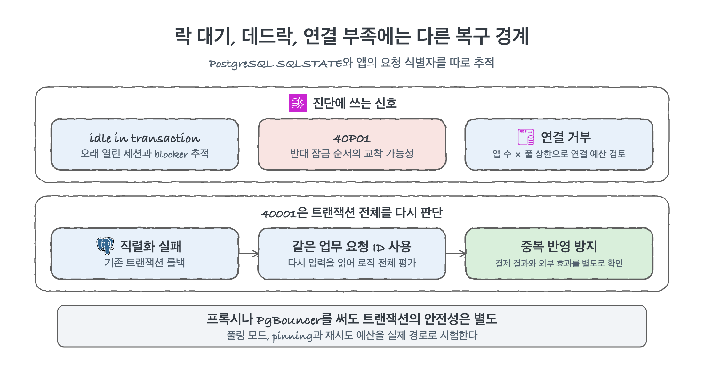

# Aurora PostgreSQL Locks, Deadlocks, Connection Pools, and Retries

락 대기에서 루트 차단 트랜잭션을 찾고, 연결 수 증가와 재시도가 원래 장애를 키우는 경로를 분리한다.

## 1. idle in transaction에서 시작한 대기 따라가기

SQL 실행을 마친 연결도 트랜잭션을 닫지 않으면 락을 보유할 수 있다. 아래 조회는 대기 세션이 어떤 PID에 막혔고 그 연결의 트랜잭션이 언제 열린 것인지 보여 준다. 차단 PID가 다른 행에서 다시 대기자로 나타나면 상위 홀더까지 추적한다. 준비된 트랜잭션 등 실제 백엔드 행이 없는 경우도 있으므로 차단 세션과 역할 로그를 확인한다. [PostgreSQL pg_blocking_pids](https://www.postgresql.org/docs/18/functions-info.html) · [Aurora Lock:transactionid](https://docs.aws.amazon.com/AmazonRDS/latest/AuroraUserGuide/apg-waits.locktransactionid.html)

```sql
SELECT w.pid AS waiter, p.pid AS blocker,
       b.application_name, b.state AS blocker_state,
       now() - b.xact_start AS blocker_xact_age,
       w.wait_event_type, w.wait_event
FROM pg_stat_activity AS w
CROSS JOIN LATERAL unnest(pg_blocking_pids(w.pid)) AS p(pid)
LEFT JOIN pg_stat_activity AS b ON b.pid = p.pid
WHERE w.datname = current_database()
ORDER BY blocker_xact_age DESC NULLS LAST, waiter;
```

## 2. 40P01과 반대 순서로 잡은 두 행

[01번 실습 데이터](01_event_readiness_and_local_postgresql_lab.md)로 A는 상품 1의 재고 행을, B는 상품 2의 재고 행을 갱신한 채 트랜잭션을 유지한다. A에서 상품 2 갱신을 보내 대기시키고 B에서 상품 1을 갱신한다. 데드락이 감지되면 한 세션이 SQLSTATE `40P01`을 받는다. 두 세션은 남은 트랜잭션을 롤백한다. 수정 후에는 두 경로 모두 같은 상품 ID 순서로 잠그고 데드락 대신 한쪽이 진행을 마칠 때까지 기다리는지 확인한다. [PostgreSQL 데드락](https://www.postgresql.org/docs/18/explicit-locking.html#LOCKING-DEADLOCKS)

## 3. 앱 증설 후 DB의 연결 거부 진단하기

인스턴스당 풀 상한에 앱 인스턴스 수를 곱해 DB가 받을 수 있는 연결 수와 비교한다. Writer·Reader용 풀, 배치, 관리 연결, 롤링 배포 중 겹치는 인스턴스를 포함한다. 예를 들어 앱 20대에서 Writer 풀의 상한이 15면 최대 300개의 연결 후보가 생긴다. 실제 연결 수는 설정 한도, 유휴 연결, 재접속률과 함께 본다. `max_connections`만 올리면 연결당 메모리와 DB의 동시 작업량도 늘 수 있다. [PostgreSQL 연결 설정](https://www.postgresql.org/docs/18/runtime-config-connection.html) · [Aurora DatabaseConnections](https://docs.aws.amazon.com/AmazonRDS/latest/AuroraUserGuide/Aurora.AuroraMonitoring.Metrics.html)

## 4. PgBouncer와 RDS Proxy 선택 조건

PgBouncer의 트랜잭션 풀링은 트랜잭션이 끝나면 백엔드 연결을 다른 클라이언트가 쓸 수 있게 한다. 세션 상태에 의존하는 기능은 풀 모드의 지원 여부를 확인한다. RDS Proxy도 백엔드 연결을 재사용하며 세션 상태에 따라 특정 연결에 고정될 수 있다. 앱과 프록시의 풀 상한, 빌리기 지연, 고정된 세션 수를 함께 관찰한다. 프록시는 긴 트랜잭션의 락 시간이나 단일 행의 경합을 줄여 주지는 않는다. [PgBouncer 풀 모드](https://www.pgbouncer.org/features.html) · [RDS Proxy 연결 고려사항](https://docs.aws.amazon.com/AmazonRDS/latest/AuroraUserGuide/rds-proxy-connections.html) · [RDS Proxy 세션 고정](https://docs.aws.amazon.com/AmazonRDS/latest/AuroraUserGuide/rds-proxy-pinning.html)

## 5. 40001을 재시도하면서 중복 결제 방지하기

SQLSTATE `40001`은 직렬화 실패다. 실패한 문장만 다시 보내지 말고, 새 트랜잭션에서 필요한 데이터와 업무 조건을 다시 읽고 전체를 제한적으로 재시도한다. DB의 요청 유일 키와 외부 결제의 멱등 키를 같은 업무 요청에 연결한다. 네트워크가 끊겨 커밋이나 결제 결과를 모르면, 새 요청을 만들기 전에 기존 키로 처리 상태를 확인한다. 재시도 가능한 DB 작업과 외부 호출의 경계를 나누고, 타임아웃과 재시도 총량을 관리한다. [PostgreSQL 직렬화 실패 처리](https://www.postgresql.org/docs/18/mvcc-serialization-failure-handling.html) · [외부 결제 호출과 트랜잭션 경계](../mysql/52_long_transactions_and_connection_pool_exhaustion.md)



그림의 근거 · [PostgreSQL 데드락](https://www.postgresql.org/docs/18/explicit-locking.html#LOCKING-DEADLOCKS) · [PostgreSQL 직렬화 실패 처리](https://www.postgresql.org/docs/18/mvcc-serialization-failure-handling.html) · [AWS RDS Proxy Pinning](https://docs.aws.amazon.com/AmazonRDS/latest/AuroraUserGuide/rds-proxy-pinning.html) · [AWS 멱등 재시도](https://aws.amazon.com/builders-library/making-retries-safe-with-idempotent-APIs/)
