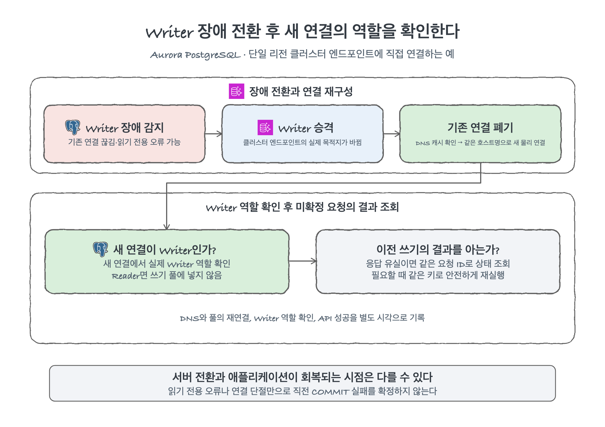

# Aurora PostgreSQL Replica Lag, DDL, and Failover

복제 지연이 주문 직후 조회에 미치는 영향을 확인하고, 배치와 DDL이 이벤트 트래픽을 막는 경로를 찾는다. 장애 전환 후에는 연결과 요청 결과를 각각 확인한다.

## 1. 주문 직후 내역이 누락돼 보이는 이유

쓰기 커밋 직후 Aurora Reader가 해당 변경을 아직 보지 못하면 주문이 없는 것으로 응답할 수 있다. 쓰기 직후 조회에서 최신 정보가 필요하면 Writer로 라우팅하거나 읽기가 최소 버전을 만족하는지 확인한다. 최신 관계를 확인할 수 없으면 주문 부재로 확정하는 대신 처리 상태를 확인하는 경로를 둔다. [Aurora PostgreSQL 복제](https://docs.aws.amazon.com/AmazonRDS/latest/AuroraUserGuide/AuroraPostgreSQL.Replication.html)

## 2. Reader 지연과 자원 부족을 같은 인스턴스에서 보기

인스턴스별 `AuroraReplicaLag`, CPU, 메모리, 활성 세션과 연결 수를 같은 구간에 맞춘다. Reader 한 대에서만 지연이 튀면 그 인스턴스의 조회 비용과 연결 분배를 본다. 모든 Reader의 지연이 함께 커지면 Writer의 쓰기량과 동시 변화도 확인한다. 평균으로 묶으면 뒤처진 한 대를 놓칠 수 있으므로 실제 요청의 Reader와 일치시킨다. [Aurora 복제 지표](https://docs.aws.amazon.com/AmazonRDS/latest/AuroraUserGuide/Aurora.AuroraMonitoring.Metrics.html)

## 3. 이벤트 중 ALTER TABLE이 SELECT까지 막는 과정

여러 형태의 `ALTER TABLE`은 `ACCESS EXCLUSIVE` 락을 요구한다. 앞선 읽기 트랜잭션을 기다리는 강한 DDL 락 요청이 뒤에 오는 SELECT도 기다리게 할 수 있다. 적용하려는 명령의 락 수준을 먼저 확인하고, 별도 배포 연결에서 `lock_timeout`과 `statement_timeout`을 정한다. 오래 열린 트랜잭션과 루트 차단 세션을 확인하고 조치 전후의 요청 지연을 대조한다. [PostgreSQL ALTER TABLE 락](https://www.postgresql.org/docs/18/sql-altertable.html) · [락 대기 조회](07_locks_deadlocks_connection_pools_and_retries.md)

## 4. 대량 UPDATE를 작은 트랜잭션으로 나누기

업무상 분할할 수 있다면 안정적인 정렬 키를 사용해 청크를 처리하고 재개 키를 같은 트랜잭션에 저장한다. 청크당 행 수, 락 대기, 복제 지연을 관측하면서 크기와 휴지 구간을 결정한다. 재개 키 뒤만 읽는 처리는 이전 키에 뒤늦게 생긴 대상이 포함되지 않으므로 적재 구간을 고정하거나 별도 재탐색 정책을 둔다.

[공통 실습 DB](01_event_readiness_and_local_postgresql_lab.md)에서 단일 배치 워커가 과거 완료 주문을 보관 상태로 바꾸는 예다. 다음 청크에서는 BEGIN부터 COMMIT까지 다시 실행한다.

```sql
CREATE TABLE aurora_lab_checkpoints (
    job_name text PRIMARY KEY,
    last_order_id bigint NOT NULL
);
INSERT INTO aurora_lab_checkpoints VALUES ('archive-paid', 0);

BEGIN;
SET LOCAL lock_timeout = '1s';
SET LOCAL statement_timeout = '5s';

WITH next_batch AS MATERIALIZED (
    SELECT o.id
    FROM aurora_lab_orders AS o
    JOIN aurora_lab_checkpoints AS c ON c.job_name = 'archive-paid'
    WHERE o.id > c.last_order_id
      AND o.status = 'PAID'
      AND o.created_at < TIMESTAMPTZ '2025-01-02 00:00:00+00'
    ORDER BY o.id
    LIMIT 100
    FOR UPDATE OF o
), updated AS (
    UPDATE aurora_lab_orders AS o
    SET status = 'ARCHIVED'
    FROM next_batch AS n
    WHERE o.id = n.id
    RETURNING o.id
)
UPDATE aurora_lab_checkpoints AS c
SET last_order_id = COALESCE((SELECT max(id) FROM updated), c.last_order_id)
WHERE c.job_name = 'archive-paid'
RETURNING last_order_id, (SELECT count(*) FROM updated) AS changed_count;

COMMIT;
```

`changed_count`가 0이면 이번 범위의 배치를 마친다. 튜플을 건너뛰면서 재개 키만 앞당기는 방식은 사용하지 않는다. [PostgreSQL UPDATE](https://www.postgresql.org/docs/18/sql-update.html) · [PostgreSQL 세션 타임아웃](https://www.postgresql.org/docs/18/runtime-config-client.html)

## 5. 장애 전환과 읽기 전용 연결 복구하기

장애 전환으로 역할과 클러스터 엔드포인트의 실제 목적지가 바뀔 수 있다. 기존 연결이 끊기거나 예전 노드로 남아 쓰기가 읽기 전용 오류로 실패할 수 있다. 문제가 된 연결을 폐기하고 Writer 엔드포인트로 새 연결을 얻어 실제 역할을 확인한다. 이미 보낸 쓰기나 커밋 결과를 모르면 요청 ID로 상태를 먼저 조회한다. 기록에 나온 7초는 관측 사례이며, DNS 갱신, 풀 재연결, 요청 성공까지의 시간을 따로 측정한다. [Aurora PostgreSQL 빠른 장애 전환](https://docs.aws.amazon.com/AmazonRDS/latest/AuroraUserGuide/AuroraPostgreSQL.BestPractices.FastFailover.html)



그림의 근거 · [AWS Aurora 클러스터 엔드포인트](https://docs.aws.amazon.com/AmazonRDS/latest/AuroraUserGuide/Aurora.Endpoints.Cluster.html) · [AWS Aurora PostgreSQL 빠른 장애 전환](https://docs.aws.amazon.com/AmazonRDS/latest/AuroraUserGuide/AuroraPostgreSQL.BestPractices.FastFailover.html) · [AWS 멱등 재시도](https://aws.amazon.com/builders-library/making-retries-safe-with-idempotent-APIs/)
