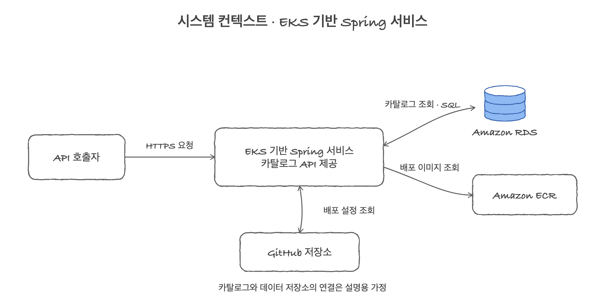

# AWS Foundations for Amazon EKS

## 1. 실행 위치, 네트워크, 권한 연결하기

| 서비스 | EKS에서 맡는 역할 |
| --- | --- |
| Amazon EC2 | EC2 기반 관리형 노드 그룹에서는 Pod를 실행하는 워커 인스턴스를 제공한다. |
| Amazon VPC | ALB, 워커 노드, 데이터베이스를 배치할 네트워크와 서브넷, 라우팅을 제공한다. |
| Amazon RDS | 애플리케이션에서 사용하는 관리형 관계형 데이터베이스를 제공한다. |
| AWS IAM | 사람, 배포 파이프라인, 컨트롤러, 워크로드가 어떤 AWS 작업을 수행할지 정의한다. |

EKS가 관리하는 컨트롤 플레인과 Pod를 실행하는 워커는 각각 다른 수명주기를 가진다. 관리형 노드 그룹을 사용할 때는 노드의 서브넷, 인스턴스 유형, 최소·최대·희망 노드 수를 구성한다. 운영자가 Kubernetes API에 접근하는 권한은 AWS 서비스 호출 권한과 함께 확인한다. [Amazon EKS · 클러스터 생성](https://docs.aws.amazon.com/eks/latest/userguide/create-cluster.html) · [Amazon EKS · 관리형 노드 그룹](https://docs.aws.amazon.com/eks/latest/userguide/managed-node-groups.html) · [Amazon EKS · 액세스 항목](https://docs.aws.amazon.com/eks/latest/userguide/access-entries.html)

## 2. 트래픽 흐름과 권한 범위 구분하기

이 문서의 예시는 인터넷에 노출하는 ALB, 프라이빗 워커, 프라이빗 RDS를 전제로 한다. 애플리케이션 DB 연결은 VPC 경로와 보안 그룹에서 허용한 포트로 전달된다. RDS의 DB 서브넷 그룹은 서로 다른 가용 영역의 서브넷을 포함하도록 구성한다. [Amazon EKS · ALB 라우팅](https://docs.aws.amazon.com/eks/latest/userguide/alb-ingress.html) · [Amazon RDS · VPC의 DB 인스턴스](https://docs.aws.amazon.com/AmazonRDS/latest/UserGuide/USER_VPC.WorkingWithRDSInstanceinaVPC.html)

| 호출 주체 | 필요한 권한의 예 |
| --- | --- |
| 운영자 또는 배포 자동화 | EKS API 접근 자격과 Kubernetes 리소스 조작 범위 |
| AWS Load Balancer Controller | Ingress에 필요한 ALB와 타깃 그룹 관리 |
| 워커 또는 이미지 실행 주체 | ECR에서 이미지를 읽는 권한 |
| Spring 애플리케이션 | 해당 서비스에 필요한 DB 계정과, 사용한다면 해당 AWS API 권한 |

Pod가 AWS API를 직접 호출한다면 EKS Pod Identity 또는 IRSA 등 서비스 계정에 연계하는 방식을 사용할 수 있다. IAM, Kubernetes RBAC, 애플리케이션의 데이터베이스 계정은 서로 다른 접근 경계를 통제한다. [Amazon EKS · 서비스 계정에 IAM 권한 부여](https://docs.aws.amazon.com/eks/latest/userguide/service-accounts.html)

## 3. 시스템 컨텍스트

Spring 서비스를 하나의 시스템으로 보고, API 호출자와 저장소·배포 의존성을 표시했다. 카탈로그와 RDS의 연결은 여러 서비스 중 하나가 DB를 소유하는 설명용 가정이다. 실제 네트워크 경계는 [EKS 배포 구성](04_deploying_spring_boot_on_eks.md)에서 이어진다.
