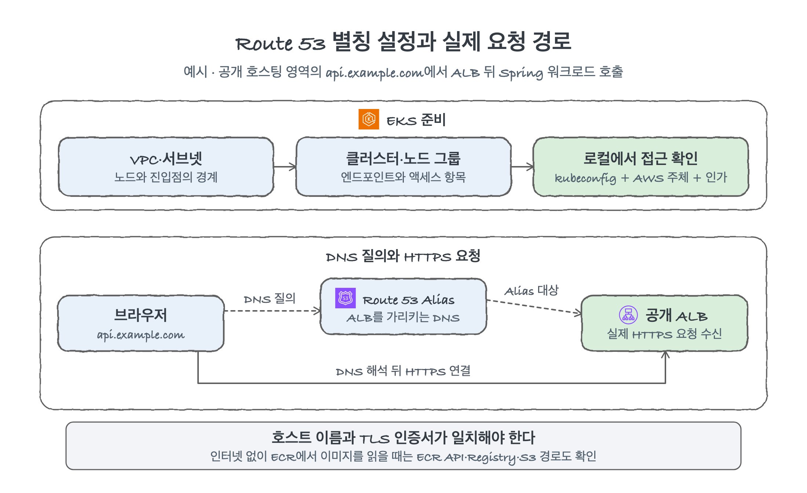

# Amazon EKS Cluster Setup and Route 53 DNS

## 1. 실습 환경 준비 순서

1. 리전, 가용 영역, VPC 서브넷과 클러스터 API 엔드포인트의 공개 범위를 정한다.
2. EKS 클러스터를 만든 뒤 관리형 노드 그룹을 붙인다. 노드가 이미지 저장소 및 필요한 AWS 서비스에 도달할 수 있는 경로를 확인한다.
3. IAM 주체를 EKS 액세스 항목에 등록할 수 있는 인증 모드인지 확인하고, EKS 액세스 정책이나 Kubernetes RBAC로 필요한 범위만 부여한다.
4. AWS CLI와 클러스터에 호환되는 `kubectl`을 준비하고, 현재 AWS 자격과 Kubernetes 컨텍스트를 확인한다.

[Amazon EKS · 클러스터 생성](https://docs.aws.amazon.com/eks/latest/userguide/create-cluster.html) · [Amazon EKS · 클러스터 API 엔드포인트](https://docs.aws.amazon.com/eks/latest/userguide/cluster-endpoint.html) · [Amazon EKS · 액세스 항목 생성](https://docs.aws.amazon.com/eks/latest/userguide/creating-access-entries.html)

인터넷으로 나가는 경로 없이 프라이빗 워커에서 ECR 이미지를 내려받으려면 ECR API와 Docker Registry용 VPC 엔드포인트, 이미지 레이어를 읽을 S3 접근 경로를 준비한다. 워크로드가 사용하는 다른 AWS 서비스도 각각 연결 경로를 확인한다. [Amazon EKS · 인터넷 접근이 제한된 프라이빗 클러스터](https://docs.aws.amazon.com/eks/latest/userguide/private-clusters.html)

```bash
aws sts get-caller-identity
aws eks update-kubeconfig --region ap-northeast-2 --name catalog-lab
kubectl config current-context
kubectl get nodes
```

위 리전과 클러스터 이름은 예시다. `update-kubeconfig`는 로컬 Kubernetes 연결 설정을 갱신한다. `kubectl`이 접근을 거부하면 현재 AWS 주체, 클러스터 액세스 항목, Kubernetes 인가를 차례대로 확인한다. API 서버에 닿지 않는 경우에는 엔드포인트의 네트워크 접근 조건도 확인한다. [Amazon EKS · kubeconfig 작성](https://docs.aws.amazon.com/eks/latest/userguide/create-kubeconfig.html)

## 2. 도메인을 Route 53에서 ALB에 연결하기

- 등록할 도메인이나 사용할 기존 도메인을 정한다. 별도 등록기관을 사용한다면 공인 호스팅 영역의 네임서버로 DNS를 위임한다.
- AWS Load Balancer Controller가 만든 ALB의 DNS 이름과 스킴을 확인한다. 공개 API에는 공개 호스팅 영역의 해당 이름과 ALB를 가리키는 별칭 레코드를 사용한다.
- 예제 호스트 `api.example.com`은 Ingress의 `host`와 ACM 인증서의 이름에도 들어간다. DNS 조회와 HTTPS 응답을 각각 확인한다.

[Amazon Route 53 · 도메인 등록](https://docs.aws.amazon.com/Route53/latest/DeveloperGuide/domain-register.html) · [Amazon Route 53 · ELB로 트래픽 라우팅](https://docs.aws.amazon.com/Route53/latest/DeveloperGuide/routing-to-elb-load-balancer.html)

클러스터 API 엔드포인트는 운영자가 `kubectl`로 접속하는 주소이고, Route 53에서 가리키는 ALB는 애플리케이션 호출자가 사용하는 진입점이다. 두 주소의 접근 범위와 접근 자격을 각각 관리한다.



그림의 근거 · [AWS EKS API 엔드포인트](https://docs.aws.amazon.com/eks/latest/userguide/cluster-endpoint.html) · [AWS EKS 액세스 항목](https://docs.aws.amazon.com/eks/latest/userguide/creating-access-entries.html) · [AWS Route 53의 ELB 별칭](https://docs.aws.amazon.com/Route53/latest/DeveloperGuide/routing-to-elb-load-balancer.html) · [AWS 프라이빗 EKS 클러스터](https://docs.aws.amazon.com/eks/latest/userguide/private-clusters.html)
