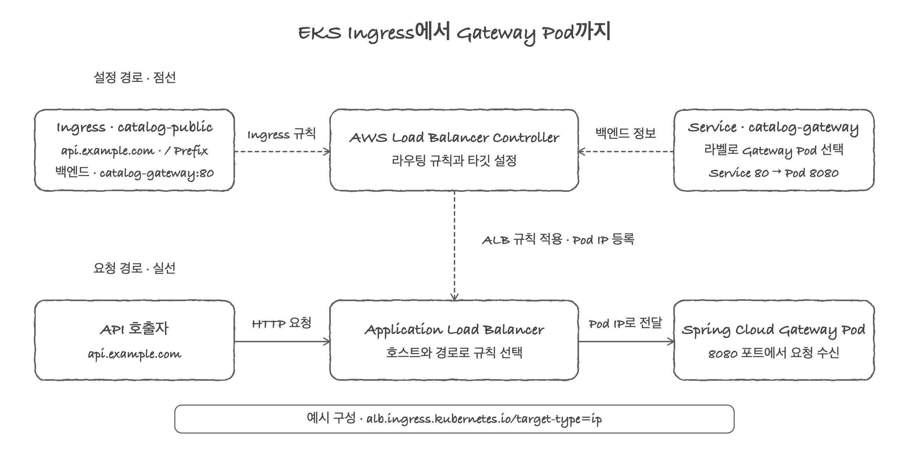

# Kubernetes Workloads, Services, and Ingress

## 1. Kubernetes 객체가 해결하는 문제

| 객체 | 역할 |
| --- | --- |
| Namespace | 이름이 속하는 범위를 나누고 정책과 권한을 적용할 단위를 제공한다. |
| Pod | 하나 이상의 컨테이너를 함께 스케줄링하고 실행한다. |
| ReplicaSet | 셀렉터에 해당하는 Pod의 목표 개수를 유지한다. |
| Deployment | ReplicaSet을 관리하고 Pod 템플릿 변경을 롤아웃한다. |
| Service | Pod가 교체돼도 유지되는 접근 이름과 포트를 제공한다. |
| Ingress | 호스트와 HTTP 경로의 라우팅 규칙을 선언한다. Ingress Controller가 규칙을 구현한다. |

Deployment가 생성하는 ReplicaSet과 Pod는 [Kubernetes 리소스 구성](../kubernetes/06_understanding_k8s_via_app_features_core_resources.md)에서 이어서 볼 수 있다. 이 예제에서 `catalog-gateway` Service는 Pod의 `app: catalog-gateway` 라벨을 선택한다. 일반적인 서비스 라우팅에서 준비 상태에 따라 EndpointSlice를 확인할 수 있다. [Kubernetes · Deployment](https://kubernetes.io/docs/concepts/workloads/controllers/deployment/) · [Kubernetes · Service](https://kubernetes.io/docs/concepts/services-networking/service/)

## 2. Service와 Ingress 연결하기

아래 예시는 `catalog` Namespace, `app: catalog-gateway` 라벨, `8080` 포트의 워크로드와 `alb` IngressClass를 전제로 한다. `ingressClassName`은 설치한 컨트롤러가 처리하는 클래스로 지정한다. [Kubernetes · Ingress](https://kubernetes.io/docs/concepts/services-networking/ingress/) · [Amazon EKS · ALB Ingress](https://docs.aws.amazon.com/eks/latest/userguide/alb-ingress.html)

```yaml
apiVersion: v1
kind: Service
metadata:
  name: catalog-gateway
  namespace: catalog
spec:
  selector:
    app: catalog-gateway
  ports:
    - port: 80
      targetPort: 8080
---
apiVersion: networking.k8s.io/v1
kind: Ingress
metadata:
  name: catalog-public
  namespace: catalog
  annotations:
    alb.ingress.kubernetes.io/target-type: ip
spec:
  ingressClassName: alb
  rules:
    - host: api.example.com
      http:
        paths:
          - path: /
            pathType: Prefix
            backend:
              service:
                name: catalog-gateway
                port:
                  number: 80
```

Service의 `port`는 서비스 호출 포트이고 `targetPort`는 Pod가 받는 포트다. 이 ALB IP 타깃 구성에서 Ingress는 백엔드 Service를 참조하고, ALB는 등록한 Pod IP로 트래픽을 보낸다. 공개 스킴과 TLS는 [배포 문서](04_deploying_spring_boot_on_eks.md)에서 추가한다. [Amazon EKS · ALB 타깃 유형](https://docs.aws.amazon.com/eks/latest/userguide/alb-ingress.html)

### EKS Ingress의 설정 경로와 요청 경로



점선은 AWS Load Balancer Controller가 Ingress와 Service 정보를 읽어 ALB 규칙을 설정하고 Pod IP를 타깃으로 등록하는 흐름이다. 실선은 `api.example.com` 요청이 ALB를 거쳐 Gateway Pod의 `8080` 포트에 도달하는 흐름이다.

## 3. 연결이 끊긴 경계 찾기

`kubectl get deployment,pods,svc,endpointslice,ingress -n catalog`로 준비 상태를 확인한다. 워크로드는 Deployment와 Pod 이벤트, 내부 연결은 Service의 셀렉터와 EndpointSlice, 외부 연결은 Ingress 이벤트와 ALB 타깃 상태를 살펴본다. 애플리케이션이 연결을 받을 수 있는 시점은 readiness probe로 확인한다. [Kubernetes · Probes](https://kubernetes.io/docs/concepts/configuration/liveness-readiness-startup-probes/)
