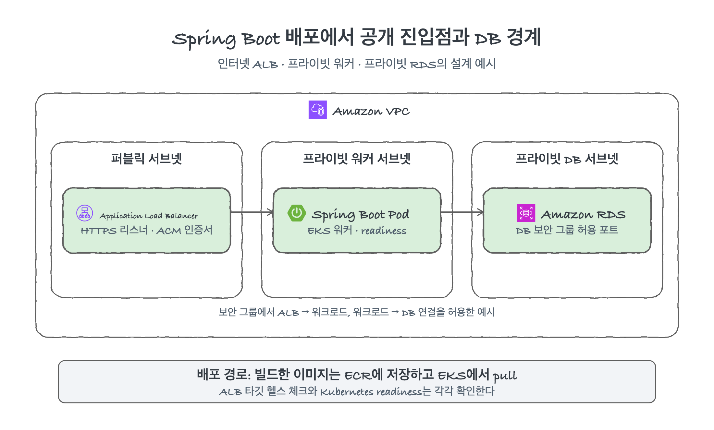

# Deploying Spring Boot on Amazon EKS

## 1. 배포에 필요한 경계



그림의 근거 · [AWS EKS의 Application Load Balancer](https://docs.aws.amazon.com/eks/latest/userguide/alb-ingress.html) · [AWS RDS VPC](https://docs.aws.amazon.com/AmazonRDS/latest/UserGuide/USER_VPC.WorkingWithRDSInstanceinaVPC.html) · [AWS Amazon ECR 이미지 게시](https://docs.aws.amazon.com/AmazonECR/latest/userguide/docker-push-ecr-image.html)

Spring Boot 워크로드는 ECR의 컨테이너 이미지를 사용한다. 예시에서는 외부 HTTPS를 ALB에서 종료하고 Spring Cloud Gateway Pod로 HTTP를 전달한다. Gateway는 같은 Namespace의 카탈로그 Service로 요청을 넘긴다. RDS 연결은 해당 데이터를 읽는 카탈로그 서비스에만 배정했다. 이 연결, 리전, 도메인은 설명용으로 정했다.

## 2. 인프라와 애플리케이션 배포 순서

1. 클러스터, 노드 그룹, ECR 저장소와 필요한 네트워크·DB 접근을 준비한다.
2. Spring Boot 이미지를 빌드하고 ECR에 업로드한다. 배포에는 커밋에 대응하는 고유 태그나 이미지 다이제스트를 사용한다.
3. Namespace, Deployment, ClusterIP Service를 적용한다. Deployment의 이미지, 컨테이너 포트, 요청 리소스, readiness probe를 확인한다.
4. AWS Load Balancer Controller에서 Ingress를 처리하도록 구성한다. ACM 인증서는 ALB와 같은 리전에 준비하고, Ingress의 호스트를 인증서 이름과 일치시킨다.
5. DNS 별칭을 ALB에 연결한 뒤 배포 진행 상태, ALB 타깃 상태, HTTPS 응답을 확인한다.

[Amazon ECR · 컨테이너 이미지 업로드](https://docs.aws.amazon.com/AmazonECR/latest/userguide/docker-push-ecr-image.html) · [Amazon EKS · ALB Ingress](https://docs.aws.amazon.com/eks/latest/userguide/alb-ingress.html) · [Elastic Load Balancing · HTTPS 인증서](https://docs.aws.amazon.com/elasticloadbalancing/latest/application/https-listener-certificates.html)

### HTTPS 설정 예시

[Ingress 매니페스트](03_kubernetes_workloads_services_and_ingress.md)의 `metadata.annotations` 아래에 적용할 예다. 인증서 ARN은 실제 발급된 값으로 바꾼다.

```yaml
alb.ingress.kubernetes.io/scheme: internet-facing
alb.ingress.kubernetes.io/target-type: ip
alb.ingress.kubernetes.io/listen-ports: '[{"HTTP":80},{"HTTPS":443}]'
alb.ingress.kubernetes.io/ssl-redirect: '443'
alb.ingress.kubernetes.io/certificate-arn: arn:aws:acm:ap-northeast-2:123456789012:certificate/EXAMPLE
```

Kubernetes readiness probe와 ALB 타깃 그룹 헬스 체크에는 각각 적절한 경로를 지정한다. Spring Boot Actuator의 readiness 경로를 사용하는 경우 노출 여부와 실제 트래픽 포트를 확인한다. [AWS Load Balancer Controller · Ingress Annotations](https://kubernetes-sigs.github.io/aws-load-balancer-controller/latest/guide/ingress/annotations/) · [Spring Boot 3.5 · Actuator Kubernetes Probes](https://docs.spring.io/spring-boot/3.5/reference/actuator/endpoints.html)

## 3. GitHub Actions에서 빌드와 배포 변경 연결하기

GitHub Actions는 테스트, 이미지 빌드, ECR 푸시를 수행할 수 있다. AWS에는 OIDC로 짧은 수명의 역할 자격을 얻고, 신뢰 정책에서 저장소와 브랜치 또는 환경의 범위를 제한한다. [Argo CD를 사용하는 구성](05_eks_autoscaling_gitops_and_observability.md)에서는 워크플로가 Git의 배포 이미지를 갱신하고 Argo CD가 클러스터를 동기화한다. 배포 결과는 워크플로 성공에 더해 클러스터 롤아웃과 HTTPS 요청으로 확인한다. [GitHub Actions · AWS OIDC 구성](https://docs.github.com/en/actions/how-tos/secure-your-work/security-harden-deployments/oidc-in-aws) · [Argo CD · Automated Sync](https://argo-cd.readthedocs.io/en/stable/user-guide/auto_sync/)
