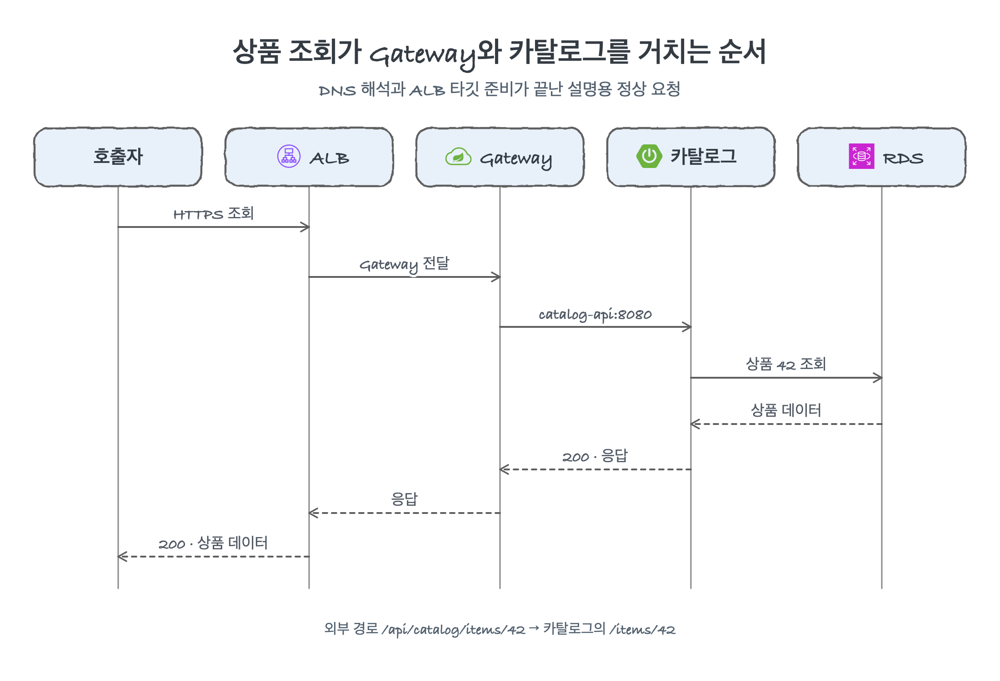
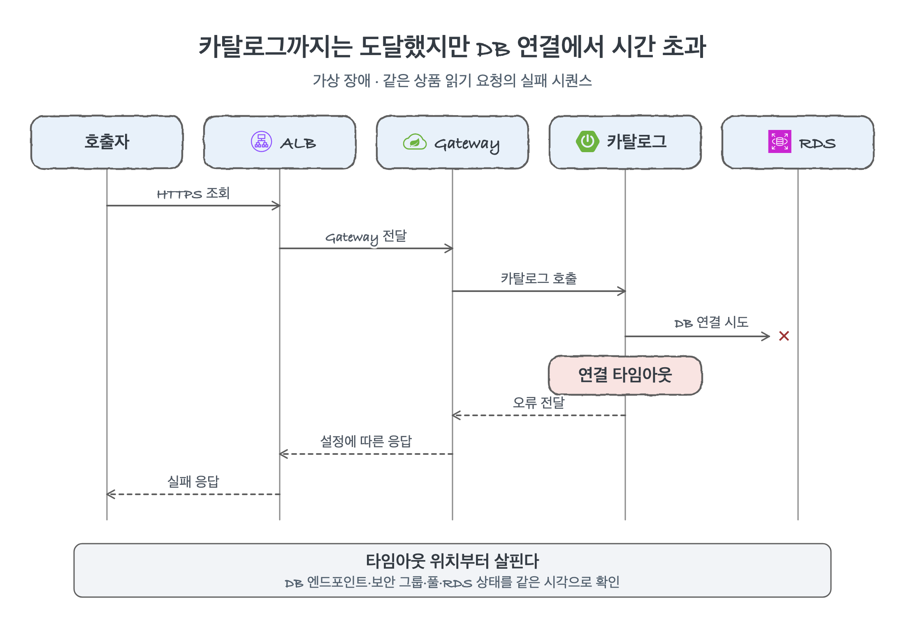

# Deploying Spring Microservices on Amazon EKS

## 1. 로컬 환경과 EKS의 서비스 주소

예제는 Spring Cloud Gateway와 카탈로그 서비스를 같은 애플리케이션의 별도 배포 단위로 둔다. Gateway가 외부 경로 `/api/catalog/items/42`를 받아 카탈로그 서비스의 `/items/42`로 보낸다고 가정한다. 로컬에서 Docker Compose를 사용하면 서비스 이름을 주소로 쓸 수 있다. EKS에서는 같은 Namespace의 `catalog-api` Service 이름을 사용하고, 예제 내부 포트는 `8080`으로 정했다. [Spring Cloud Gateway · Reference](https://docs.spring.io/spring-cloud-gateway/reference/) · [Docker · Networking in Compose](https://docs.docker.com/compose/how-tos/networking/) · [Kubernetes · DNS for Services and Pods](https://kubernetes.io/docs/concepts/services-networking/dns-pod-service/)

| 배포 단위 | 구성 확인 |
| --- | --- |
| 카탈로그 서비스 | 독립 이미지, 내부 Service, readiness, 자신이 사용할 DB 접속 설정 |
| Spring Cloud Gateway | 독립 이미지, 경로 매칭과 재작성 규칙, 내부 Service DNS |
| ALB와 공개 Ingress | 공개 호스트와 TLS, Gateway 대상 상태 |

로컬에서는 내부 서비스가 준비되면 Gateway 경유 요청을 실행한다. EKS에서는 먼저 카탈로그 Deployment와 Service의 준비 상태를 확인하고 Gateway를 통해 호출한다. Gateway를 먼저 적용해야 하는 경우에는 외부 공개 전에 내부 엔드포인트를 확인한다. [Kubernetes · Service](https://kubernetes.io/docs/concepts/services-networking/service/) · [EKS에서 Spring Boot 배포하기](04_deploying_spring_boot_on_eks.md)

## 2. 정상 요청 흐름

그림의 근거 · [AWS EKS의 Application Load Balancer](https://docs.aws.amazon.com/eks/latest/userguide/alb-ingress.html) · [Kubernetes Service DNS](https://kubernetes.io/docs/concepts/services-networking/dns-pod-service/) · [AWS RDS VPC](https://docs.aws.amazon.com/AmazonRDS/latest/UserGuide/USER_VPC.WorkingWithRDSInstanceinaVPC.html)

DNS 조회가 끝나고 타깃이 요청을 처리할 수 있는 상태에서 읽기 요청을 보낸다고 가정한다. ALB에서 HTTPS를 종료하고 Gateway로 전달한다. 카탈로그 서비스가 RDS에서 상품을 읽고 결과를 반환하면 호출자는 `200`과 상품 데이터를 받는다.

## 3. 실패 요청 흐름

그림의 근거 · [AWS RDS VPC](https://docs.aws.amazon.com/AmazonRDS/latest/UserGuide/USER_VPC.WorkingWithRDSInstanceinaVPC.html) · [Spring Cloud Gateway 타임아웃](https://docs.spring.io/spring-cloud-gateway/reference/spring-cloud-gateway-server-webflux/http-timeouts-configuration.html)

가상 시나리오에서는 같은 조회가 카탈로그 서비스까지 도달한 뒤 RDS 연결 단계에서 시간 초과된다. 호출자에게 전달되는 HTTP 상태, 서비스별 재시도 정책, 자동 복구 여부는 실제 설정에 따라 달라진다. 운영자는 요청 시각의 서비스 로그와 지표를 보고 DB 엔드포인트, 보안 그룹, 연결 풀 및 RDS 상태를 확인할 수 있다. 이 그림의 예시는 읽기 요청이다. [Amazon RDS · VPC의 DB 연결](https://docs.aws.amazon.com/AmazonRDS/latest/UserGuide/USER_VPC.WorkingWithRDSInstanceinaVPC.html) · [EKS에서 관측과 운영 확인하기](05_eks_autoscaling_gitops_and_observability.md)
