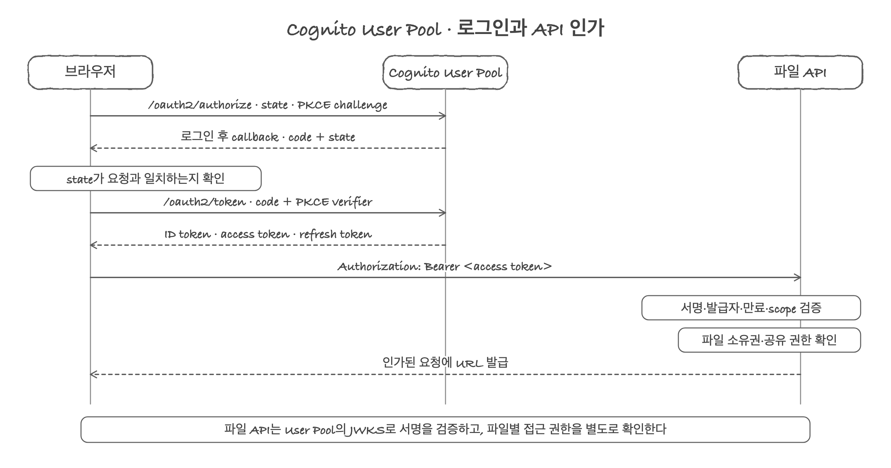

# Amazon Cognito로 로그인하고 파일 API를 인가하기

User Pool은 로그인한 사용자에게 토큰을 발급한다. 브라우저에 IAM 역할의 임시 AWS 자격 증명을 직접 줄 때는 Identity Pool을 사용한다. 여기서는 백엔드가 URL을 발급하므로 User Pool과 백엔드의 IAM 역할로 구성한다. [Cognito PKCE](https://docs.aws.amazon.com/cognito/latest/developerguide/using-pkce-in-authorization-code.html) · [Cognito Identity Pool](https://docs.aws.amazon.com/cognito/latest/developerguide/cognito-identity.html) · [S3 Presigned URL](https://docs.aws.amazon.com/AmazonS3/latest/userguide/using-presigned-url.html)

그림의 근거 · [Cognito authorize endpoint](https://docs.aws.amazon.com/cognito/latest/developerguide/authorization-endpoint.html) · [Cognito PKCE](https://docs.aws.amazon.com/cognito/latest/developerguide/using-pkce-in-authorization-code.html) · [Cognito JWT 검증](https://docs.aws.amazon.com/cognito/latest/developerguide/amazon-cognito-user-pools-using-tokens-verifying-a-jwt.html) · [CloudFront Signed URL](https://docs.aws.amazon.com/AmazonCloudFront/latest/DeveloperGuide/private-content-signed-urls.html)

## 1. 브라우저 공개 앱 클라이언트에서 코드와 토큰을 교환한다

User Pool에 콜백 URL과 관리형 로그인 도메인을 설정한다. 브라우저는 client secret을 보관할 수 없으므로 공개 앱 클라이언트를 사용한다. `/oauth2/authorize`에 `response_type=code`, `state`, S256 challenge를 보내고, 콜백에서 `state`를 대조한 후 `/oauth2/token`에서 code와 verifier를 교환한다. [Cognito 앱 클라이언트](https://docs.aws.amazon.com/cognito/latest/developerguide/user-pool-settings-client-apps.html) · [Cognito authorize endpoint](https://docs.aws.amazon.com/cognito/latest/developerguide/authorization-endpoint.html) · [Cognito PKCE](https://docs.aws.amazon.com/cognito/latest/developerguide/using-pkce-in-authorization-code.html)

브라우저는 사용자 프로필 정보용 ID token과 API 호출용 access token을 구분한다. 파일 API에는 access token만 보내고, 예제의 `files/upload`와 `files/read`는 User Pool 리소스 서버에 등록한 별도 scope로 사용한다. [Cognito ID token](https://docs.aws.amazon.com/cognito/latest/developerguide/amazon-cognito-user-pools-using-the-id-token.html) · [Cognito access token](https://docs.aws.amazon.com/cognito/latest/developerguide/amazon-cognito-user-pools-using-the-access-token.html) · [Cognito 리소스 서버와 scope](https://docs.aws.amazon.com/cognito/latest/developerguide/cognito-user-pools-define-resource-servers.html)

## 2. 토큰과 파일 권한을 각각 확인한다

API는 예상 User Pool의 JWKS에서 `kid`에 맞는 키로 서명을 검증한다. 예상 `iss`, `exp`, `token_use=access`, 허용한 `client_id`와 작업에 필요한 scope를 검사한다. resource binding을 사용한 access token에서는 대상 API의 `aud`도 검사한다. 알 수 없는 `kid`가 나타나면 키 교체를 고려해 JWKS를 갱신한다. [Cognito JWT 검증](https://docs.aws.amazon.com/cognito/latest/developerguide/amazon-cognito-user-pools-using-tokens-verifying-a-jwt.html) · [Cognito access token](https://docs.aws.amazon.com/cognito/latest/developerguide/amazon-cognito-user-pools-using-the-access-token.html)

API에서는 검증된 `iss`와 `sub`를 서비스 사용자에 연결하고, 파일 소유권 및 공유 상태로 최종 판단한다. 다른 사용자의 파일에 대한 조회·업로드 완료 요청은 scope가 맞더라도 허용하지 않는다. [Cognito access token](https://docs.aws.amazon.com/cognito/latest/developerguide/amazon-cognito-user-pools-using-the-access-token.html) · [Cognito 리소스 서버와 scope](https://docs.aws.amazon.com/cognito/latest/developerguide/cognito-user-pools-define-resource-servers.html) · [CloudFront Signed URL](https://docs.aws.amazon.com/AmazonCloudFront/latest/DeveloperGuide/private-content-signed-urls.html)

## 3. 만료와 권한 변경을 다른 실패로 시험한다

잘못된 발급자, ID token 오용, 만료 토큰, scope 누락, 파일 소유권 불일치를 각각 시험한다. JWT 서명과 만료만 보는 자체 API는 철회된 토큰을 여전히 받아들일 수 있다. 즉시 차단이 필요한 경우에는 토큰 수명과 별도로 계정·세션 또는 파일의 최신 허용 상태를 확인하는 경계를 둔다. [Cognito JWT 검증](https://docs.aws.amazon.com/cognito/latest/developerguide/amazon-cognito-user-pools-using-tokens-verifying-a-jwt.html) · [Cognito access token](https://docs.aws.amazon.com/cognito/latest/developerguide/amazon-cognito-user-pools-using-the-access-token.html) · [Cognito 토큰 철회](https://docs.aws.amazon.com/cognito/latest/developerguide/token-revocation.html) · [CloudFront Signed URL](https://docs.aws.amazon.com/AmazonCloudFront/latest/DeveloperGuide/private-content-signed-urls.html)
