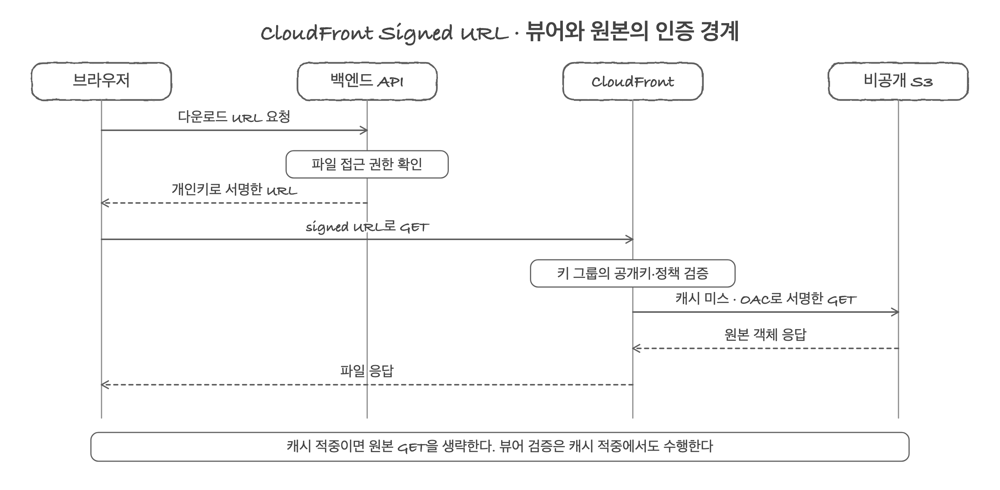

# CloudFront Signed URL로 비공개 파일 다운로드 제공하기

CloudFront Signed URL은 비공개 콘텐츠를 CDN으로 다운로드하거나 스트리밍할 때 뷰어에게 주는 권한이다. 파일 API는 사용자 접근을 허용한 뒤 배포의 비공개 경로를 서명한다. [CloudFront Signed URL](https://docs.aws.amazon.com/AmazonCloudFront/latest/DeveloperGuide/private-content-signed-urls.html) · [CloudFront 신뢰 키 그룹](https://docs.aws.amazon.com/AmazonCloudFront/latest/DeveloperGuide/private-content-trusted-signers.html)

그림의 근거 · [CloudFront Signed URL](https://docs.aws.amazon.com/AmazonCloudFront/latest/DeveloperGuide/private-content-signed-urls.html) · [CloudFront 신뢰 키 그룹](https://docs.aws.amazon.com/AmazonCloudFront/latest/DeveloperGuide/private-content-trusted-signers.html) · [CloudFront S3 원본 접근 제어](https://docs.aws.amazon.com/AmazonCloudFront/latest/DeveloperGuide/private-content-restricting-access-to-s3.html)

## 1. 뷰어 URL을 서명하고 키 그룹을 연결한다

파일 API는 예를 들어 `https://media.example.com/ready/<object>`에 대한 정책을 개인키로 서명한다. CloudFront 캐시 동작에 신뢰 키 그룹을 지정하고 그 그룹에 공개키를 등록한다. 단일 파일은 Signed URL을, 허용 범위 안의 여러 파일은 Signed Cookie를 검토한다. [CloudFront Signed URL](https://docs.aws.amazon.com/AmazonCloudFront/latest/DeveloperGuide/private-content-signed-urls.html) · [CloudFront 신뢰 키 그룹](https://docs.aws.amazon.com/AmazonCloudFront/latest/DeveloperGuide/private-content-trusted-signers.html) · [CloudFront 서명 URL과 쿠키 선택](https://docs.aws.amazon.com/AmazonCloudFront/latest/DeveloperGuide/private-content-choosing-signed-urls-cookies.html)

canned policy는 주로 만료 시각을 명시하는 단순 흐름에 쓴다. 시작 시각, IP 조건, 와일드카드 리소스처럼 더 세밀한 조건이 필요하면 custom policy를 사용한다. 원래 URL의 쿼리 파라미터도 서명 전에 확정한다. [CloudFront Signed URL](https://docs.aws.amazon.com/AmazonCloudFront/latest/DeveloperGuide/private-content-signed-urls.html)

## 2. 뷰어 검증과 S3 원본 접근을 별개로 구성한다

CloudFront는 서명·리소스·유효 시간을 검사한 뒤 캐시 객체를 전송하거나 원본에 요청한다. 일반 S3 버킷 원본에는 서명 동작을 `always`로 설정한 OAC를 쓰고, 버킷 정책에서 해당 배포의 `AWS:SourceArn`과 읽기 대상 키를 제한한다. S3 웹사이트 엔드포인트는 이 OAC 구성에 해당하지 않는다. [CloudFront Signed URL](https://docs.aws.amazon.com/AmazonCloudFront/latest/DeveloperGuide/private-content-signed-urls.html) · [CloudFront S3 원본 접근 제어](https://docs.aws.amazon.com/AmazonCloudFront/latest/DeveloperGuide/private-content-restricting-access-to-s3.html)

## 3. 만료와 원본 직접 접근을 각각 검증한다

캐시를 먼저 채운 뒤 서명 누락·변조·만료 요청이 거절되는지 확인한다. S3 원본의 직접 비인증 요청도 별개로 시험한다. 권한 변경 시 새 URL 발급을 차단하고 기존 URL에 남을 수 있는 접근 시간은 짧은 만료로 관리한다. 캐시 무효화는 캐시에서 객체를 제거하는 기능이므로 권한 철회 절차와 구분한다. [CloudFront Signed URL](https://docs.aws.amazon.com/AmazonCloudFront/latest/DeveloperGuide/private-content-signed-urls.html) · [CloudFront S3 원본 접근 제어](https://docs.aws.amazon.com/AmazonCloudFront/latest/DeveloperGuide/private-content-restricting-access-to-s3.html) · [CloudFront 캐시 무효화](https://docs.aws.amazon.com/AmazonCloudFront/latest/DeveloperGuide/Invalidation.html)

전송 중 URL이 만료되면 이미 시작한 다운로드는 완료될 수 있다. 연결이 끊겨 만료 후 다시 요청하면 새로 평가되므로, 큰 파일을 다룰 때는 재요청 경로와 만료 시점을 함께 시험한다. [CloudFront Signed URL](https://docs.aws.amazon.com/AmazonCloudFront/latest/DeveloperGuide/private-content-signed-urls.html)
