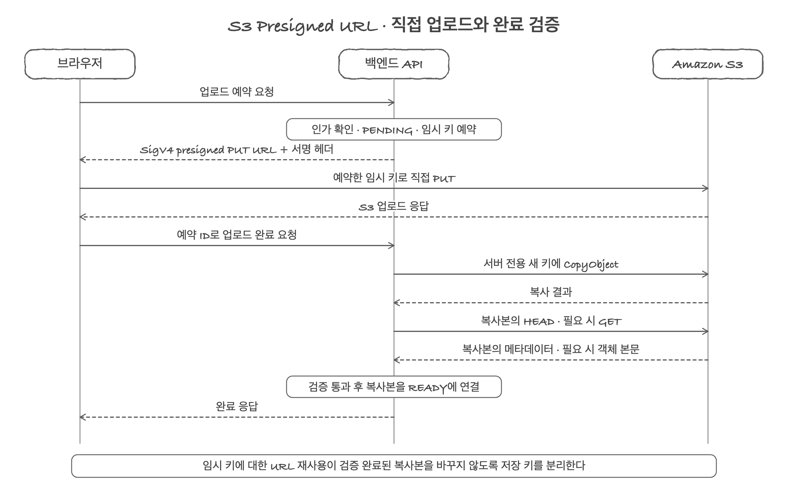

# S3 Presigned URL로 직접 업로드하고 완료를 검증하기

S3 Presigned URL은 엔드포인트, 객체 키, HTTP 메서드와 만료를 지정해 특정 S3 요청을 위임한다. 백엔드는 IAM 역할 자격 증명으로 SigV4 서명을 만들고, 브라우저는 그 URL로 S3에 직접 요청한다. [S3 Presigned URL](https://docs.aws.amazon.com/AmazonS3/latest/userguide/using-presigned-url.html) · [S3 Presigned PUT](https://docs.aws.amazon.com/AmazonS3/latest/userguide/PresignedUrlUploadObject.html)

그림의 근거 · [S3 Presigned URL](https://docs.aws.amazon.com/AmazonS3/latest/userguide/using-presigned-url.html) · [S3 Presigned PUT](https://docs.aws.amazon.com/AmazonS3/latest/userguide/PresignedUrlUploadObject.html) · [S3 CopyObject](https://docs.aws.amazon.com/AmazonS3/latest/API/API_CopyObject.html) · [S3 HeadObject](https://docs.aws.amazon.com/AmazonS3/latest/API/API_HeadObject.html)

## 1. 업로드 대상과 만료를 발급 시점에 고정한다

백엔드는 사용자·파일 권한을 확인하고 새 임시 객체 키와 업로드 예약을 저장한다. 브라우저에는 그 키에 대한 짧은 `PUT` URL과 서명에 포함한 헤더를 돌려준다. 예를 들어 서명에 포함한 `Content-Type`과 체크섬 헤더의 값은 실제 요청과 일치시킨다. [S3 Presigned URL](https://docs.aws.amazon.com/AmazonS3/latest/userguide/using-presigned-url.html) · [S3 Presigned PUT](https://docs.aws.amazon.com/AmazonS3/latest/userguide/PresignedUrlUploadObject.html)

URL은 보유자가 사용할 수 있고 만료까지 재사용될 수 있다. 유효 시간은 지정한 만료와 서명에 사용한 IAM 역할 세션 만료 중 먼저 도달하는 시점에 제한된다. 필요하면 버킷 정책의 `s3:signatureAge`로 허용 시간을 더 좁히고 URL 쿼리 전체를 일반 앱 로그에 남기지 않는다. [S3 Presigned URL](https://docs.aws.amazon.com/AmazonS3/latest/userguide/using-presigned-url.html)

## 2. 브라우저 요청과 스토리지 검증을 나눈다

교차 출처 업로드에는 허용할 웹 출처, `PUT`, 실제 전송 헤더에 맞는 S3 CORS 규칙을 둔다. CORS에 맞는 요청도 S3 권한 검사를 통과해야 한다. 스토리지에서 업로드 크기 범위를 폼 정책으로 강제하려면 `content-length-range`를 사용하는 S3 POST 정책을 검토한다. [S3 CORS](https://docs.aws.amazon.com/AmazonS3/latest/userguide/cors.html) · [S3 POST 정책](https://docs.aws.amazon.com/AmazonS3/latest/developerguide/sigv4-HTTPPOSTConstructPolicy.html)

같은 임시 키에 다시 PUT하면 대상 객체가 바뀔 수 있다. 완료 요청은 예약한 사용자와 키를 다시 확인하고, 서버 전용 새 키로 복사한 뒤 그 복사본을 검증한다. `HeadObject`로 크기와 메타데이터를 얻고, 실제 내용 판정이 필요하면 복사본 본문을 검사해 통과한 키만 `READY`에 연결한다. [S3 Presigned URL](https://docs.aws.amazon.com/AmazonS3/latest/userguide/using-presigned-url.html) · [S3 CopyObject](https://docs.aws.amazon.com/AmazonS3/latest/API/API_CopyObject.html) · [S3 HeadObject](https://docs.aws.amazon.com/AmazonS3/latest/API/API_HeadObject.html)

## 3. 서명과 업로드 완료를 구분해서 시험한다

메서드·서명 헤더 변경, 만료 URL, CORS 불일치, 다른 사용자의 완료 요청을 각각 재현한다. 통과 시나리오에서는 완료 뒤 임시 키에 파일을 다시 올려도 `READY`가 가리키는 서버 전용 복사본의 바이트가 바뀌지 않는지 확인한다. [S3 Presigned URL](https://docs.aws.amazon.com/AmazonS3/latest/userguide/using-presigned-url.html) · [S3 Presigned PUT](https://docs.aws.amazon.com/AmazonS3/latest/userguide/PresignedUrlUploadObject.html) · [S3 CORS](https://docs.aws.amazon.com/AmazonS3/latest/userguide/cors.html) · [S3 CopyObject](https://docs.aws.amazon.com/AmazonS3/latest/API/API_CopyObject.html) · [CloudFront Signed URL](https://docs.aws.amazon.com/AmazonCloudFront/latest/DeveloperGuide/private-content-signed-urls.html)
