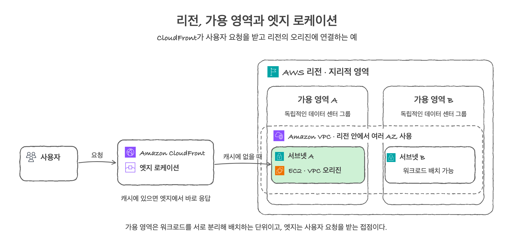
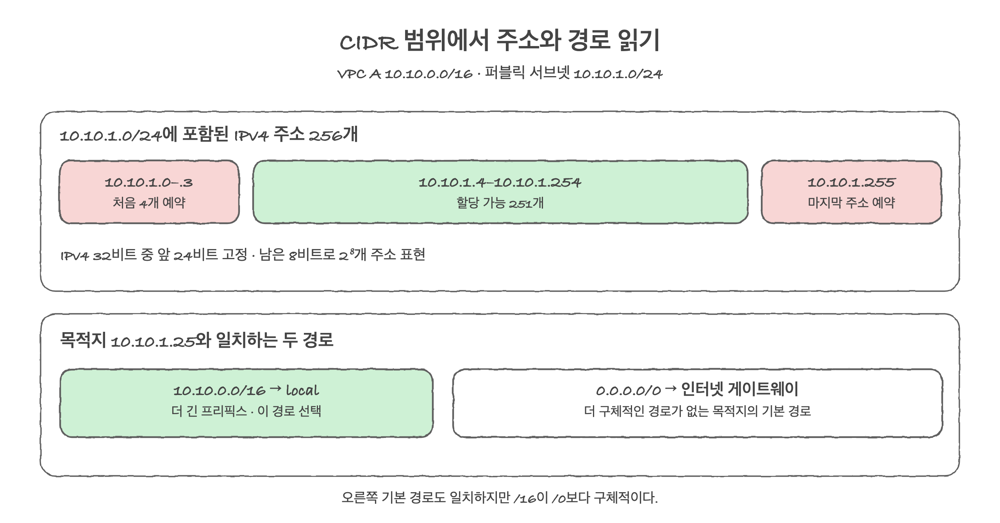
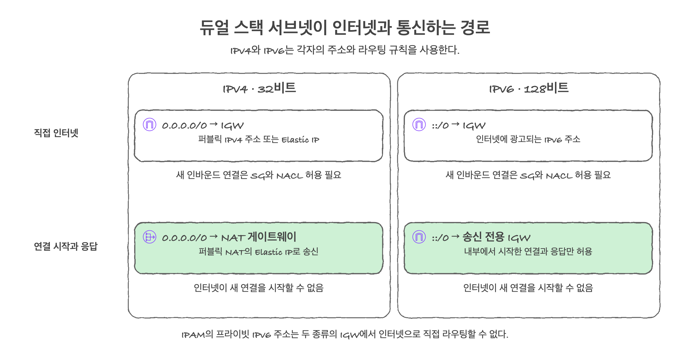

# AWS 네트워킹 기초 이해하기

## 1. AWS 글로벌 인프라의 리전, 가용 영역, 엣지 로케이션

리전(Region)은 서로 분리된 지리적 영역이다. 리전 안의 가용 영역(Availability Zone, AZ)은 물리적으로 분리되며, 각 AZ는 하나 이상의 데이터 센터로 구성된다. 같은 리전의 AZ들은 전용 네트워크로 연결된다. 한 AZ의 장애에도 서비스를 제공하려면 서로 다른 AZ에 리소스를 배치하고, 트래픽이 정상 리소스로 전달되도록 구성한다. [AWS · 리전과 가용 영역](https://docs.aws.amazon.com/global-infrastructure/latest/regions/aws-regions-availability-zones.html)

엣지 로케이션과 리전의 오리진이 각각 요청 처리와 리소스 배치에서 맡는 역할을 그렸다. [AWS · 리전과 가용 영역](https://docs.aws.amazon.com/global-infrastructure/latest/regions/aws-regions-availability-zones.html) · [Amazon CloudFront · CloudFront란 무엇인가](https://docs.aws.amazon.com/AmazonCloudFront/latest/DeveloperGuide/Introduction.html) · [Amazon CloudFront · VPC 오리진](https://docs.aws.amazon.com/AmazonCloudFront/latest/DeveloperGuide/private-content-vpc-origins.html)

Amazon VPC는 한 리전에 속하고, VPC의 각 서브넷은 한 AZ에 속한다. 예를 들어 하나의 VPC에 AZ A와 AZ B의 서브넷을 만들면, 두 서브넷에 나누어 워크로드를 배치할 수 있다. [Amazon VPC · 개념](https://docs.aws.amazon.com/vpc/latest/userguide/what-is-amazon-vpc.html) · [Amazon VPC · 서브넷 기본 사항](https://docs.aws.amazon.com/vpc/latest/userguide/configure-subnets.html#subnet-basics)

엣지 로케이션은 CloudFront처럼 사용자와 가까운 지점에서 요청을 처리하는 서비스의 접점이다. CloudFront는 네트워크 지연이 가장 낮은 엣지 로케이션으로 요청을 보내고, 캐시에 콘텐츠가 없으면 설정된 오리진에서 가져온다. 그림의 예에서는 CloudFront의 VPC 오리진 기능으로 리전의 프라이빗 서브넷에 있는 EC2에 연결한다. [Amazon CloudFront · CloudFront란 무엇인가](https://docs.aws.amazon.com/AmazonCloudFront/latest/DeveloperGuide/Introduction.html) · [Amazon CloudFront · VPC 오리진](https://docs.aws.amazon.com/AmazonCloudFront/latest/DeveloperGuide/private-content-vpc-origins.html)

## 2. CIDR로 주소 범위와 경로 읽기

CIDR 표기에서 `/` 뒤의 숫자는 주소 앞부분에서 네트워크에 해당하는 비트 수다. IPv4는 32비트이므로 `10.10.1.0/24`는 앞 24비트가 고정되고 나머지 8비트가 바뀐다. 범위에는 `10.10.1.0`부터 `10.10.1.255`까지 256개 주소가 들어 있다. [RFC 4632 · CIDR 표기와 크기](https://www.rfc-editor.org/rfc/rfc4632.html#section-3.1)

서브넷에 할당 가능한 주소 개수와 목적지에 적용할 경로를 각각 계산했다. [RFC 4632 · CIDR 표기와 크기](https://www.rfc-editor.org/rfc/rfc4632.html#section-3.1) · [Amazon VPC · IPv4 서브넷 크기](https://docs.aws.amazon.com/vpc/latest/userguide/subnet-sizing.html#subnet-sizing-ipv4) · [Amazon VPC · 최장 프리픽스 일치](https://docs.aws.amazon.com/vpc/latest/userguide/route-tables-priority.html#route-table-longest-prefix-match)

AWS의 일반적인 IPv4 서브넷은 처음 네 주소와 마지막 한 주소를 예약한다. `10.10.1.0/24`라면 `.0`은 네트워크 주소, `.1`은 VPC 라우터, `.2`와 `.3`은 AWS 예약 주소, `.255`는 브로드캐스트 주소로 예약된다. EC2 같은 리소스에 할당할 수 있는 범위는 `10.10.1.4`부터 `10.10.1.254`까지 총 251개다. [Amazon VPC · IPv4 서브넷 크기](https://docs.aws.amazon.com/vpc/latest/userguide/subnet-sizing.html#subnet-sizing-ipv4)

목적지가 여러 경로와 일치하면 VPC 라우팅은 가장 긴 프리픽스를 선택한다. 예를 들어 `10.10.1.25`는 `10.10.0.0/16 → local`과 `0.0.0.0/0 → 인터넷 게이트웨이`에 모두 해당하므로 `/16` 경로를 사용한다. 목적지가 `203.0.113.25`이고 일치하는 더 구체적인 경로가 없으면 `/0`을 사용한다. [Amazon VPC · 최장 프리픽스 일치](https://docs.aws.amazon.com/vpc/latest/userguide/route-tables-priority.html#route-table-longest-prefix-match) · [RFC 5737 · 문서용 IPv4 대역](https://www.rfc-editor.org/rfc/rfc5737.html#section-3)

## 3. AWS의 IPv4와 IPv6 연결 방식

IPv4 주소는 32비트, IPv6 주소는 128비트다. 듀얼 스택을 구성하려면 VPC와 서브넷에 IPv6 CIDR을 추가하고 워크로드에도 IPv6 주소를 할당한다. IPv4와 IPv6는 경로를 별도로 평가한다. 서비스의 IPv6 지원 범위를 확인하고 각 주소 체계가 사용할 경로, 보안 그룹, 네트워크 ACL을 설정한다. [Amazon VPC · IP 주소 표기](https://docs.aws.amazon.com/vpc/latest/userguide/vpc-ip-addressing.html) · [Amazon VPC · IPv6 지원 추가](https://docs.aws.amazon.com/vpc/latest/userguide/vpc-migrate-ipv6-add.html)

듀얼 스택에서 주소 체계별 기본 경로와 새 인바운드 연결의 허용 조건을 비교했다. [Amazon VPC · IPv6 지원 추가](https://docs.aws.amazon.com/vpc/latest/userguide/vpc-migrate-ipv6-add.html) · [Amazon VPC · 송신 전용 인터넷 게이트웨이](https://docs.aws.amazon.com/vpc/latest/userguide/egress-only-internet-gateway.html#egress-only-internet-gateway-basics) · [Amazon VPC · 인터넷 게이트웨이 기본 사항](https://docs.aws.amazon.com/vpc/latest/userguide/VPC_Internet_Gateway.html#vpc-igw-internet-access)

IPv4에서 EC2가 인터넷 게이트웨이를 통해 직접 통신하려면 `0.0.0.0/0` 같은 게이트웨이 경로와 퍼블릭 IPv4 주소 또는 Elastic IP 주소가 필요하다. 공개 IPv6로 직접 통신하는 예에서는 `::/0`을 인터넷 게이트웨이로 보낸다. 새 인바운드 연결이 성립하려면 해당 주소, 경로, 보안 그룹과 네트워크 ACL이 모두 맞아야 한다. [Amazon VPC · 인터넷 게이트웨이 기본 사항](https://docs.aws.amazon.com/vpc/latest/userguide/VPC_Internet_Gateway.html#vpc-igw-internet-access)

프라이빗 서브넷에서 IPv4 연결을 외부로 시작하려면 `0.0.0.0/0`을 퍼블릭 NAT 게이트웨이로 보낼 수 있다. 인터넷에 광고되는 IPv6 주소에서 아웃바운드 연결과 응답만 허용하려면 `::/0`을 송신 전용 인터넷 게이트웨이로 보낸다. IPAM으로 할당한 프라이빗 IPv6 주소는 두 종류의 인터넷 게이트웨이에서 모두 인터넷으로 직접 라우팅할 수 없다. [Amazon VPC · NAT 게이트웨이](https://docs.aws.amazon.com/vpc/latest/userguide/vpc-nat-gateway.html) · [Amazon VPC · 송신 전용 인터넷 게이트웨이](https://docs.aws.amazon.com/vpc/latest/userguide/egress-only-internet-gateway.html#egress-only-internet-gateway-basics) · [Amazon VPC · 공개 및 프라이빗 IPv6 주소](https://docs.aws.amazon.com/vpc/latest/userguide/vpc-ip-addressing.html)
