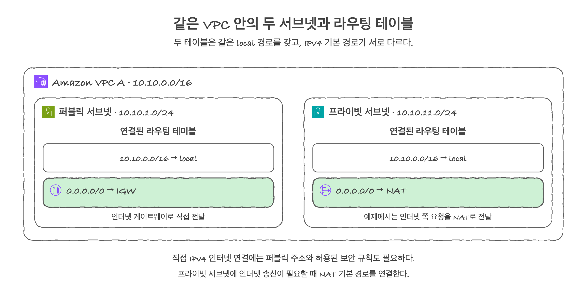
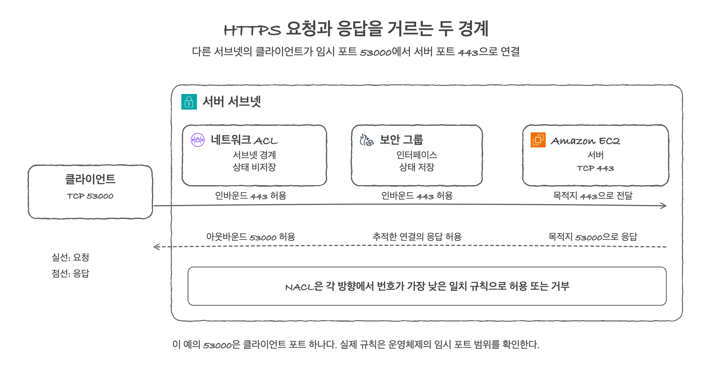
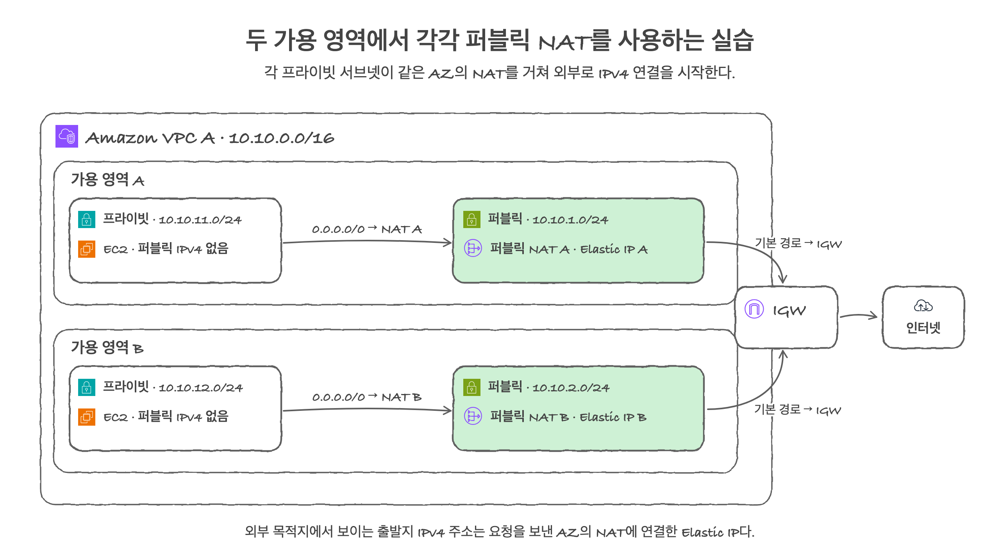
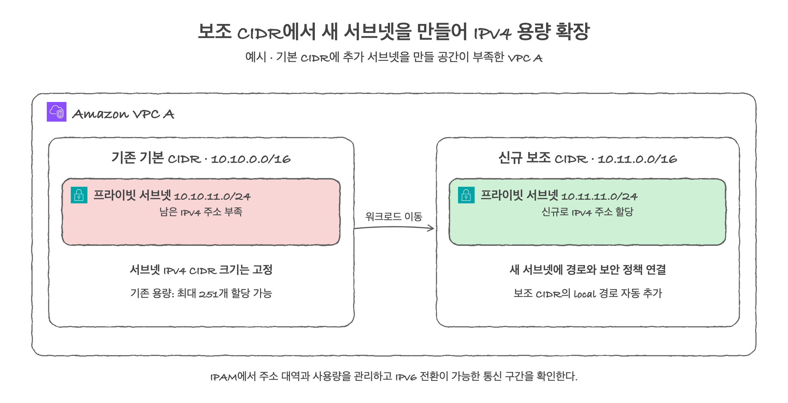

# VPC, 서브넷, 라우팅 구성하기

## 1. 라우팅 테이블로 퍼블릭과 프라이빗 서브넷 구분하기

서브넷은 한 번에 하나의 라우팅 테이블과 연결된다. 명시적으로 연결한 테이블이 없으면 VPC의 기본 라우팅 테이블을 사용한다. 각 경로는 `목적지 → 대상`을 정한다. VPC 주소 범위에는 `local` 경로가 생기며, 이 경로로 VPC 내부 통신을 전달한다. [Amazon VPC · 서브넷 라우팅 테이블](https://docs.aws.amazon.com/vpc/latest/userguide/subnet-route-tables.html)

서브넷에 연결된 라우팅 테이블의 기본 경로로 두 서브넷의 인터넷 경로를 비교했다. [Amazon VPC · 서브넷 라우팅 테이블](https://docs.aws.amazon.com/vpc/latest/userguide/subnet-route-tables.html) · [Amazon VPC · 서브넷 유형](https://docs.aws.amazon.com/vpc/latest/userguide/configure-subnets.html#subnet-types)

인터넷 게이트웨이(IGW)로 향하는 경로가 있으면 퍼블릭 서브넷이다. 이 문서의 VPC A에서 퍼블릭 서브넷 `10.10.1.0/24`의 테이블에는 `10.10.0.0/16 → local`과 `0.0.0.0/0 → IGW`가 있다. IPv4 인스턴스가 이 IGW를 통해 직접 통신하려면 퍼블릭 IPv4 주소 또는 Elastic IP 주소가 필요하며, 보안 그룹과 네트워크 ACL도 해당 트래픽을 허용해야 한다. [Amazon VPC · 인터넷 게이트웨이 기본 사항](https://docs.aws.amazon.com/vpc/latest/userguide/VPC_Internet_Gateway.html#vpc-igw-internet-access)

프라이빗 서브넷은 IGW로 직접 향하는 경로가 없다. 예제의 `10.10.11.0/24`에서는 내부 목적지에 `10.10.0.0/16 → local`을 사용하고, 나머지 IPv4 목적지에 `0.0.0.0/0 → NAT 게이트웨이`를 사용한다. 외부 연결이 필요 없는 서브넷이라면 이 기본 경로를 두지 않을 수 있다. [Amazon VPC · 서브넷 유형](https://docs.aws.amazon.com/vpc/latest/userguide/configure-subnets.html#subnet-types) · [Amazon VPC · NAT 게이트웨이 예제](https://docs.aws.amazon.com/vpc/latest/userguide/vpc-example-private-subnets-nat.html#routing-vpc-private-subnets-nat)

## 2. 상태 저장형 보안 그룹과 상태 비저장형 네트워크 ACL

보안 그룹(Security Group, SG)은 EC2 네트워크 인터페이스처럼 그룹이 연결된 리소스의 인바운드·아웃바운드를 제어한다. 규칙에는 허용만 지정할 수 있다. 보안 그룹은 연결 상태를 추적하므로 허용된 요청에 대한 응답은 반대 방향 규칙을 따로 열지 않아도 통과한다. [Amazon VPC · 보안 그룹 기본 사항](https://docs.aws.amazon.com/vpc/latest/userguide/vpc-security-groups.html#security-group-basics) · [Amazon VPC · 보안 그룹 규칙](https://docs.aws.amazon.com/vpc/latest/userguide/security-group-rules.html#security-group-rule-characteristics)

동일한 HTTPS 연결에서 서브넷과 서버 인터페이스가 요청과 응답을 평가하는 차이를 표시했다. [Amazon VPC · 보안 그룹 규칙](https://docs.aws.amazon.com/vpc/latest/userguide/security-group-rules.html#security-group-rule-characteristics) · [Amazon VPC · 네트워크 ACL 기본 사항](https://docs.aws.amazon.com/vpc/latest/userguide/vpc-network-acls.html#nacl-basics) · [Amazon VPC · NACL과 임시 포트](https://docs.aws.amazon.com/vpc/latest/userguide/custom-network-acl.html#nacl-ephemeral-ports)

네트워크 ACL(Network ACL, NACL)은 서브넷 경계를 드나드는 트래픽을 제어한다. 인바운드와 아웃바운드 규칙을 각각 평가하며, 낮은 번호부터 검사해 처음 일치하는 허용 또는 거부를 적용한다. 상태를 저장하지 않으므로 응답 방향에도 허용 규칙이 필요하다. [Amazon VPC · 네트워크 ACL 기본 사항](https://docs.aws.amazon.com/vpc/latest/userguide/vpc-network-acls.html#nacl-basics)

예를 들어 다른 서브넷의 클라이언트가 출발지 TCP 포트 `53000`에서 서버 `443`으로 연결한다. 서버 보안 그룹에 해당 클라이언트의 `443` 인바운드를 허용하면 응답도 통과한다. 서버 서브넷에 제한적인 NACL을 적용했다면 요청의 인바운드 `443`과 응답의 아웃바운드 목적지 `53000`이 모두 허용되어야 한다. 실제 규칙에는 연결을 시작하는 클라이언트의 임시 포트 범위를 적용한다. [Amazon VPC · 보안 그룹 기본 사항](https://docs.aws.amazon.com/vpc/latest/userguide/vpc-security-groups.html#security-group-basics) · [Amazon VPC · NACL과 임시 포트](https://docs.aws.amazon.com/vpc/latest/userguide/custom-network-acl.html#nacl-ephemeral-ports)

## 3. 실습으로 퍼블릭·프라이빗 서브넷과 인터넷 경로 구성하기

1. 한 리전에 VPC A `10.10.0.0/16`을 만들고, AZ A에는 퍼블릭 `10.10.1.0/24`와 프라이빗 `10.10.11.0/24`, AZ B에는 퍼블릭 `10.10.2.0/24`와 프라이빗 `10.10.12.0/24`를 만든다. 인터넷 게이트웨이를 VPC에 연결한다. [Amazon VPC · VPC 생성](https://docs.aws.amazon.com/vpc/latest/userguide/create-vpc.html) · [Amazon VPC · 인터넷 게이트웨이 기본 사항](https://docs.aws.amazon.com/vpc/latest/userguide/VPC_Internet_Gateway.html#vpc-igw-internet-access)
2. 퍼블릭 라우팅 테이블을 두 퍼블릭 서브넷에 연결하고 `0.0.0.0/0 → IGW`를 추가한다. 각 퍼블릭 서브넷에 가용 영역 단위의 퍼블릭 NAT 게이트웨이를 하나씩 만들고, 각각 Elastic IP를 할당한다. [Amazon VPC · 퍼블릭 NAT 게이트웨이](https://docs.aws.amazon.com/vpc/latest/userguide/vpc-nat-gateway.html) · [Amazon VPC · 서브넷 라우팅 테이블](https://docs.aws.amazon.com/vpc/latest/userguide/subnet-route-tables.html)
3. 프라이빗 라우팅 테이블은 AZ별로 만든다. `10.10.11.0/24`의 `0.0.0.0/0` 대상은 AZ A의 NAT, `10.10.12.0/24`의 `0.0.0.0/0` 대상은 AZ B의 NAT로 설정한다. 이 구성은 각 AZ가 다른 AZ의 NAT에 의존하는 상황을 피한다. [Amazon VPC · 가용 영역 단위 NAT와 복원력](https://docs.aws.amazon.com/vpc/latest/userguide/nat-gateway-basics.html)
4. 퍼블릭 IPv4 주소 없이 각각의 프라이빗 서브넷에 테스트 인스턴스를 배치한다. 여기서 외부 IPv4 HTTPS 요청을 보내고, 목적지에서 관찰한 출발지 주소가 같은 AZ의 NAT에 연결된 Elastic IP와 일치하는지 확인한다. 실패하면 프라이빗 서브넷의 테이블 연결, NAT 상태, 퍼블릭 서브넷의 IGW 경로, 보안 그룹의 HTTPS 아웃바운드, NACL의 요청·응답 허용을 차례로 점검한다. 퍼블릭 NAT를 통과하는 인터넷 연결은 프라이빗 인스턴스가 시작한다. [Amazon VPC · 퍼블릭 NAT의 주소 변환](https://docs.aws.amazon.com/vpc/latest/userguide/vpc-nat-gateway.html) · [Amazon VPC · 프라이빗 서브넷의 NAT 예제](https://docs.aws.amazon.com/vpc/latest/userguide/vpc-example-private-subnets-nat.html)

가용 영역별 NAT를 두고 각 프라이빗 서브넷의 기본 경로를 같은 AZ의 NAT에 연결했다. [Amazon VPC · 프라이빗 서브넷의 NAT 예제](https://docs.aws.amazon.com/vpc/latest/userguide/vpc-example-private-subnets-nat.html) · [Amazon VPC · 퍼블릭 NAT 게이트웨이](https://docs.aws.amazon.com/vpc/latest/userguide/vpc-nat-gateway.html) · [Amazon VPC · 가용 영역 단위 NAT와 복원력](https://docs.aws.amazon.com/vpc/latest/userguide/nat-gateway-basics.html)

이 실습은 가용 영역 단위(Zonal) NAT를 사용한다. 리전 단위(Regional) NAT는 NAT를 배치할 퍼블릭 서브넷 없이 VPC에 만들고 여러 AZ의 프라이빗 테이블에서 같은 NAT ID를 대상으로 쓸 수 있다. 자동 모드에서는 워크로드가 있는 AZ로 확장하며, 문서에 따르면 새 AZ의 확장에는 최대 60분이 걸릴 수 있다. [Amazon VPC · 리전 단위 NAT 게이트웨이](https://docs.aws.amazon.com/vpc/latest/userguide/nat-gateways-regional.html)

실습에 사용한 리소스는 검증 후 정리한다. NAT 게이트웨이의 사용 시간·데이터 처리와 퍼블릭 IPv4 주소에는 요금이 발생한다. [Amazon VPC · NAT 요금](https://docs.aws.amazon.com/vpc/latest/userguide/nat-gateway-pricing.html) · [Amazon VPC · 퍼블릭 IPv4 요금](https://aws.amazon.com/vpc/pricing/)

## 4. VPC의 IPv4 주소가 부족할 때 확장하기

먼저 어느 서브넷에서 주소가 부족한지 `DescribeSubnets` 결과의 `AvailableIpAddressCount`를 확인한다. 이 값은 서브넷의 미사용 프라이빗 IPv4 개수이며, 중지한 EC2 인스턴스도 프라이빗 IPv4 주소를 계속 점유한다. VPC의 주소 범위에 사용하지 않은 공간이 있으면 그 범위에 새 서브넷을 만들 수 있다. [Amazon EC2 · DescribeSubnets](https://docs.aws.amazon.com/AWSEC2/latest/APIReference/API_DescribeSubnets.html) · [Amazon EC2 · 서브넷 속성](https://docs.aws.amazon.com/AWSEC2/latest/APIReference/API_Subnet.html#API_Subnet_Contents) · [Amazon EC2 · CreateSubnet](https://docs.aws.amazon.com/AWSEC2/latest/APIReference/API_CreateSubnet.html)

서브넷의 IPv4 주소가 부족할 때 보조 CIDR에서 새 서브넷을 만들어 확장하는 예다. [Amazon EC2 · 서브넷 속성](https://docs.aws.amazon.com/AWSEC2/latest/APIReference/API_Subnet.html#API_Subnet_Contents) · [Amazon VPC · IPv4 CIDR 연결 제한](https://docs.aws.amazon.com/vpc/latest/userguide/vpc-cidr-blocks.html#vpc-sizing-ipv4) · [Amazon EC2 · CreateSubnet](https://docs.aws.amazon.com/AWSEC2/latest/APIReference/API_CreateSubnet.html)

새 서브넷을 만들 공간이 부족하면 VPC에 보조 IPv4 CIDR을 연결한다. 기존 VPC CIDR이나 연결된 피어·온프레미스 주소 대역과 겹치지 않게 계획하고, 기존 라우팅 테이블의 목적지 및 VPC의 CIDR 연결 제한도 확인한다. 예제에서는 VPC A에 `10.11.0.0/16`을 추가하고 그 안에 `10.11.11.0/24`를 만든다. AWS는 보조 CIDR을 연결할 때 VPC 라우팅 테이블에 해당 CIDR의 `local` 경로를 추가한다. [Amazon VPC · IPv4 CIDR 연결 제한](https://docs.aws.amazon.com/vpc/latest/userguide/vpc-cidr-blocks.html#vpc-sizing-ipv4) · [Amazon VPC · CIDR 추가 및 제거](https://docs.aws.amazon.com/vpc/latest/userguide/add-ipv4-cidr.html)

기존 서브넷의 IPv4 CIDR은 생성 후 크기를 바꿀 수 없다. 새 서브넷에 요구되는 라우팅과 보안 정책을 연결한 뒤 워크로드를 서비스별 절차에 따라 옮긴다. 예제의 `10.10.11.0/24`는 그대로 유지되며, 새로 얻은 주소의 할당은 `10.11.11.0/24`에서 이루어진다. [Amazon EC2 · CreateSubnet](https://docs.aws.amazon.com/AWSEC2/latest/APIReference/API_CreateSubnet.html) · [Amazon VPC · 서브넷 구성을 위한 리소스](https://docs.aws.amazon.com/vpc/latest/userguide/configure-subnets.html)

Amazon VPC IP Address Manager(IPAM)로 주소 풀, 할당 현황과 사용량을 관리할 수 있다. IPv6를 지원하는 워크로드와 상대 시스템의 통신을 IPv6로 전환하면 해당 구간의 IPv4 수요를 줄일 수 있다. 듀얼 스택은 두 주소 체계를 함께 사용하는 구성이므로, 계속 IPv4 주소를 할당하는 리소스의 용량은 별도로 계획한다. [Amazon VPC IPAM · 기능](https://docs.aws.amazon.com/vpc/latest/ipam/what-it-is-ipam.html) · [Amazon VPC · IPv6 지원](https://docs.aws.amazon.com/vpc/latest/userguide/vpc-migrate-ipv6.html)
