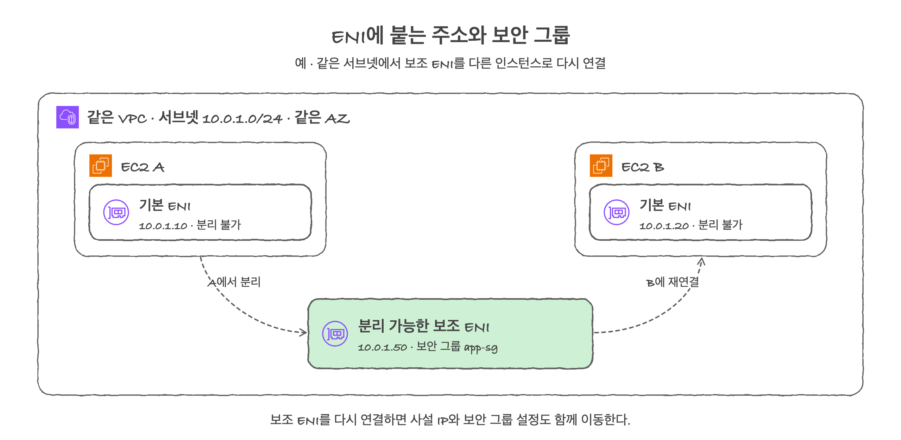
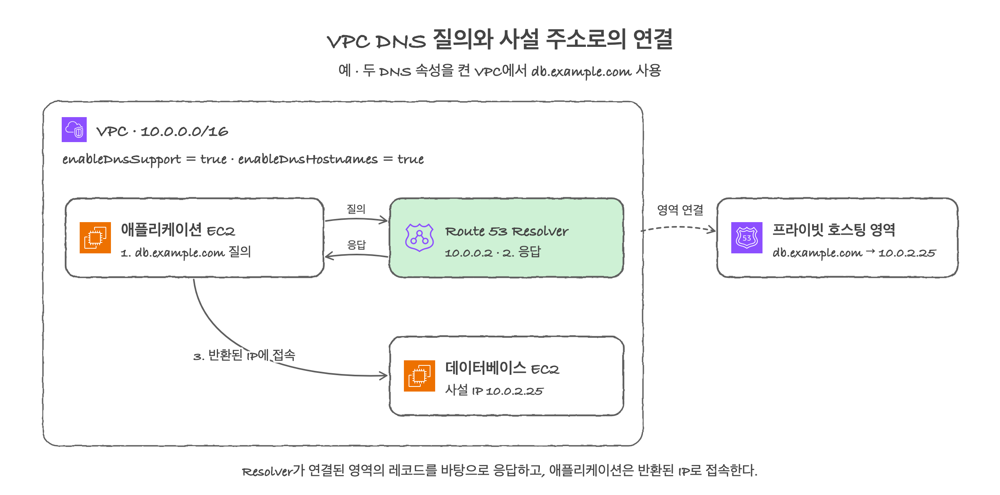
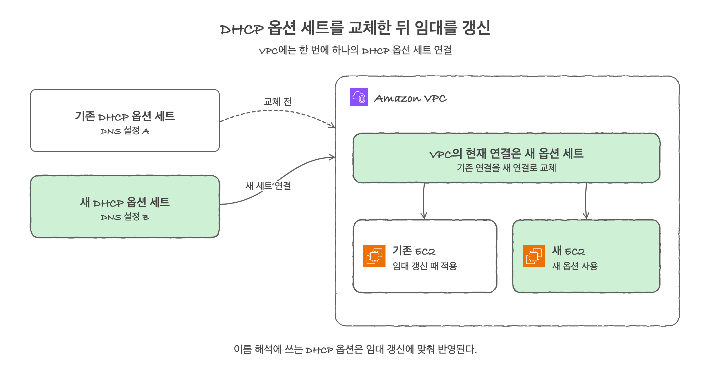

# VPC의 네트워크 인터페이스, DNS, 주소 설정

## 1. Elastic Network Interface(ENI)

Elastic Network Interface(ENI)는 VPC에서 EC2에 연결하는 가상 네트워크 카드다. 서브넷 범위의 사설 IP 주소, 연결된 보안 그룹, MAC 주소, 소스/대상 확인 설정을 가진다. IPv4를 쓰는 서브넷에서는 기본 사설 IPv4에 더해 보조 사설 IPv4를 할당할 수 있으며, Elastic IP는 ENI의 사설 IPv4 주소 하나에 연결한다. [EC2 네트워크 인터페이스와 속성](https://docs.aws.amazon.com/AWSEC2/latest/UserGuide/using-eni.html#eni-basics)

같은 서브넷을 예로 들어 기본 ENI와 다시 연결할 수 있는 보조 ENI의 차이를 보여 준다. [EC2 네트워크 인터페이스와 속성](https://docs.aws.amazon.com/AWSEC2/latest/UserGuide/using-eni.html#eni-basics) · [ENI 연결 제약](https://docs.aws.amazon.com/AWSEC2/latest/UserGuide/network-interface-attachments.html)

EC2의 기본 ENI는 분리할 수 없다. 분리 가능한 보조 ENI는 같은 가용 영역(AZ)의 다른 인스턴스에 다시 연결할 수 있다. 이때 ENI의 주소와 보안 그룹 설정도 함께 이동한다. 보조 ENI가 필요한 경우에는 인스턴스 유형의 ENI 개수 한도와, 해당 유형이 ENA 큐 할당을 지원한다면 큐 여유도 확인한다. [EC2 네트워크 인터페이스](https://docs.aws.amazon.com/AWSEC2/latest/UserGuide/using-eni.html#eni-basics) · [ENI 연결 제약](https://docs.aws.amazon.com/AWSEC2/latest/UserGuide/network-interface-attachments.html)

EC2를 라우터나 NAT 인스턴스로 운용하면 인스턴스 자체가 출발지나 목적지가 아닌 패킷도 전달한다. 이 용도에서는 기본적으로 켜진 소스/대상 확인을 비활성화하고, 전달할 트래픽이 그 장비를 향하도록 VPC 라우팅 테이블을 구성한다. [EC2 소스/대상 확인](https://docs.aws.amazon.com/AWSEC2/latest/UserGuide/using-eni.html#eni-basics) · [VPC 라우팅 테이블](https://docs.aws.amazon.com/vpc/latest/userguide/VPC_Route_Tables.html)

## 2. DNS와 VPC의 DNS 속성

VPC에서 Amazon이 제공하는 DNS 서버의 이름은 Route 53 Resolver이며, DHCP 옵션에서는 `AmazonProvidedDNS`라고 부른다. 예를 들어 기본 IPv4 CIDR이 `10.0.0.0/16`이라면 Resolver 주소는 `10.0.0.2`이며, IPv4 링크 로컬 주소 `169.254.169.253`과 IPv6 주소 `fd00:ec2::253`도 제공된다. [VPC의 Amazon DNS 서버](https://docs.aws.amazon.com/vpc/latest/userguide/AmazonDNS-concepts.html#AmazonDNS)

VPC가 프라이빗 호스팅 영역과 연결된 상태에서 이름 질의, DNS 응답, 데이터 연결을 순서대로 나타냈다. [VPC의 Amazon DNS 서버](https://docs.aws.amazon.com/vpc/latest/userguide/AmazonDNS-concepts.html#AmazonDNS) · [VPC DNS 속성과 적용 조건](https://docs.aws.amazon.com/vpc/latest/userguide/AmazonDNS-concepts.html#vpc-dns-support) · [Route 53 프라이빗 호스팅 영역](https://docs.aws.amazon.com/Route53/latest/DeveloperGuide/hosted-zones-private.html)

`enableDnsSupport`는 Amazon이 제공하는 Resolver를 통한 이름 해석을 제어한다. `enableDnsHostnames`는 공개 IP가 있는 EC2에 공개 DNS 호스트 이름을 부여하는 데 쓰인다. 공개 IPv4나 Elastic IP가 있는 인스턴스에 공개 DNS 이름을 부여하려면 두 속성을 모두 켠다. Route 53 프라이빗 호스팅 영역의 사용자 지정 도메인이나 인터페이스 VPC 엔드포인트의 프라이빗 DNS를 사용할 때도 두 값이 모두 `true`여야 한다. [VPC DNS 속성과 적용 조건](https://docs.aws.amazon.com/vpc/latest/userguide/AmazonDNS-concepts.html#vpc-dns-support)

프라이빗 호스팅 영역에는 `db.example.com` 같은 이름의 레코드를 저장하고, 영역을 사용할 VPC를 연결한다. 연결된 VPC의 애플리케이션이 이름을 질의하면 Resolver가 해당 영역의 레코드를 바탕으로 응답한다. 이름이 해석되어도 데이터 연결은 반환된 IP로 별도로 맺으므로, 접속에 실패하면 그 IP까지의 라우팅과 대상 보안 그룹을 확인한다. [Route 53 프라이빗 호스팅 영역](https://docs.aws.amazon.com/Route53/latest/DeveloperGuide/hosted-zones-private.html) · [VPC 라우팅 테이블](https://docs.aws.amazon.com/vpc/latest/userguide/VPC_Route_Tables.html) · [VPC 보안 그룹](https://docs.aws.amazon.com/vpc/latest/userguide/vpc-security-groups.html)

## 3. DHCP 옵션 세트

DHCP 옵션 세트는 EC2 같은 리소스가 DHCP로 받을 DNS 서버, 도메인 이름, NTP 서버 등의 설정을 정의한다. VPC에는 한 번에 하나의 옵션 세트를 연결할 수 있다. 목적지 CIDR과 다음 홉은 서브넷에 적용되는 VPC 라우팅 테이블에서 확인한다. [DHCP 옵션 세트 개념](https://docs.aws.amazon.com/vpc/latest/userguide/DHCPOptionSetConcepts.html) · [VPC 라우팅 테이블](https://docs.aws.amazon.com/vpc/latest/userguide/VPC_Route_Tables.html)

VPC 수준의 옵션 세트 연결 교체와 운영체제의 설정 반영 시점을 나타냈다. [DHCP 옵션 세트 개념](https://docs.aws.amazon.com/vpc/latest/userguide/DHCPOptionSetConcepts.html) · [DHCP 옵션 변경의 반영 시점](https://docs.aws.amazon.com/vpc/latest/userguide/DHCPOptionSet.html#ChangingDHCPOptionsofaVPC)

설정을 변경하려면 새 옵션 세트를 생성해 VPC 연결을 교체한다. 새 인스턴스는 새 세트를 사용하고, 실행 중인 인스턴스는 DHCP 임대를 갱신할 때 반영하므로 반영 시점이 인스턴스마다 다를 수 있다. 즉시 반영이 필요한 경우 운영체제에서 임대를 직접 갱신할 수 있으며, 인스턴스를 재시작할 필요는 없다. [DHCP 옵션 세트 생성과 연결 변경](https://docs.aws.amazon.com/vpc/latest/userguide/DHCPOptionSet.html#ChangingDHCPOptionsofaVPC)

사용자 지정 DNS 서버를 배포한 뒤에는 대표 인스턴스에서 실제 사용 중인 DNS 서버와 필요한 도메인의 해석을 확인한다. 예를 들어 EC2의 `<region>.compute.internal` 이름을 계속 해석해야 한다면 해당 도메인 질의가 Amazon DNS 서버에 전달되는지 확인한다. 롤백할 때도 이전 세트를 다시 연결한 뒤 임대 갱신과 이름 해석 결과를 확인한다. [Amazon DNS 사용 시 고려 사항](https://docs.aws.amazon.com/vpc/latest/userguide/AmazonDNS-concepts.html#amazon-dns-rules) · [DHCP 옵션 변경의 반영 시점](https://docs.aws.amazon.com/vpc/latest/userguide/DHCPOptionSet.html#ChangingDHCPOptionsofaVPC)
