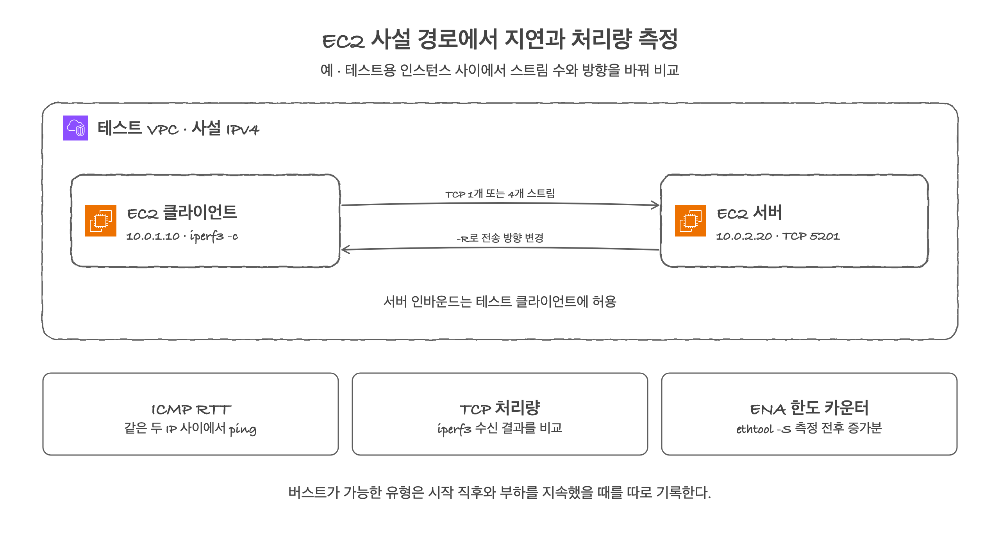
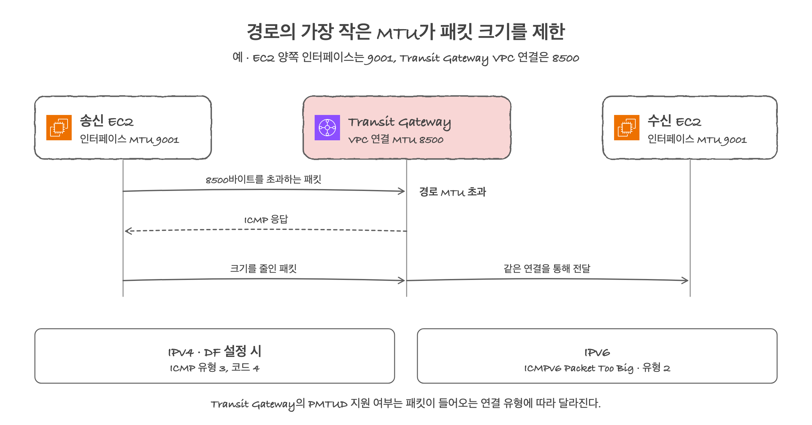
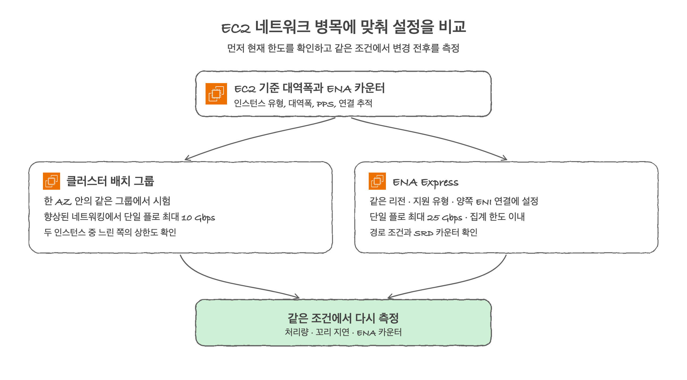

# EC2 네트워크 성능 측정과 최적화

## 1. EC2 네트워크 성능 측정

테스트용 EC2 두 대를 사용하고 송수신 인스턴스 유형, AZ, 사설 IP, MTU, iperf3 버전을 기록한다. 테스트 서버는 사설 IP에 바인딩하고, TCP 5201 인바운드는 테스트 클라이언트에만 허용한다. `-P 1`과 `-P 4`는 각각 TCP 스트림 하나와 여러 개를 측정하며, `-R`은 데이터 전송 방향을 뒤집는다. iperf3 3.16부터는 병렬 스트림마다 별도 스레드를 사용한다. [ESnet iperf3 매뉴얼](https://software.es.net/iperf/invoking.html#iperf3-manual-page) · [VPC 보안 그룹 규칙](https://docs.aws.amazon.com/vpc/latest/userguide/security-group-rules.html#security-group-rule-components)



같은 사설 경로에서 전송 조건을 바꾸고 각 지표를 어디서 읽는지 보여 준다. [AWS RTT 측정 방법](https://aws.amazon.com/what-is/rtt-in-networking/) · [ESnet iperf3 매뉴얼](https://software.es.net/iperf/invoking.html#iperf3-manual-page) · [ENA 드라이버 지표](https://docs.aws.amazon.com/AWSEC2/latest/UserGuide/monitoring-network-performance-ena.html#network-performance-metrics)

```bash
# 테스트 서버
iperf3 -s -B 10.0.2.20

# 테스트 클라이언트
iperf3 -c 10.0.2.20 -P 1 -t 30
iperf3 -c 10.0.2.20 -P 4 -t 30
iperf3 -c 10.0.2.20 -P 1 -t 30 -R
```

RTT는 같은 두 사설 IP 사이에서 `ping`으로 ICMP 왕복 시간을 확인하고, TCP 처리량은 iperf3의 수신 결과를 비교한다. 구간 전후에 Linux의 `ethtool -S <인터페이스>`로 누적 ENA 카운터를 읽어 증가분을 기록한다. `bw_in_allowance_exceeded`·`bw_out_allowance_exceeded`는 대역폭, `pps_allowance_exceeded`는 초당 패킷 수, `conntrack_allowance_exceeded`는 연결 추적 한도에 걸린 신호다. [AWS RTT 측정 방법](https://aws.amazon.com/what-is/rtt-in-networking/) · [ESnet iperf3 매뉴얼](https://software.es.net/iperf/invoking.html#iperf3-manual-page) · [ENA 드라이버 지표](https://docs.aws.amazon.com/AWSEC2/latest/UserGuide/monitoring-network-performance-ena.html#network-performance-metrics)

30초 테스트는 조건을 비교하기 위한 예시다. 네트워크 I/O 크레딧으로 버스트할 수 있는 유형에서는 시작 직후와 부하를 지속했을 때를 따로 기록하고, 인스턴스 유형의 기준 대역폭을 확인한다. TCP/UDP 단일 플로는 출발지·목적지 IP와 포트, 프로토콜의 5개 값으로 구분된다. 여러 플로의 합계는 개별 플로의 처리량과 구분해서 읽는다. 인터넷 게이트웨이나 로컬 게이트웨이를 지나는 다중 플로에도 유형별 경로 한도가 적용될 수 있다. [EC2 가용 대역폭과 플로 제한](https://docs.aws.amazon.com/AWSEC2/latest/UserGuide/ec2-instance-network-bandwidth.html)

## 2. Jumbo frame과 경로 MTU

MTU는 한 링크에서 전달할 수 있는 최대 IP 패킷 크기다. 모든 EC2 인스턴스 유형은 MTU 1500을 지원하며, 현재 세대 유형은 MTU 9001도 지원한다. 큰 패킷을 보낼 수 있으면 같은 양의 데이터를 더 적은 패킷으로 전달할 수 있다. 실제 사용 가능한 크기는 양쪽 인터페이스와 중간 경로가 허용하는 값 중 가장 작은 값이다. Linux에서는 `ip link show`로 인터페이스 MTU를 확인하고, `tracepath <목적지 IP>`로 경로 MTU를 점검할 수 있다. [EC2 Jumbo frame](https://docs.aws.amazon.com/AWSEC2/latest/UserGuide/network_mtu.html#jumbo_frame_instances) · [EC2 MTU 확인](https://docs.aws.amazon.com/AWSEC2/latest/UserGuide/ec2-instance-mtu.html)



Transit Gateway의 VPC 연결에서 발생하는 MTU 제한과 PMTUD 응답을 예로 들었다. [EC2 Path MTU Discovery](https://docs.aws.amazon.com/AWSEC2/latest/UserGuide/network_mtu.html#path_mtu_discovery) · [Transit Gateway MTU와 PMTUD](https://docs.aws.amazon.com/vpc/latest/tgw/transit-gateway-quotas.html#mtu-quotas)

VPC 피어링의 MTU는 같은 리전에서 9001바이트, 리전 간에는 8500바이트다. Transit Gateway의 VPC 연결을 거치는 경로는 최대 8500바이트다. NAT 게이트웨이 자체는 8500바이트를 지원하지만 인터넷 게이트웨이를 통과하는 구간은 최대 1500바이트다. AWS는 퍼블릭 NAT 게이트웨이로 인터넷에 연결하는 EC2에 MTU 1500 이하를 권장한다. [VPC 피어링 제약](https://docs.aws.amazon.com/vpc/latest/peering/vpc-peering-basics.html#vpc-peering-limitations) · [Transit Gateway MTU](https://docs.aws.amazon.com/vpc/latest/tgw/transit-gateway-quotas.html#mtu-quotas) · [NAT 게이트웨이 기본 사항](https://docs.aws.amazon.com/vpc/latest/userguide/nat-gateway-basics.html) · [EC2 경로 MTU](https://docs.aws.amazon.com/AWSEC2/latest/UserGuide/network_mtu.html#path_mtu_discovery)

경로 MTU 탐색(PMTUD)에서 IPv4의 DF(Don’t Fragment)가 설정된 패킷이 경로 한도를 넘으면 ICMP `Fragmentation Needed`(유형 3, 코드 4), IPv6는 ICMPv6 `Packet Too Big`(유형 2) 응답을 사용한다. 큰 패킷에서만 연결이 멈춘다면 송수신 경로의 MTU와 ICMP 응답이 돌아오는 경로를 확인한다. Transit Gateway는 VPC·Connect 연결에서 들어오는 트래픽에는 PMTUD를 지원하며, Site-to-Site VPN·Direct Connect·피어링 연결에는 지원하지 않는다. [EC2 Path MTU Discovery](https://docs.aws.amazon.com/AWSEC2/latest/UserGuide/network_mtu.html#path_mtu_discovery) · [Transit Gateway MTU와 PMTUD](https://docs.aws.amazon.com/vpc/latest/tgw/transit-gateway-quotas.html#mtu-quotas)

## 3. EC2 네트워크 최적화

지원 인스턴스에서는 ENA 기반 향상된 네트워킹을 사용하고, 인스턴스 유형의 기준 대역폭과 테스트 중 늘어난 ENA 카운터를 먼저 확인한다. Linux의 일반 ENA 네트워크 성능 지표에는 드라이버 2.2.10 이상이 필요하고, `conntrack_allowance_available`은 2.8.1 이상이면서 Nitro 기반 인스턴스에서 제공된다. 일반 CloudWatch 집계에서는 짧은 트래픽 급증이 드러나지 않을 수 있어, 측정 구간의 ENA 카운터 증가분도 함께 읽는다. [EC2 향상된 네트워킹](https://docs.aws.amazon.com/AWSEC2/latest/UserGuide/enhanced-networking.html) · [ENA 지표 요구 사항](https://docs.aws.amazon.com/AWSEC2/latest/UserGuide/monitoring-network-performance-ena.html#network-performance-metrics-requirements) · [EC2 대역폭 모니터링](https://docs.aws.amazon.com/AWSEC2/latest/UserGuide/ec2-instance-network-bandwidth.html#monitor-instance-bandwidth)



인스턴스 한도 확인에서 시작해 배치와 전송 기능을 검토하고, 같은 부하에서 효과를 판별하는 흐름이다. [EC2 향상된 네트워킹](https://docs.aws.amazon.com/AWSEC2/latest/UserGuide/enhanced-networking.html) · [ENA Express 동작 조건과 지원 유형](https://docs.aws.amazon.com/AWSEC2/latest/UserGuide/ena-express.html#ena-express-how-it-works) · [EC2 클러스터 배치 그룹의 권장 사항과 제약](https://docs.aws.amazon.com/AWSEC2/latest/UserGuide/placement-strategies.html#placement-groups-cluster)

클러스터 배치 그룹은 같은 AZ에 있는 인스턴스 사이의 통신이 많고 높은 처리량이나 낮은 지연이 필요할 때 검토한다. 향상된 네트워킹을 사용하는 같은 그룹의 EC2 사이에서는 단일 플로가 최대 10 Gbps를 사용할 수 있으며, 실제 상한은 두 인스턴스 중 느린 쪽의 대역폭에도 제약을 받는다. 그룹에 인스턴스를 나중에 추가하거나 여러 유형을 섞어 시작하면 용량 부족 가능성이 커진다. [EC2 클러스터 배치 그룹의 권장 사항과 제약](https://docs.aws.amazon.com/AWSEC2/latest/UserGuide/placement-strategies.html#placement-groups-cluster)

ENA Express는 지원되는 인스턴스 두 대의 ENI 연결에 모두 설정하고, 두 인스턴스가 같은 리전에 있으며 중간 네트워크 장비가 없는 경로에서 사용한다. UDP는 두 끝에서 UDP용 설정도 켜야 한다. 조건을 충족하면 SRD로 전송할 수 있으며 단일 플로 상한은 최대 25 Gbps로, 인스턴스의 집계 대역폭을 넘을 수 없다. 리전과 AZ 조합에는 예외가 있으므로 적용할 리전의 지원 조건을 확인한다. [ENA Express 동작 조건과 지원 유형](https://docs.aws.amazon.com/AWSEC2/latest/UserGuide/ena-express.html#ena-express-how-it-works) · [ENA Express 효과와 리전 제한](https://docs.aws.amazon.com/AWSEC2/latest/UserGuide/ena-express.html)

설정을 한 번에 하나씩 바꾸고 같은 경로와 부하에서 처리량, p95·p99 지연, ENA 카운터를 다시 측정한다. ENA Express를 켰다면 설정 확인에 더해 `ena_srd_tx_pkts`와 `ena_srd_rx_pkts` 증가분으로 실제 SRD 전송 여부를 확인한다. Linux에서 ENA Express 지표를 수집하려면 ENA 드라이버 2.8 이상이 필요하다. [Linux EC2 네트워크 지연 측정과 최적화](https://docs.aws.amazon.com/AWSEC2/latest/UserGuide/ena-improve-network-latency-linux.html) · [ENA Express 지표](https://docs.aws.amazon.com/AWSEC2/latest/UserGuide/monitoring-network-performance-ena.html#network-performance-metrics-ena-express) · [ENA Express Linux 드라이버 요건](https://docs.aws.amazon.com/AWSEC2/latest/UserGuide/ena-express.html#ena-express-how-it-works)
