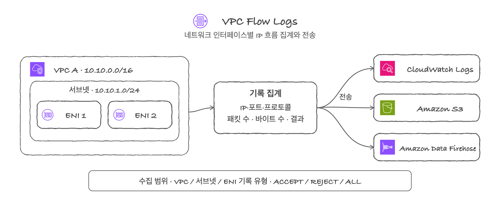
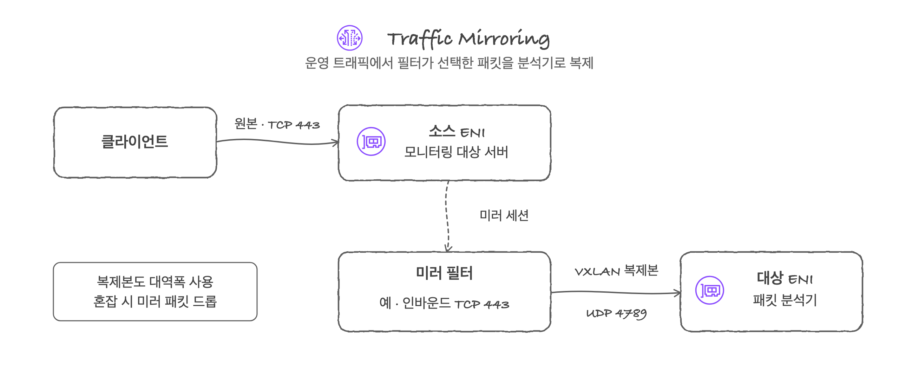
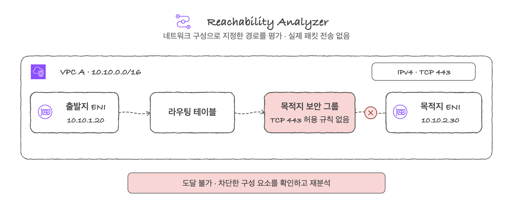
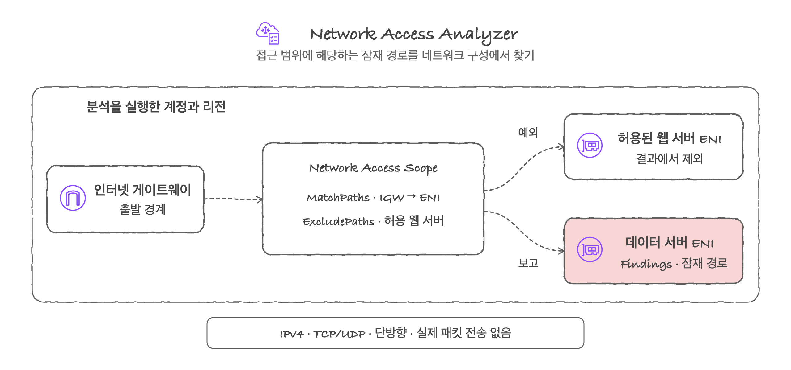

# VPC 네트워크 모니터링과 경로 분석

## 1. VPC Flow Logs

VPC Flow Logs는 네트워크 인터페이스(ENI)를 드나드는 IP 트래픽의 메타데이터를 기록한다. VPC, 서브넷 또는 ENI를 수집 범위로 선택한다. VPC나 서브넷에 설정하면 그 안의 각 ENI를 관찰하며, `ACCEPT`, `REJECT`, `ALL` 중 수집할 트래픽을 고른다. 결과는 CloudWatch Logs, Amazon S3 또는 Amazon Data Firehose로 보낼 수 있다. [Flow Logs 개요](https://docs.aws.amazon.com/vpc/latest/userguide/flow-logs.html) · [수집 범위와 유형](https://docs.aws.amazon.com/vpc/latest/userguide/flow-logs-basics.html)



VPC Flow Logs는 각 ENI의 흐름 메타데이터를 집계해 선택한 대상으로 보낸다. [Flow Logs 개요](https://docs.aws.amazon.com/vpc/latest/userguide/flow-logs.html) · [수집 범위와 유형](https://docs.aws.amazon.com/vpc/latest/userguide/flow-logs-basics.html) · [레코드와 집계 간격](https://docs.aws.amazon.com/vpc/latest/userguide/flow-log-records.html#flow-logs-aggregration-interval)

기본 레코드는 ENI별로 출발지 IP·포트, 목적지 IP·포트, 프로토콜이 같은 흐름을 집계한다. 패킷 수, 바이트 수, `ACCEPT`·`REJECT` 등 처리 결과가 남는다. 최대 집계 간격은 기본 10분이고 1분으로 설정할 수 있다. Nitro 기반 인스턴스의 ENI는 설정과 관계없이 1분 이하로 집계한다. [레코드와 집계 간격](https://docs.aws.amazon.com/vpc/latest/userguide/flow-log-records.html#flow-logs-aggregration-interval) · [레코드 필드](https://docs.aws.amazon.com/vpc/latest/userguide/flow-log-records.html#flow-logs-fields)

집계 후에는 처리와 전송에 시간이 더 걸린다. 보통 CloudWatch Logs로 약 5분, Amazon S3로 약 10분이 걸리며 더 지연될 수도 있다. `NODATA`는 해당 구간에 기록된 트래픽이 없었다는 뜻이고, `SKIPDATA`는 내부 용량 제한이나 오류로 레코드 일부를 건너뛰었다는 뜻이다. `Active`인데 로그가 비어 있으면 트래픽 발생 여부와 전송 상태를 확인한다. `Access error`가 보이면 CloudWatch Logs 전송 역할의 권한과 신뢰 정책을 확인하고, S3 전송 오류라면 버킷 ARN과 정책을 확인한다. [전송 지연](https://docs.aws.amazon.com/vpc/latest/userguide/flow-log-records.html#flow-logs-aggregration-interval) · [레코드 상태](https://docs.aws.amazon.com/vpc/latest/userguide/flow-logs-records-examples.html#flow-log-example-no-data) · [전송 오류 해결](https://docs.aws.amazon.com/vpc/latest/userguide/flow-logs-troubleshooting.html)

기본 형식 로그가 들어오는 CloudWatch Logs의 Standard 로그 그룹을 선택한 뒤, 다음 Logs Insights 쿼리로 TCP 443 거부 레코드가 많은 출발지·목적지 조합을 확인한다. `rejectedRecords`는 집계 레코드 수다. 대상 ENI와 시간 범위를 좁힌 뒤 보안 그룹과 네트워크 ACL을 대조한다. [자동 검색 필드](https://docs.aws.amazon.com/AmazonCloudWatch/latest/logs/CWL_AnalyzeLogData-discoverable-fields.html) · [VPC Flow Logs 쿼리 예시](https://docs.aws.amazon.com/AmazonCloudWatch/latest/logs/CWL_QuerySyntax-examples.html#CWL_QuerySyntax-examples-VPC) · [보안 그룹과 네트워크 ACL 예시](https://docs.aws.amazon.com/vpc/latest/userguide/flow-logs-records-examples.html#flow-log-example-security-groups)

```text
filter action = "REJECT" and protocol = 6 and dstPort = 443
| stats count(*) as rejectedRecords by srcAddr, dstAddr
| sort rejectedRecords desc
| limit 10
```

## 2. Traffic Mirroring

Traffic Mirroring은 지원되는 EC2 인스턴스에 연결된 ENI에서 실제 패킷을 복제한다. 미러 세션은 소스 ENI, 필터, 대상을 연결한다. 필터는 인바운드와 아웃바운드 규칙을 번호가 낮은 순서로 평가하며, 처음 일치한 규칙이 복제 여부를 정한다. 예를 들어 인바운드 TCP 443을 복제하도록 규칙을 만들 수 있다. [Traffic Mirroring 개요](https://docs.aws.amazon.com/vpc/latest/mirroring/what-is-traffic-mirroring.html#concepts) · [미러 필터](https://docs.aws.amazon.com/vpc/latest/mirroring/traffic-mirroring-filters.html)



TCP 443 원본 패킷이 소스 ENI에 도착하면 필터가 선택한 복제본을 VXLAN으로 분석기에 보낸다. [Traffic Mirroring 개요](https://docs.aws.amazon.com/vpc/latest/mirroring/what-is-traffic-mirroring.html#concepts) · [미러 필터](https://docs.aws.amazon.com/vpc/latest/mirroring/traffic-mirroring-filters.html) · [VXLAN 캡슐화](https://docs.aws.amazon.com/vpc/latest/mirroring/traffic-mirroring-targets.html#traffic-mirroring-vxlan-encapsulation)

복제한 패킷을 VXLAN으로 캡슐화해 대상 ENI, Network Load Balancer 또는 Gateway Load Balancer 엔드포인트로 보낸다. 대상까지 라우팅되는지 확인하고, 대상에 적용되는 보안 그룹에서 소스의 UDP 4789 트래픽을 허용한다. 분석기는 VXLAN을 해석할 수 있어야 한다. [미러 대상](https://docs.aws.amazon.com/vpc/latest/mirroring/traffic-mirroring-targets.html) · [VXLAN 캡슐화](https://docs.aws.amazon.com/vpc/latest/mirroring/traffic-mirroring-targets.html#traffic-mirroring-vxlan-encapsulation)

소스의 인바운드 보안 그룹이나 네트워크 ACL이 버린 패킷은 복제되지 않는다. 복제 트래픽은 인스턴스 대역폭을 사용한다. 대역폭 또는 초당 패킷 수 한도에 도달하면 미러 복제본부터 드롭될 수 있다. 설정과 대상 경로의 MTU에 따라 패킷이 잘릴 수 있으므로 캡처에서 보이지 않는 패킷을 판단할 때는 이러한 조건도 확인한다. [라우팅과 보안 그룹](https://docs.aws.amazon.com/vpc/latest/mirroring/traffic-mirroring-targets.html#traffic-mirroring-routing) · [MTU와 대역폭 제약](https://docs.aws.amazon.com/vpc/latest/mirroring/traffic-mirroring-network-limitations.html)

## 3. Reachability Analyzer

Reachability Analyzer는 출발지와 목적지, TCP 또는 UDP, 필요한 경우 포트와 IP를 지정해 도달 가능성을 분석한다. 현재 네트워크 구성을 모델로 평가하며 실제 패킷을 보내지 않는다. 가능한 경로가 여러 개면 가장 짧은 경로를 보여 준다. 도달할 수 없으면 경로를 차단하는 구성 요소를 알려 준다. 예를 들어 목적지 보안 그룹에 TCP 443 인바운드 허용 규칙이 없다면 규칙을 수정한 뒤 같은 경로를 다시 분석한다. [경로 분석 방식](https://docs.aws.amazon.com/vpc/latest/reachability/how-reachability-analyzer-works.html) · [분석 결과와 재분석](https://docs.aws.amazon.com/vpc/latest/reachability/getting-started.html#analyze-path)



두 ENI 사이의 TCP 443 경로를 구성으로 평가해 목적지 보안 그룹의 차단을 찾는 예다. [경로 분석 방식](https://docs.aws.amazon.com/vpc/latest/reachability/how-reachability-analyzer-works.html) · [분석 결과와 재분석](https://docs.aws.amazon.com/vpc/latest/reachability/getting-started.html#analyze-path)

출발지와 목적지 리소스는 같은 리전에 있어야 한다. 같은 VPC에 있거나 VPC 피어링 또는 Transit Gateway로 연결된 VPC에 있어야 한다. 여러 계정에 걸친 분석은 같은 AWS Organizations 조직에서 신뢰할 수 있는 액세스를 설정한 경우에 가능하다. 분석 대상 주소는 IPv4이며, TCP 경로가 Transit Gateway 라우팅 테이블을 거치면 순방향만 분석한다. [출발지와 목적지 조건](https://docs.aws.amazon.com/vpc/latest/reachability/how-reachability-analyzer-works.html#source-and-destination-resources) · [교차 계정 설정](https://docs.aws.amazon.com/vpc/latest/reachability/multi-account.html) · [분석 제약](https://docs.aws.amazon.com/vpc/latest/reachability/how-reachability-analyzer-works.html#considerations)

## 4. Network Access Analyzer

Network Access Analyzer는 Network Access Scope 조건에 해당하는 잠재 경로를 네트워크 구성에서 찾는다. 예를 들어 `MatchPaths`에 인터넷 게이트웨이에서 ENI로 향하는 경로를 지정하고 `ExcludePaths`로 허용된 웹 서버를 제외한다. 결과(Findings)에 나타난 ENI와 경로를 검토해 의도치 않게 접근 가능한 리소스를 확인한다. AWS는 실제 패킷을 전송하지 않고 대표 경로를 반환하므로 결과가 비어 있더라도 분석 범위와 미지원 조건을 함께 확인한다. [분석 범위와 결과](https://docs.aws.amazon.com/vpc/latest/network-access-analyzer/what-is-network-access-analyzer.html#concepts) · [정적 분석 방식](https://docs.aws.amazon.com/vpc/latest/network-access-analyzer/how-network-access-analyzer-works.html)



Network Access Scope에 일치하는 경로에서 승인된 웹 서버를 제외하고 데이터 서버로 향하는 경로를 보고한다. [분석 범위와 결과](https://docs.aws.amazon.com/vpc/latest/network-access-analyzer/what-is-network-access-analyzer.html#concepts) · [정적 분석 방식](https://docs.aws.amazon.com/vpc/latest/network-access-analyzer/how-network-access-analyzer-works.html) · [분석 제약](https://docs.aws.amazon.com/vpc/latest/network-access-analyzer/how-network-access-analyzer-works.html#analyzer-limitations)

분석은 실행한 계정과 리전 안에서 이루어지며 IPv4의 TCP·UDP 단방향 경로를 다룬다. 다른 계정이나 리전의 리소스를 포함하는 경로나 AWS Direct Connect를 통과하는 경로는 결과에 포함되지 않는다. 분석이 4시간을 넘으면 시간 초과된다. [미지원 리소스](https://docs.aws.amazon.com/vpc/latest/network-access-analyzer/how-network-access-analyzer-works.html#unsupported-resources) · [분석 제약](https://docs.aws.amazon.com/vpc/latest/network-access-analyzer/how-network-access-analyzer-works.html#analyzer-limitations)

2026년 11월 26일에 확인한 AWS 가이드는 Network Access Analyzer의 실행 절차를 안내하고, 변경 이력에는 2026년 11월 13일 관리형 정책 업데이트가 기록되어 있다. AWS는 Network Access Analyzer와 Reachability Analyzer를 일부 상용 리전에서 사용할 수 없다고 안내한다. [분석 실행 절차](https://docs.aws.amazon.com/vpc/latest/network-access-analyzer/getting-started.html#run-analysis) · [변경 이력](https://docs.aws.amazon.com/vpc/latest/network-access-analyzer/doc-history.html) · [리전 가용성 안내](https://docs.aws.amazon.com/vpc/latest/userguide/security-vpc-bpa-basics.html#security-vpc-bpa-reg-avail)
