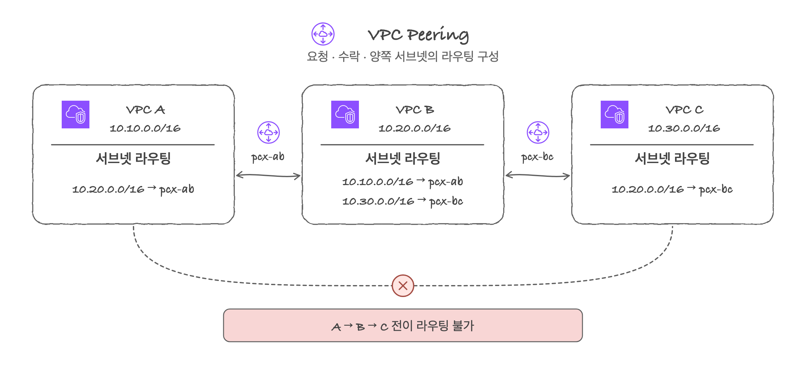

# VPC Peering으로 두 VPC 연결하기

## 1. VPC Peering

VPC Peering은 두 VPC 사이에 사설 IPv4 또는 IPv6 경로를 제공한다. 같은 계정뿐 아니라 다른 계정이나 리전의 VPC와도 연결할 수 있다. 요청자 VPC가 피어링을 요청하고 상대 VPC 소유자가 수락한다. 두 VPC의 IPv4 또는 IPv6 CIDR이 하나라도 겹치면 피어링을 생성할 수 없다. [VPC Peering 개요](https://docs.aws.amazon.com/vpc/latest/peering/what-is-vpc-peering.html) · [연결과 수락](https://docs.aws.amazon.com/vpc/latest/peering/vpc-peering-basics.html#vpc-peering-lifecycle) · [CIDR 제약](https://docs.aws.amazon.com/vpc/latest/peering/vpc-peering-basics.html#vpc-peering-limitations)

A–B와 B–C의 양쪽 라우팅을 구성해도 A에서 B를 경유해 C로 갈 수 없다. [VPC Peering 개요](https://docs.aws.amazon.com/vpc/latest/peering/what-is-vpc-peering.html) · [양쪽 라우팅 테이블 설정](https://docs.aws.amazon.com/vpc/latest/peering/vpc-peering-routing.html) · [다중 피어링과 전이 라우팅](https://docs.aws.amazon.com/vpc/latest/peering/vpc-peering-basics.html#vpc-peering-basics-multiple)

VPC A(`10.10.0.0/16`)와 VPC B(`10.20.0.0/16`)가 `pcx-ab`로 연결된 예에서 A 쪽 워크로드 서브넷의 라우팅 테이블에 `10.20.0.0/16 → pcx-ab`, B 쪽 워크로드 서브넷의 라우팅 테이블에 `10.10.0.0/16 → pcx-ab`를 추가한다. 두 방향의 목적지 대역을 지정해야 요청과 응답이 서로의 VPC에 도달한다. 접근 범위를 줄이려면 상대 VPC 전체 CIDR 대신 대상 서브넷 대역이나 개별 주소를 목적지로 지정할 수 있다. [양쪽 라우팅 테이블 설정](https://docs.aws.amazon.com/vpc/latest/peering/vpc-peering-routing.html)

연결이 `Active`가 되면 라우팅 외에도 양쪽 워크로드의 보안 그룹과 서브넷의 네트워크 ACL을 확인한다. 같은 리전의 활성 피어링에서는 상대 VPC의 보안 그룹을 규칙에서 참조할 수 있다. 다른 리전의 피어링에서는 이러한 참조를 사용할 수 없으므로 상대 CIDR을 규칙에 지정한다. 상태 비저장 방식인 네트워크 ACL은 응답 방향 규칙도 확인한다. [연결 상태](https://docs.aws.amazon.com/vpc/latest/peering/vpc-peering-basics.html#vpc-peering-lifecycle) · [피어 보안 그룹 참조](https://docs.aws.amazon.com/vpc/latest/peering/vpc-peering-security-groups.html) · [네트워크 ACL](https://docs.aws.amazon.com/vpc/latest/userguide/vpc-network-acls.html#nacl-basics)

EC2의 퍼블릭 IPv4 DNS 이름은 기본값에서 퍼블릭 IPv4 주소로 해석된다. 피어 VPC에서 이 이름을 프라이빗 IPv4 주소로 해석하려면 두 VPC의 DNS 해석과 DNS 호스트 이름을 활성화하고, 피어링 연결에서 필요한 방향의 DNS 해석 옵션을 켠다. 각 VPC 소유자가 자기 측 옵션을 변경한다. [피어링 DNS 해석](https://docs.aws.amazon.com/vpc/latest/peering/vpc-peering-dns.html)

VPC B와 VPC C(`10.30.0.0/16`)도 피어링하더라도 A에서 B를 거쳐 C로 갈 수 없다. VPC Peering은 두 VPC의 일대일 연결이며 전이 라우팅을 지원하지 않는다. A와 C를 피어링으로 연결하려면 별도의 A–C 연결과 양쪽 라우팅이 필요하다. [다중 피어링과 전이 라우팅](https://docs.aws.amazon.com/vpc/latest/peering/vpc-peering-basics.html#vpc-peering-basics-multiple) · [피어링 경로 설정](https://docs.aws.amazon.com/vpc/latest/peering/vpc-peering-routing.html)
