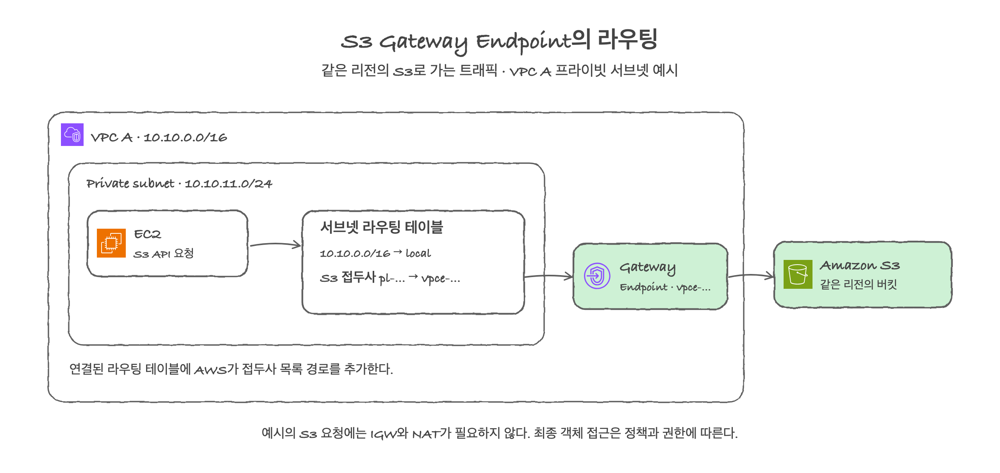
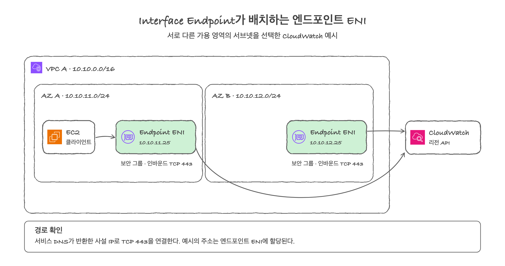
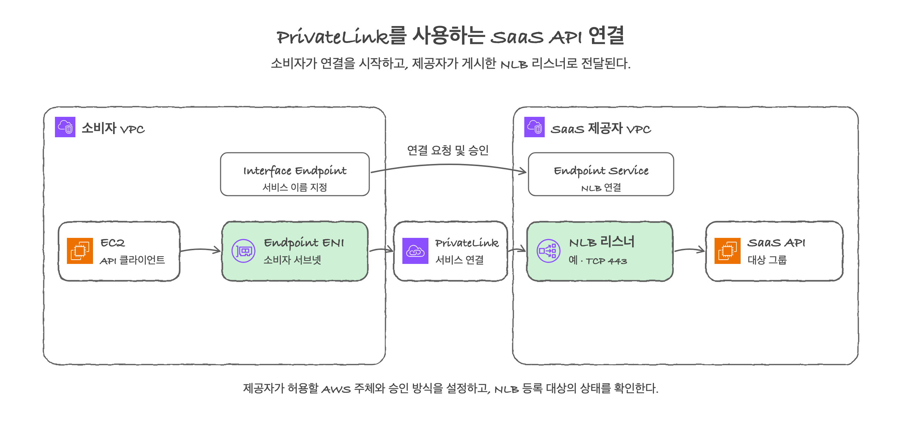
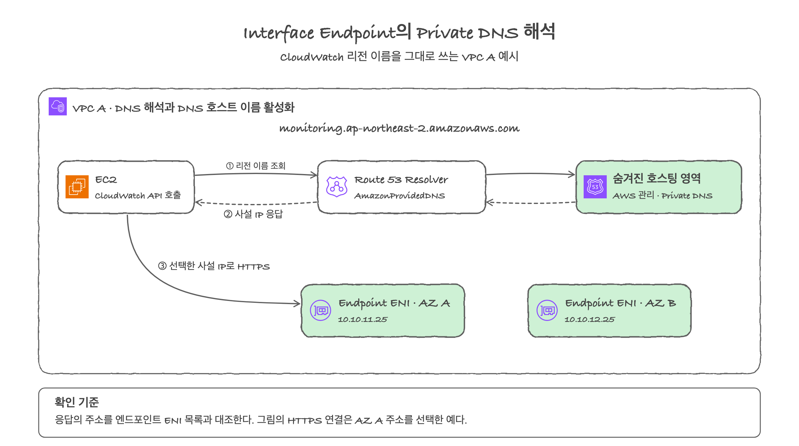
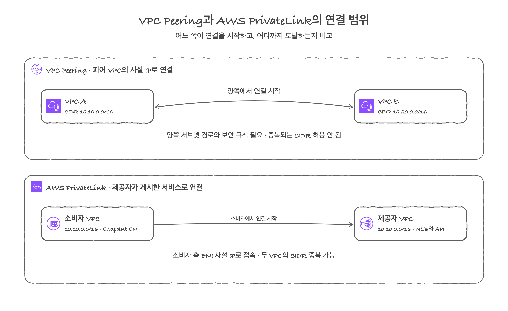

# VPC Endpoint와 AWS PrivateLink

## 1. Gateway Endpoint로 같은 리전의 S3에 접근하기

VPC A의 프라이빗 서브넷에서 같은 리전의 Amazon S3 버킷을 읽는 상황을 가정하자. S3 Gateway Endpoint를 생성하고 워크로드 서브넷의 라우팅 테이블을 연결하면 AWS가 목적지에 해당 리전의 S3 관리형 접두사 목록을, 대상으로 Gateway Endpoint를 넣는다. 일치하는 S3 요청에 인터넷 게이트웨이와 NAT 장비가 필요하지 않다. DynamoDB도 Gateway Endpoint를 제공한다. [AWS Gateway Endpoint · Routing](https://docs.aws.amazon.com/vpc/latest/privatelink/gateway-endpoints.html#gateway-endpoint-routing)

서브넷 라우팅 테이블에 연결한 S3 Gateway Endpoint의 패킷 경로다. [AWS Gateway Endpoint · Routing](https://docs.aws.amazon.com/vpc/latest/privatelink/gateway-endpoints.html#gateway-endpoint-routing) · [AWS S3 Gateway Endpoint · Considerations and policies](https://docs.aws.amazon.com/vpc/latest/privatelink/vpc-endpoints-s3.html)

- 설정 예시. 리전의 S3 서비스를 선택하고 Gateway 유형을 지정한 뒤, `10.10.11.0/24`에 연결된 라우팅 테이블을 선택한다. 테이블에서 `pl-… → vpce-…`가 생겼는지 확인한다. S3 접두사는 일반적인 `0.0.0.0/0` 기본 경로보다 구체적이며, S3 개별 주소에 더 구체적인 경로가 있다면 그 경로가 우선한다. [AWS Gateway Endpoint · Routing](https://docs.aws.amazon.com/vpc/latest/privatelink/gateway-endpoints.html#gateway-endpoint-routing)
- 검증 예시. 해당 서브넷의 IAM 역할이 있는 EC2에서 `aws s3api head-object --region ap-northeast-2 --bucket BUCKET --key KEY`를 실행한다. 객체 접근이 실패하면 서브넷의 라우팅 테이블 연결, 엔드포인트 정책, IAM 권한, 적용 중인 버킷 정책을 확인한다. HTTP 403을 받았다면 요청 권한도 확인할 단서가 된다. [AWS S3 Gateway Endpoint · Considerations and policies](https://docs.aws.amazon.com/vpc/latest/privatelink/vpc-endpoints-s3.html) · [Amazon S3 HeadObject](https://docs.aws.amazon.com/AmazonS3/latest/API/API_HeadObject.html)

## 2. Interface Endpoint와 엔드포인트 ENI 만들기

Interface Endpoint는 선택한 가용 영역마다 서브넷 하나에 엔드포인트 ENI를 생성한다. 클라이언트는 DNS 이름을 사용해 엔드포인트 ENI의 사설 IP로 접속한다. 엔드포인트 생성 시 선택한 보안 그룹이 ENI의 인바운드 트래픽을 제어한다. [AWS Interface Endpoint · Create](https://docs.aws.amazon.com/vpc/latest/privatelink/create-interface-endpoint.html)

두 가용 영역에 배치한 CloudWatch Interface Endpoint와 ENI 인바운드 보안 그룹을 그렸다. [AWS Interface Endpoint · Create](https://docs.aws.amazon.com/vpc/latest/privatelink/create-interface-endpoint.html) · [CloudWatch Interface VPC Endpoint · Create](https://docs.aws.amazon.com/AmazonCloudWatch/latest/monitoring/cloudwatch-and-interface-VPC.html)

- 예를 들어 서울 리전에서 CloudWatch API에 연결할 때 서비스 `com.amazonaws.ap-northeast-2.monitoring`을 선택한다. VPC A의 두 가용 영역에 서브넷 하나씩을 지정하고 엔드포인트 보안 그룹의 인바운드 TCP 443에 워크로드의 접근을 허용한다. [CloudWatch Interface VPC Endpoint · Create](https://docs.aws.amazon.com/AmazonCloudWatch/latest/monitoring/cloudwatch-and-interface-VPC.html) · [AWS Interface Endpoint · Create](https://docs.aws.amazon.com/vpc/latest/privatelink/create-interface-endpoint.html)
- 엔드포인트 상태와 생성된 ENI 주소를 확인한 뒤 AWS CLI의 `aws cloudwatch list-metrics --region ap-northeast-2`로 호출한다. 기본 리전 서비스 이름으로 테스트할 때는 Private DNS를 켠다. DNS가 예상한 ENI 주소로 해석되는지 확인한 뒤 TCP 443 도달 여부와 API 호출 권한을 차례로 점검한다. [CloudWatch Interface VPC Endpoint · Create and test](https://docs.aws.amazon.com/AmazonCloudWatch/latest/monitoring/cloudwatch-and-interface-VPC.html) · [AWS PrivateLink · DNS resolution](https://docs.aws.amazon.com/vpc/latest/privatelink/privatelink-access-aws-services.html#interface-endpoint-dns-resolution) · [AWS CLI · cloudwatch list-metrics](https://docs.aws.amazon.com/cli/latest/reference/cloudwatch/list-metrics.html)

## 3. PrivateLink로 소비자 VPC에 SaaS API 제공하기

제공자는 SaaS 애플리케이션을 Network Load Balancer(NLB)의 대상으로 등록하고 그 NLB를 가리키는 Endpoint Service를 만든다. 소비자는 서비스 이름으로 자신의 VPC에 Interface Endpoint를 생성한다. 소비자 애플리케이션의 연결은 엔드포인트 ENI와 PrivateLink를 거쳐 제공자 NLB의 리스너 및 서비스 대상으로 전달된다. [AWS PrivateLink · Create an endpoint service](https://docs.aws.amazon.com/vpc/latest/privatelink/create-endpoint-service.html) · [AWS 멀티 VPC 백서 · PrivateLink](https://docs.aws.amazon.com/whitepapers/latest/building-scalable-secure-multi-vpc-network-infrastructure/aws-privatelink.html)

SaaS 제공자가 승인하는 연결 설정과 승인 후 데이터 경로를 위아래로 나눠 그렸다. [AWS PrivateLink · Create an endpoint service](https://docs.aws.amazon.com/vpc/latest/privatelink/create-endpoint-service.html) · [AWS Endpoint Service · Manage permissions and accept requests](https://docs.aws.amazon.com/vpc/latest/privatelink/configure-endpoint-service.html)

- 제공자는 연결을 요청할 수 있는 AWS 계정 또는 IAM 주체를 허용한다. 수동 승인으로 설정했으면 소비자가 생성한 연결 요청을 확인하고 수락한다. 허용 대상 설정은 요청 자격을, 승인 설정은 각 연결의 수락 방식을 제어한다. [AWS Endpoint Service · Manage permissions and accept requests](https://docs.aws.amazon.com/vpc/latest/privatelink/configure-endpoint-service.html)
- 연결이 실패하면 소비자 쪽 엔드포인트의 상태와 ENI 보안 그룹을 확인하고, 제공자 쪽에서 허용 주체, 연결 승인, NLB 리스너와 대상 상태를 확인한다. 애플리케이션 요청에 필요한 인증은 서비스에서 따로 검사한다. [AWS PrivateLink · Create an endpoint service](https://docs.aws.amazon.com/vpc/latest/privatelink/create-endpoint-service.html) · [AWS NLB · Target group health checks](https://docs.aws.amazon.com/elasticloadbalancing/latest/network/target-group-health-checks.html)

## 4. Private DNS로 기존 서비스 이름 유지하기

VPC에서 DNS 해석과 DNS 호스트 이름을 활성화하고 AWS 서비스 Interface Endpoint의 Private DNS를 켜면 AWS가 숨겨진 관리형 프라이빗 호스팅 영역을 만든다. 이 VPC에서 리전의 기본 서비스 DNS 이름을 질의하면 인터페이스 엔드포인트의 사설 IP를 얻는다. 애플리케이션은 기존 리전 서비스 이름을 계속 사용한다. [AWS PrivateLink · DNS resolution](https://docs.aws.amazon.com/vpc/latest/privatelink/privatelink-access-aws-services.html#interface-endpoint-dns-resolution) · [Amazon VPC · DNS attributes](https://docs.aws.amazon.com/vpc/latest/userguide/vpc-dns-updating.html)

Private DNS가 기존 CloudWatch 리전 이름을 Interface Endpoint의 사설 IP로 해석하는 과정이다. [AWS PrivateLink · DNS resolution](https://docs.aws.amazon.com/vpc/latest/privatelink/privatelink-access-aws-services.html#interface-endpoint-dns-resolution) · [Amazon VPC · DNS attributes](https://docs.aws.amazon.com/vpc/latest/userguide/vpc-dns-updating.html)

- 예를 들어 VPC A의 AmazonProvidedDNS에서 `monitoring.ap-northeast-2.amazonaws.com`을 조회한다. 반환된 주소를 ENI 목록과 대조한다. 그림의 `10.10.11.25`와 `10.10.12.25`는 두 가용 영역의 예시 주소다. DNS가 정상이어도 엔드포인트 보안 그룹 및 AWS API 권한 확인은 별도로 필요하다. [AWS PrivateLink · DNS resolution](https://docs.aws.amazon.com/vpc/latest/privatelink/privatelink-access-aws-services.html#interface-endpoint-dns-resolution) · [AWS Interface Endpoint · Security groups](https://docs.aws.amazon.com/vpc/latest/privatelink/create-interface-endpoint.html)
- 제공자 자체 도메인으로도 프라이빗 이름을 사용할 수 있다. 제공자가 Endpoint Service에 연결할 도메인 소유권을 검증하고 소비자는 엔드포인트에 Private DNS를 활성화한다. [AWS Endpoint Service · Manage private DNS names](https://docs.aws.amazon.com/vpc/latest/privatelink/manage-dns-names.html)

## 5. VPC Peering과 AWS PrivateLink 선택하기

VPC Peering은 두 VPC의 사설 IP 네트워크를 연결한다. 양쪽 서브넷에 피어 CIDR을 향한 경로를 추가하고 보안 규칙을 허용하면 두 방향에서 연결을 시작할 수 있다. 두 VPC에 중복되는 CIDR이 있으면 VPC Peering을 만들 수 없다. [Amazon VPC Peering · What is VPC peering?](https://docs.aws.amazon.com/vpc/latest/peering/what-is-vpc-peering.html) · [Amazon VPC Peering · Limitations](https://docs.aws.amazon.com/vpc/latest/peering/vpc-peering-basics.html)

VPC 간 IP 연결과 게시된 서비스 연결을 연결 방향, CIDR 조건과 함께 비교했다. [Amazon VPC Peering · What is VPC peering?](https://docs.aws.amazon.com/vpc/latest/peering/what-is-vpc-peering.html) · [Amazon VPC Peering · Limitations](https://docs.aws.amazon.com/vpc/latest/peering/vpc-peering-basics.html) · [AWS 멀티 VPC 백서 · 연결 방식 선택](https://docs.aws.amazon.com/whitepapers/latest/building-scalable-secure-multi-vpc-network-infrastructure/aws-privatelink.html)

PrivateLink의 NLB 기반 Endpoint Service는 소비자가 자신의 ENI에 접속해 제공자가 게시한 서비스에 연결하는 방식이다. 소비자 VPC와 제공자 VPC의 주소 범위가 겹쳐도 구성할 수 있다. 여러 내부 시스템 사이에 양방향 사설 IP 통신이 필요한 경우에는 Peering을, 고객이 특정 SaaS API에 연결해야 하는 경우에는 PrivateLink를 고려한다. [AWS 멀티 VPC 백서 · 연결 방식 선택](https://docs.aws.amazon.com/whitepapers/latest/building-scalable-secure-multi-vpc-network-infrastructure/aws-privatelink.html)
