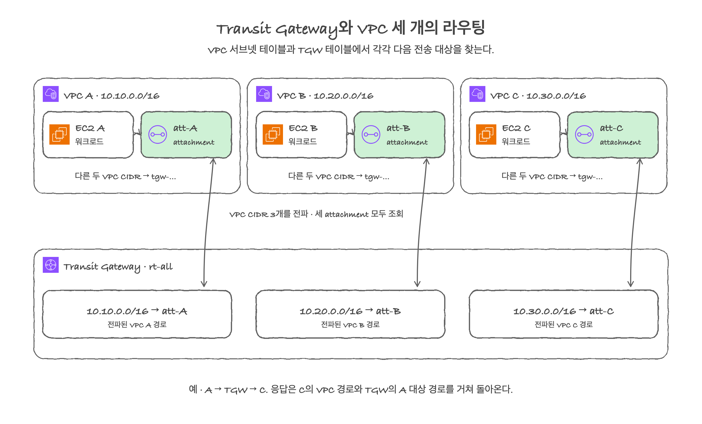
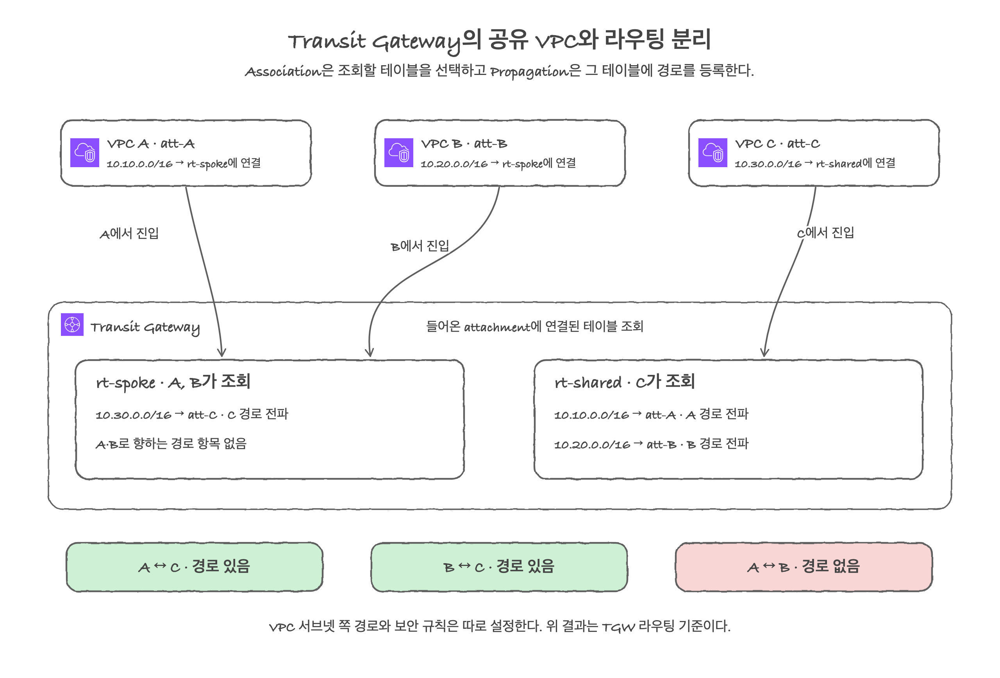
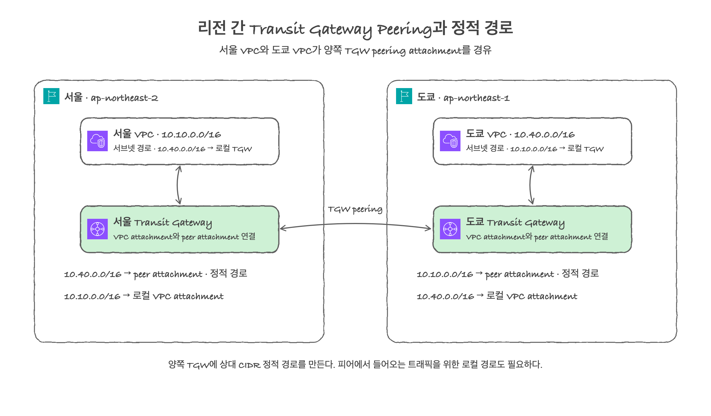

# Transit Gateway와 다중 VPC 라우팅

## 1. Transit Gateway에 VPC 세 개 연결하기

Transit Gateway(TGW)는 여러 VPC attachment의 트래픽을 전달하는 리전 단위 라우터다. VPC A(`10.10.0.0/16`), B(`10.20.0.0/16`), C(`10.30.0.0/16`)를 연결하려면 각 VPC에서 사용할 가용 영역마다 attachment 서브넷 하나를 지정한다. TGW를 사용하는 워크로드의 가용 영역에 해당 VPC의 attachment 서브넷이 있어야 한다. [AWS Transit Gateway · How it works](https://docs.aws.amazon.com/vpc/latest/tgw/how-transit-gateways-work.html) · [AWS Transit Gateway · VPC attachments](https://docs.aws.amazon.com/vpc/latest/tgw/tgw-vpc-attachments.html)

TGW와 VPC의 라우팅 테이블을 둘 다 설정한 세 VPC 예시다. [AWS Transit Gateway · How it works](https://docs.aws.amazon.com/vpc/latest/tgw/how-transit-gateways-work.html) · [AWS Transit Gateway · VPC attachments](https://docs.aws.amazon.com/vpc/latest/tgw/tgw-vpc-attachments.html)

- TGW에 `rt-all` 테이블을 만든 뒤 세 attachment를 연결하고, 세 VPC CIDR의 전파를 이 테이블에서 활성화한다. 소스 attachment에 연결된 TGW 테이블에서 목적지 CIDR을 찾고, 경로가 가리키는 attachment로 패킷을 보낸다. [AWS Transit Gateway · Route tables](https://docs.aws.amazon.com/vpc/latest/tgw/tgw-route-tables.html) · [AWS Transit Gateway · Routing](https://docs.aws.amazon.com/vpc/latest/tgw/how-transit-gateways-work.html)
- 워크로드 서브넷 라우팅 테이블에도 다른 두 VPC의 CIDR을 `tgw-…` 대상으로 추가한다. 예를 들어 A에는 `10.20.0.0/16`, `10.30.0.0/16`을, C에는 `10.10.0.0/16`, `10.20.0.0/16`을 등록한다. attachment가 TGW 테이블에 전파한 경로와 VPC에 등록하는 경로는 각자 설정한다. [AWS Transit Gateway · VPC attachments](https://docs.aws.amazon.com/vpc/latest/tgw/tgw-vpc-attachments.html)
- 보안 그룹과 NACL에 테스트 트래픽과 필요한 반환 흐름을 허용한 뒤 A에서 C의 테스트 포트에 연결한다. 요청은 `A → TGW → C`, 응답은 `C → TGW → A` 경로를 따른다. 한쪽에서만 실패하면 각 VPC 라우팅 테이블과 소스 attachment별 TGW 테이블을 요청과 응답 방향으로 확인한다. [AWS Transit Gateway · How routing works](https://docs.aws.amazon.com/vpc/latest/tgw/how-transit-gateways-work.html) · [Amazon VPC · Traffic control](https://docs.aws.amazon.com/vpc/latest/userguide/infrastructure-security.html)

## 2. Association과 Propagation으로 통신 범위 제한하기

Association은 attachment에서 들어온 패킷을 조회할 TGW 라우팅 테이블을 선택한다. 각 attachment에 테이블 하나를 연결한다. Propagation은 attachment의 경로를 선택한 TGW 라우팅 테이블에 등록한다. 한 attachment의 경로는 여러 테이블에 전파할 수 있다. [AWS Transit Gateway · Route tables, association and propagation](https://docs.aws.amazon.com/vpc/latest/tgw/how-transit-gateways-work.html)

같은 Transit Gateway에서 공용 서비스 VPC C에 대한 경로를 주면서 A와 B 사이의 경로를 제한했다. [AWS Transit Gateway · Route tables, association and propagation](https://docs.aws.amazon.com/vpc/latest/tgw/how-transit-gateways-work.html) · [AWS Transit Gateway · Isolation and shared services](https://docs.aws.amazon.com/vpc/latest/tgw/how-transit-gateways-work.html#TGW_Scenarios)

- A와 B에 각각 서비스가 있고 공용 VPC C를 함께 사용하는 경우를 가정한다. A와 B의 attachment는 `rt-spoke`에 연결하고 이 테이블에는 C의 `10.30.0.0/16`만 전파한다. C의 attachment는 `rt-shared`에 연결하고 이 테이블에는 A의 `10.10.0.0/16`과 B의 `10.20.0.0/16`을 전파한다. [AWS Transit Gateway · Isolation and shared services](https://docs.aws.amazon.com/vpc/latest/tgw/how-transit-gateways-work.html#TGW_Scenarios)
- 예상 결과는 A↔C와 B↔C의 라우팅 경로가 있고 A↔B는 일치하는 경로가 없다는 것이다. 테스트 VPC 라우팅과 보안 규칙을 갖춘 뒤 이 세 연결 결과를 확인한다. C에서 A·B로 새 연결을 시작할 수 있는지는 C의 송신과 A·B의 수신 보안 정책에서 제어한다. [AWS Transit Gateway · Isolation and shared services](https://docs.aws.amazon.com/vpc/latest/tgw/how-transit-gateways-work.html#TGW_Scenarios) · [Amazon VPC · Security group rules](https://docs.aws.amazon.com/vpc/latest/userguide/security-group-rules.html)

## 3. Transit Gateway Peering에 정적 경로 추가하기

다른 리전에 있는 TGW도 peering attachment로 연결할 수 있다. 서울의 TGW와 도쿄의 TGW를 연결할 때 한쪽에서 요청하고 상대 TGW 소유자가 수락한다. TGW peering에는 양쪽 테이블에 상대 CIDR을 peering attachment로 보내는 정적 경로를 추가한다. [AWS Transit Gateway · Peering attachments](https://docs.aws.amazon.com/vpc/latest/tgw/tgw-peering.html)

리전 간 왕복에 필요한 VPC 서브넷 경로와 TGW Peering 정적 경로를 그렸다. [AWS Transit Gateway · Peering attachments](https://docs.aws.amazon.com/vpc/latest/tgw/tgw-peering.html) · [AWS Transit Gateway · VPC attachments](https://docs.aws.amazon.com/vpc/latest/tgw/tgw-vpc-attachments.html)

- 서울 워크로드 VPC의 `10.10.0.0/16`과 도쿄 워크로드 VPC의 `10.40.0.0/16`이 통신한다고 가정한다. 서울 TGW에서는 도쿄 CIDR을, 도쿄 TGW에서는 서울 CIDR을 peering attachment로 보낸다. 각 TGW에서 peering attachment를 통해 들어온 트래픽을 조회하는 테이블에는 로컬 워크로드의 attachment로 향하는 경로도 있어야 한다. [AWS Transit Gateway · Peering attachments](https://docs.aws.amazon.com/vpc/latest/tgw/tgw-peering.html) · [AWS Transit Gateway · Association and routing](https://docs.aws.amazon.com/vpc/latest/tgw/how-transit-gateways-work.html)
- 양쪽 워크로드 서브넷에서도 상대 CIDR을 각 리전의 TGW 대상으로 지정한다. 확인할 전체 경로는 `서울 VPC → 서울 TGW → peering → 도쿄 TGW → 도쿄 VPC`와 그 역방향이다. [AWS Transit Gateway · VPC attachments](https://docs.aws.amazon.com/vpc/latest/tgw/tgw-vpc-attachments.html) · [AWS Transit Gateway · Peering attachments](https://docs.aws.amazon.com/vpc/latest/tgw/tgw-peering.html)
