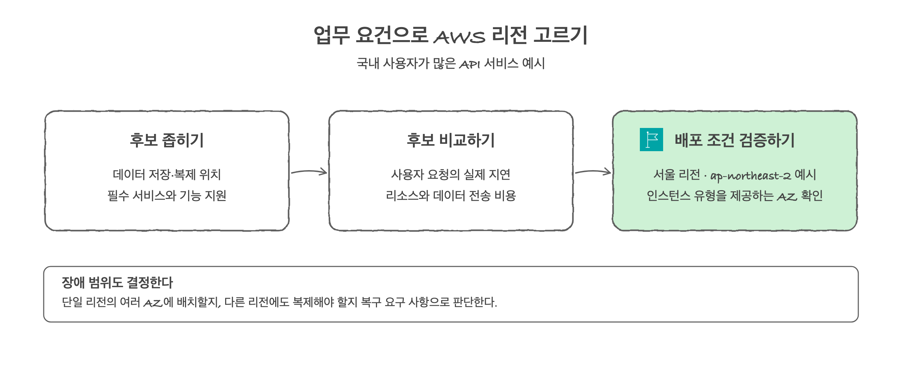

# AWS 서비스 모델과 리전 선택

## 1. AWS에서 사용할 서비스 모델 고르기

AWS에서는 컴퓨팅, 스토리지, 네트워크 같은 IT 리소스를 필요할 때 프로비저닝할 수 있다. 인프라형 서비스(IaaS)는 운영체제와 애플리케이션을 직접 구성할 수 있는 AWS 리소스를 제공하고, 플랫폼형 서비스(PaaS)는 기반 인프라 관리 부담을 줄여 애플리케이션 배포와 운영에 집중할 수 있게 한다. 소프트웨어형 서비스(SaaS)는 공급자가 운영하는 완성된 애플리케이션을 제공한다. [AWS · 클라우드 컴퓨팅의 유형](https://aws.amazon.com/what-is-cloud-computing/)

예를 들어 OS 패키지나 커널 설정을 직접 제어해야 하는 API는 Amazon EC2에서 구동할 수 있다. 첨부 파일을 저장하고 읽는 기능에는 Amazon S3의 API를 사용할 수 있다. 각 구성 요소의 요구 사항에 맞춰 서비스 모델을 고르면 팀이 운영할 범위를 줄일 수 있다. [AWS Well-Architected · 공동 책임 모델](https://docs.aws.amazon.com/wellarchitected/latest/framework/shared-responsibility.html)

## 2. 서비스별 공동 책임 범위 확인하기

AWS는 데이터 센터 시설, 물리 장비, 기반 네트워크와 가상화 계층을 운영한다. EC2를 쓰는 고객은 게스트 OS의 보안 패치, 앱 구성과 업데이트, 보안 그룹 규칙을 관리한다. S3에서는 AWS가 기반 인프라와 운영체제, 플랫폼을 운영하며, 고객은 데이터 분류, 암호화 설정, 백업·버전 관리와 접근 권한을 관리한다. [AWS Well-Architected · 공동 책임 모델](https://docs.aws.amazon.com/wellarchitected/latest/framework/shared-responsibility.html)

API 서버와 파일 저장소를 함께 운영한다면 EC2의 패치 담당자와 적용 주기를 정하고, S3에서는 버킷 정책과 애플리케이션의 IAM 권한을 검토한다. 같은 데이터라도 어떤 서비스에 두는지에 따라 팀이 점검할 항목이 달라진다. [AWS Well-Architected · 공동 책임 모델](https://docs.aws.amazon.com/wellarchitected/latest/framework/shared-responsibility.html)

## 3. 지연, 데이터 요건, 서비스 지원과 비용으로 리전 고르기

리전은 AWS가 리소스를 배치하는 지리적 영역이며, 리전마다 사용 가능한 서비스와 기능이 다를 수 있다. 후보를 비교할 때 데이터 저장·복제 위치 요건과 필수 서비스 지원 여부를 먼저 확인한다. 요건을 충족하는 후보에서 주요 사용자의 요청 지연을 측정하고, 리소스 및 데이터 전송 비용을 함께 비교한다. 여러 AZ에 배치하는 목적과 리전 간 복제가 필요한 목적도 구분한다. [AWS 글로벌 인프라 · AWS 리전](https://docs.aws.amazon.com/global-infrastructure/latest/regions/aws-regions.html) · [AWS Well-Architected · 네트워크 요건에 따른 배치](https://docs.aws.amazon.com/wellarchitected/latest/framework/perf04-bp06.html) · [AWS Well-Architected · 리전별 비용 비교](https://docs.aws.amazon.com/wellarchitected/latest/framework/cost07-bp02.html) · [AWS 네트워킹 기초](04_understanding_aws_networking_fundamentals.md)



리전 선정에 사용할 조건과 배포 전 검증 순서를 나타냈다. [AWS 글로벌 인프라 · AWS 리전](https://docs.aws.amazon.com/global-infrastructure/latest/regions/aws-regions.html) · [AWS Well-Architected · 네트워크 요건에 따른 배치](https://docs.aws.amazon.com/wellarchitected/latest/framework/perf04-bp06.html) · [AWS Well-Architected · 리전별 비용 비교](https://docs.aws.amazon.com/wellarchitected/latest/framework/cost07-bp02.html)

예를 들어 국내 사용자가 많고 국내에 데이터를 저장해야 한다면 서울 리전(`ap-northeast-2`)에서 필요한 기능과 인스턴스 유형의 제공 여부부터 확인한다. 아래 읽기 전용 명령은 `t3.micro`가 제공되는 서울 리전의 AZ ID를 조회한다. 출력은 해당 위치의 유형 제공 여부를 보여 준다. 배포 시점의 용량 확보 여부는 실제 시작 또는 용량 예약으로 확인한다. [AWS 글로벌 인프라 · AWS 리전 목록](https://docs.aws.amazon.com/global-infrastructure/latest/regions/aws-regions.html) · [AWS CLI v2 · describe-instance-type-offerings](https://docs.aws.amazon.com/cli/latest/reference/ec2/describe-instance-type-offerings.html) · [Amazon EC2 · 용량 부족 오류](https://docs.aws.amazon.com/AWSEC2/latest/UserGuide/troubleshooting-launch.html#troubleshooting-launch-capacity)

```bash
aws ec2 describe-instance-type-offerings \
  --region ap-northeast-2 \
  --location-type availability-zone-id \
  --filters Name=instance-type,Values=t3.micro \
  --query 'InstanceTypeOfferings[].Location' \
  --output json
```
