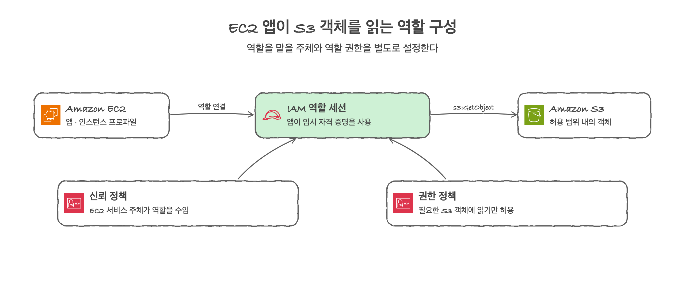
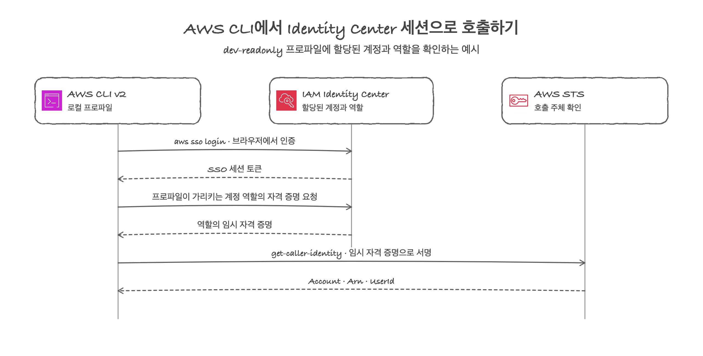

# AWS IAM으로 사용자와 워크로드의 접근 관리하기

## 1. IAM 사용자, 그룹, 정책과 Identity Center 구분하기

IAM 사용자는 AWS 계정 내의 개별 자격 증명이며 콘솔 암호나 장기 액세스 키를 가질 수 있다. IAM 그룹은 여러 IAM 사용자에게 공통 권한을 부여하는 단위다. IAM 정책은 `Action`, `Resource`, `Effect` 및 필요에 따라 `Condition`을 사용해 요청의 허용 또는 거부 조건을 정의한다. 권한은 기본적으로 거부되며, 적용되는 정책에 명시적인 거부가 있으면 허용보다 우선한다. [AWS IAM · 사용자 그룹](https://docs.aws.amazon.com/IAM/latest/UserGuide/id_groups.html) · [AWS IAM · 정책과 권한](https://docs.aws.amazon.com/IAM/latest/UserGuide/access_policies.html)

팀원이 여러 AWS 계정에 접근한다면 IAM Identity Center의 연동 로그인을 사용한다. 예를 들어 개발자 그룹에 개발 계정의 `DevReadOnly` 권한 세트(permission set)를 할당하면, Identity Center가 그 계정에 해당 역할과 정책을 구성한다. 팀원은 조직의 로그인 절차를 거쳐 권한이 부여된 역할의 임시 세션으로 접근한다. [AWS IAM · 보안 모범 사례](https://docs.aws.amazon.com/IAM/latest/UserGuide/best-practices.html#bp-users-federation-idp) · [IAM Identity Center · 권한 세트](https://docs.aws.amazon.com/singlesignon/latest/userguide/permissionsetsconcept.html)

## 2. IAM 역할의 신뢰 정책과 권한 정책 나누기

역할을 수임(assume)하면 역할 세션에 사용할 임시 자격 증명을 얻는다. 역할의 신뢰 정책은 어떤 사용자·역할·서비스가 어떤 조건에서 수임할 수 있는지 정한다. 역할에 연결한 권한 정책은 수임한 세션이 요청할 수 있는 작업과 리소스를 정한다. 다른 계정의 역할에 접근하는 일반적인 구성에서는 대상 역할의 신뢰 정책과 호출자 측의 `sts:AssumeRole` 허용이 모두 필요하다. [AWS IAM · 역할과 위임](https://docs.aws.amazon.com/IAM/latest/UserGuide/id_roles.html#id_roles_terms-and-concepts)



인스턴스 프로파일로 연결한 역할에 신뢰 정책과 권한 정책이 적용되는 예시다. [AWS IAM · 역할과 위임](https://docs.aws.amazon.com/IAM/latest/UserGuide/id_roles.html#id_roles_terms-and-concepts) · [Amazon EC2 · IAM 역할과 인스턴스 프로파일](https://docs.aws.amazon.com/AWSEC2/latest/UserGuide/iam-roles-for-amazon-ec2.html) · [Amazon EC2 · 역할 연결과 신뢰 정책](https://docs.aws.amazon.com/AWSEC2/latest/UserGuide/attach-iam-role.html)

EC2에서 S3 객체를 읽는 앱의 역할을 예로 들면, 신뢰 정책에는 EC2 서비스 주체(`ec2.amazonaws.com`)를 지정하고 권한 정책에는 필요한 객체 경로의 `s3:GetObject`를 허용한다. 인스턴스 프로파일로 역할을 EC2에 연결하면 앱은 AWS SDK를 통해 해당 역할의 임시 자격 증명을 사용할 수 있다. [Amazon EC2 · IAM 역할과 인스턴스 프로파일](https://docs.aws.amazon.com/AWSEC2/latest/UserGuide/iam-roles-for-amazon-ec2.html) · [Amazon EC2 · 역할 연결과 신뢰 정책](https://docs.aws.amazon.com/AWSEC2/latest/UserGuide/attach-iam-role.html) · [Amazon S3 · 작업과 리소스 유형](https://docs.aws.amazon.com/service-authorization/latest/reference/list_s3.html)

## 3. MFA와 최소 권한 적용하기

AWS 계정의 루트 사용자는 루트가 필요한 작업에만 사용하고 MFA를 설정한다. 별도의 IAM 사용자가 필요하면 해당 사용자에도 MFA를 설정한다. Identity Center 로그인은 연결된 자격 증명 공급자에 맞춰 MFA를 구성한다. 사용 가능한 환경에서는 패스키나 보안 키처럼 피싱에 강한 MFA를 사용한다. [AWS IAM · 보안 모범 사례](https://docs.aws.amazon.com/IAM/latest/UserGuide/best-practices.html) · [IAM Identity Center · MFA 설정](https://docs.aws.amazon.com/singlesignon/latest/userguide/enable-mfa.html)

사람은 연동 로그인으로, 워크로드는 역할로 임시 자격 증명을 받도록 구성한다. 역할이나 권한 세트에는 업무에 필요한 작업과 리소스만 허용한다. 개발 계정에서 필요한 요청이 성공하고 불필요한 요청은 거부되는지 확인하고, IAM Access Analyzer의 정책 검증과 사용 기록을 활용해 미사용 권한과 자격 증명을 정리한다. [AWS IAM · 보안 모범 사례](https://docs.aws.amazon.com/IAM/latest/UserGuide/best-practices.html)

## 4. AWS CLI v2 프로파일로 호출 주체 확인하기

AWS CLI v2의 프로파일은 계정·역할을 고르는 인증 설정과 기본 리전 등의 구성을 이름으로 선택하는 방법이다. IAM Identity Center 사용자는 관리자가 할당한 계정과 역할에 맞춰 SSO 프로파일을 만든다. `aws configure sso`에서 SSO 세션 이름, 조직의 시작 URL, Identity Center 리전, 계정과 역할을 선택한다. CLI에서 API를 호출할 기본 리전은 이 로그인 서비스의 리전과 별도로 지정할 수 있다. [AWS CLI v2 · IAM Identity Center 인증 구성](https://docs.aws.amazon.com/cli/latest/userguide/cli-configure-sso.html) · [AWS CLI v2 · 프로파일과 설정 파일](https://docs.aws.amazon.com/cli/latest/userguide/cli-configure-files.html)



SSO 로그인과 임시 자격 증명 발급, STS 호출 주체 확인의 순서다. [AWS CLI v2 · IAM Identity Center 인증 구성](https://docs.aws.amazon.com/cli/latest/userguide/cli-configure-sso.html) · [AWS CLI v2 · get-caller-identity](https://docs.aws.amazon.com/cli/latest/reference/sts/get-caller-identity.html) · [AWS CLI v2 · 프로파일과 설정 파일](https://docs.aws.amazon.com/cli/latest/userguide/cli-configure-files.html)

아래의 `dev-readonly`는 프로파일 이름이다. `aws sso login`으로 로그인한 뒤 `get-caller-identity`의 `Account`와 `Arn`이 예상한 계정과 역할 세션을 가리키는지 확인한다. 이 조회는 현재 호출 주체를 알려 주므로 서비스 작업별 권한은 해당 API 요청으로 별도 검증한다. 작업을 마치면 `aws sso logout`으로 로컬에 캐시된 모든 SSO 프로파일의 토큰과 자격 증명을 지울 수 있다. [AWS CLI v2 · IAM Identity Center 인증 구성](https://docs.aws.amazon.com/cli/latest/userguide/cli-configure-sso.html) · [AWS CLI v2 · get-caller-identity](https://docs.aws.amazon.com/cli/latest/reference/sts/get-caller-identity.html) · [AWS CLI v2 · sso logout](https://docs.aws.amazon.com/cli/latest/reference/sso/logout.html)

```bash
aws --version
aws configure sso
aws sso login --profile dev-readonly
aws sts get-caller-identity --profile dev-readonly --output json
# 이 기기에서 모든 SSO 프로파일의 캐시를 지울 때
aws sso logout
```

## 5. AWS CloudShell에서 콘솔 권한으로 명령 실행하기

AWS CloudShell은 관리 콘솔에서 여는 브라우저 셸이다. 셸에 AWS CLI v2가 설치되어 있고, 새 셸 세션에서 콘솔 로그인에 사용한 AWS 자격 증명을 사용할 수 있다. CloudShell을 연 뒤 `aws sts get-caller-identity`로 계정과 역할을 확인한다. 리전 리소스를 조회하는 명령에는 대상 `--region`을 명시하면 작업 대상을 확인하기 쉽다. [AWS CloudShell · AWS CLI와 인증](https://docs.aws.amazon.com/cloudshell/latest/userguide/welcome.html) · [AWS CLI v2 · get-caller-identity](https://docs.aws.amazon.com/cli/latest/reference/sts/get-caller-identity.html)
