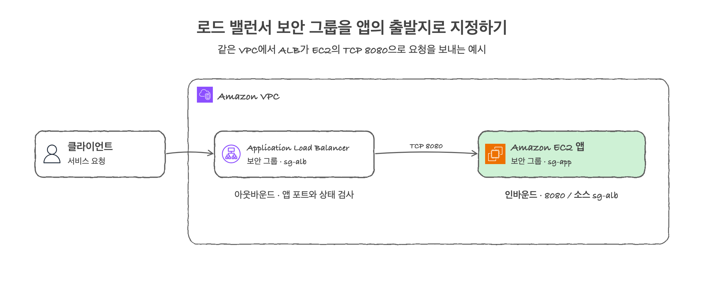
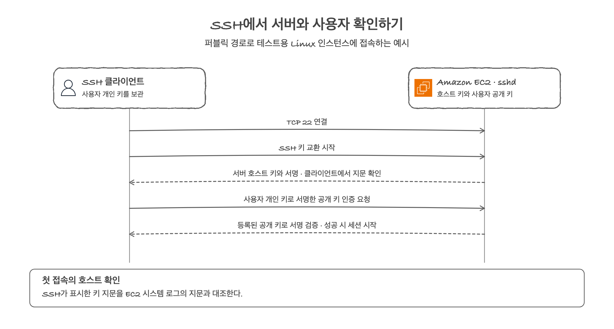

# EC2 인스턴스 시작과 접속

## 1. AMI, 인스턴스 유형과 스토리지 이해하기

Amazon EC2는 필요에 따라 시작할 수 있는 가상 서버를 제공한다. 인스턴스를 시작할 때 AMI(Amazon Machine Image)로 운영체제와 초기 소프트웨어를 선택하고, 인스턴스 유형으로 CPU·메모리·네트워크 등 하드웨어 구성을 정한다. AMI의 CPU 아키텍처와 인스턴스 유형은 호환되어야 한다. [Amazon EC2 · 개요와 기능](https://docs.aws.amazon.com/AWSEC2/latest/UserGuide/concepts.html) · [Amazon EC2 · 시작 구성 매개변수](https://docs.aws.amazon.com/AWSEC2/latest/UserGuide/ec2-instance-launch-parameters.html)

EBS(Amazon Elastic Block Store) 볼륨은 인스턴스에 연결하는 영구 블록 스토리지다. 인스턴스를 중지해도 데이터가 남으며, 종료 시 삭제 여부는 볼륨의 `DeleteOnTermination` 설정으로 결정된다. 인스턴스 스토어는 호스트에 연결된 임시 스토리지로, 중지나 종료 후에도 보관할 데이터는 EBS나 S3 등 영구 저장소에 둔다. [Amazon EC2 · 개요와 기능](https://docs.aws.amazon.com/AWSEC2/latest/UserGuide/concepts.html) · [Amazon EC2 · 종료 시 EBS 볼륨 보존](https://docs.aws.amazon.com/AWSEC2/latest/UserGuide/preserving-volumes-on-termination.html)

## 2. 콘솔에서 Linux 인스턴스 시작하기

예제는 테스트 계정에서 Amazon Linux 2023 x86_64 AMI와 호환되는 유형(예: `t3.micro`)으로 온디맨드 인스턴스 한 대를 시작한다. EC2 콘솔의 대상 리전을 선택하고 **인스턴스 시작**에서 인스턴스 이름, AMI, 유형, 로그인에 사용할 키 페어를 고른다. 새 키 페어를 만든 경우 내려받은 개인 키를 보관한다. Linux 인스턴스는 처음 부팅할 때 선택한 공개 키를 기본 사용자의 `~/.ssh/authorized_keys`에 추가한다. [Amazon EC2 · 콘솔 시작 마법사](https://docs.aws.amazon.com/AWSEC2/latest/UserGuide/ec2-launch-instance-wizard.html) · [Amazon EC2 · 키 페어](https://docs.aws.amazon.com/AWSEC2/latest/UserGuide/ec2-key-pairs.html)

인터넷에서 직접 SSH하는 이 예제에서는 인터넷 게이트웨이 경로가 있는 테스트 서브넷과 퍼블릭 IPv4 자동 할당을 선택하고, 테스트용 보안 그룹의 TCP 22 인바운드는 접속자의 현재 공인 IPv4 한 개(`/32`)에만 허용한다. 스토리지에는 테스트용 EBS 루트 볼륨을 설정하고, 실습 종료 후 지울 볼륨에 `DeleteOnTermination`이 켜져 있는지 확인한다. [Amazon EC2 · 콘솔 시작 마법사](https://docs.aws.amazon.com/AWSEC2/latest/UserGuide/ec2-launch-instance-wizard.html) · [Amazon VPC · 인터넷 게이트웨이](https://docs.aws.amazon.com/vpc/latest/userguide/VPC_Internet_Gateway.html#vpc-igw-internet-access) · [Amazon EC2 · 종료 시 EBS 볼륨 보존](https://docs.aws.amazon.com/AWSEC2/latest/UserGuide/preserving-volumes-on-termination.html)

시작 후 콘솔에서 인스턴스가 `running` 상태인지, 상태 검사를 통과했는지 확인하고 퍼블릭 DNS 이름을 기록한다. 접속을 확인한 뒤 테스트 인스턴스를 종료하고 `terminated` 전환을 확인한다. 이후 남은 EBS 볼륨을 점검하고 이 예제에서만 만든 보안 그룹과 키 페어를 정리한다. [Amazon EC2 · 콘솔 시작 마법사](https://docs.aws.amazon.com/AWSEC2/latest/UserGuide/ec2-launch-instance-wizard.html) · [Amazon EC2 · SSH 연결 전제 조건](https://docs.aws.amazon.com/AWSEC2/latest/UserGuide/connect-linux-inst-ssh.html#ssh-prereqs-linux-from-linux-macos) · [Amazon EC2 · 인스턴스 종료](https://docs.aws.amazon.com/AWSEC2/latest/UserGuide/terminating-instances.html)

## 3. 보안 그룹으로 접속 출발지 좁히기

보안 그룹은 인스턴스의 네트워크 인터페이스에서 인바운드와 아웃바운드 허용 규칙을 적용한다. 상태를 추적하므로 허용된 연결의 응답 트래픽은 반대 방향에 별도 규칙을 추가하지 않아도 통과한다. 여러 보안 그룹을 연결하면 각 그룹의 허용 규칙을 합쳐 적용한다. 서브넷 단위 네트워크 ACL의 평가 방식은 [VPC, 서브넷과 라우팅](05_configuring_vpcs_subnets_and_routes.md)에서 이어서 설명한다. [Amazon VPC · 보안 그룹 규칙](https://docs.aws.amazon.com/vpc/latest/userguide/security-group-rules.html) · [Amazon EC2 · 보안 그룹](https://docs.aws.amazon.com/AWSEC2/latest/UserGuide/ec2-security-groups.html)



앱의 인바운드 규칙에서 로드 밸런서 보안 그룹을 참조한다. [Elastic Load Balancing · Application Load Balancer 보안 그룹](https://docs.aws.amazon.com/elasticloadbalancing/latest/application/load-balancer-update-security-groups.html) · [Amazon VPC · 보안 그룹 참조](https://docs.aws.amazon.com/vpc/latest/userguide/security-group-rules.html#security-group-referencing) · [Amazon VPC · 보안 그룹 규칙](https://docs.aws.amazon.com/vpc/latest/userguide/security-group-rules.html)

같은 VPC에서 로드 밸런서가 앱 인스턴스의 TCP 8080으로 요청을 보내는 예에서는, 앱 인스턴스의 보안 그룹에 `TCP 8080 / 소스: 로드 밸런서 보안 그룹`을 추가한다. 로드 밸런서의 보안 그룹에는 앱 대상으로 나가는 트래픽과 상태 검사에 필요한 아웃바운드를 허용한다. 앱으로 들어오는 다른 허용 규칙이 없는 상태에서 로드 밸런서를 통한 요청이 성공하는지, 일반 클라이언트의 앱 직접 요청이 차단되는지 확인한다. [Elastic Load Balancing · Application Load Balancer 보안 그룹](https://docs.aws.amazon.com/elasticloadbalancing/latest/application/load-balancer-update-security-groups.html) · [Amazon VPC · 보안 그룹 참조](https://docs.aws.amazon.com/vpc/latest/userguide/security-group-rules.html#security-group-referencing)

## 4. SSH 호스트 검증과 공개 키 로그인

SSH 클라이언트는 서버에 TCP 연결을 맺고 키 교환으로 암호화에 사용할 세션 키를 협상한다. 이 과정에서 서버의 호스트 키를 확인한다. 이후 공개 키 인증에서는 클라이언트가 개인 키로 인증 요청에 서명하고, 서버가 로그인 계정에 등록된 공개 키로 서명을 검증한다. 서명에 사용한 개인 키는 클라이언트에 보관한다. [RFC 4251 · SSH 아키텍처](https://www.rfc-editor.org/rfc/rfc4251.html#section-4) · [RFC 4252 · 공개 키 인증](https://www.rfc-editor.org/rfc/rfc4252.html#section-7)



서버 호스트 키 확인과 사용자 공개 키 인증이 일어나는 순서를 단순화했다. [RFC 4251 · SSH 아키텍처](https://www.rfc-editor.org/rfc/rfc4251.html#section-4) · [RFC 4252 · 공개 키 인증](https://www.rfc-editor.org/rfc/rfc4252.html#section-7) · [Amazon EC2 · SSH 클라이언트 연결](https://docs.aws.amazon.com/AWSEC2/latest/UserGuide/connect-linux-inst-ssh.html)

아래 명령에서 `EC2_PUBLIC_DNS`에는 시작한 인스턴스의 주소를 넣는다. Amazon Linux의 기본 로그인 사용자는 `ec2-user`다. 첫 접속에서는 콘솔의 시스템 로그에서 확인한 호스트 키 지문과 SSH가 표시한 지문을 대조한 뒤 연결을 승인한다. 접속에 실패하면 상태 검사, 주소와 경로, 보안 그룹의 TCP 22 소스, 로그인 이름과 키 페어를 차례로 확인한다. [Amazon EC2 · SSH 클라이언트 연결](https://docs.aws.amazon.com/AWSEC2/latest/UserGuide/connect-linux-inst-ssh.html) · [Amazon EC2 · 인스턴스 키 지문 확인](https://docs.aws.amazon.com/AWSEC2/latest/UserGuide/connection-prereqs-general.html#connection-prereqs-fingerprint) · [Amazon VPC · 인터넷 게이트웨이](https://docs.aws.amazon.com/vpc/latest/userguide/VPC_Internet_Gateway.html#vpc-igw-internet-access)

```bash
EC2_PUBLIC_DNS='<인스턴스의 퍼블릭 DNS 이름>'
chmod 400 ./ec2-lab.pem
ssh -i ./ec2-lab.pem "ec2-user@$EC2_PUBLIC_DNS"
```

프라이빗 인스턴스에는 대상 네트워크로 연결된 관리 경로를 사용한다. Systems Manager Session Manager를 구성하면 IAM으로 접근을 제어하면서 인바운드 SSH 포트 없이 관리 세션을 열 수 있다. [AWS Systems Manager · Session Manager](https://docs.aws.amazon.com/systems-manager/latest/userguide/session-manager.html)

## 5. 사용 패턴과 용량 요건에 맞춰 구매 옵션 선택하기

온디맨드는 장기 약정 없이 시작한 인스턴스 사용량에 따라 지불한다. 사용량이 일정하면 Savings Plans의 시간당 사용 금액 약정이나 Reserved Instances의 인스턴스 구성 약정으로 할인받을 수 있다. Reserved Instances는 범위에 따라 동작이 달라지며, AZ 범위의 Reserved Instances는 해당 AZ의 용량 예약도 포함한다. [Amazon EC2 · 구매 옵션](https://docs.aws.amazon.com/AWSEC2/latest/UserGuide/instance-purchasing-options.html) · [Amazon EC2 · Reserved Instances 적용 범위](https://docs.aws.amazon.com/AWSEC2/latest/UserGuide/reserved-instances-scope.html)

Spot은 AWS의 여유 용량을 할인된 요금으로 쓰는 옵션이며 중단 후 다시 실행할 수 있는 배치 등에 적합하다. 지정한 AZ의 용량이 필요하면 온디맨드 Capacity Reservation을 검토한다. 물리 호스트가 필요한 라이선스나 전용 하드웨어 요건은 Dedicated Hosts와 Dedicated Instances의 세부 조건을 비교한다. [Amazon EC2 · 구매 옵션](https://docs.aws.amazon.com/AWSEC2/latest/UserGuide/instance-purchasing-options.html) · [Amazon EC2 · Spot 모범 사례](https://docs.aws.amazon.com/AWSEC2/latest/UserGuide/spot-best-practices.html)

요청량이 일정한 API와 재시도 가능한 배치가 함께 있다면, API의 지속 사용량을 측정해 약정 규모를 정하고 배치는 Spot 중단을 견딜 수 있는 범위에서 사용한다. 예산에는 인스턴스 사용료와 함께 EBS, 퍼블릭 IPv4, 데이터 전송도 포함한다. [AWS Well-Architected · 요금 모델 선택](https://docs.aws.amazon.com/wellarchitected/latest/framework/cost07.html) · [AWS · EC2 요금](https://aws.amazon.com/ec2/pricing/) · [AWS · EBS 요금](https://aws.amazon.com/ebs/pricing/) · [AWS · VPC 요금](https://aws.amazon.com/vpc/pricing/)
