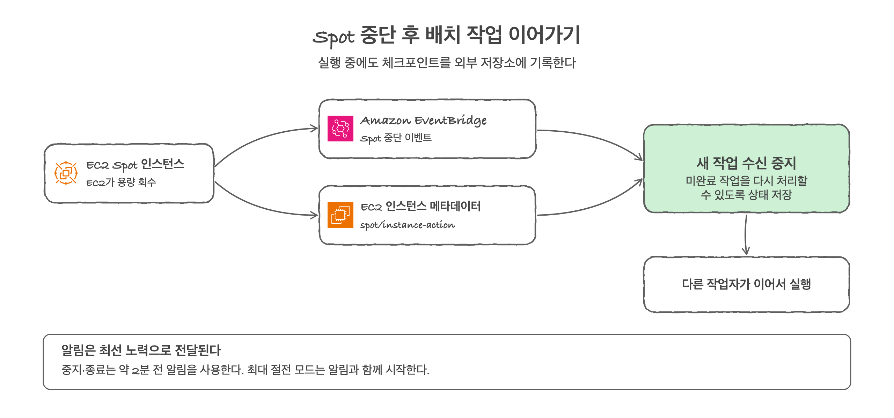
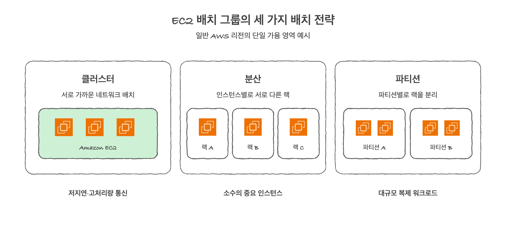
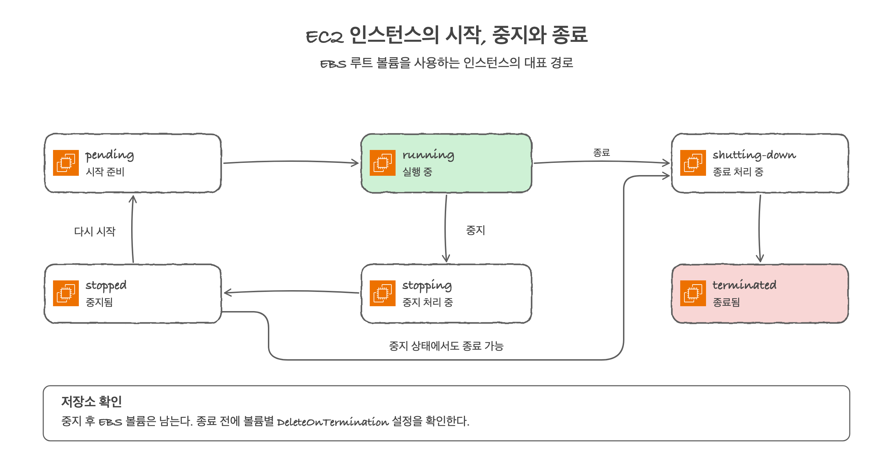

# EC2 인스턴스 운영과 수명 주기

## 1. Spot 중단 신호를 감지하고 작업 이어가기

EC2는 필요에 따라 Spot 용량을 회수한다. 중단 동작이 중지 또는 종료이면 EC2는 약 2분 전에 중단 알림을 보낸다. 최대 절전 모드(hibernate)는 알림과 함께 즉시 시작된다. 알림은 최선 노력 방식으로 전달되며, Amazon EventBridge의 `EC2 Spot Instance Interruption Warning` 이벤트와 인스턴스 메타데이터의 `spot/instance-action`에서 확인할 수 있다. [Amazon EC2 · Spot 중단](https://docs.aws.amazon.com/AWSEC2/latest/UserGuide/spot-interruptions.html) · [Amazon EC2 · Spot 중단 알림](https://docs.aws.amazon.com/AWSEC2/latest/UserGuide/spot-instance-termination-notices.html)



중단 신호를 감지한 작업자가 다른 작업자에게 처리를 넘기는 예시다. [Amazon EC2 · Spot 중단 알림](https://docs.aws.amazon.com/AWSEC2/latest/UserGuide/spot-instance-termination-notices.html) · [Amazon EC2 · Spot 중단](https://docs.aws.amazon.com/AWSEC2/latest/UserGuide/spot-interruptions.html) · [Amazon EC2 · Spot 모범 사례](https://docs.aws.amazon.com/AWSEC2/latest/UserGuide/spot-best-practices.html)

큐 기반 배치 작업은 진행 상태를 외부 저장소에 주기적으로 기록한다. 중단 알림을 받으면 새 작업 수신을 멈추고, 끝내지 못한 작업은 다른 인스턴스가 재시도할 수 있도록 한다. 테스트에서는 실행 중인 작업자를 중단시켜 체크포인트부터 작업이 재개되고 결과가 한 번만 반영되는지 확인한다. [Amazon EC2 · Spot 모범 사례](https://docs.aws.amazon.com/AWSEC2/latest/UserGuide/spot-best-practices.html)

EC2 Auto Scaling 그룹에서 여러 호환 인스턴스 유형과 AZ를 사용하면 요청할 수 있는 Spot 용량 풀이 늘어난다. Capacity Rebalancing을 사용하면 중단 위험이 높아졌다는 리밸런싱 권고를 받고 대체 용량의 시작을 시도할 수 있다. 권고는 중단 알림보다 일찍 올 수도 있고 동시에 올 수도 있으므로 평소에도 작업을 재시도할 수 있게 설계한다. [Amazon EC2 · Spot 모범 사례](https://docs.aws.amazon.com/AWSEC2/latest/UserGuide/spot-best-practices.html) · [Amazon EC2 · 리밸런싱 권고](https://docs.aws.amazon.com/AWSEC2/latest/UserGuide/rebalance-recommendations.html)

## 2. 사설 IPv4, 퍼블릭 IPv4와 Elastic IP 구분하기

사설 IPv4 주소는 VPC와 연결된 사설 네트워크에서 라우팅할 수 있으며, 인스턴스를 중지했다 다시 시작해도 ENI에 유지된다. EC2가 자동으로 할당한 퍼블릭 IPv4 주소는 중지할 때 반환되며, 퍼블릭 IPv4를 받도록 구성한 인스턴스를 시작하면 일반적으로 새 주소를 받는다. 인터넷 게이트웨이를 통한 직접 접속에는 퍼블릭 주소 외에도 라우팅과 보안 규칙이 필요하다. [Amazon EC2 · 인스턴스 IP 주소 지정](https://docs.aws.amazon.com/AWSEC2/latest/UserGuide/using-instance-addressing.html) · [Amazon EC2 · 중지와 시작 동작](https://docs.aws.amazon.com/AWSEC2/latest/UserGuide/how-ec2-instance-stop-start-works.html) · [Amazon VPC · 인터넷 게이트웨이](https://docs.aws.amazon.com/vpc/latest/userguide/VPC_Internet_Gateway.html#vpc-igw-internet-access)

Elastic IP는 계정에 할당한 리전 범위의 고정 퍼블릭 IPv4 주소다. ENI의 사설 IPv4 주소와 연결할 수 있고, 필요하면 같은 리전 안에서 다른 적격 리소스로 다시 연결할 수 있다. 사용 중인 퍼블릭 IPv4와 유휴 Elastic IP 모두 요금이 발생할 수 있으므로, 사용을 마친 Elastic IP는 연결을 해제하고 할당도 반환한다. [Amazon EC2 · Elastic IP](https://docs.aws.amazon.com/AWSEC2/latest/UserGuide/elastic-ip-addresses-eip.html) · [AWS · VPC 요금](https://aws.amazon.com/vpc/pricing/)

## 3. 배치 그룹으로 통신 성능과 장애 범위 조정하기

클러스터(cluster) 배치 그룹은 한 AZ의 인스턴스를 네트워크상 가깝게 배치한다. 인스턴스 간 지연과 처리량이 중요한 밀결합 연산에 사용하며, 인스턴스 유형이나 용량 때문에 시작에 실패할 수 있으므로 실제 배포 구성을 검증한다. [Amazon EC2 · 클러스터 배치 전략](https://docs.aws.amazon.com/AWSEC2/latest/UserGuide/placement-strategies.html#placement-groups-cluster)



통신 성능과 랙 장애의 영향 범위에 따라 선택하는 배치 전략을 비교했다. [Amazon EC2 · 클러스터 배치 전략](https://docs.aws.amazon.com/AWSEC2/latest/UserGuide/placement-strategies.html#placement-groups-cluster) · [Amazon EC2 · 배치 전략](https://docs.aws.amazon.com/AWSEC2/latest/UserGuide/placement-strategies.html)

분산(spread) 배치 그룹은 일반 리전의 랙 수준 구성에서 인스턴스를 서로 다른 랙에 둔다. 서로 독립적인 소수의 중요 인스턴스가 같은 랙 장애의 영향을 받는 상황을 줄이는 데 적합하다. 파티션(partition) 배치 그룹은 여러 인스턴스를 하나의 파티션에 둘 수 있으며, 서로 다른 파티션의 랙을 공유하지 않는다. 예를 들어 Cassandra처럼 복제본을 관리하는 시스템은 배치 파티션 정보를 사용해 복제본을 분산할 수 있다. [Amazon EC2 · 배치 전략](https://docs.aws.amazon.com/AWSEC2/latest/UserGuide/placement-strategies.html)

## 4. ENI 연결과 삭제 동작 확인하기

ENI(Elastic Network Interface)는 서브넷의 사설 IP, MAC 주소와 보안 그룹을 가진 EC2 가상 네트워크 인터페이스다. 기본 ENI는 분리할 수 없고, 보조 ENI는 인스턴스와 같은 AZ에서 분리해 다른 인스턴스에 연결할 수 있다. 보조 ENI를 옮기면 그 ENI의 IP 주소와 보안 그룹도 함께 이동한다. 연결 조건과 속성은 [VPC 인터페이스, DNS와 주소](06_managing_vpc_interfaces_dns_and_addresses.md)에서 이어서 설명한다. [Amazon EC2 · ENI 속성](https://docs.aws.amazon.com/AWSEC2/latest/UserGuide/using-eni.html#eni-basics) · [Amazon EC2 · ENI 연결](https://docs.aws.amazon.com/AWSEC2/latest/UserGuide/network-interface-attachments.html)

예를 들어 보조 ENI에 업무 트래픽용 사설 주소를 둔 경우, 이를 대체 인스턴스로 옮긴 뒤 새 인스턴스의 인터페이스와 애플리케이션 바인딩을 확인한다. 원본 인스턴스를 종료하기 전에 ENI 연결의 `DeleteOnTermination` 설정을 확인해 재사용할 인터페이스를 보존한다. [Amazon EC2 · ENI 속성](https://docs.aws.amazon.com/AWSEC2/latest/UserGuide/using-eni.html#eni-basics) · [Amazon EC2 · ENI 연결](https://docs.aws.amazon.com/AWSEC2/latest/UserGuide/network-interface-attachments.html)

## 5. 인스턴스 중지, 재시작과 종료 구분하기

인스턴스가 처음 시작되거나 중지 상태에서 시작되면 `pending`에서 `running`으로 바뀐다. EBS 루트 볼륨을 사용하는 인스턴스를 중지하면 `stopping`을 거쳐 `stopped`가 된다. 일반 중지와 재시작에서는 연결한 EBS 볼륨과 ENI를 유지하고 인스턴스 스토어 데이터와 메모리 상태는 잃는다. `stopped` 동안 인스턴스 사용료는 청구되지 않지만 EBS 볼륨 등 보유 중인 리소스에는 비용이 남을 수 있다. [Amazon EC2 · 인스턴스의 상태와 과금](https://docs.aws.amazon.com/AWSEC2/latest/UserGuide/ec2-instance-lifecycle.html) · [Amazon EC2 · 중지와 시작 동작](https://docs.aws.amazon.com/AWSEC2/latest/UserGuide/how-ec2-instance-stop-start-works.html)



EBS 루트 인스턴스의 대표 상태 전환과 종료 전 저장소 점검 항목을 표시했다. [Amazon EC2 · 인스턴스의 상태와 과금](https://docs.aws.amazon.com/AWSEC2/latest/UserGuide/ec2-instance-lifecycle.html) · [Amazon EC2 · 중지와 시작 동작](https://docs.aws.amazon.com/AWSEC2/latest/UserGuide/how-ec2-instance-stop-start-works.html) · [Amazon EC2 · 인스턴스 종료](https://docs.aws.amazon.com/AWSEC2/latest/UserGuide/terminating-instances.html)

종료하면 `shutting-down`을 거쳐 `terminated`가 되며 다시 시작할 수 없다. 종료 전에 보존할 데이터를 백업하고, 루트와 데이터 볼륨 각각의 `DeleteOnTermination` 설정을 확인한다. 종료 후에도 보존한 EBS 볼륨과 할당된 Elastic IP는 용도를 확인해 계속 보유하거나 정리한다. [Amazon EC2 · 인스턴스 종료](https://docs.aws.amazon.com/AWSEC2/latest/UserGuide/terminating-instances.html) · [Amazon EC2 · 종료 시 EBS 볼륨 보존](https://docs.aws.amazon.com/AWSEC2/latest/UserGuide/preserving-volumes-on-termination.html) · [Amazon EC2 · Elastic IP 요금](https://docs.aws.amazon.com/AWSEC2/latest/UserGuide/elastic-ip-addresses-eip.html)

테스트 인스턴스를 중지하기 전과 다시 시작한 뒤에 아래 조회를 실행한다. 같은 인스턴스 ID와 사설 IPv4를 확인하고, 자동으로 받은 퍼블릭 IPv4가 바뀌었는지 비교한다. `running` 상태를 확인한 뒤 상태 검사와 애플리케이션 접속도 확인한다. 테스트를 마치면 해당 인스턴스를 종료한다. [AWS CLI v2 · describe-instances](https://docs.aws.amazon.com/cli/latest/reference/ec2/describe-instances.html) · [Amazon EC2 · 중지와 시작](https://docs.aws.amazon.com/AWSEC2/latest/UserGuide/Stop_Start.html) · [Amazon EC2 · 연결 전제 조건](https://docs.aws.amazon.com/AWSEC2/latest/UserGuide/connection-prereqs-general.html)

```bash
aws ec2 describe-instances --region ap-northeast-2 \
  --instance-ids '<테스트 인스턴스 ID>' \
  --query 'Reservations[].Instances[].{Id:InstanceId,State:State.Name,Private:PrivateIpAddress,Public:PublicIpAddress}' \
  --output table
```
