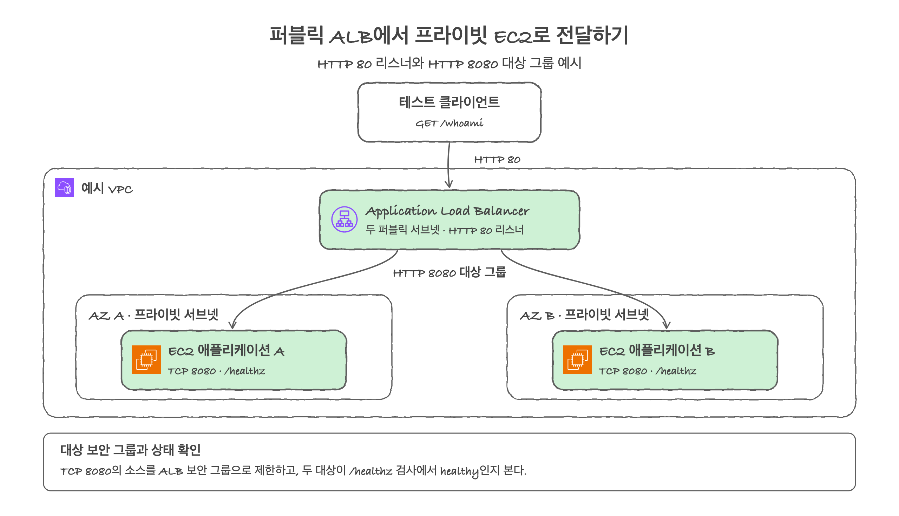
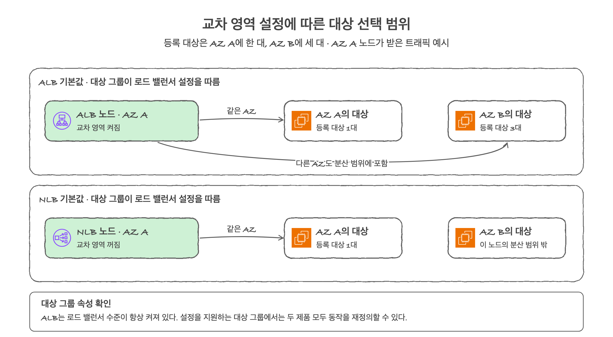
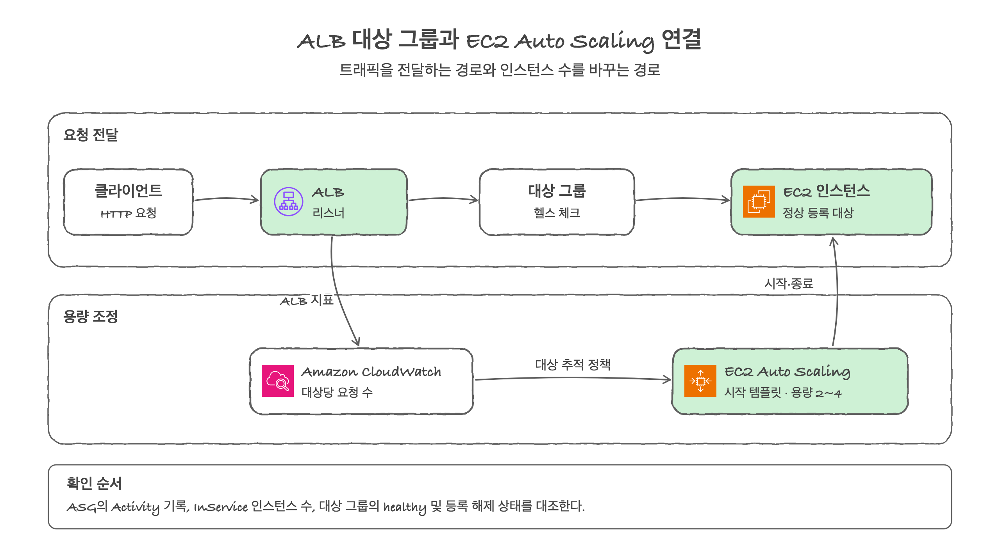

# Elastic Load Balancing과 EC2 Auto Scaling으로 트래픽 분산하기

Elastic Load Balancing(ELB)은 등록 대상에 트래픽을 분산하고 헬스 체크로 요청을 보낼 대상을 결정한다. EC2 Auto Scaling은 Auto Scaling 그룹(ASG)에 필요한 인스턴스 수를 유지한다. 웹 애플리케이션 예시에서 요청 라우팅, 장애 영역, 연결 종료, 용량 변경을 설정하고 확인한다. [Elastic Load Balancing 개요](https://docs.aws.amazon.com/elasticloadbalancing/latest/userguide/what-is-load-balancing.html) · [EC2 Auto Scaling과 ELB](https://docs.aws.amazon.com/autoscaling/ec2/userguide/autoscaling-load-balancer.html)

## 1. 트래픽에 맞는 로드 밸런서 고르기

- **Application Load Balancer(ALB)**는 HTTP/HTTPS 요청의 호스트나 경로 등에 따라 대상 그룹을 선택한다. 예를 들어 같은 ALB에서 `/api/*`는 API 대상 그룹, 기본 요청은 웹 대상 그룹으로 전달한다. 리스너가 연결을 받고 우선순위에 따라 규칙을 검사한다. [ELB 종류](https://docs.aws.amazon.com/elasticloadbalancing/latest/userguide/what-is-load-balancing.html) · [ALB 리스너 규칙](https://docs.aws.amazon.com/elasticloadbalancing/latest/application/listener-rules.html)
- **Network Load Balancer(NLB)**는 TCP·UDP 등의 연결 또는 흐름을 기준으로 분산한다. 정적 IP가 필요한 TCP 서비스에서 사용할 수 있으며, TLS 리스너를 사용하면 NLB에서 TLS를 종료할 수 있다. [NLB 개요](https://docs.aws.amazon.com/elasticloadbalancing/latest/network/introduction.html) · [NLB 리스너](https://docs.aws.amazon.com/elasticloadbalancing/latest/network/load-balancer-listeners.html)
- **Gateway Load Balancer(GWLB)**는 방화벽 같은 네트워크 가상 어플라이언스로 IP 패킷을 전달한다. **Classic Load Balancer(CLB)**는 이전 세대 로드 밸런서이며, 기존 CLB의 연결 종료 설정을 다룰 때 구분한다. [GWLB 개요](https://docs.aws.amazon.com/elasticloadbalancing/latest/gateway/introduction.html) · [CLB 개요](https://docs.aws.amazon.com/elasticloadbalancing/latest/classic/introduction.html)

## 2. 두 가용 영역에 ALB 만들고 확인하기

1. 예제 VPC의 서로 다른 두 가용 영역(AZ)에 퍼블릭 서브넷과 프라이빗 애플리케이션 서브넷을 준비한다. 각 프라이빗 서브넷의 EC2 애플리케이션은 TCP 8080에서 요청을 받고 `/healthz`에 HTTP 200을 반환한다. 검증을 위해 `/whoami` 응답에는 각 인스턴스의 식별 문자열을 넣는다. [ALB 생성 전 준비 사항](https://docs.aws.amazon.com/elasticloadbalancing/latest/application/create-application-load-balancer.html) · [ALB 대상 그룹 헬스 체크](https://docs.aws.amazon.com/elasticloadbalancing/latest/application/target-group-health-checks.html)
2. ALB 보안 그룹은 테스트 클라이언트에서 오는 80번 포트를 허용한다. EC2 보안 그룹의 8080번 인바운드 소스는 ALB 보안 그룹으로 제한하고, ALB에서 EC2의 8080번 포트로 요청과 헬스 체크를 보낼 수 있게 설정한다. [ALB 보안 그룹](https://docs.aws.amazon.com/elasticloadbalancing/latest/application/load-balancer-update-security-groups.html)
3. EC2 콘솔의 **Target Groups**에서 인스턴스 유형의 HTTP 8080 대상 그룹을 만든다. 헬스 체크 경로를 `/healthz`로 지정하고 EC2 두 대를 등록한다. **Load Balancers**에서 인터넷 연결형 ALB를 만든 뒤 두 퍼블릭 서브넷과 ALB 보안 그룹을 선택한다. HTTP 80 리스너의 기본 전달 대상으로 이 대상 그룹을 지정한다. [ALB 생성](https://docs.aws.amazon.com/elasticloadbalancing/latest/application/create-application-load-balancer.html) · [ALB 대상 그룹 헬스 체크](https://docs.aws.amazon.com/elasticloadbalancing/latest/application/target-group-health-checks.html)
4. ALB가 `active`이고 각 대상이 `healthy`인지 확인한다. 테스트 클라이언트에서 `curl -fsS "http://${ALB_DNS}/whoami"`를 반복해 응답의 식별자를 확인한다. 비정상 대상이 나오면 대상 상태의 사유 코드, 보안 그룹, 포트, `/healthz` 응답을 확인한다. [ALB 생성 후 테스트](https://docs.aws.amazon.com/elasticloadbalancing/latest/application/create-application-load-balancer.html) · [대상 상태와 사유 코드](https://docs.aws.amazon.com/elasticloadbalancing/latest/application/target-group-health-checks.html)

인터넷 연결형 ALB를 통해 두 가용 영역의 프라이빗 EC2로 요청을 전달하는 실습 구성이다. [ALB 생성 전 준비 사항](https://docs.aws.amazon.com/elasticloadbalancing/latest/application/create-application-load-balancer.html) · [ALB 보안 그룹](https://docs.aws.amazon.com/elasticloadbalancing/latest/application/load-balancer-update-security-groups.html) · [ALB 대상 그룹 헬스 체크](https://docs.aws.amazon.com/elasticloadbalancing/latest/application/target-group-health-checks.html)

## 3. 쿠키로 세션을 같은 대상에 연결하기

ALB의 대상 세션 고정(sticky sessions)은 쿠키를 사용해 같은 클라이언트의 요청을 대상 그룹 내 같은 대상으로 보낸다. 기간 기반 고정은 ALB가 만든 `AWSALB`를 쓰며, 애플리케이션 기반 고정은 지정한 애플리케이션 쿠키와 ALB가 만든 쿠키를 사용한다. 대상이 비정상 상태가 되거나 등록 해제로 드레이닝 중이면 이후 요청이 정상 대상으로 이동할 수 있으므로, 업무상 보존해야 하는 세션 데이터는 공유 저장소에 둔다. [ALB 대상 그룹 속성 · Sticky sessions](https://docs.aws.amazon.com/elasticloadbalancing/latest/application/edit-target-group-attributes.html#sticky-sessions)

두 대상이 정상 상태에서 기간 기반 고정을 켜고 `curl -fsS -c cookies.txt "http://${ALB_DNS}/whoami"`로 쿠키를 저장한다. `curl -fsS -b cookies.txt -c cookies.txt "http://${ALB_DNS}/whoami"`를 반복해 같은 식별자가 반환되는지 확인한다. 테스트 대상 하나를 등록 해제한 뒤에는 새 요청이 남은 정상 대상으로 전달되는지 확인한다. [ALB 기간 기반 세션 고정](https://docs.aws.amazon.com/elasticloadbalancing/latest/application/edit-target-group-attributes.html#sticky-sessions) · [ALB 등록 해제 지연](https://docs.aws.amazon.com/elasticloadbalancing/latest/application/edit-target-group-attributes.html#deregistration-delay)

## 4. 교차 영역 로드 밸런싱의 설정 위치 확인하기

교차 영역 로드 밸런싱을 켜면 로드 밸런서 노드가 활성화된 가용 영역의 대상으로 트래픽을 분산할 수 있다. 끄면 노드가 자기 가용 영역의 대상으로 전달한다. AZ A에 대상 한 대, AZ B에 세 대를 배치한 경우에는 설정에 따라 대상당 부하가 달라질 수 있다. [ELB 동작 · Cross-zone load balancing](https://docs.aws.amazon.com/elasticloadbalancing/latest/userguide/how-elastic-load-balancing-works.html#cross-zone-load-balancing)

ALB와 NLB의 기본 설정에서 AZ A 노드가 전달할 수 있는 대상 범위를 비교했다. [ELB 동작 · Cross-zone load balancing](https://docs.aws.amazon.com/elasticloadbalancing/latest/userguide/how-elastic-load-balancing-works.html#cross-zone-load-balancing) · [ALB 대상 그룹의 교차 영역 분산](https://docs.aws.amazon.com/elasticloadbalancing/latest/application/edit-target-group-attributes.html#modify-cross-zone) · [NLB 대상 그룹의 교차 영역 분산](https://docs.aws.amazon.com/elasticloadbalancing/latest/network/edit-target-group-attributes.html#target-group-cross-zone)

- **ALB**의 로드 밸런서 수준에서는 항상 켜져 있다. 대상 그룹은 기본적으로 이 설정을 따르며, 그룹에서 명시적으로 끌 수 있다. 교차 영역 분산이 꺼진 그룹에서는 대상 세션 고정을 사용할 수 없다. [ALB 대상 그룹의 교차 영역 분산](https://docs.aws.amazon.com/elasticloadbalancing/latest/application/edit-target-group-attributes.html#modify-cross-zone)
- **NLB**의 로드 밸런서 수준에서는 기본으로 꺼져 있다. 대상 그룹은 기본적으로 로드 밸런서 설정을 따르며, 속성 변경을 지원하는 대상 그룹은 그룹 수준의 설정으로 재정의할 수 있다. `alb` 유형의 NLB 대상 그룹은 기본 속성을 사용한다. 콘솔의 로드 밸런서 **Attributes**와 대상 그룹 **Attributes**를 각각 확인한다. [NLB 대상 그룹의 교차 영역 분산](https://docs.aws.amazon.com/elasticloadbalancing/latest/network/edit-target-group-attributes.html#target-group-cross-zone) · [NLB 대상 유형 ALB의 제약](https://docs.aws.amazon.com/elasticloadbalancing/latest/network/application-load-balancer-target.html)

## 5. ACM 인증서로 HTTPS 리스너 설정하기

서비스 도메인에 맞는 발급 완료 AWS Certificate Manager(ACM) 인증서를 ALB와 같은 리전에 준비한다. ALB에 HTTPS 443 리스너를 만들고 기본 인증서, 보안 정책, 전달할 대상 그룹을 선택한다. ALB 보안 그룹에 443을 열고, 서비스 도메인의 DNS 레코드를 ALB에 연결한다. HTTP에서 HTTPS로 전환하려면 80 리스너에 HTTPS 리다이렉트 동작을 설정한다. [ACM 개요](https://docs.aws.amazon.com/acm/latest/userguide/acm-overview.html) · [ALB HTTPS 리스너](https://docs.aws.amazon.com/elasticloadbalancing/latest/application/create-https-listener.html) · [ALB 리스너 동작](https://docs.aws.amazon.com/elasticloadbalancing/latest/application/rule-action-types.html) · [Route 53에서 ELB로 라우팅](https://docs.aws.amazon.com/Route53/latest/DeveloperGuide/routing-to-elb-load-balancer.html)

`curl -fsS "https://${APP_HOST}/whoami"`가 인증서 검증을 거쳐 응답을 받는지, 리다이렉트를 구성한 경우 `curl -sSI "http://${APP_HOST}/whoami"`의 `Location`이 기대한 HTTPS 주소인지 확인한다. 예제의 HTTP 8080 대상 그룹을 그대로 쓰면 TLS는 ALB에서 종료된다. 백엔드 구간도 TLS로 보호하려면 대상의 HTTPS 설정과 대상 그룹 프로토콜을 함께 구성한다. [ALB HTTPS 리스너](https://docs.aws.amazon.com/elasticloadbalancing/latest/application/create-https-listener.html) · [ALB 대상 그룹 프로토콜](https://docs.aws.amazon.com/elasticloadbalancing/latest/application/load-balancer-target-groups.html)

## 6. 등록 해제 중 처리하던 요청 마치기

ALB에서는 대상 그룹의 `deregistration_delay.timeout_seconds`로 등록 해제 지연을 설정한다. 기본값은 300초다. 등록 해제를 시작하면 ALB는 해당 대상으로 새 요청을 보내지 않고, 대상은 `draining`을 거쳐 `unused`가 된다. 대상이 지연 만료 전에 연결을 닫으면 클라이언트가 500번대 응답을 받을 수 있다. CLB에서는 로드 밸런서의 **Connection Draining** 기능으로 등록 해제 중이거나 비정상인 인스턴스로 새 요청을 보내지 않고 진행 중인 요청을 처리할 시간을 준다. [ALB 등록 해제 지연](https://docs.aws.amazon.com/elasticloadbalancing/latest/application/edit-target-group-attributes.html#deregistration-delay) · [CLB Connection Draining](https://docs.aws.amazon.com/elasticloadbalancing/latest/classic/config-conn-drain.html)

실습에서는 정상 대상 두 대 중 한 대가 처리 중인 느린 테스트 요청을 만든 뒤 해당 대상을 등록 해제한다. 새 요청이 남은 대상으로 가는지, 지연 설정 내에 기존 요청이 완료되는지, 최종 상태가 `unused`인지 확인한다. 배포 때에는 애플리케이션 종료 유예를 함께 조정한다. [ALB 등록 해제 지연](https://docs.aws.amazon.com/elasticloadbalancing/latest/application/edit-target-group-attributes.html#deregistration-delay)

## 7. EC2 Auto Scaling 그룹과 대상 그룹 연결하기

애플리케이션이 포함된 시작 템플릿으로 ASG를 만들고 두 프라이빗 서브넷, 최소·희망 용량 2, 최대 용량 4를 예시로 설정한다. 앞에서 만든 대상 그룹을 연결하면 ASG가 인스턴스의 대상 등록과 해제를 관리한다. ELB 헬스 체크를 ASG에 추가해 비정상 대상을 교체하도록 하고, 시작할 때 필요한 시간을 고려해 헬스 체크 유예 기간을 설정한다. 앞에서 수동 등록한 인스턴스가 남아 있다면 새 ASG 대상이 `healthy`가 된 뒤 해당 수동 대상을 등록 해제한다. [ASG와 ELB 연결](https://docs.aws.amazon.com/autoscaling/ec2/userguide/autoscaling-load-balancer.html) · [ASG 헬스 체크 유예 기간](https://docs.aws.amazon.com/autoscaling/ec2/userguide/health-check-grace-period.html)

ALB는 등록된 대상에 요청을 분산하고, ASG는 대상 추적 정책에 따라 EC2 용량을 조정한다. [ASG와 ELB 연결](https://docs.aws.amazon.com/autoscaling/ec2/userguide/autoscaling-load-balancer.html) · [ASG 헬스 체크 유예 기간](https://docs.aws.amazon.com/autoscaling/ec2/userguide/health-check-grace-period.html) · [ASG 대상 추적 정책](https://docs.aws.amazon.com/autoscaling/ec2/userguide/as-scaling-target-tracking.html)

대상당 요청 수 `ALBRequestCountPerTarget`로 대상 추적 정책을 구성할 수 있다. 격리된 실습에서 부하를 늘리고 ASG의 **Activity** 기록, 인스턴스 `InService` 상태, 대상 그룹의 `healthy` 수를 대조한다. 부하를 줄인 뒤에는 용량 감소 이력과 대상의 등록 해제를 관찰한다. 실습 종료 후 실습용 ASG, ALB, 대상 그룹과 수동 EC2를 정리한다. [ASG 대상 추적 정책](https://docs.aws.amazon.com/autoscaling/ec2/userguide/as-scaling-target-tracking.html) · [ASG 삭제](https://docs.aws.amazon.com/autoscaling/ec2/userguide/as-process-shutdown.html) · [ALB 삭제](https://docs.aws.amazon.com/elasticloadbalancing/latest/APIReference/API_DeleteLoadBalancer.html) · [대상 그룹 삭제](https://docs.aws.amazon.com/elasticloadbalancing/latest/application/delete-target-group.html)
