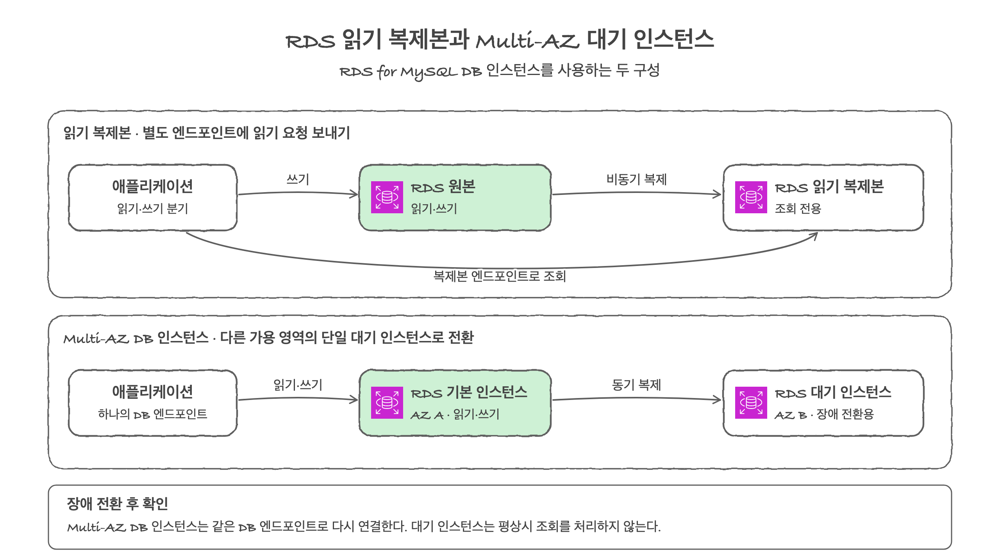
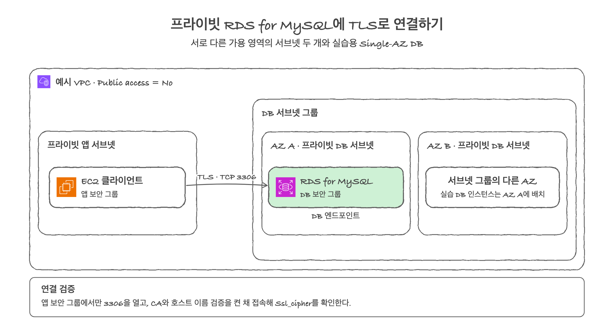

# Amazon RDS에서 관계형 데이터베이스 운영하기

Amazon RDS는 관계형 데이터베이스의 인프라와 백업, 소프트웨어 패치 같은 관리 작업을 제공한다. 애플리케이션 팀은 엔진과 버전, 용량, 접근 경로, DB 계정, 스키마와 쿼리를 설계한다. 여기서는 Amazon RDS for MySQL DB 인스턴스를 기준으로 가용성 구성을 비교하고 비공개 데이터베이스에 접속한다. [Amazon RDS 개요](https://docs.aws.amazon.com/AmazonRDS/latest/UserGuide/Welcome.html) · [RDS DB 인스턴스 생성](https://docs.aws.amazon.com/AmazonRDS/latest/UserGuide/USER_CreateDBInstance.html)

## 1. DB 인스턴스와 접속에 필요한 리소스 확인하기

DB 인스턴스에는 엔진과 버전, 컴퓨팅 인스턴스 클래스, 스토리지를 지정한다. DB 파라미터 그룹에는 엔진 설정이 들어가고, DB 서브넷 그룹은 RDS가 배치에 사용할 VPC 서브넷 집합을 제공한다. 보안 그룹은 TCP 연결을 허용할 소스와 포트를 제어한다. 클라이언트는 RDS가 제공하는 DB 엔드포인트의 DNS 이름과 포트를 사용한다. [RDS DB 인스턴스 생성](https://docs.aws.amazon.com/AmazonRDS/latest/UserGuide/USER_CreateDBInstance.html) · [VPC의 RDS DB 인스턴스](https://docs.aws.amazon.com/AmazonRDS/latest/UserGuide/USER_VPC.WorkingWithRDSInstanceinaVPC.html) · [RDS for MySQL 접속](https://docs.aws.amazon.com/AmazonRDS/latest/UserGuide/USER_ConnectToInstance.html)

## 2. 읽기 복제본과 Multi-AZ DB 인스턴스 고르기

- **읽기 부하 분산**에는 RDS for MySQL 읽기 복제본을 사용한다. RDS는 원본 변경을 비동기 복제하고, 애플리케이션은 읽기 복제본의 별도 엔드포인트로 조회를 보낸다. 커밋 직후 변경을 반드시 읽어야 하는 요청은 원본 엔드포인트를 사용한다. 복제본은 필요한 경우 독립 DB 인스턴스로 승격할 수 있다. [RDS DB 인스턴스 읽기 복제본](https://docs.aws.amazon.com/AmazonRDS/latest/UserGuide/USER_ReadRepl.html)
- **DB 인스턴스의 고가용성**에는 단일 대기 인스턴스가 있는 **Multi-AZ DB 인스턴스 배포**를 사용한다. 다른 가용 영역에 동기 방식으로 복제하는 대기 인스턴스를 두고 장애 전환에 사용한다. 대기 인스턴스에서 애플리케이션 조회를 처리할 수 없다. 장애 전환 후 RDS가 같은 DB 엔드포인트 이름이 가리키는 대상을 바꾸므로 끊긴 연결은 다시 연다. [Multi-AZ DB 인스턴스](https://docs.aws.amazon.com/AmazonRDS/latest/UserGuide/Concepts.MultiAZSingleStandby.html) · [Multi-AZ DB 인스턴스 장애 전환](https://docs.aws.amazon.com/AmazonRDS/latest/UserGuide/Concepts.MultiAZ.Failover.html)
- **Multi-AZ DB 클러스터**는 지원되는 엔진 및 버전에서 사용할 수 있는 별도 RDS 배포 방식이다. 서로 다른 세 가용 영역에 Writer 한 대와 조회 및 장애 전환에 사용할 수 있는 Reader 두 대를 둔다. 콘솔에서 배포 옵션을 선택할 때 인스턴스와 클러스터의 구성을 구분한다. [Multi-AZ DB 클러스터](https://docs.aws.amazon.com/AmazonRDS/latest/UserGuide/multi-az-db-clusters-concepts.html)



RDS 읽기 복제본의 조회 경로와 단일 대기 인스턴스가 있는 Multi-AZ 배포의 장애 전환 경로를 비교했다. [RDS DB 인스턴스 읽기 복제본](https://docs.aws.amazon.com/AmazonRDS/latest/UserGuide/USER_ReadRepl.html) · [Multi-AZ DB 인스턴스](https://docs.aws.amazon.com/AmazonRDS/latest/UserGuide/Concepts.MultiAZSingleStandby.html) · [Multi-AZ DB 인스턴스 장애 전환](https://docs.aws.amazon.com/AmazonRDS/latest/UserGuide/Concepts.MultiAZ.Failover.html)

## 3. 프라이빗 MySQL DB 인스턴스 만들기

1. 같은 VPC의 서로 다른 두 가용 영역에서 프라이빗 서브넷을 준비하고 RDS 콘솔의 **Subnet groups**에서 묶는다. 테스트용 애플리케이션 EC2의 보안 그룹을 소스로 지정해 DB 보안 그룹에 TCP 3306 인바운드를 연다. [VPC의 RDS DB 인스턴스와 DB 서브넷 그룹](https://docs.aws.amazon.com/AmazonRDS/latest/UserGuide/USER_VPC.WorkingWithRDSInstanceinaVPC.html)
2. RDS 콘솔에서 **Databases → Create database → Standard create → MySQL**을 선택한다. 실습은 Single-AZ DB 인스턴스를 사용한다. 엔진 버전과 인스턴스 클래스는 실습 리전의 제공 옵션에서 고르고, 초기 데이터베이스 이름은 `handbook_lab`으로 지정한다. [RDS DB 인스턴스 생성](https://docs.aws.amazon.com/AmazonRDS/latest/UserGuide/USER_CreateDBInstance.html)
3. **Connectivity**에서 같은 VPC, 앞에서 만든 DB 서브넷 그룹과 DB 보안 그룹을 선택하고 **Public access**를 `No`로 설정한다. 실습에서는 마스터 암호를 Secrets Manager에서 관리하도록 설정한다. 생성 상태가 `Available`로 바뀌면 **Connectivity & security**에서 DB 엔드포인트와 3306 포트를 확인한다. [RDS DB 인스턴스 생성](https://docs.aws.amazon.com/AmazonRDS/latest/UserGuide/USER_CreateDBInstance.html) · [RDS 마스터 암호 관리](https://docs.aws.amazon.com/AmazonRDS/latest/UserGuide/rds-secrets-manager.html) · [RDS for MySQL 접속](https://docs.aws.amazon.com/AmazonRDS/latest/UserGuide/USER_ConnectToInstance.html)



실습용 Single-AZ RDS for MySQL의 VPC 경로와 DB 서브넷 그룹을 그렸다. [VPC의 RDS DB 인스턴스와 DB 서브넷 그룹](https://docs.aws.amazon.com/AmazonRDS/latest/UserGuide/USER_VPC.WorkingWithRDSInstanceinaVPC.html) · [RDS DB 인스턴스 생성](https://docs.aws.amazon.com/AmazonRDS/latest/UserGuide/USER_CreateDBInstance.html) · [RDS for MySQL 접속](https://docs.aws.amazon.com/AmazonRDS/latest/UserGuide/USER_ConnectToInstance.html)

## 4. TLS 접속과 쿼리 실행 확인하기

같은 VPC의 테스트 EC2에서 MySQL 클라이언트를 사용한다. AWS 문서에서 DB 리전의 CA 번들 또는 전역 CA 번들을 내려받고, `RDS_ENDPOINT`와 `DB_ADMIN_USER`를 생성한 DB 엔드포인트와 실습 관리자 계정으로 설정한다. MySQL의 `--ssl-mode=VERIFY_IDENTITY`는 CA와 엔드포인트 이름을 확인하며, `-p`는 암호 입력 프롬프트를 표시한다. [RDS TLS CA 번들](https://docs.aws.amazon.com/AmazonRDS/latest/UserGuide/UsingWithRDS.SSL.html) · [TLS로 MySQL에 접속](https://docs.aws.amazon.com/AmazonRDS/latest/UserGuide/USER_ConnectToInstanceSSL.CLI.html)

```sh
mysql --host="$RDS_ENDPOINT" --port=3306 --user="$DB_ADMIN_USER" -p \
  --ssl-mode=VERIFY_IDENTITY --ssl-ca=global-bundle.pem handbook_lab
```

`SELECT DATABASE()` 결과가 `handbook_lab`이고 `Ssl_cipher` 값이 비어 있지 않은지 확인한다. 접속 시간이 초과되면 테스트 EC2에서 엔드포인트 이름이 해석되는지, DB 보안 그룹과 필요한 네트워크 경로가 TCP 3306을 허용하는지 확인한다. 운영 애플리케이션에는 필요한 권한만 부여한 DB 계정을 사용한다. [RDS for MySQL 접속](https://docs.aws.amazon.com/AmazonRDS/latest/UserGuide/USER_ConnectToInstance.html) · [MySQL 암호화 세션 확인](https://dev.mysql.com/doc/refman/8.4/en/using-encrypted-connections.html) · [RDS 마스터 사용자 권한](https://docs.aws.amazon.com/AmazonRDS/latest/UserGuide/UsingWithRDS.MasterAccounts.html)

```sql
SELECT DATABASE();
SHOW SESSION STATUS LIKE 'Ssl_cipher';
```

## 5. 실습 리소스 정리하기

데이터를 계속 보존할지 정한 뒤 실습 DB의 삭제 보호를 해제하고 삭제한다. 다시 복원할 데이터가 있으면 최종 스냅샷을 남기고, 자동 백업 보존 여부도 확인한다. DB 삭제가 끝나면 실습 전용 DB 서브넷 그룹과 보안 그룹, 테스트 EC2를 정리하고 보존하기로 한 스냅샷만 남았는지 확인한다. RDS가 관리하는 마스터 암호 시크릿은 DB 삭제 시 함께 삭제된다. [RDS DB 인스턴스 삭제](https://docs.aws.amazon.com/AmazonRDS/latest/UserGuide/USER_DeleteInstance.html) · [RDS 관리 암호의 삭제 동작](https://docs.aws.amazon.com/AmazonRDS/latest/UserGuide/rds-secrets-manager.html) · [VPC 보안 그룹 삭제](https://docs.aws.amazon.com/vpc/latest/userguide/deleting-security-groups.html) · [EC2 인스턴스 종료](https://docs.aws.amazon.com/AWSEC2/latest/UserGuide/terminating-instances.html)
