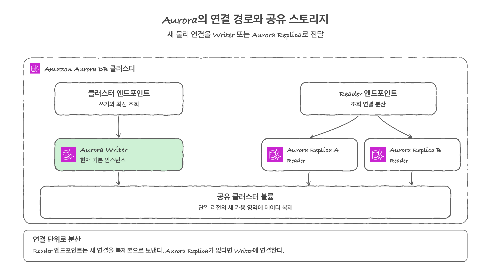
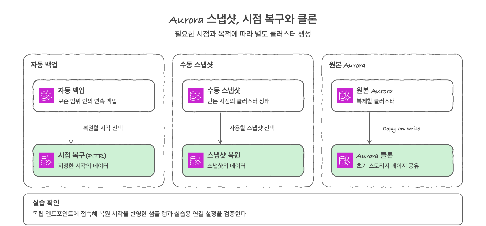
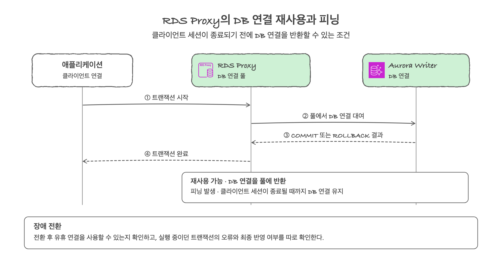

# Aurora의 복구, 접근 제어, RDS Proxy 운영하기

Amazon Aurora는 DB 인스턴스와 클러스터 스토리지를 분리한다. 애플리케이션은 Writer와 Reader의 연결 경로를 선택하고, 운영자는 복구할 시점과 환경에 따라 백업, 스냅샷, 복제를 구분한다. RDS Proxy를 추가할 때는 DB 연결 재사용과 장애 전환 중 클라이언트 동작을 함께 확인한다. [Aurora 스토리지](https://docs.aws.amazon.com/AmazonRDS/latest/AuroraUserGuide/Aurora.Overview.StorageReliability.html) · [Aurora 백업과 복구](https://docs.aws.amazon.com/AmazonRDS/latest/AuroraUserGuide/Aurora.Managing.Backups.html) · [RDS Proxy 동작](https://docs.aws.amazon.com/AmazonRDS/latest/AuroraUserGuide/rds-proxy.howitworks.html)

## 1. Writer와 Reader가 공유하는 클러스터 스토리지 이해하기

Writer와 Aurora Replica는 같은 클러스터 볼륨을 사용한다. Aurora는 단일 리전의 세 가용 영역에 볼륨 데이터를 복제한다. Reader를 추가할 때는 기존 볼륨에 DB 인스턴스를 연결한다. Writer 장애가 나면 Aurora가 기존 Reader를 승격하거나 새 Writer를 만든다. [Aurora 스토리지](https://docs.aws.amazon.com/AmazonRDS/latest/AuroraUserGuide/Aurora.Overview.StorageReliability.html) · [Aurora 엔드포인트의 고가용성 동작](https://docs.aws.amazon.com/AmazonRDS/latest/AuroraUserGuide/Aurora.Overview.Endpoints.html)

Aurora의 Writer와 Reader가 연결을 받는 방식과 공유 볼륨을 표시했다. [Aurora 스토리지](https://docs.aws.amazon.com/AmazonRDS/latest/AuroraUserGuide/Aurora.Overview.StorageReliability.html) · [Aurora Reader 엔드포인트](https://docs.aws.amazon.com/AmazonRDS/latest/AuroraUserGuide/Aurora.Endpoints.Reader.html) · [Aurora 엔드포인트의 고가용성 동작](https://docs.aws.amazon.com/AmazonRDS/latest/AuroraUserGuide/Aurora.Overview.Endpoints.html)

클러스터 엔드포인트는 현재 Writer에 연결한다. Reader 엔드포인트는 새 연결을 Aurora Replica로 분산하고, Replica가 없다면 Writer에 연결한다. 같은 연결의 쿼리는 그 연결을 받은 인스턴스에서 처리한다. 쓰기 직후의 최신 결과를 요구하는 조회에는 Writer를 사용한다. [Aurora Reader 엔드포인트](https://docs.aws.amazon.com/AmazonRDS/latest/AuroraUserGuide/Aurora.Endpoints.Reader.html) · [Aurora 복제](https://docs.aws.amazon.com/AmazonRDS/latest/AuroraUserGuide/Aurora.Replication.html)

Aurora MySQL 실습 클러스터에서 두 엔드포인트에 각각 접속해 `SELECT @@hostname, @@GLOBAL.innodb_read_only;`를 실행한다. Reader가 있는 정상 상태에서 Writer 연결은 `0`, Reader 연결은 `1`을 반환하는지 확인한다. 연결 풀과 전환 절차는 [Aurora MySQL 연결 실습](../aurora-mysql/01_event_readiness_and_local_mysql_lab.md)과 [Writer 장애 전환과 복구](../aurora-mysql/07_replica_lag_ddl_and_writer_failover.md)를 이어서 본다. [Aurora MySQL 연결 역할 확인](https://docs.aws.amazon.com/AmazonRDS/latest/AuroraUserGuide/AuroraMySQL.BestPractices.html)

## 2. 복구 시점에 맞춰 스냅샷, PITR, 클론 사용하기

- **자동 백업과 시점 복구(PITR)**는 실수로 삭제하거나 변경하기 직전처럼 시점을 지정해야 할 때 사용한다. Aurora의 연속 증분 백업은 1~35일의 보존 기간을 설정하며, 콘솔에 표시된 `Earliest restorable time`부터 `Latest restorable time`까지의 범위에서 새 클러스터를 복원한다. [Aurora 백업과 복구 가능 시점](https://docs.aws.amazon.com/AmazonRDS/latest/AuroraUserGuide/Aurora.Managing.Backups.html)
- **수동 DB 클러스터 스냅샷**은 배포 직전처럼 특정 상태를 별도로 보존할 때 사용한다. 스냅샷은 삭제할 때까지 남으며, 필요하면 그 상태로 새 클러스터를 복원한다. [Aurora 백업과 스냅샷](https://docs.aws.amazon.com/AmazonRDS/latest/AuroraUserGuide/Aurora.Managing.Backups.html) · [DB 클러스터 스냅샷 생성](https://docs.aws.amazon.com/AmazonRDS/latest/AuroraUserGuide/USER_CreateSnapshotCluster.html)
- **Aurora 클론**은 원본과 별개로 스키마 변경을 시험할 때 사용할 수 있다. Copy-on-write 클론은 생성 직후 원본과 스토리지 페이지를 공유하며, 양쪽의 변경분에 별도 페이지를 할당한다. 클론은 독립 엔드포인트를 가진 클러스터다. 보존 기간과 과거 복원 시점은 자동 백업이나 스냅샷으로 관리한다. [Aurora 클론과 Copy-on-write](https://docs.aws.amazon.com/AmazonRDS/latest/AuroraUserGuide/Aurora.Managing.Clone.html) · [Aurora 백업과 복원](https://docs.aws.amazon.com/AmazonRDS/latest/AuroraUserGuide/Aurora.Managing.Backups.html)

Aurora에서 복구 시점이나 스키마 검증 목적에 따라 선택하는 세 가지 방법이다. [Aurora 백업과 복구 가능 시점](https://docs.aws.amazon.com/AmazonRDS/latest/AuroraUserGuide/Aurora.Managing.Backups.html) · [DB 클러스터 스냅샷 생성](https://docs.aws.amazon.com/AmazonRDS/latest/AuroraUserGuide/USER_CreateSnapshotCluster.html) · [Aurora 클론과 Copy-on-write](https://docs.aws.amazon.com/AmazonRDS/latest/AuroraUserGuide/Aurora.Managing.Clone.html)

복구 실습에서는 샘플 행을 변경하기 전후의 시각을 기록하고, 복구 가능한 범위를 확인한 뒤 변경 전 시점으로 별도 클러스터를 만든다. 복원한 클러스터의 보안 그룹과 엔드포인트를 확인하고 샘플 행과 애플리케이션 연결을 검증한 뒤 실습용 클러스터를 정리한다. [Aurora 백업과 복원](https://docs.aws.amazon.com/AmazonRDS/latest/AuroraUserGuide/Aurora.Managing.Backups.html) · [Aurora 클러스터 삭제](https://docs.aws.amazon.com/AmazonRDS/latest/AuroraUserGuide/USER_DeleteCluster.html)

## 3. RDS의 네트워크, 전송, 저장과 인증 제어하기

- **네트워크**에서는 프라이빗 서브넷과 DB 보안 그룹을 사용한다. 직접 연결 구성이면 애플리케이션 보안 그룹을 DB 포트의 소스로 지정한다. Proxy 구성이면 애플리케이션에서 Proxy로, Proxy에서 DB로 연결할 수 있도록 각 보안 그룹을 설정한다. [VPC의 RDS DB 인스턴스](https://docs.aws.amazon.com/AmazonRDS/latest/UserGuide/USER_VPC.WorkingWithRDSInstanceinaVPC.html) · [Aurora RDS Proxy 생성](https://docs.aws.amazon.com/AmazonRDS/latest/AuroraUserGuide/rds-proxy-creating.html)
- **전송 및 저장 암호화**에서는 클라이언트가 TLS 인증서와 접속 호스트 이름을 검증하도록 설정한다. 저장 암호화에는 AWS KMS를 사용하고, 백업과 스냅샷을 복구할 환경에서 필요한 키 접근 권한을 확인한다. [Aurora TLS](https://docs.aws.amazon.com/AmazonRDS/latest/AuroraUserGuide/UsingWithRDS.SSL.html) · [Aurora 저장 암호화](https://docs.aws.amazon.com/AmazonRDS/latest/AuroraUserGuide/Overview.Encryption.html)
- **접속 계정**에는 필요한 SQL 권한만 부여한다. 마스터 사용자 암호 관리를 AWS Secrets Manager에 위임할 수 있다. 지원되는 엔진과 구성에서는 IAM DB 인증을 설정하고 애플리케이션의 IAM 주체에 접속 권한을 부여할 수 있다. [Aurora 마스터 사용자 권한](https://docs.aws.amazon.com/AmazonRDS/latest/AuroraUserGuide/UsingWithRDS.MasterAccounts.html) · [Aurora 마스터 암호 관리](https://docs.aws.amazon.com/AmazonRDS/latest/AuroraUserGuide/rds-secrets-manager.html) · [Aurora IAM DB 인증](https://docs.aws.amazon.com/AmazonRDS/latest/AuroraUserGuide/UsingWithRDS.IAMDBAuth.html)

## 4. RDS Proxy의 연결 재사용과 장애 전환 확인하기

RDS Proxy는 애플리케이션 연결을 받고 DB 연결을 풀에 유지한다. 트랜잭션을 처리하는 동안 하나의 DB 연결을 사용하고, 안전하게 재사용할 수 있으면 트랜잭션 종료 후 풀로 반환한다. 기본 Proxy 엔드포인트는 Aurora Writer로 연결하며, Reader가 있는 클러스터에는 읽기 전용 Proxy 엔드포인트를 추가할 수 있다. 애플리케이션에서 엔드포인트를 선택한다. [RDS Proxy 동작](https://docs.aws.amazon.com/AmazonRDS/latest/AuroraUserGuide/rds-proxy.howitworks.html) · [RDS Proxy 엔드포인트](https://docs.aws.amazon.com/AmazonRDS/latest/AuroraUserGuide/rds-proxy-endpoints.html)

RDS Proxy가 트랜잭션에 DB 연결을 빌려주고 세션 상태에 따라 풀로 반환하는 과정을 그렸다. [RDS Proxy 동작](https://docs.aws.amazon.com/AmazonRDS/latest/AuroraUserGuide/rds-proxy.howitworks.html) · [RDS Proxy 피닝 조건](https://docs.aws.amazon.com/AmazonRDS/latest/AuroraUserGuide/rds-proxy-pinning.html) · [RDS Proxy 엔드포인트](https://docs.aws.amazon.com/AmazonRDS/latest/AuroraUserGuide/rds-proxy-endpoints.html)

세션 상태를 유지해야 하면 Proxy가 클라이언트 세션을 같은 DB 연결에 고정한다(피닝). Aurora MySQL에서는 임시 테이블 생성이 한 예다. 피닝된 연결은 세션이 끝날 때까지 다른 클라이언트가 재사용할 수 없다. 검증 환경에서 평상시와 임시 테이블을 사용하는 부하를 비교하고 `DatabaseConnectionsCurrentlySessionPinned`, `DatabaseConnectionsBorrowLatency`, `DatabaseConnections`를 같은 구간에서 확인한다. [RDS Proxy 피닝 조건](https://docs.aws.amazon.com/AmazonRDS/latest/AuroraUserGuide/rds-proxy-pinning.html) · [RDS Proxy CloudWatch 지표](https://docs.aws.amazon.com/AmazonRDS/latest/UserGuide/rds-proxy.monitoring.html)

Writer 장애 전환 중에는 유휴 애플리케이션 연결이 유지될 수 있다. 실행 중인 SQL이나 트랜잭션은 취소될 수 있으므로 애플리케이션에서 오류를 관측하고 실패한 작업의 재처리 조건을 정한다. 격리된 실습에서 Proxy를 통해 유휴 연결과 실행 중인 트랜잭션을 각각 열고 장애 전환 후 작동 여부를 확인한다. `COMMIT` 응답을 잃은 쓰기는 새 Writer에서 같은 업무 키로 반영 여부를 확인한 뒤 재시도를 판단한다. [RDS Proxy 장애 전환](https://docs.aws.amazon.com/AmazonRDS/latest/AuroraUserGuide/rds-proxy.howitworks.html) · [Aurora 장애 전환 테스트](https://docs.aws.amazon.com/AmazonRDS/latest/AuroraUserGuide/aurora-poc.html) · [AWS 멱등 재시도 설계](https://aws.amazon.com/builders-library/making-retries-safe-with-idempotent-APIs/)
