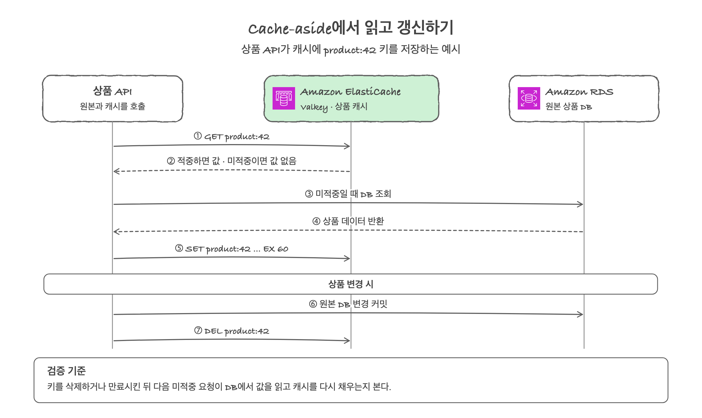
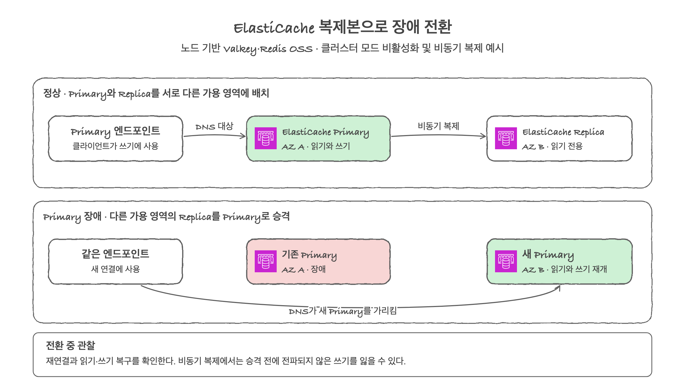

# Amazon ElastiCache로 조회 지연 줄이기

Amazon ElastiCache는 Valkey, Redis OSS, Memcached 엔진을 제공하는 관리형 인메모리 서비스다. 상품 조회처럼 같은 데이터를 반복해서 읽는 경로에서는 애플리케이션이 원본 DB에서 가져온 결과를 캐시에 저장할 수 있다. 엔진과 배포 방식에 따라 클라이언트 연결과 장애 대응 방법이 달라진다. [Amazon ElastiCache 개요](https://docs.aws.amazon.com/AmazonElastiCache/latest/dg/WhatIs.html) · [캐싱 전략](https://docs.aws.amazon.com/AmazonElastiCache/latest/dg/Strategies.html)

## 1. 엔진과 배포 방식 고르기

- **Valkey와 Redis OSS**는 문자열 외에 해시, 리스트, 집합, 정렬된 집합 같은 자료구조를 지원한다. 노드 기반 배포의 기능을 비교할 때는 클러스터 모드, 샤딩, 복제 요구와 함께 사용할 엔진 버전의 명령 지원을 확인한다. [노드 기반 엔진 비교](https://docs.aws.amazon.com/AmazonElastiCache/latest/dg/SelectEngine.html) · [ElastiCache에서 지원하는 명령](https://docs.aws.amazon.com/AmazonElastiCache/latest/dg/SupportedCommands.html)
- **Memcached**는 단순한 키-값 캐싱에 사용할 수 있다. 노드 기반 Memcached에서 여러 노드를 쓰면 클라이언트가 키를 나누며, Valkey·Redis OSS처럼 Primary와 Reader 복제본을 구성하는 방식은 제공하지 않는다. [노드 기반 엔진 비교](https://docs.aws.amazon.com/AmazonElastiCache/latest/dg/SelectEngine.html) · [ElastiCache 구성 요소와 복제](https://docs.aws.amazon.com/AmazonElastiCache/latest/dg/WhatIs.Components.html)
- **Serverless**에서는 ElastiCache가 용량을 자동으로 조정하고 엔드포인트를 제공한다. 클라이언트는 TLS를 지원해야 하며, Valkey·Redis OSS 클라이언트는 클러스터 모드도 지원해야 한다. **노드 기반 배포**에서는 노드 유형, 수, 배치를 선택하고 용량을 모니터링한다. 엔진 버전과 배포 방식을 정한 뒤 지원 명령과 네트워크 설정을 확인한다. [ElastiCache 배포 옵션](https://docs.aws.amazon.com/AmazonElastiCache/latest/dg/WhatIs.deployment.html) · [ElastiCache 동작](https://docs.aws.amazon.com/AmazonElastiCache/latest/dg/WhatIs.corecomponents.html)

## 2. Cache-aside, TTL과 무효화 적용하기

상품 API는 `product:42`를 먼저 조회한다. 캐시 적중 시 값을 사용하고, 미적중 시 상품 DB를 조회한 뒤 값을 TTL과 함께 저장한다. Valkey 예시로는 `SET product:42 <value> EX 60`을 사용한다. TTL은 데이터 변경 주기와 API가 허용할 오래된 응답 시간에 맞춰 정한다. [ElastiCache 지연 로딩과 TTL](https://docs.aws.amazon.com/AmazonElastiCache/latest/dg/Strategies.html) · [Valkey SET 명령](https://valkey.io/commands/set/)



상품 조회의 적중·미적중과 가격 변경 후 캐시 무효화를 예로 들었다. [ElastiCache 지연 로딩과 TTL](https://docs.aws.amazon.com/AmazonElastiCache/latest/dg/Strategies.html) · [캐싱 패턴과 캐시 무효화](https://aws.amazon.com/builders-library/caching-challenges-and-strategies/) · [Valkey SET 명령](https://valkey.io/commands/set/)

운영자가 상품 가격을 변경하면 DB 커밋 후 애플리케이션이 `DEL product:42`를 호출해 캐시를 무효화한다. 다음 조회에서 새 값을 채운다. 이미 시작한 조회가 이전 값을 다시 저장하거나 삭제 호출이 실패할 수 있으므로, 쓰기 직후 최신성이 중요한 경로는 원본에서 읽는 등 별도로 설계한다. 여러 키의 만료가 몰리면 원본 DB 요청이 급증할 수 있다. TTL을 조금씩 분산하고 캐시 적중·미적중과 원본 DB 쿼리율을 함께 본다. [캐싱 패턴과 캐시 무효화](https://aws.amazon.com/builders-library/caching-challenges-and-strategies/) · [ElastiCache 성능 지침과 TTL](https://docs.aws.amazon.com/AmazonElastiCache/latest/dg/PerformanceEfficiencyPillar.html) · [Valkey DEL 명령](https://valkey.io/commands/del/)

## 3. 복제본과 장애 전환의 동작 확인하기

일반적인 비동기 복제를 쓰는 노드 기반 Valkey·Redis OSS 복제 그룹에서 샤드마다 읽기·쓰기를 처리하는 Primary와 읽기 전용 복제본을 둘 수 있다. 클러스터 모드가 꺼진 다중 노드 배포의 쓰기는 Primary 엔드포인트로 보낸다. Reader 엔드포인트는 DNS를 통해 읽기 복제본의 주소를 반환하므로, 기존 연결 풀을 재사용할 때 읽기 트래픽이 균등하게 분산되는지 따로 확인한다. 클러스터 모드가 켜진 경우에는 Configuration 엔드포인트와 클러스터를 지원하는 클라이언트를 쓴다. [ElastiCache 구성 요소와 복제](https://docs.aws.amazon.com/AmazonElastiCache/latest/dg/WhatIs.Components.html) · [ElastiCache 연결 엔드포인트](https://docs.aws.amazon.com/AmazonElastiCache/latest/dg/Endpoints.html)



노드 기반 Valkey·Redis OSS의 Multi-AZ 장애 전환에서 Primary 엔드포인트가 새 Primary를 가리키는 모습을 그렸다. [ElastiCache 구성 요소와 복제](https://docs.aws.amazon.com/AmazonElastiCache/latest/dg/WhatIs.Components.html) · [ElastiCache 연결 엔드포인트](https://docs.aws.amazon.com/AmazonElastiCache/latest/dg/Endpoints.html) · [ElastiCache Multi-AZ 및 자동 장애 전환 시험](https://docs.aws.amazon.com/AmazonElastiCache/latest/dg/AutoFailover.html)

해당 복제 그룹에서 다른 가용 영역에 있는 복제본으로 Multi-AZ 자동 장애 전환을 설정하면 Primary 장애 시 ElastiCache가 복제본을 승격한다. 비동기 복제에서는 마지막 쓰기가 승격될 복제본에 도달하기 전에 유실될 수 있다. 격리된 복제 그룹에서 테스트 장애 전환을 실행하고 캐시 엔드포인트 재연결, 읽기·쓰기 재개, 원본 조회 증가를 기록한다. Serverless는 서비스가 여러 가용 영역에 데이터를 배치하고 장애를 관리한다. [ElastiCache Multi-AZ 및 자동 장애 전환 시험](https://docs.aws.amazon.com/AmazonElastiCache/latest/dg/AutoFailover.html) · [ElastiCache 배포 옵션](https://docs.aws.amazon.com/AmazonElastiCache/latest/dg/WhatIs.deployment.html)

## 4. 프라이빗 Valkey Serverless 캐시에서 TTL 확인하기

ElastiCache 콘솔에서 **Valkey caches → Create Valkey cache**로 VPC 내 실습용 Serverless 캐시를 만든다. 실습 EC2가 접근할 수 있는 VPC를 사용하고, 캐시 보안 그룹에는 실습 EC2 보안 그룹에서 오는 TCP 6379를 허용한다. 캐시가 활성화되면 콘솔에 표시된 쓰기 엔드포인트를 `CACHE_ENDPOINT`에 설정한다. 실습 명령은 AWS 시작하기 예제의 인증 설정을 가정하며, 사용자 그룹을 설정한 환경에서는 해당 사용자 인증을 적용한다. [VPC의 Valkey Serverless 생성](https://docs.aws.amazon.com/AmazonElastiCache/latest/dg/getting-started-valkey-vpc.html) · [Valkey Serverless 읽기와 쓰기](https://docs.aws.amazon.com/AmazonElastiCache/latest/dg/GettingStarted.serverless-valkey.step2.html) · [ElastiCache TLS 접속](https://docs.aws.amazon.com/AmazonElastiCache/latest/dg/connect-tls.html)

```sh
valkey-cli -c --tls -h "$CACHE_ENDPOINT" -p 6379
```

```text
SET handbook:product:42 "12000" EX 60
GET handbook:product:42
TTL handbook:product:42
DEL handbook:product:42
GET handbook:product:42
```

첫 `GET`에서 `12000`, `TTL`에서 남은 초를 확인한다. `DEL`로 삭제한 다음 `GET`에서는 값이 없어야 한다. 다시 저장하고 60초 뒤에도 값이 없는지 확인한다. 애플리케이션을 연결해 미적중 시 DB를 조회하고 키를 다시 채우는 흐름까지 검증한 뒤 실습용 캐시를 삭제한다. [Valkey SET](https://valkey.io/commands/set/) · [Valkey TTL](https://valkey.io/commands/ttl/) · [Valkey DEL](https://valkey.io/commands/del/) · [Valkey Serverless 실습 정리](https://docs.aws.amazon.com/AmazonElastiCache/latest/dg/GettingStarted.serverless-valkey.step3.html)
