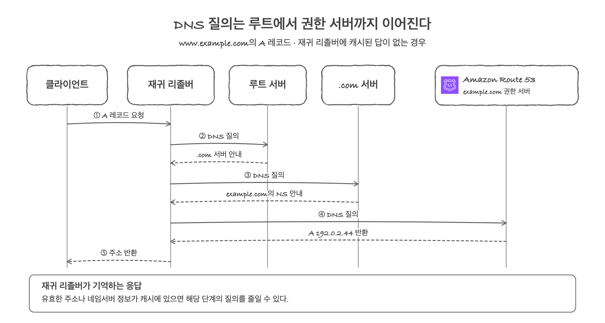
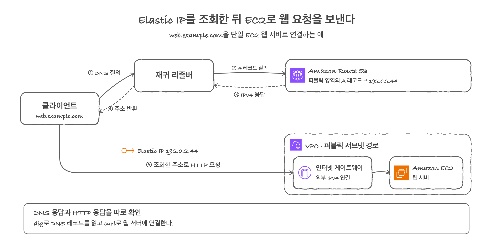
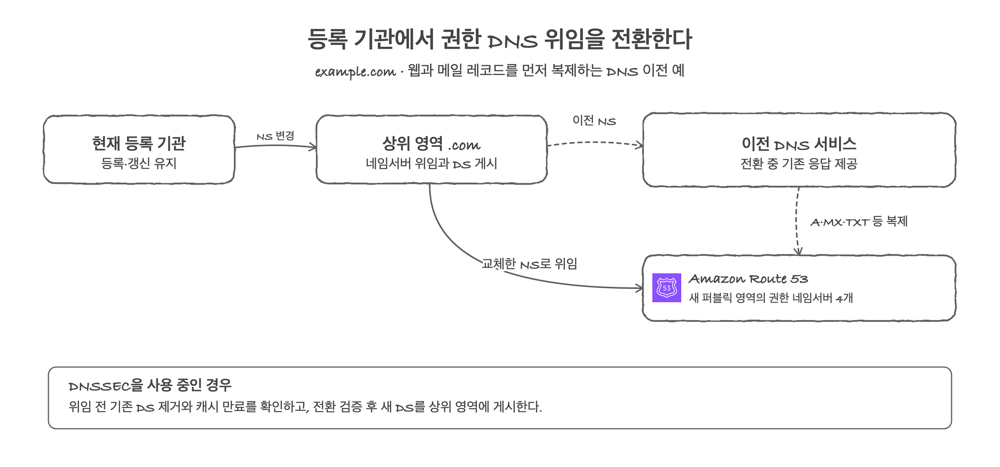

# Amazon Route 53으로 DNS 운영하기

DNS는 `www.example.com` 같은 이름에 대해 연결에 필요한 주소나 다른 레코드 값을 돌려준다. Amazon Route 53은 도메인 등록, 권한 DNS 호스팅, 상태 확인 기능을 제공한다. 도메인의 등록 기관이 별도로 있어도 Route 53에서 DNS를 운영할 수 있다. [Amazon Route 53 · 서비스 개요](https://docs.aws.amazon.com/Route53/latest/DeveloperGuide/Welcome.html) · [Amazon Route 53 · DNS 서비스 구성](https://docs.aws.amazon.com/Route53/latest/DeveloperGuide/dns-configuring.html)

## 1. DNS 계층과 이름 해석 순서

클라이언트는 재귀 리졸버에 `www.example.com`의 주소를 질의한다. 사용할 수 있는 답이 캐시에 없으면 리졸버가 루트 네임서버에 `.com` 네임서버를 확인하고, `.com` 네임서버에서 `example.com`의 권한 네임서버를 확인한다. 권한 네임서버가 최종 A 레코드를 반환하면 리졸버는 응답을 캐시하고 클라이언트에 IPv4 주소를 돌려준다. IPv6 주소는 AAAA 레코드에서 받는다. [Amazon Route 53 · DNS 조회 흐름](https://docs.aws.amazon.com/Route53/latest/DeveloperGuide/welcome-dns-service.html#welcome-dns-service-how-route-53-routes-traffic) · [Amazon Route 53 · 레코드 유형](https://docs.aws.amazon.com/Route53/latest/DeveloperGuide/ResourceRecordTypes.html)



캐시를 사용하지 않는 재귀 리졸버의 조회 예에서 위임 정보와 최종 A 레코드가 각 단계에서 어떻게 반환되는지 나타냈다. [Amazon Route 53 · DNS 조회 흐름](https://docs.aws.amazon.com/Route53/latest/DeveloperGuide/welcome-dns-service.html#welcome-dns-service-how-route-53-routes-traffic) · [Amazon Route 53 · 레코드 유형](https://docs.aws.amazon.com/Route53/latest/DeveloperGuide/ResourceRecordTypes.html) · [Amazon Route 53 · 하위 도메인 라우팅](https://docs.aws.amazon.com/Route53/latest/DeveloperGuide/dns-routing-traffic-for-subdomains.html)

상위 영역의 NS 레코드는 하위 영역의 권한 네임서버가 어디에 있는지 알려준다. 예를 들어 `app.example.com`을 별도 영역으로 운영하려면 `example.com` 영역에 `app.example.com`의 NS 레코드를 두고, 하위 영역에서는 해당 이름 이하의 레코드를 관리한다. [Amazon Route 53 · 하위 도메인 라우팅](https://docs.aws.amazon.com/Route53/latest/DeveloperGuide/dns-routing-traffic-for-subdomains.html)

## 2. 퍼블릭과 프라이빗 호스팅 영역

호스팅 영역은 도메인과 하위 이름의 레코드를 담는 단위다. 퍼블릭 호스팅 영역은 인터넷 DNS 질의에 사용하며, Route 53이 영역 생성 시 NS와 SOA 레코드를 만든다. 상위 영역에서 이 NS로 위임하면 인터넷의 리졸버가 이 영역의 권한 네임서버를 찾는다. [Amazon Route 53 · 호스팅 영역](https://docs.aws.amazon.com/Route53/latest/DeveloperGuide/hosted-zones-working-with.html) · [Amazon Route 53 · 퍼블릭 호스팅 영역의 NS와 SOA](https://docs.aws.amazon.com/Route53/latest/DeveloperGuide/SOA-NSrecords.html)

프라이빗 호스팅 영역은 연결한 VPC에서 `db.example.com` 같은 이름을 해석하는 데 사용한다. VPC의 Route 53 Resolver와 DNS 속성은 [VPC 인터페이스, DNS, IP 관리](06_managing_vpc_interfaces_dns_and_addresses.md)에서 다룬다. [Amazon Route 53 · 프라이빗 호스팅 영역](https://docs.aws.amazon.com/Route53/latest/DeveloperGuide/hosted-zones-private.html) · [Amazon VPC · DNS 속성](https://docs.aws.amazon.com/vpc/latest/userguide/AmazonDNS-concepts.html#vpc-dns-support)

## 3. Elastic IP로 EC2에 연결하고 확인하기

인터넷에서 EC2 웹 서버에 IPv4로 직접 접속하는 예에서는 Elastic IP를 할당해 인스턴스에 연결한 뒤, 퍼블릭 호스팅 영역의 `web.example.com`에 그 주소를 값으로 갖는 A 레코드를 생성한다. 서브넷 라우팅 테이블에 인터넷 게이트웨이 경로를 설정하고, 보안 그룹과 네트워크 ACL에서 웹 서버 통신을 허용한다. Elastic IP를 반환할 때는 해당 주소를 가리키는 DNS 레코드도 제거한다. [Amazon Route 53 · EC2 인스턴스로 라우팅](https://docs.aws.amazon.com/Route53/latest/DeveloperGuide/routing-to-ec2-instance.html) · [Amazon EC2 · Elastic IP](https://docs.aws.amazon.com/AWSEC2/latest/UserGuide/elastic-ip-addresses-eip.html) · [Amazon VPC · 인터넷 게이트웨이](https://docs.aws.amazon.com/vpc/latest/userguide/VPC_Internet_Gateway.html#vpc-igw-internet-access)



주소를 얻는 DNS 조회와 Elastic IP로 접속하는 HTTP 요청이 거치는 경로를 나타냈다. [Amazon Route 53 · EC2 인스턴스로 라우팅](https://docs.aws.amazon.com/Route53/latest/DeveloperGuide/routing-to-ec2-instance.html) · [Amazon VPC · 인터넷 게이트웨이](https://docs.aws.amazon.com/vpc/latest/userguide/VPC_Internet_Gateway.html#vpc-igw-internet-access) · [Amazon EC2 · Elastic IP](https://docs.aws.amazon.com/AWSEC2/latest/UserGuide/elastic-ip-addresses-eip.html)

먼저 해당 영역의 권한 네임서버에 직접 질의하고, 이어서 기본 리졸버에 질의해 두 응답이 예상 Elastic IP인지 확인한다. DNS 응답이 맞으면 별도로 웹 서버에 HTTP 요청을 보낸다. DNS가 맞고 HTTP만 실패하면 인터넷 경로, 포트 허용 여부, 웹 서버의 리슨 상태를 확인한다. 예시 명령의 호스트 이름과 `ns.example.net`은 실제 환경 값으로 바꾼다. [Amazon Route 53 · 도메인 DNS 확인](https://docs.aws.amazon.com/Route53/latest/DeveloperGuide/welcome-dns-service.html#welcome-dns-service-how-route-53-routes-traffic) · [Amazon Route 53 · DNS 전환 후 확인](https://docs.aws.amazon.com/Route53/latest/DeveloperGuide/migrate-dns-domain-in-use.html#migrate-dns-monitor-traffic) · [Amazon VPC · 인터넷 게이트웨이](https://docs.aws.amazon.com/vpc/latest/userguide/VPC_Internet_Gateway.html#vpc-igw-internet-access)

```bash
dig @ns.example.net web.example.com A +noall +answer
dig web.example.com A +noall +answer
curl -I http://web.example.com/
```

## 4. TTL과 변경 적용 시점 읽기

TTL(Time to Live)은 리졸버가 DNS 응답을 캐시에 유지할 수 있는 시간을 초로 나타낸다. TTL을 낮추면 리졸버의 재질의가 잦아져 레코드 변경을 더 빠르게 확인할 수 있고, TTL을 높이면 캐시에서 답할 기회가 늘어난다. 전환 전에 TTL을 낮추고, 이전에 저장된 응답이 기존 TTL만큼 만료될 시간을 확보한 뒤 레코드를 바꾼다. [Amazon Route 53 · DNS 모범 사례](https://docs.aws.amazon.com/Route53/latest/DeveloperGuide/best-practices-dns.html) · [Amazon Route 53 · Simple 레코드의 TTL](https://docs.aws.amazon.com/Route53/latest/DeveloperGuide/resource-record-sets-values-basic.html#rrsets-values-basic-ttl)

Route 53 변경 상태가 `INSYNC`이면 해당 호스팅 영역을 담당하는 Route 53 권한 서버에 변경이 반영된 상태다. 재귀 리졸버가 캐시한 이전 값은 각 리졸버의 남은 TTL에 따라 계속 응답에 나타날 수 있다. 전환 확인에는 권한 서버의 응답과 리졸버의 응답을 각각 사용한다. [Amazon Route 53 API · GetChange](https://docs.aws.amazon.com/Route53/latest/APIReference/API_GetChange.html) · [Amazon Route 53 · DNS 모범 사례](https://docs.aws.amazon.com/Route53/latest/DeveloperGuide/best-practices-dns.html)

## 5. CNAME과 Alias의 적용 범위

CNAME은 `www.example.com` 같은 이름을 `app.example.net` 같은 다른 DNS 이름에 연결한다. 리졸버는 그 대상 이름의 주소를 해석한다. 영역 정점(zone apex)인 `example.com`에는 NS와 SOA 레코드가 존재하므로 CNAME을 만들 수 없다. [Amazon Route 53 · CNAME 레코드](https://docs.aws.amazon.com/Route53/latest/DeveloperGuide/ResourceRecordTypes.html#CNAMEFormat) · [Amazon Route 53 · Alias와 CNAME 비교](https://docs.aws.amazon.com/Route53/latest/DeveloperGuide/resource-record-sets-choosing-alias-non-alias.html#resource-record-sets-choosing-alias-non-alias-comparison)

Alias는 Route 53의 확장 기능이다. 예를 들어 퍼블릭 영역 정점에 A Alias를 만들어 CloudFront 배포나 Elastic Load Balancing 로드 밸런서를 가리킬 수 있다. 대상은 Route 53이 지원하는 AWS 리소스 또는 같은 영역의 동일 유형 레코드여야 한다. CloudFront 배포에는 레코드 이름과 일치하는 대체 도메인 이름이 필요하고, S3를 직접 가리키는 Alias에는 레코드 이름과 같은 이름의 웹사이트 호스팅 버킷이 필요하다. 따라서 영역 정점의 Alias를 같은 영역의 CNAME 레코드로 연결하는 방식은 지원되지 않는다. AWS 리소스를 가리키는 Alias는 대상 리소스의 TTL을, 같은 영역의 다른 레코드를 가리키는 Alias는 대상 레코드의 TTL을 사용한다. [Amazon Route 53 · Alias와 CNAME 비교](https://docs.aws.amazon.com/Route53/latest/DeveloperGuide/resource-record-sets-choosing-alias-non-alias.html#resource-record-sets-choosing-alias-non-alias-comparison) · [Amazon Route 53 · Alias 대상과 설정값](https://docs.aws.amazon.com/Route53/latest/DeveloperGuide/resource-record-sets-values-alias-common.html)

## 6. 라우팅 정책과 상태 확인

라우팅 정책은 같은 이름에 어떤 DNS 응답을 돌려줄지 결정한다. 단일 대상은 Simple, 카나리 배포처럼 비율을 조절하려면 Weighted, 활성·대기 전환은 Failover, 여러 AWS 리전에서 지연 시간이 낮은 리전을 선택하려면 Latency를 사용한다. Weighted의 비율은 Route 53의 DNS 응답 선택에 적용되므로 캐시를 공유하는 클라이언트의 실제 HTTP 요청 비율과 다를 수 있다. [Amazon Route 53 · 라우팅 정책](https://docs.aws.amazon.com/Route53/latest/DeveloperGuide/routing-policy.html) · [Amazon Route 53 · Weighted 라우팅](https://docs.aws.amazon.com/Route53/latest/DeveloperGuide/routing-policy-weighted.html) · [Amazon Route 53 · DNS 모범 사례](https://docs.aws.amazon.com/Route53/latest/DeveloperGuide/best-practices-dns.html)

사용자의 위치가 기준이면 Geolocation, 리소스와 사용자 위치 및 지역별 응답 범위 조정이 기준이면 Geoproximity, 알려진 출발지 CIDR이 기준이면 IP-based를 선택한다. 여러 주소를 한 응답에 담으려면 Multivalue answer를 사용해 정상 레코드를 최대 8개 반환하도록 구성할 수 있다. AWS 워크로드의 질의에서 같은 AZ의 리소스를 우선하고 해당 범위에 적합한 응답이 없으면 더 넓은 범위로 폴백하려면 AZ-affinity를 검토한다. [Amazon Route 53 · 라우팅 정책](https://docs.aws.amazon.com/Route53/latest/DeveloperGuide/routing-policy.html) · [Amazon Route 53 · Multivalue answer 라우팅](https://docs.aws.amazon.com/Route53/latest/DeveloperGuide/routing-policy-multivalue.html) · [Amazon Route 53 · AZ-affinity 라우팅](https://docs.aws.amazon.com/Route53/latest/DeveloperGuide/routing-policy-azaffinity.html)

레코드에 Route 53 상태 확인을 연결하거나 지원되는 Alias 대상에서 `Evaluate target health`를 켜면 레코드를 선택할 때 상태를 반영한다. 예를 들어 Failover에서 주 대상이 비정상이고 대기 대상이 정상이면 대기 대상을 반환하며, 두 대상이 모두 비정상이면 주 대상을 반환한다. 캐시된 DNS 응답과 이미 맺은 연결이 있는 상태에서도 장애 전환을 시험한다. [Amazon Route 53 · 상태 확인 구성](https://docs.aws.amazon.com/Route53/latest/DeveloperGuide/dns-failover.html) · [Amazon Route 53 · 상태에 따른 레코드 선택](https://docs.aws.amazon.com/Route53/latest/DeveloperGuide/health-checks-how-route-53-chooses-records.html) · [Amazon Route 53 · DNS 모범 사례](https://docs.aws.amazon.com/Route53/latest/DeveloperGuide/best-practices-dns.html)

## 7. 다른 등록 기관의 도메인을 Route 53에 연결하기

현재 등록 기관에서 도메인 등록과 갱신을 유지하면서 DNS 호스팅만 Route 53으로 옮길 수 있다. 같은 이름의 퍼블릭 호스팅 영역을 만들고, 현재 DNS의 A·AAAA·CNAME·MX·TXT 레코드와 필요한 하위 영역 위임을 비교하며 복제한다. 새 영역의 권한 서버를 직접 조회해 의도한 응답을 확인한 뒤, 등록 기관에서 기존 네임서버를 새 영역에 배정된 네 개의 Route 53 네임서버로 교체한다. 이 변경이 상위 영역의 위임에 반영되어야 한다. [Amazon Route 53 · DNS 호스팅과 도메인 등록](https://docs.aws.amazon.com/Route53/latest/DeveloperGuide/dns-configuring.html) · [Amazon Route 53 · 운영 도메인 DNS 이전](https://docs.aws.amazon.com/Route53/latest/DeveloperGuide/migrate-dns-domain-in-use.html)



도메인 등록을 유지한 채 상위 영역의 위임을 Route 53으로 바꾸는 예를 그렸다. [Amazon Route 53 · 운영 도메인 DNS 이전](https://docs.aws.amazon.com/Route53/latest/DeveloperGuide/migrate-dns-domain-in-use.html) · [Amazon Route 53 · 기존 DS 레코드 제거](https://docs.aws.amazon.com/Route53/latest/DeveloperGuide/migrate-dns-domain-in-use.html#migrate-remove-ds) · [Amazon Route 53 · DNS 호스팅과 도메인 등록](https://docs.aws.amazon.com/Route53/latest/DeveloperGuide/dns-configuring.html)

이미 DNSSEC을 사용한다면 AWS의 이전 절차에 따라 네임서버 전환 전에 상위 영역의 기존 DS(Delegation Signer) 레코드를 제거하고, 캐시된 DS가 만료될 때까지 기다린다. 전환을 검증한 뒤 Route 53 영역의 DNSSEC 서명을 켜고 등록 기관을 통해 새 DS를 상위 영역에 추가한다. 이전 전에는 직전 네임서버 값을 기록하고, 전환 중에는 웹과 메일 응답을 확인한다. [Amazon Route 53 · 기존 DS 레코드 제거](https://docs.aws.amazon.com/Route53/latest/DeveloperGuide/migrate-dns-domain-in-use.html#migrate-remove-ds) · [Amazon Route 53 · 전환 후 트래픽 확인](https://docs.aws.amazon.com/Route53/latest/DeveloperGuide/migrate-dns-domain-in-use.html#migrate-dns-monitor-traffic) · [Amazon Route 53 · DNSSEC 서명 다시 활성화](https://docs.aws.amazon.com/Route53/latest/DeveloperGuide/migrate-dns-domain-in-use.html#migrate-dns-re-enable-dnssec)
