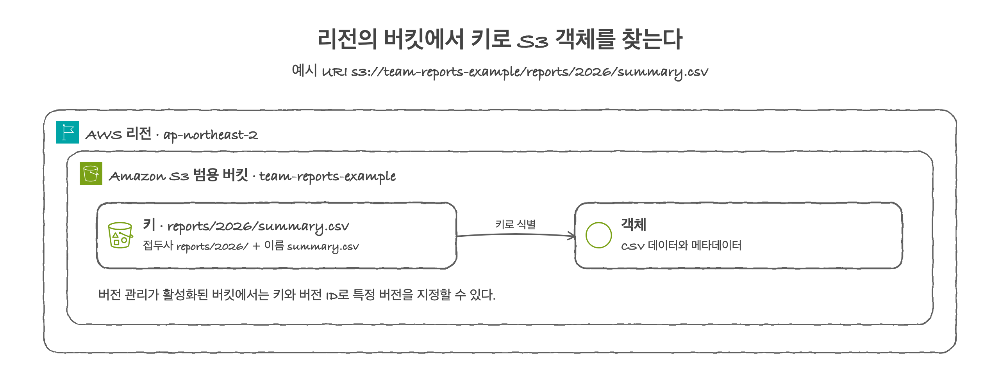
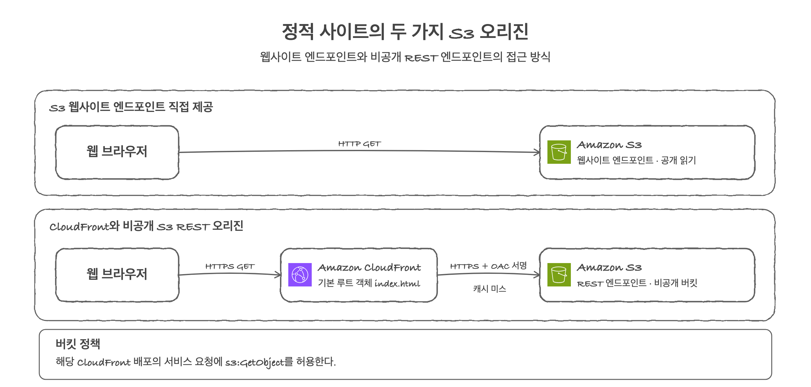
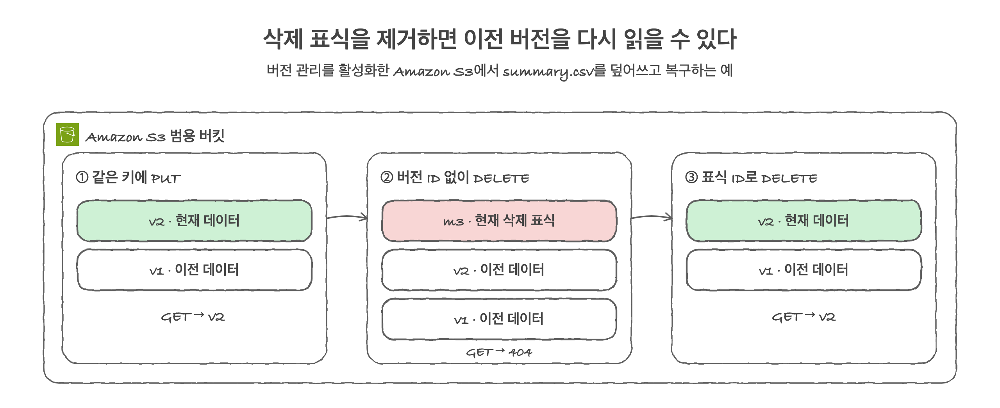

# Amazon S3에 객체 저장하고 보호하기

Amazon S3는 객체 데이터를 버킷에 저장한다. 이 문서는 범용 버킷을 기준으로 객체를 식별하는 방법, IAM과 공개 접근 제어, 정적 사이트 제공 방식, 이전 버전 복구를 다룬다. [Amazon S3 · 서비스 개요와 작동 방식](https://docs.aws.amazon.com/AmazonS3/latest/userguide/Welcome.html#CoreConcepts)

## 1. 리전, 버킷, 키, 객체

범용 버킷은 선택한 AWS 리전에 생성한다. 버킷은 객체를 담고, 객체는 데이터와 메타데이터로 구성된다. 키는 버킷 안에서 객체를 식별하는 이름이다. 예를 들어 `reports/2026/summary.csv` 전체가 키이며, S3 콘솔은 `/`로 구분되는 접두사를 폴더처럼 표시한다. 버전 관리 버킷에서는 키와 버전 ID를 함께 사용해 특정 버전을 식별한다. [Amazon S3 · 버킷과 객체](https://docs.aws.amazon.com/AmazonS3/latest/userguide/Welcome.html#CoreConcepts) · [Amazon S3 · 객체 키](https://docs.aws.amazon.com/AmazonS3/latest/userguide/object-keys.html)

S3 URI에서 버킷 이름과 전체 객체 키가 가리키는 대상을 나타냈다. [Amazon S3 · 버킷과 객체](https://docs.aws.amazon.com/AmazonS3/latest/userguide/Welcome.html#CoreConcepts) · [Amazon S3 · 객체 키](https://docs.aws.amazon.com/AmazonS3/latest/userguide/object-keys.html) · [Amazon S3 · 데이터 일관성 모델](https://docs.aws.amazon.com/AmazonS3/latest/userguide/Welcome.html#ConsistencyModel)

S3는 모든 AWS 리전에서 객체 PUT과 DELETE에 대해 강한 읽기 일관성을 제공한다. 새 키를 저장하거나 기존 키를 덮어쓴 요청이 성공하면 이어지는 GET과 LIST에서 변경 결과를 확인할 수 있다. 키를 삭제한 요청도 성공하면 이어지는 GET과 LIST에 반영된다. 이 일관성은 키 단위로 적용된다. [Amazon S3 · 데이터 일관성 모델](https://docs.aws.amazon.com/AmazonS3/latest/userguide/Welcome.html#ConsistencyModel) · [Amazon S3 · 삭제 표식](https://docs.aws.amazon.com/AmazonS3/latest/userguide/DeleteMarker.html)

## 2. 역할, 공개 접근 차단, 소유권, 암호화

애플리케이션에는 IAM 역할의 임시 자격 증명을 사용하고, 작업에 필요한 S3 권한만 부여한다. 예를 들어 보고서를 쓰는 역할은 `reports/` 접두사 아래의 객체에 `s3:PutObject` 권한을 받는다. 목록 조회가 필요한 경우에는 버킷에 대한 `s3:ListBucket` 권한을 별도로 검토한다. 브라우저에 특정 업로드 요청을 위임하는 예는 [S3 Presigned URL 업로드](03_uploading_objects_with_s3_presigned_urls.md)에서 다룬다. [Amazon S3 · 보안 모범 사례](https://docs.aws.amazon.com/AmazonS3/latest/userguide/security-best-practices.html) · [Amazon S3 · 정책의 작업과 리소스](https://docs.aws.amazon.com/AmazonS3/latest/userguide/using-with-s3-policy-actions.html) · [Amazon S3 · Presigned URL](https://docs.aws.amazon.com/AmazonS3/latest/userguide/using-presigned-url.html)

비공개 버킷에서는 S3 Block Public Access의 네 설정을 켜 공개 정책과 ACL을 통한 노출을 막는다. S3는 버킷과 계정 등 적용되는 수준에 설정이 다르면 가장 제한적인 조합을 적용한다. 새 버킷의 기본 Object Ownership인 `Bucket owner enforced`는 ACL을 비활성화한다. 이때 버킷 소유자가 객체를 소유하며 IAM 정책과 버킷 정책 등으로 접근을 관리한다. [Amazon S3 · Block Public Access](https://docs.aws.amazon.com/AmazonS3/latest/userguide/access-control-block-public-access.html) · [Amazon S3 · Object Ownership과 ACL](https://docs.aws.amazon.com/AmazonS3/latest/userguide/about-object-ownership.html)

새 객체는 S3 관리형 키를 사용하는 SSE-S3로 기본 암호화된다. KMS 키를 사용해야 한다면 버킷 기본 암호화를 SSE-KMS로 설정하고, 읽고 쓰는 주체의 S3 권한과 KMS 권한을 함께 확인한다. 버킷 기본 암호화를 변경한 뒤에도 기존 객체의 암호화 설정은 해당 객체를 다시 써야 바뀐다. 전송 구간에서는 HTTPS를 사용하고, 필요하면 `aws:SecureTransport` 조건으로 비보안 전송을 거부한다. [Amazon S3 · 기본 암호화](https://docs.aws.amazon.com/AmazonS3/latest/userguide/default-bucket-encryption.html) · [Amazon S3 · 전송 구간 보호](https://docs.aws.amazon.com/AmazonS3/latest/userguide/security-best-practices.html)

## 3. 정적 웹사이트의 HTTP와 CloudFront의 HTTPS

S3 정적 웹사이트 호스팅을 설정하면 웹사이트 엔드포인트가 인덱스 문서와 오류 문서 등의 동작을 제공한다. 이 엔드포인트는 공개적으로 읽을 수 있는 콘텐츠에 한해 HTTP로 서비스를 제공한다. CloudFront가 이 엔드포인트를 오리진으로 사용하면 사용자 연결에 HTTPS를 적용할 수 있다. 이때 CloudFront는 웹사이트 엔드포인트를 사용자 지정 오리진으로 취급하고 오리진과 HTTP로 통신하며, OAC는 사용할 수 없다. [Amazon S3 · 웹사이트 엔드포인트](https://docs.aws.amazon.com/AmazonS3/latest/userguide/WebsiteEndpoints.html#WebsiteRestEndpointDiff) · [Amazon CloudFront · S3 웹사이트 오리진](https://docs.aws.amazon.com/AmazonCloudFront/latest/DeveloperGuide/DownloadDistS3AndCustomOrigins.html) · [Amazon CloudFront · S3 오리진 접근 제한](https://docs.aws.amazon.com/AmazonCloudFront/latest/DeveloperGuide/private-content-restricting-access-to-s3.html)

공개 S3 웹사이트와 CloudFront를 사용하는 비공개 S3 오리진의 요청 경로를 비교했다. [Amazon S3 · 웹사이트 엔드포인트](https://docs.aws.amazon.com/AmazonS3/latest/userguide/WebsiteEndpoints.html#WebsiteRestEndpointDiff) · [Amazon CloudFront · OAC 설정과 버킷 정책](https://docs.aws.amazon.com/AmazonCloudFront/latest/DeveloperGuide/private-content-restricting-access-to-s3.html#create-oac-overview-s3) · [Amazon CloudFront · S3 웹사이트 오리진](https://docs.aws.amazon.com/AmazonCloudFront/latest/DeveloperGuide/DownloadDistS3AndCustomOrigins.html)

S3 버킷을 비공개로 유지하며 HTTPS로 제공하려면 CloudFront의 오리진에 일반 S3 REST 엔드포인트를 지정한다. 뷰어에는 HTTPS를 적용하고, OAC 서명 동작을 `always`로 설정해 CloudFront가 HTTPS로 서명한 요청을 S3에 보낸다. 버킷 정책에는 해당 CloudFront 배포의 `AWS:SourceArn`을 조건으로 서비스 주체에 필요한 `s3:GetObject` 권한을 부여한다. 루트 경로 `/`에 `index.html`을 제공하려면 CloudFront의 기본 루트 객체를 지정한다. 이 설정은 하위 경로에 같은 파일 이름을 자동으로 붙이지 않는다. [Amazon CloudFront · OAC 설정과 버킷 정책](https://docs.aws.amazon.com/AmazonCloudFront/latest/DeveloperGuide/private-content-restricting-access-to-s3.html#create-oac-overview-s3) · [Amazon CloudFront · 뷰어 HTTPS](https://docs.aws.amazon.com/AmazonCloudFront/latest/DeveloperGuide/using-https-viewers-to-cloudfront.html) · [Amazon CloudFront · 기본 루트 객체](https://docs.aws.amazon.com/AmazonCloudFront/latest/DeveloperGuide/DefaultRootObject.html)

CloudFront의 OAC는 배포에서 S3로 보내는 요청을 인증한다. 뷰어 접근까지 제어하려면 CloudFront의 서명 URL이나 서명 쿠키를 적용한다. 검증할 때는 CloudFront HTTPS 주소에서 객체가 열리는지와 S3 버킷 REST 주소에 대한 직접 비인증 요청이 거부되는지를 각각 확인한다. [CloudFront 서명 URL 다운로드](02_serving_private_downloads_with_cloudfront_signed_urls.md) · [Amazon CloudFront · S3 오리진 접근 제한](https://docs.aws.amazon.com/AmazonCloudFront/latest/DeveloperGuide/private-content-restricting-access-to-s3.html) · [Amazon CloudFront · 비공개 콘텐츠 제공](https://docs.aws.amazon.com/AmazonCloudFront/latest/DeveloperGuide/PrivateContent.html)

## 4. 버전과 삭제 표식으로 복구하기

버전 관리가 활성화된 버킷에서 같은 키에 PUT하면 새 버전이 현재 버전이 되고 이전 버전은 남는다. 버전 ID를 생략한 DELETE는 삭제 표식(delete marker)을 현재 버전으로 추가한다. 이후 버전 ID를 생략한 GET은 `404 Not Found`를 반환한다. 데이터가 있는 이전 버전은 그 버전 ID를 지정해 읽을 수 있다. [Amazon S3 · S3 Versioning](https://docs.aws.amazon.com/AmazonS3/latest/userguide/Versioning.html) · [Amazon S3 · 삭제 표식](https://docs.aws.amazon.com/AmazonS3/latest/userguide/DeleteMarker.html)

버전 ID를 생략한 GET의 결과가 현재 버전과 삭제 표식에 따라 어떻게 달라지는지 나타냈다. [Amazon S3 · 삭제 표식](https://docs.aws.amazon.com/AmazonS3/latest/userguide/DeleteMarker.html) · [Amazon S3 · 삭제 표식 관리](https://docs.aws.amazon.com/AmazonS3/latest/userguide/ManagingDelMarkers.html) · [Amazon S3 · S3 Versioning](https://docs.aws.amazon.com/AmazonS3/latest/userguide/Versioning.html)

복구할 때는 객체의 버전 목록에서 현재 삭제 표식의 버전 ID를 찾아 그 표식을 삭제한다. 바로 이전 버전이 데이터 버전이면 다시 현재 버전이 된다. 특정 데이터 버전의 ID로 DELETE를 호출하면 그 버전이 영구 삭제되므로, 복구 가능 기간에 맞춰 버전 삭제 권한과 수명 주기 정책의 이전 버전 보존 기간을 설정한다. [Amazon S3 · 삭제 표식 관리](https://docs.aws.amazon.com/AmazonS3/latest/userguide/ManagingDelMarkers.html) · [Amazon S3 · S3 Versioning](https://docs.aws.amazon.com/AmazonS3/latest/userguide/Versioning.html) · [Amazon S3 · 수명 주기 규칙](https://docs.aws.amazon.com/AmazonS3/latest/userguide/intro-lifecycle-rules.html)
