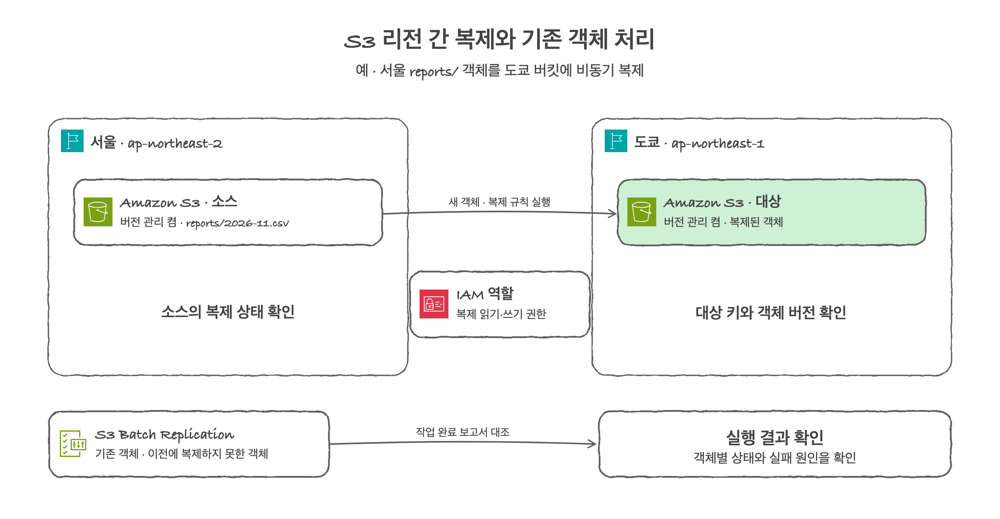
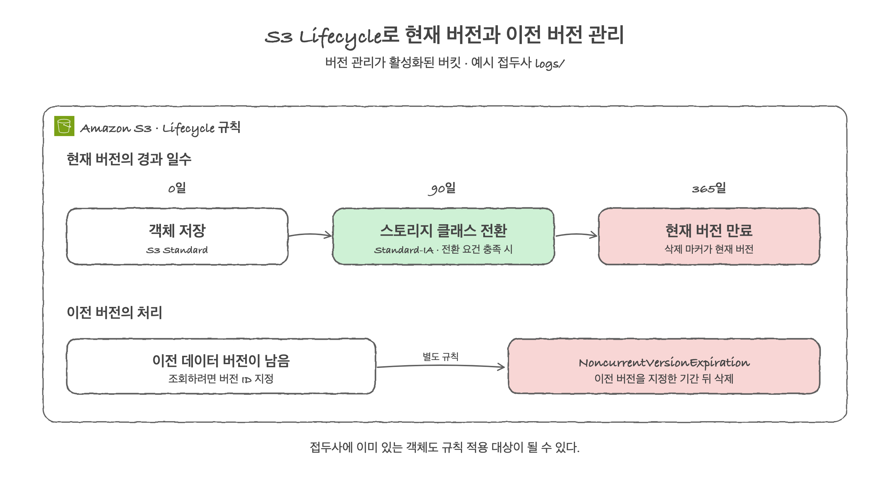
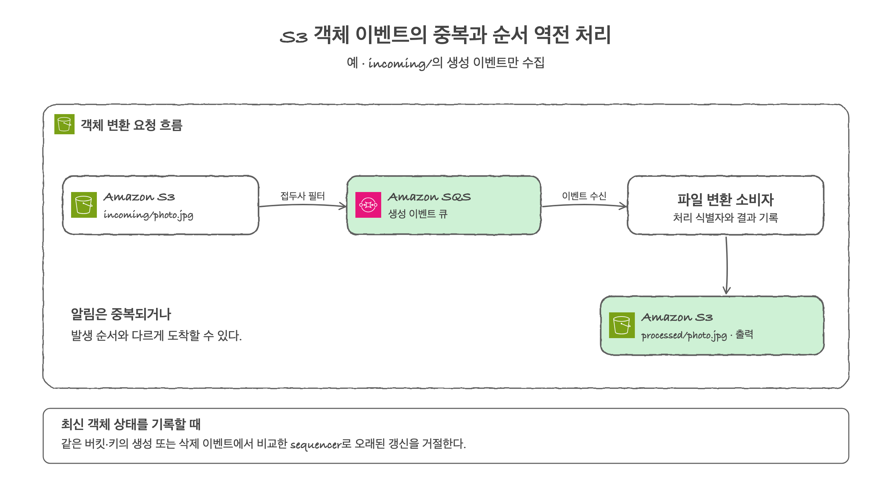
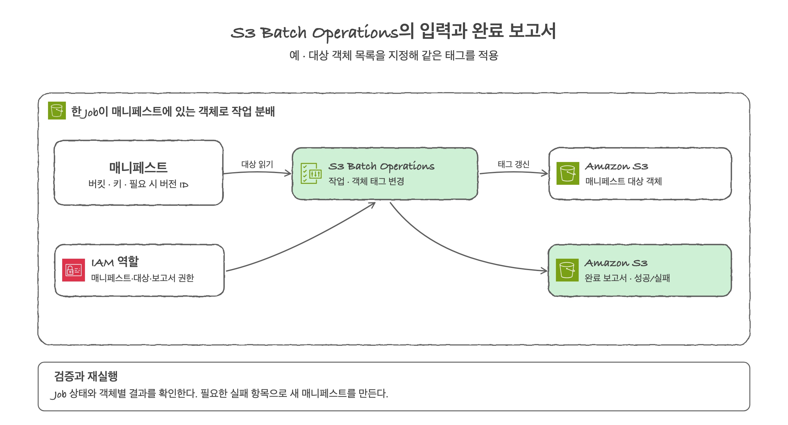

# Amazon S3 복제, 수명 주기, 이벤트와 대량 작업

## 1. 버킷 간 복제로 객체 사본 유지하기

S3 Replication은 소스 버킷의 객체를 목적지 버킷에 비동기 복제한다. 같은 리전이면 SRR(Same-Region Replication), 다른 리전이면 CRR(Cross-Region Replication)이다. 소스와 대상 일반 목적 버킷에 버전 관리를 활성화하고 복제 규칙을 실행할 IAM 역할과 목적지 쓰기 권한을 설정한다. [Amazon S3 · Replicating objects](https://docs.aws.amazon.com/AmazonS3/latest/userguide/replication.html) · [Amazon S3 · Replication requirements](https://docs.aws.amazon.com/AmazonS3/latest/userguide/replication-requirements.html)



신규 객체의 비동기 복제 경로와 기존 객체를 처리하는 배치 작업을 구분한 예다. [Amazon S3 · Replicating objects](https://docs.aws.amazon.com/AmazonS3/latest/userguide/replication.html) · [Amazon S3 · Replication requirements](https://docs.aws.amazon.com/AmazonS3/latest/userguide/replication-requirements.html) · [Amazon S3 · Replication status](https://docs.aws.amazon.com/AmazonS3/latest/userguide/replication-status.html)

- 예를 들어 서울 버킷의 `reports/`를 도쿄 버킷으로 복제한다. 규칙 활성화 후 새 테스트 객체를 올리고, 소스의 복제 상태가 `COMPLETED`가 된 뒤 목적지에서 객체를 확인한다. 규칙을 만들기 전에 올렸거나 이전 복제에 실패한 객체는 S3 Batch Replication으로 처리할 수 있다. [Amazon S3 · Replicating objects](https://docs.aws.amazon.com/AmazonS3/latest/userguide/replication.html) · [Amazon S3 · Replication status](https://docs.aws.amazon.com/AmazonS3/latest/userguide/replication-status.html)
- 복제 규칙이 복사할 객체 버전과 소스에서 생긴 삭제의 반영 범위를 따로 확인한다. 삭제 마커 복제는 규칙에서 활성화할 수 있으며 태그 기반 규칙은 지원하지 않는다. 특정 버전을 명시해 삭제하는 작업은 목적지에서 그 버전을 지우지 않는다. [Amazon S3 · What is replicated](https://docs.aws.amazon.com/AmazonS3/latest/userguide/replication-what-is-isnot-replicated.html) · [Amazon S3 · Replicating delete markers](https://docs.aws.amazon.com/AmazonS3/latest/userguide/delete-marker-replication.html)

## 2. 내구성과 가용성을 고려해 스토리지 클래스 고르기

내구성은 저장한 데이터를 잃지 않을 확률을, 가용성은 필요할 때 데이터에 접근할 수 있는 정도를 나타낸다. 자주 읽는 객체는 S3 Standard, 드물게 읽지만 빠르게 가져와야 하는 객체는 Standard-IA, 읽기 패턴이 바뀌는 데이터는 Intelligent-Tiering을 비교한다. One Zone-IA는 한 가용 영역에 저장하므로 다른 곳에서 재생성할 수 있는 사본에 적합하다. [Amazon S3 · Storage classes](https://docs.aws.amazon.com/AmazonS3/latest/userguide/storage-class-intro.html)

- 장기 보관은 조회 시간부터 정한다. Glacier Instant Retrieval은 즉시 접근용이고, Glacier Flexible Retrieval과 Deep Archive의 아카이브 객체는 복원 요청이 필요하다. 총비용은 저장 단가에 더해 검색·복원, 요청, 최소 보관 기간과 최소 과금 크기를 포함해 비교한다. [Amazon S3 · Archive storage classes](https://docs.aws.amazon.com/AmazonS3/latest/userguide/storage-class-intro.html) · [Amazon S3 · Pricing](https://aws.amazon.com/s3/pricing/)

## 3. Lifecycle 규칙으로 전환과 만료 자동화하기

S3 Lifecycle은 접두사나 태그에 맞는 객체의 스토리지 클래스 전환과 만료를 자동화한다. 예를 들어 `logs/`의 현재 버전을 90일 뒤 Standard-IA로 전환하고 365일 뒤 만료시킬 수 있다. 같은 규칙이 적용되는 기존 객체도 처리 대상이므로 배포 전에 필터와 보존 기간을 확인한다. [Amazon S3 · Managing the object lifecycle](https://docs.aws.amazon.com/AmazonS3/latest/userguide/object-lifecycle-mgmt.html) · [Amazon S3 · Transition constraints](https://docs.aws.amazon.com/AmazonS3/latest/userguide/lifecycle-transition-general-considerations.html)



객체의 경과 일수에 따른 전환, 현재 버전 만료, 이전 버전 정리를 그렸다. [Amazon S3 · Managing the object lifecycle](https://docs.aws.amazon.com/AmazonS3/latest/userguide/object-lifecycle-mgmt.html) · [Amazon S3 · Transition constraints](https://docs.aws.amazon.com/AmazonS3/latest/userguide/lifecycle-transition-general-considerations.html) · [Amazon S3 · Lifecycle configuration elements](https://docs.aws.amazon.com/AmazonS3/latest/userguide/intro-lifecycle-rules.html)

- 버전 관리 버킷에서 현재 버전을 만료하면 보통 삭제 마커가 생기고 이전 버전은 남는다. 이전 버전까지 정리하려면 `NoncurrentVersionExpiration`을 설정한다. 미완료 멀티파트 업로드의 조각에도 별도의 중단 규칙을 적용할 수 있다. [Amazon S3 · Lifecycle configuration elements](https://docs.aws.amazon.com/AmazonS3/latest/userguide/intro-lifecycle-rules.html)

## 4. 이벤트 알림으로 객체 업로드 후 처리하기

S3 Event Notifications는 객체 생성·삭제 같은 이벤트를 Amazon SNS, Amazon SQS, AWS Lambda 또는 Amazon EventBridge로 보낸다. 예를 들어 `incoming/`의 생성 이벤트를 SQS에 전달하고 소비자가 파일 변환을 수행하게 한다. 변환 결과를 다른 버킷이나 이벤트 필터 밖의 접두사에 저장하면 자신의 결과물로 작업이 다시 호출되는 일을 막을 수 있다. [Amazon S3 · Event Notifications](https://docs.aws.amazon.com/AmazonS3/latest/userguide/EventNotifications.html) · [Amazon S3 · Destinations and delivery](https://docs.aws.amazon.com/AmazonS3/latest/userguide/notification-how-to-event-types-and-destinations.html)



알림 필터로 입력과 출력을 구분하고, 소비자에서 중복과 순서 역전을 처리하는 예다. [Amazon S3 · Event Notifications](https://docs.aws.amazon.com/AmazonS3/latest/userguide/EventNotifications.html) · [Amazon S3 · Destinations and delivery](https://docs.aws.amazon.com/AmazonS3/latest/userguide/notification-how-to-event-types-and-destinations.html) · [Amazon S3 · Event message structure](https://docs.aws.amazon.com/AmazonS3/latest/userguide/notification-content-structure.html)

- 알림은 적어도 한 번 전달하도록 설계되어 중복이나 순서 역전이 발생할 수 있다. 소비자는 처리 식별자를 저장해 중복 실행을 막는다. 최신 객체 상태를 DB에 기록한다면 같은 버킷과 객체 키의 생성·삭제 이벤트에 담긴 `sequencer`를 비교해 오래된 갱신을 거절할 수 있다. 다른 키의 `sequencer`는 순서 비교에 사용하지 않는다. [Amazon S3 · Ordering and delivery](https://docs.aws.amazon.com/AmazonS3/latest/userguide/notification-how-to-event-types-and-destinations.html) · [Amazon S3 · Event message structure](https://docs.aws.amazon.com/AmazonS3/latest/userguide/notification-content-structure.html)

## 5. 전송 방식과 요청 지표로 S3 성능 개선하기

큰 객체의 업로드는 멀티파트 전송으로 조각을 병렬 처리할 수 있고, 읽기는 바이트 범위 요청을 나눠 병렬화할 수 있다. 작업자 수를 바꿀 때 전체 전송 시간, 클라이언트 대역폭 사용량, 재시도 및 `503 Slow Down`을 함께 측정한다. 일시 오류에는 지수 백오프 재시도를 적용한다. [Amazon S3 · Performance guidelines](https://docs.aws.amazon.com/AmazonS3/latest/userguide/optimizing-performance-guidelines.html) · [Amazon S3 · Performance design patterns](https://docs.aws.amazon.com/AmazonS3/latest/userguide/optimizing-performance-design-patterns.html)

- 읽기 요청이 같은 객체에 집중되고 응답을 재사용할 수 있다면 [CloudFront의 캐시 동작](23_delivering_content_with_cloudfront_and_global_accelerator.md)을 검토한다. 애플리케이션과 저장소가 같은 리전에 있는지도 지연과 데이터 전송 비용을 판단할 때 확인한다. [Amazon S3 · Performance guidelines](https://docs.aws.amazon.com/AmazonS3/latest/userguide/optimizing-performance-guidelines.html)

## 6. S3 Select의 범위와 신규 분석 경로 이해하기

S3 Select는 CSV, JSON, Parquet 형식의 **객체 하나**에서 SQL 표현식에 맞는 부분만 반환한다. 기존 이용자는 계속 사용할 수 있고 신규 고객은 사용할 수 없다. 여러 파일을 데이터셋으로 조회해야 하는 신규 구성은 Amazon Athena로 S3의 데이터를 쿼리하는 방식을 검토한다. [Amazon S3 · Querying with S3 Select](https://docs.aws.amazon.com/AmazonS3/latest/userguide/selecting-content-from-objects.html) · [Amazon Athena · What is Athena?](https://docs.aws.amazon.com/athena/latest/ug/what-is.html)

기존 이용자는 콘솔에서 CSV 객체를 선택한 뒤 입력 형식과 헤더 옵션을 지정하고 아래와 같은 쿼리의 결과를 확인할 수 있다. 헤더에 `status` 열이 있고 그 값이 `PAID`인 행을 고르는 예다. [Amazon S3 · Examples of using S3 Select](https://docs.aws.amazon.com/AmazonS3/latest/userguide/using-select.html) · [Amazon S3 Select · SELECT command](https://docs.aws.amazon.com/AmazonS3/latest/userguide/s3-select-sql-reference-select.html)

```sql
SELECT * FROM S3Object s WHERE s.status = 'PAID';
```

## 7. S3 Batch Operations로 기존 객체 일괄 처리하기

S3 Batch Operations의 한 작업은 대상 객체 목록인 매니페스트와 적용할 연산 하나를 사용한다. 예를 들어 S3 Inventory 또는 CSV 매니페스트를 지정하고, Batch Operations가 맡을 IAM 역할에 매니페스트 읽기와 객체 태그 변경 및 완료 보고서 쓰기 권한을 설정한다. 특정 객체 버전을 처리할 때는 매니페스트에 버전 ID도 지정한다. [Amazon S3 · Batch Operations](https://docs.aws.amazon.com/AmazonS3/latest/userguide/batch-ops.html) · [Amazon S3 · Creating a job](https://docs.aws.amazon.com/AmazonS3/latest/userguide/batch-ops-create-job.html) · [Amazon S3 · Batch Operations permissions](https://docs.aws.amazon.com/AmazonS3/latest/userguide/batch-ops-iam-role-policies.html)



대상 목록, 실행 권한, 객체별 결과를 확인하는 S3 대량 작업 흐름이다. [Amazon S3 · Creating a job](https://docs.aws.amazon.com/AmazonS3/latest/userguide/batch-ops-create-job.html) · [Amazon S3 · Batch Operations permissions](https://docs.aws.amazon.com/AmazonS3/latest/userguide/batch-ops-iam-role-policies.html) · [Amazon S3 · Job status and completion reports](https://docs.aws.amazon.com/AmazonS3/latest/userguide/batch-ops-job-status.html)

- 최초 작업은 객체 몇 개로 범위를 제한한다. 완료 보고서를 켜고, 실행이 끝나면 `Complete` 상태와 별도로 객체별 성공·실패 결과를 확인한다. 실패 사유를 해결한 뒤 재처리가 필요한 객체를 보고서에서 골라 새 매니페스트를 만든다. [Amazon S3 · Job status and completion reports](https://docs.aws.amazon.com/AmazonS3/latest/userguide/batch-ops-job-status.html)
