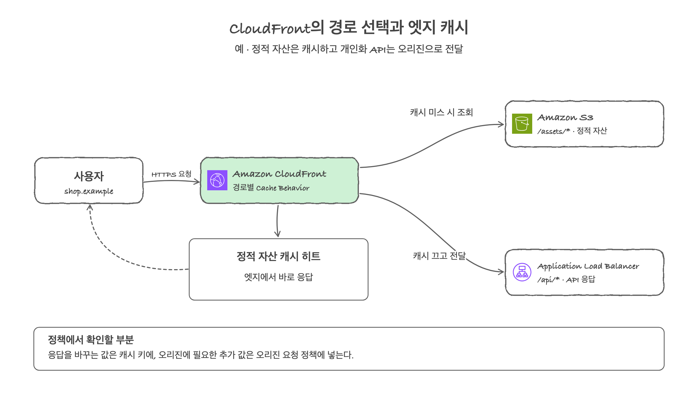
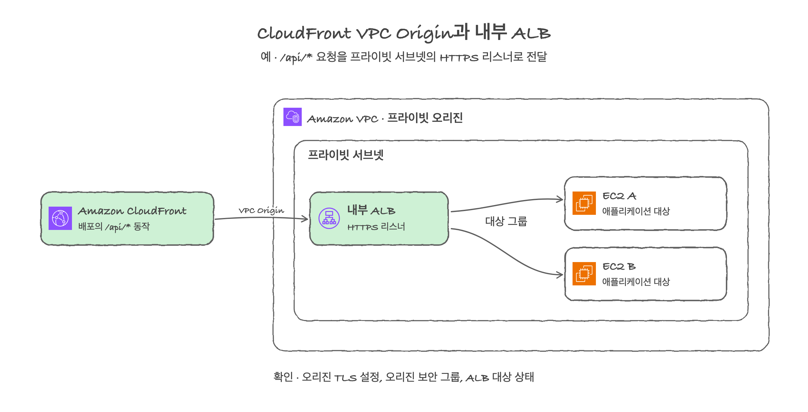
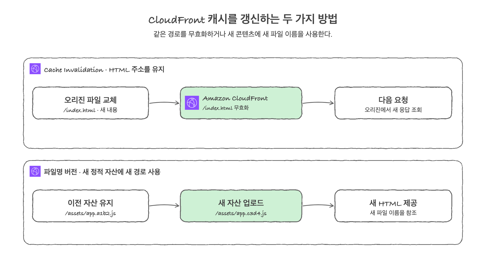
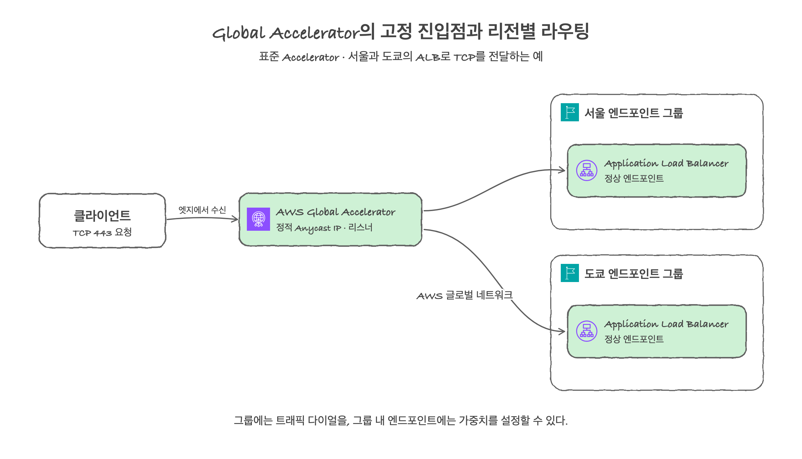

# Amazon CloudFront와 AWS Global Accelerator

## 1. 엣지 캐시에서 HTTP 응답 제공하기

CloudFront는 HTTP(S) 요청을 엣지에서 받아 배포의 캐시 동작(behavior)에 따라 처리한다. 요청 경로에 맞는 동작이 오리진과 정책을 선택한다. 캐시에 재사용할 응답이 있으면 엣지에서 반환하고, 오리진이 필요한 경우에는 지정한 오리진에서 응답을 가져온다. [Amazon CloudFront · How CloudFront delivers content](https://docs.aws.amazon.com/AmazonCloudFront/latest/DeveloperGuide/HowCloudFrontWorks.html) · [Amazon CloudFront · Cache behavior](https://docs.aws.amazon.com/AmazonCloudFront/latest/DeveloperGuide/DownloadDistValuesCacheBehavior.html)

경로별 정책과 정적 자산의 캐시 히트·미스 예시다. [Amazon CloudFront · How CloudFront delivers content](https://docs.aws.amazon.com/AmazonCloudFront/latest/DeveloperGuide/HowCloudFrontWorks.html) · [Amazon CloudFront · Cache behavior](https://docs.aws.amazon.com/AmazonCloudFront/latest/DeveloperGuide/DownloadDistValuesCacheBehavior.html) · [Amazon CloudFront · Origin request policies](https://docs.aws.amazon.com/AmazonCloudFront/latest/DeveloperGuide/controlling-origin-requests.html)

- 예를 들어 `/assets/*`는 정적 파일 오리진에, `/api/*`는 ALB에 연결한다. 캐시 키에 포함할 쿼리 문자열, 헤더, 쿠키는 응답이 달라지는 값으로 제한한다. 개인화 API에서 캐시가 불필요하다면 캐싱을 끄고, 오리진이 필요한 인증 정보를 받도록 요청 전달 정책도 확인한다. [Amazon CloudFront · Cache keys](https://docs.aws.amazon.com/AmazonCloudFront/latest/DeveloperGuide/controlling-the-cache-key.html) · [Amazon CloudFront · Origin request policies](https://docs.aws.amazon.com/AmazonCloudFront/latest/DeveloperGuide/controlling-origin-requests.html)

## 2. ALB 또는 EC2를 오리진으로 연결하기

동적 요청의 HTTPS 오리진으로 ALB를 두면 대상 그룹의 여러 EC2 인스턴스로 분산할 수 있다. CloudFront VPC Origin은 지원 조건을 충족하는 VPC의 프라이빗 서브넷에 있는 ALB, NLB 또는 EC2를 오리진으로 사용한다. 이 구성에서는 오리진을 향한 직접 인터넷 요청을 허용할 필요가 없다. [Amazon CloudFront · VPC origins](https://docs.aws.amazon.com/AmazonCloudFront/latest/DeveloperGuide/private-content-vpc-origins.html) · [Elastic Load Balancing · Application Load Balancers](https://docs.aws.amazon.com/elasticloadbalancing/latest/application/introduction.html)

CloudFront 배포에서 내부 ALB를 오리진으로 사용한 API 경로 예시다. [Amazon CloudFront · VPC origins](https://docs.aws.amazon.com/AmazonCloudFront/latest/DeveloperGuide/private-content-vpc-origins.html) · [Elastic Load Balancing · Application Load Balancers](https://docs.aws.amazon.com/elasticloadbalancing/latest/application/introduction.html) · [Amazon CloudFront · Restrict access to an ALB](https://docs.aws.amazon.com/AmazonCloudFront/latest/DeveloperGuide/restrict-access-to-load-balancer.html)

- 예를 들어 내부 ALB의 리스너와 대상 상태를 먼저 확인하고, VPC Origin을 만들어 배포의 `/api/*` 동작에 연결한다. 배포 도메인으로 테스트할 때 TLS 설정, 오리진의 보안 그룹, ALB 대상 상태를 확인한다. 공개 ALB를 커스텀 오리진으로 운영한다면 AWS가 안내하는 커스텀 헤더와 ALB 리스너 규칙 또는 CloudFront 관리형 접두사 목록으로 직접 접근을 제한할 수 있다. [Amazon CloudFront · Create a VPC origin](https://docs.aws.amazon.com/AmazonCloudFront/latest/DeveloperGuide/private-content-vpc-origins.html) · [Amazon CloudFront · Restrict access to an ALB](https://docs.aws.amazon.com/AmazonCloudFront/latest/DeveloperGuide/restrict-access-to-load-balancer.html)

## 3. 국가 기준으로 콘텐츠 접근 제한하기

CloudFront 지리적 제한은 접속 IP를 기준으로 판단한 국가에서 배포 콘텐츠에 접근할 수 있는지 결정한다. 허용 목록 또는 차단 목록을 구성하며, 거부된 요청에 `403`을 반환한다. 이 설정은 배포의 콘텐츠 전체에 적용된다. [Amazon CloudFront · Restrict geographic distribution](https://docs.aws.amazon.com/AmazonCloudFront/latest/DeveloperGuide/georestrictions.html)

- 국가별 허용 조건이 경로마다 다르면 AWS WAF의 위치 일치 조건과 URI 경로 조건을 AND로 묶을 수 있다. 배포 전후에는 허용 국가와 차단 국가의 접속 결과를 각각 확인한다. [AWS WAF · Geographic match rule](https://docs.aws.amazon.com/waf/latest/developerguide/waf-rule-statement-type-geo-match.html) · [AWS WAF · AND rule statement](https://docs.aws.amazon.com/waf/latest/developerguide/waf-rule-statement-type-and.html)

## 4. Price Class로 전송 비용과 지연의 균형 맞추기

사용량 기반 요금의 Price Class는 배포가 콘텐츠 전송에 사용할 엣지 위치 범위를 선택하는 설정이다. `PriceClass_All`은 전체 엣지 위치를 사용하고, `PriceClass_200`과 `PriceClass_100`은 더 좁은 범위를 사용한다. 선택한 범위가 좁으면 일부 사용자가 더 먼 엣지를 이용해 지연이 늘 수 있다. 국가별 트래픽과 응답 지연을 살핀 뒤 현재 요금표와 위치 범위를 대조한다. 월 정액 플랜은 별도의 과금 옵션으로, 적용 서비스와 사용량 조건을 플랜 문서에서 확인한다. [Amazon CloudFront · Distribution settings, Price class](https://docs.aws.amazon.com/AmazonCloudFront/latest/DeveloperGuide/DownloadDistValuesGeneral.html) · [CloudFront API · DistributionConfig의 PriceClass](https://docs.aws.amazon.com/cloudfront/latest/APIReference/API_DistributionConfig.html) · [Amazon CloudFront · Pay-as-you-go price classes](https://aws.amazon.com/cloudfront/pricing/pay-as-you-go/) · [Amazon CloudFront · Flat-rate pricing plans](https://docs.aws.amazon.com/AmazonCloudFront/latest/DeveloperGuide/flat-rate-pricing-plan.html)

## 5. Invalidation과 파일명 버전으로 캐시 갱신하기

오리진에서 같은 키의 파일을 교체했더라도 CloudFront는 캐시된 응답을 TTL까지 반환할 수 있다. 즉시 갱신해야 한다면 `/index.html`처럼 필요한 경로의 invalidation을 만들고 완료 상태를 확인한다. 엣지에서 캐시가 제거된 뒤 해당 객체를 다시 요청하면 오리진에서 응답을 가져온다. [Amazon CloudFront · Invalidating files](https://docs.aws.amazon.com/AmazonCloudFront/latest/DeveloperGuide/Invalidation.html) · [Amazon CloudFront · Manage expiration](https://docs.aws.amazon.com/AmazonCloudFront/latest/DeveloperGuide/Expiration.html)

HTML 경로 무효화와 해시를 포함한 정적 파일명 배포를 예시로 비교했다. [Amazon CloudFront · Invalidating files](https://docs.aws.amazon.com/AmazonCloudFront/latest/DeveloperGuide/Invalidation.html) · [Amazon CloudFront · Updating content with versioned file names](https://docs.aws.amazon.com/AmazonCloudFront/latest/DeveloperGuide/UpdatingExistingObjects.html) · [Amazon CloudFront · Manage expiration](https://docs.aws.amazon.com/AmazonCloudFront/latest/DeveloperGuide/Expiration.html)

- 정적 자산은 `/assets/app.a1b2.js`, `/assets/app.c3d4.js`처럼 내용에 따라 새 경로로 배포할 수 있다. 새 HTML이 새 자산을 참조하게 만들고, 이미 이전 HTML을 받은 사용자도 요청할 수 있도록 기존 자산은 일정 기간 유지한다. [Amazon CloudFront · Updating content with versioned file names](https://docs.aws.amazon.com/AmazonCloudFront/latest/DeveloperGuide/UpdatingExistingObjects.html)

## 6. Global Accelerator로 리전 엔드포인트에 연결하기

표준 Global Accelerator는 정적 Anycast IP로 TCP 또는 UDP 트래픽을 받아 AWS 글로벌 네트워크를 통해 리전의 정상 엔드포인트로 전달한다. 엔드포인트로 ALB, NLB, EC2 또는 Elastic IP를 사용할 수 있다. 트래픽 다이얼은 해당 그룹으로 향하도록 결정된 트래픽 중 실제 보낼 비율을 조정한다. 엔드포인트 가중치는 그룹 안에서 엔드포인트별 분배 비율을 조정한다. [AWS Global Accelerator · What is Global Accelerator?](https://docs.aws.amazon.com/global-accelerator/latest/dg/what-is-global-accelerator.html) · [AWS Global Accelerator · Components](https://docs.aws.amazon.com/global-accelerator/latest/dg/introduction-components.html) · [AWS Global Accelerator · Traffic dials](https://docs.aws.amazon.com/global-accelerator/latest/dg/about-endpoint-groups-traffic-dial.html)

같은 고정 진입점에서 AWS 글로벌 네트워크를 거쳐 리전 엔드포인트로 분산하는 흐름이다. [AWS Global Accelerator · What is Global Accelerator?](https://docs.aws.amazon.com/global-accelerator/latest/dg/what-is-global-accelerator.html) · [AWS Global Accelerator · Components](https://docs.aws.amazon.com/global-accelerator/latest/dg/introduction-components.html) · [AWS Global Accelerator · Traffic dials](https://docs.aws.amazon.com/global-accelerator/latest/dg/about-endpoint-groups-traffic-dial.html)

- 예를 들어 서울과 도쿄의 ALB를 엔드포인트 그룹에 두고, 고정 IP로 접근하는 클라이언트를 리전별 상태에 따라 분산한다. HTTP 콘텐츠를 엣지에 캐싱하는 요구에는 CloudFront가, 고정 진입 IP와 TCP·UDP 엔드포인트 라우팅이 필요한 요구에는 Global Accelerator가 맞는다. [AWS Global Accelerator · How it works](https://docs.aws.amazon.com/global-accelerator/latest/dg/introduction-how-it-works.html) · [Amazon CloudFront · How CloudFront works](https://docs.aws.amazon.com/AmazonCloudFront/latest/DeveloperGuide/HowCloudFrontWorks.html)
