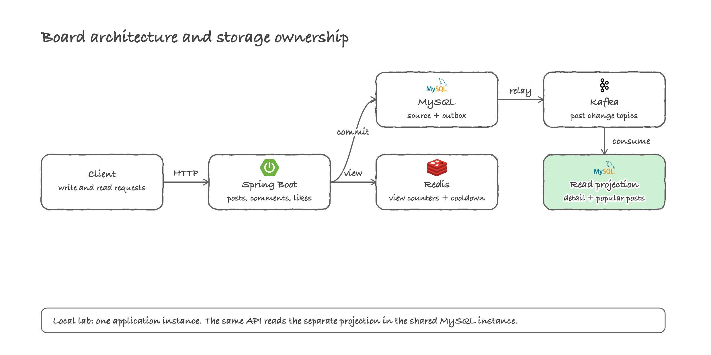

# Designing the Distributed Board Architecture

그림의 근거 · [AWS · Transactional Outbox](https://docs.aws.amazon.com/prescriptive-guidance/latest/cloud-design-patterns/transactional-outbox.html) · [Microsoft · CQRS Pattern](https://learn.microsoft.com/en-us/azure/architecture/patterns/cqrs)

## 1. 게시글 원본과 조회용 상태를 나눈다

Spring Boot API는 게시글·댓글·좋아요의 변경을 MySQL에 저장한다. Redis는 조회수와 중복 제한 상태를 담당한다. 별도 인기글·상세 조회 모델을 갱신할 변경 통지는 게시글 변경과 함께 아웃박스에 기록하고, 커밋 후 Kafka로 전달한다. [AWS · Transactional Outbox](https://docs.aws.amazon.com/prescriptive-guidance/latest/cloud-design-patterns/transactional-outbox.html) · [Microsoft · CQRS Pattern](https://learn.microsoft.com/en-us/azure/architecture/patterns/cqrs)

## 2. 게시판 키를 기준으로 분산 경계를 잡는다

샤딩을 적용한다면 게시판 ID로 게시글·댓글·좋아요를 같은 샤드에 모아 일반적인 쓰기와 목록 조회가 단일 샤드에서 끝나도록 설계한다. 인기 게시판은 게시판 단위 샤딩에서도 한 노드로 몰릴 수 있다. 전역 인기글처럼 여러 샤드가 필요한 조회는 별도 집계 모델을 두고, 샤드 키 선택에는 조회 패턴과 데이터 편중을 함께 반영한다. [Microsoft · Sharding Pattern](https://learn.microsoft.com/en-us/azure/architecture/patterns/sharding)

## 3. MySQL 개발 환경으로 먼저 검증한다

로컬 실습은 MySQL 8.4, Redis, Kafka와 Spring Boot 인스턴스 한 개를 Docker Compose로 실행한다. Flyway의 MySQL 모듈로 테이블과 인덱스를 만들고, MySQL에는 로컬 전용 연결을 사용한다. 애플리케이션 차원의 샤드 라우팅과 다중 브로커 복제는 별도 설계 항목이다. [Spring Boot 3.5 · Flyway Database Migrations](https://docs.spring.io/spring-boot/3.5/how-to/data-initialization.html#howto.data-initialization.migration-tool.flyway) · [Docker Compose · Control Startup Order](https://docs.docker.com/compose/how-tos/startup-order/)
