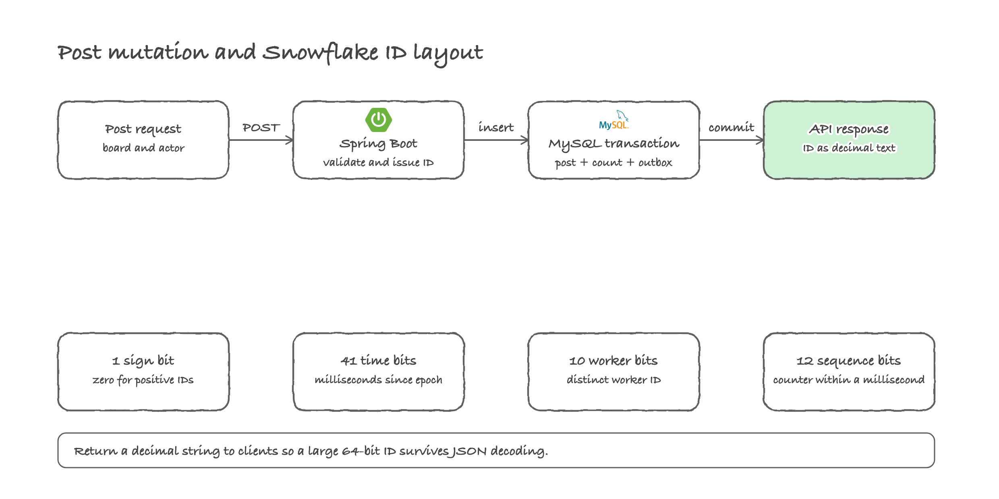

# Modeling Post CRUD and Distributed IDs

그림의 근거 · [RFC 9110 · Idempotent Methods](https://www.rfc-editor.org/rfc/rfc9110.html#section-9.2.2) · [MySQL 8.4 · Locking Reads](https://dev.mysql.com/doc/refman/8.4/en/innodb-locking-reads.html)

## 1. 게시글과 변경 계약을 정의한다

게시글은 ID, 게시판, 작성자, 제목·본문, 작성·변경·삭제 시각을 가진다. 생성 시 201과 ID를 반환하고 수정·삭제에서 작성자를 검사한다. 삭제는 시각을 기록하고 상세·목록 조회가 삭제된 행을 숨긴다. 동일한 소유자의 삭제 재시도는 게시글 수를 다시 감소시키지 않는다. [RFC 9110 · Idempotent Methods](https://www.rfc-editor.org/rfc/rfc9110.html#section-9.2.2) · [MySQL 8.4 · Locking Reads](https://dev.mysql.com/doc/refman/8.4/en/innodb-locking-reads.html)

## 2. Snowflake에서 충돌 조건을 관리한다

실습 구현은 41비트 밀리초, 10비트 워커 ID, 12비트 밀리초 내 순번을 사용한다. 서로 다른 프로세스에 같은 워커 ID를 주지 않는다. 워커가 시계 역행이나 같은 밀리초의 순번 고갈을 감지하면 발급을 중단한다. `BIGINT` ID는 MySQL에 숫자로 저장하고, JavaScript 정밀도를 보존하도록 응답에는 십진 문자열로 보낸다. [Twitter · Snowflake Archive](https://github.com/twitter-archive/snowflake) · [ECMAScript · Number.MAX_SAFE_INTEGER](https://tc39.es/ecma262/multipage/numbers-and-dates.html#sec-number.max_safe_integer)

## 3. 기본 키 후보와 테스트 데이터를 검증한다

단일 MySQL에서 키 발급이 충분하면 `AUTO_INCREMENT`로 시작할 수 있다. 분산 발급의 대안으로 UUIDv7을 검토할 때는 시간 필드, 인덱스 크기, 저장·전송 형식을 비교한다. 목록 평가용 합성 데이터에는 동일 타임스탬프와 다양한 작성자·게시판 분포를 포함하고, API 검증은 생성·수정·삭제와 조회 행 수를 각각 확인한다. [MySQL 8.4 · AUTO_INCREMENT Handling in InnoDB](https://dev.mysql.com/doc/refman/8.4/en/innodb-auto-increment-handling.html) · [RFC 9562 · UUID Version 7](https://www.rfc-editor.org/rfc/rfc9562.html#section-5.7)
