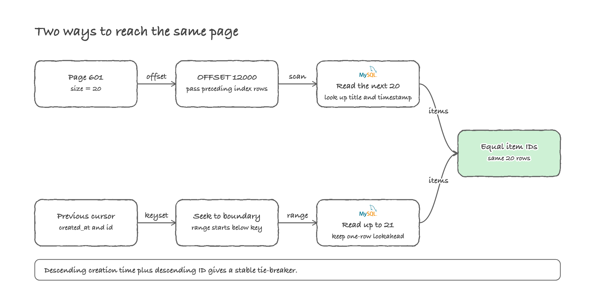

# Paginating Posts by Page and Cursor

그림의 근거 · [MySQL 8.4 · LIMIT Query Optimization](https://dev.mysql.com/doc/refman/8.4/en/limit-optimization.html) · [MySQL 8.4 · Consistent Nonlocking Reads](https://dev.mysql.com/doc/refman/8.4/en/innodb-consistent-read.html)

## 1. 번호 페이지의 비용과 총건수 계약을 정한다

번호 페이지는 `LIMIT M OFFSET (N - 1) * M`으로 임의 페이지를 선택한다. 깊은 페이지에서는 스토리지 엔진이 반환할 행 앞의 항목도 건너뛴다. 총건수가 매 조회에 필요하다면 실습처럼 게시판별 카운터를 게시글 생성·삭제와 같은 트랜잭션에서 갱신한다. 원본 행과 카운터를 다시 대조하는 절차도 운영에 포함한다. [MySQL 8.4 · LIMIT Query Optimization](https://dev.mysql.com/doc/refman/8.4/en/limit-optimization.html) · [MySQL 8.4 · Consistent Nonlocking Reads](https://dev.mysql.com/doc/refman/8.4/en/innodb-consistent-read.html)

## 2. 무한 스크롤은 마지막 정렬 키부터 재개한다

`ORDER BY created_at DESC, id DESC`로 결과를 정렬한다. 다음 페이지는 `created_at < :time OR (created_at = :time AND id < :id)`를 적용한다. `(board_id, deleted_at, created_at DESC, id DESC)` 인덱스와 정렬·필터의 순서를 맞추고, `size + 1`행을 읽어 다음 커서 여부를 결정한다. [MySQL 8.4 · ORDER BY Optimization](https://dev.mysql.com/doc/refman/8.4/en/order-by-optimization.html) · [MySQL 8.4 · Row Constructor Expression Optimization](https://dev.mysql.com/doc/refman/8.4/en/row-constructor-optimization.html)

## 3. 변경 중인 목록의 경계를 명시한다

같은 시각의 게시글은 고유 ID로 순서를 정한다. 커서는 실습에서 시각·ID를 인코딩한 불투명한 전달값이며 스냅샷 토큰은 별도로 제공하는 기능이다. 페이지 사이에 삽입·삭제가 일어날 수 있으므로 번호와 커서의 동작을 각각 검증한다. 동일한 페이지가 필요할 때는 고정 데이터에서 두 방식의 ID 목록과 `EXPLAIN ANALYZE`의 실제 처리 행 수를 대조한다. [MySQL 8.4 · ORDER BY Optimization](https://dev.mysql.com/doc/refman/8.4/en/order-by-optimization.html) · [MySQL 8.4 · EXPLAIN ANALYZE](https://dev.mysql.com/doc/refman/8.4/en/explain.html#explain-analyze)
