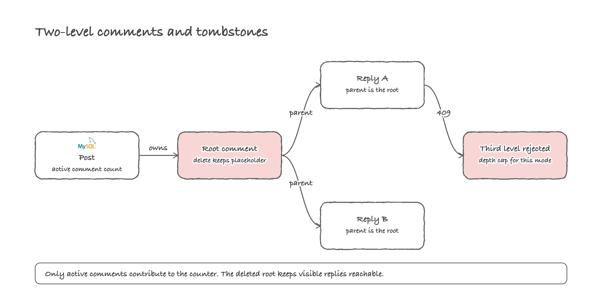

# Modeling Two-Level Comments

댓글 테이블·쓰기 API·목록 API는 루트 댓글 하나와 그 아래 한 단계의 답글을 기준으로 묶는다. 실습은 루트와 답글에 같은 테이블을 쓰고, `parent_id`와 `depth`로 두 층을 구분한다. [MySQL 8.4 · FOREIGN KEY Constraints](https://dev.mysql.com/doc/refman/8.4/en/create-table-foreign-keys.html)

그림의 근거 · [MySQL 8.4 · FOREIGN KEY Constraints](https://dev.mysql.com/doc/refman/8.4/en/create-table-foreign-keys.html)

## 1. 부모 댓글은 같은 게시글에 둔다

`board_comments`는 댓글 ID, 게시글 ID, 작성자 ID, 부모 ID, 모드, 깊이, 본문, 삭제 시각을 저장한다. 루트는 `parent_id IS NULL`과 깊이 0으로 표현한다. 복합 자기 참조 외래 키 `(post_id, mode, parent_id)`는 다른 게시글이나 다른 모드의 부모를 차단하고, `CHECK` 제약은 `TWO_LEVEL`의 깊이를 0 또는 1로 제한한다. [MySQL 8.4 · FOREIGN KEY Constraints](https://dev.mysql.com/doc/refman/8.4/en/create-table-foreign-keys.html) · [MySQL 8.4 · CHECK Constraints](https://dev.mysql.com/doc/refman/8.4/en/create-table-check-constraints.html)

## 2. 댓글 변경과 카운터를 함께 커밋한다

`POST /posts/{postId}/comments`는 활성 게시글에 새 댓글을 생성한다. 부모가 없으면 최상위, 활성 루트 댓글에 답하면 깊이 1이 된다. 작성자만 `PATCH`와 `DELETE`를 할 수 있다. 삭제는 본문을 비우고 삭제 시각을 기록하며, 답글이 남은 구조에서는 부모 자리를 유지한다. [Spring Framework 6.2 · Annotated Controllers](https://docs.spring.io/spring-framework/reference/6.2/web/webmvc/mvc-controller.html) · [MySQL 8.4 · FOREIGN KEY Constraints](https://dev.mysql.com/doc/refman/8.4/en/create-table-foreign-keys.html)

같은 게시글의 댓글 변경은 게시글 행을 먼저 `FOR UPDATE`로 잠근다. 댓글 생성이나 최초 삭제는 실제 상태 변경에 맞춰 게시글 카운터를 증감하고 아웃박스 행을 같은 트랜잭션에서 기록한다. 같은 댓글의 삭제를 다시 보내면 카운터와 이벤트는 그대로다. [MySQL 8.4 · Locking Reads](https://dev.mysql.com/doc/refman/8.4/en/innodb-locking-reads.html) · [AWS · Transactional Outbox](https://docs.aws.amazon.com/prescriptive-guidance/latest/cloud-design-patterns/transactional-outbox.html) · [RFC 9110 · Idempotent Methods](https://www.rfc-editor.org/rfc/rfc9110.html#name-idempotent-methods)

## 3. 목록과 경계 조건을 검증한다

`GET /posts/{postId}/comments?mode=TWO_LEVEL`는 댓글과 답글을 ID 순서로 반환한다. `parentId=0`이면 루트만, 양의 부모 ID를 주면 해당 부모의 답글만 읽는다. `size + 1`개를 조회해 다음 페이지 유무를 확인하고, 마지막 ID와 게시글·모드·부모 범위를 커서에 담는다. 인덱스는 전체 목록과 부모별 목록에 각각 `(post_id, mode, id)`와 `(post_id, mode, parent_id, id)`를 사용한다. [MySQL 8.4 · Multiple-Column Indexes](https://dev.mysql.com/doc/refman/8.4/en/multiple-column-indexes.html) · [MySQL 8.4 · LIMIT Query Optimization](https://dev.mysql.com/doc/refman/8.4/en/limit-optimization.html)

실습 데이터에는 루트 여러 개, 인기 루트에 몰린 답글, 답글을 남겨 둔 삭제 루트를 섞는다. 부모가 다른 게시글에 속한 경우, 세 번째 층의 댓글을 시도한 경우, 커서의 부모 범위를 바꾼 경우, 같은 삭제를 재시도한 경우를 각각 검사한다. [MySQL 8.4 · FOREIGN KEY Constraints](https://dev.mysql.com/doc/refman/8.4/en/create-table-foreign-keys.html) · [MySQL 8.4 · CHECK Constraints](https://dev.mysql.com/doc/refman/8.4/en/create-table-check-constraints.html) · [RFC 9110 · Idempotent Methods](https://www.rfc-editor.org/rfc/rfc9110.html#name-idempotent-methods)
