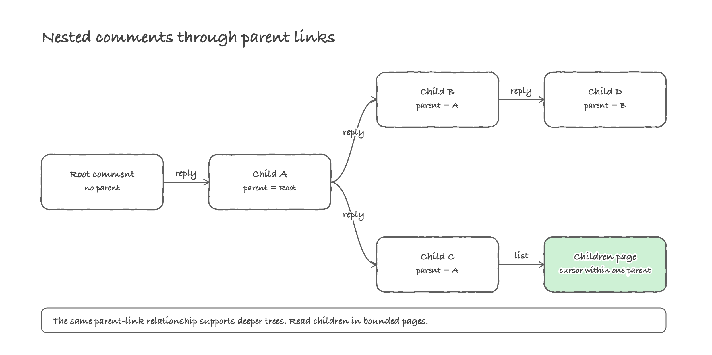

# Modeling Nested Comment Trees

깊이 제한 없는 댓글은 부모 ID를 연결하는 인접 리스트로 정리한다. 실습의 `TREE` 모드는 두 단계 제약을 해제하고, 부모·자식이 같은 게시글과 모드를 공유하는 제약은 유지한다. [MySQL 8.4 · FOREIGN KEY Constraints](https://dev.mysql.com/doc/refman/8.4/en/create-table-foreign-keys.html)

그림의 근거 · [MySQL 8.4 · FOREIGN KEY Constraints](https://dev.mysql.com/doc/refman/8.4/en/create-table-foreign-keys.html)

## 1. 부모 연결을 만들고 생성 순서로 순환을 막는다

댓글은 이미 존재하는 부모만 참조하고 생성 뒤 부모를 바꾸는 API를 제공하지 않는다. 부모의 깊이에 1을 더해 저장하고, 삭제된 부모에는 새 답글을 달 수 없게 한다. 본문이나 삭제 상태가 바뀌어도 식별자와 부모 관계는 유지된다. [MySQL 8.4 · FOREIGN KEY Constraints](https://dev.mysql.com/doc/refman/8.4/en/create-table-foreign-keys.html) · [MySQL 8.4 · Locking Reads](https://dev.mysql.com/doc/refman/8.4/en/innodb-locking-reads.html)

## 2. 필요한 가지를 펼친다

클라이언트는 `GET /posts/{postId}/comments?mode=TREE&parentId=0`에서 루트를 읽고, 댓글을 펼칠 때 `parentId`에 해당 댓글 ID를 넣어 직계 자식을 이어 읽는다. `parentId`를 생략하면 게시글 전체를 정렬된 평면 항목으로 순회한다. 직계 자식이 남은 삭제 행은 본문이 없는 연결점으로 남기며, 자식이 없는 삭제 행은 목록에서 제외한다. [MySQL 8.4 · Multiple-Column Indexes](https://dev.mysql.com/doc/refman/8.4/en/multiple-column-indexes.html) · [MySQL 8.4 · EXISTS and NOT EXISTS](https://dev.mysql.com/doc/refman/8.4/en/exists-and-not-exists-subqueries.html)

운영 분석에서 한 번에 서브트리를 가져올 때는 재귀 CTE의 종료 조건과 처리할 행 수를 함께 정한다. MySQL 8.4의 `cte_max_recursion_depth` 기본값은 1,000이다. 응답 깊이와 최대 크기를 제한하면 긴 가지가 깊어져도 첫 페이지 비용을 예측하기 쉽다. [MySQL 8.4 · Recursive Common Table Expressions](https://dev.mysql.com/doc/refman/8.4/en/with.html#common-table-expressions-recursive)

## 3. 깊이와 너비를 따로 검증한다

테스트 데이터에는 깊은 가지 하나와 같은 부모에 자식이 몰리는 넓은 가지를 모두 넣는다. 중간 댓글을 삭제한 뒤 자손을 계속 탐색할 수 있는지, 삭제된 본문이 반환되지 않는지, 다른 부모에서 재사용한 커서가 거부되는지 확인한다. 전체 순회와 단일 가지 조회의 요청 수와 스캔 행 수는 따로 측정한다. [MySQL 8.4 · Multiple-Column Indexes](https://dev.mysql.com/doc/refman/8.4/en/multiple-column-indexes.html) · [MySQL 8.4 · EXPLAIN](https://dev.mysql.com/doc/refman/8.4/en/explain.html)
