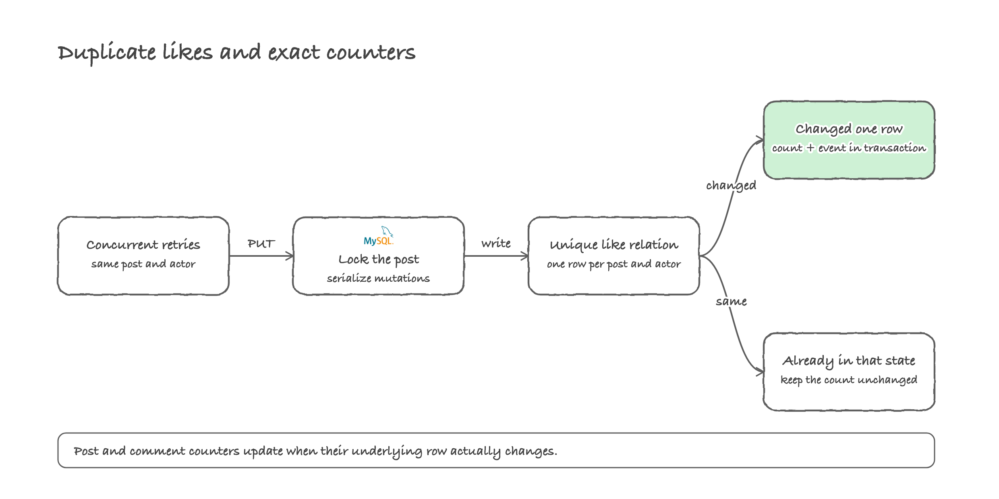

# Modeling Likes and Exact Counters

게시판의 좋아요·댓글·게시글 수는 목록에서 자주 쓰는 집계 값이다. 쓰기 트랜잭션에서 원본 관계와 집계 값을 함께 바꾸면 조회할 때마다 원본 행을 세는 비용을 줄일 수 있다. InnoDB에서는 여러 트랜잭션이 같은 집계 행에 쓰면 해당 행에서 잠금 대기가 생길 수 있다. [MySQL 8.4 · COUNT](https://dev.mysql.com/doc/refman/8.4/en/aggregate-functions.html#function_count) · [MySQL 8.4 · Locking Reads](https://dev.mysql.com/doc/refman/8.4/en/innodb-locking-reads.html)

그림의 근거 · [MySQL 8.4 · COUNT](https://dev.mysql.com/doc/refman/8.4/en/aggregate-functions.html#function_count) · [MySQL 8.4 · Locking Reads](https://dev.mysql.com/doc/refman/8.4/en/innodb-locking-reads.html)

## 1. 공개 API를 관계의 원하는 상태로 표현한다

`PUT /posts/{id}/likes`는 로그인 사용자의 좋아요 관계를 만들고, `DELETE /posts/{id}/likes`는 관계를 없앤다. `post_likes`의 복합 기본 키 `(post_id, user_id)`가 관계의 중복을 막는다. 동일 요청을 성공 후 재전송할 때는 관계와 좋아요 수가 그대로 유지된다. [RFC 9110 · Idempotent Methods](https://www.rfc-editor.org/rfc/rfc9110.html#name-idempotent-methods) · [MySQL 8.4 · PRIMARY KEY and UNIQUE Index Constraints](https://dev.mysql.com/doc/refman/8.4/en/constraint-primary-key.html)

## 2. 원본 행이 바뀔 때만 같은 트랜잭션에서 센다

실습에서는 살아 있는 게시글 행을 `SELECT ... FOR UPDATE`로 먼저 잠근다. 좋아요 INSERT가 유일 키에 걸리거나 DELETE가 0행을 지우면 그대로 끝낸다. 관계가 실제로 바뀌면 `like_count = like_count + :delta`로 보정하고, 같은 트랜잭션에서 인기글·읽기 모델 갱신용 아웃박스 이벤트를 기록한다. MySQL InnoDB의 중복 키 오류는 해당 문장을 롤백하므로 이 경우를 성공한 재전송으로 처리한다. [MySQL 8.4 · Locking Reads](https://dev.mysql.com/doc/refman/8.4/en/innodb-locking-reads.html) · [MySQL 8.4 · InnoDB Error Handling](https://dev.mysql.com/doc/refman/8.4/en/innodb-error-handling.html) · [AWS · Transactional Outbox](https://docs.aws.amazon.com/prescriptive-guidance/latest/cloud-design-patterns/transactional-outbox.html)

게시판별 게시글 수와 게시글별 댓글 수도 실제 생성·삭제 상태 전이에 맞춰 갱신한다. 댓글을 삭제 표시로 남기는 모델에서는 API가 어떤 삭제 상태를 총수에서 제외하는지 정하고, 한 번만 감소시킨다. 교차 검증에서는 같은 일관 읽기 시점에서 원본의 유효 행 수와 집계 값을 대조한다. [MySQL 8.4 · InnoDB Consistent Nonlocking Reads](https://dev.mysql.com/doc/refman/8.4/en/innodb-consistent-read.html) · [MySQL 8.4 · COUNT](https://dev.mysql.com/doc/refman/8.4/en/aggregate-functions.html#function_count)

## 3. 동시 재전송과 한 게시물에 몰린 쓰기를 검증한다

같은 사용자로 PUT을 동시에 재전송하면 관계와 증가분은 각각 1건이다. DELETE를 반복하면 관계는 없고 증가분을 한 번만 되돌린 상태여야 한다. 사용자 여러 명이 한 게시글을 갱신하는 경우에는 카운터의 정합성에 더해 잠금 대기와 쓰기 p95를 측정한다. 여러 게시글에 요청을 분산한 결과도 같은 부하 수준에서 비교한다. [MySQL 8.4 · Locks Set by Different SQL Statements](https://dev.mysql.com/doc/refman/8.4/en/innodb-locks-set.html) · [MySQL 8.4 · The data_lock_waits Table](https://dev.mysql.com/doc/refman/8.4/en/performance-schema-data-lock-waits-table.html)
