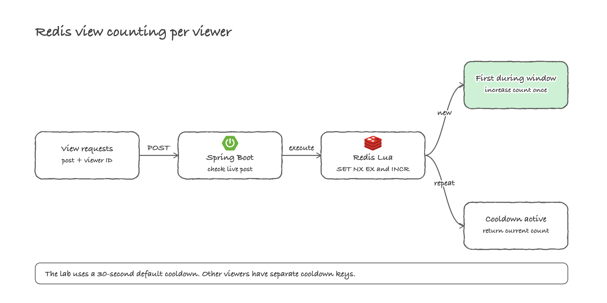

# Counting Views and Preventing Duplicates

조회수 정책은 무엇을 한 번의 조회로 간주하는지 먼저 정한다. 로컬 실습의 `POST /posts/{id}/views`는 게시글과 사용자 조합이 지난 30초 안에 집계된 적이 있는지 판정한다. `counted`는 이번 호출의 반영 여부이고, `views`에는 그 시점의 누적 수를 반환한다. [Redis · SET](https://redis.io/docs/latest/commands/set/) · [Redis · INCR](https://redis.io/docs/latest/commands/incr/)

그림의 근거 · [Redis · SET](https://redis.io/docs/latest/commands/set/) · [Redis · INCR](https://redis.io/docs/latest/commands/incr/)

## 1. 중복 키 획득과 증가를 한 번에 처리한다

스크립트는 사용자 쿨다운 키에 `SET key 1 NX EX seconds`를 실행한다. 키가 없을 때만 생성되므로 같은 사용자의 동시 요청 중 성공한 호출만 게시글 누적 키에 `INCR`를 실행한다. 중복 호출에는 현재 누적 수를 반환하고 기존 쿨다운은 연장하지 않는다. [Redis · SET](https://redis.io/docs/latest/commands/set/) · [Redis · Scripting with Lua](https://redis.io/docs/latest/develop/programmability/eval-intro/)

Spring Data Redis의 `StringRedisTemplate.execute`로 클래스패스 Lua 스크립트를 호출한다. 스크립트가 다루는 누적 키와 쿨다운 키에는 같은 게시글 ID 해시 태그를 넣는다. 저장된 카운터가 정수 범위를 넘거나 잘못된 타입이어서 `INCR`가 실패하면 스크립트는 그 요청이 만든 쿨다운 키를 되돌리고 오류를 반환한다. [Spring Data Redis 3.5 · Scripting](https://docs.spring.io/spring-data/redis/reference/3.5/redis/scripting.html) · [Redis · Cluster Hash Tags](https://redis.io/docs/latest/operate/oss_and_stack/reference/cluster-spec/#hash-tags) · [Redis · Lua API](https://redis.io/docs/latest/develop/programmability/lua-api/)

## 2. 쿨다운과 영속성의 적용 범위를 고른다

쿨다운 TTL은 메모리를 회수하면서 중복을 제한한다. 30초가 지나면 같은 사용자도 다시 집계할 수 있다. 운영에서는 인증한 사용자 식별자를 적용하고, 다계정이나 자동화 트래픽을 제한할 별도의 정책을 둔다. 동일 식별자의 재전송 제한은 같은 키의 유효 기간에 적용된다. [Redis · SET](https://redis.io/docs/latest/commands/set/) · [Spring Security 6.5 · Authentication Architecture](https://docs.spring.io/spring-security/reference/6.5/servlet/authentication/architecture.html)

실습의 조회수 원본은 Redis다. 카운터 키에는 TTL을 두지 않고, 재시작과 장애에서 보존되는 범위는 배포의 AOF·RDB 정책에 따른다. 회계나 과금처럼 손실 허용량이 작은 집계에서는 영속 이벤트와 재구축 절차를 따로 설계한다. [Redis · Persistence](https://redis.io/docs/latest/operate/oss_and_stack/management/persistence/)

## 3. TTL 경계와 장애를 검증한다

같은 사용자의 동시 요청, 서로 다른 사용자의 동시 요청, 만료 직후 다시 조회를 각각 시험한다. 스크립트의 원자성은 요청 사이에 다른 명령이 끼어들지 않도록 한다. 실행 중 오류에서 앞 명령이 자동으로 롤백되는 방식은 아니므로, 증가 실패 후 쿨다운 키가 남지 않는지 확인한다. [Redis · Scripting with Lua](https://redis.io/docs/latest/develop/programmability/eval-intro/) · [Redis · Lua API](https://redis.io/docs/latest/develop/programmability/lua-api/)
