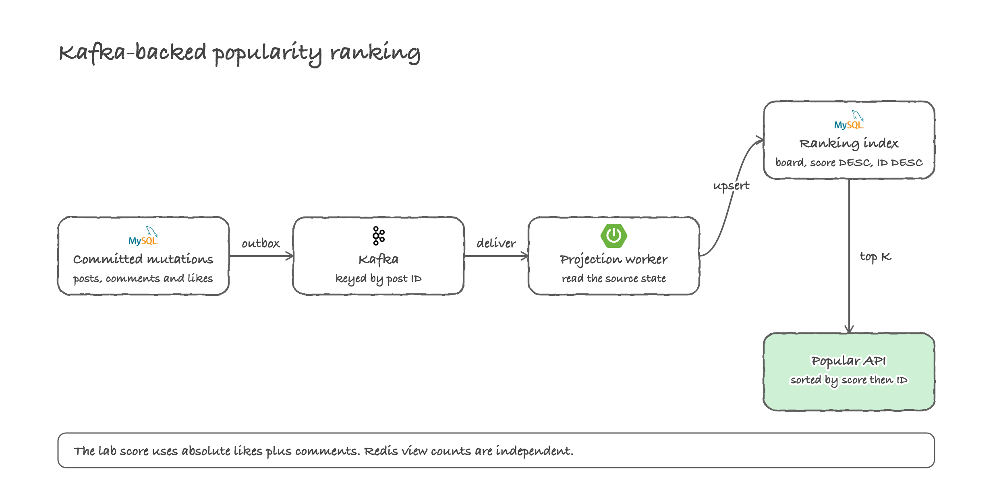

# Building a Kafka-Backed Popular Posts Projection

인기글은 게시판별로 정렬된 별도 읽기 모델에서 조회한다. 로컬 실습은 Kafka에 게시물 변경 알림을 보내고, MySQL에 게시글 내용과 좋아요·댓글의 현재 수를 투영한다. 학습 범위는 강의 41~48이다. [Microsoft · CQRS](https://learn.microsoft.com/en-us/azure/architecture/patterns/cqrs) · [Spring for Apache Kafka 3.3 · Receiving Messages](https://docs.spring.io/spring-kafka/reference/3.3/kafka/receiving-messages.html)

그림의 근거 · [Microsoft · CQRS](https://learn.microsoft.com/en-us/azure/architecture/patterns/cqrs) · [Spring for Apache Kafka 3.3 · Receiving Messages](https://docs.spring.io/spring-kafka/reference/3.3/kafka/receiving-messages.html)

## 1. 토픽과 소비자 그룹을 정한다

로컬 Kafka의 `board-post-changed` 토픽은 파티션 3개와 복제 계수 1을 사용한다. 변경 알림은 게시물 ID를 키로 발행하고 `board-projector` 소비자 그룹에서 읽는다. 여러 소비자를 시험할 때는 같은 그룹의 파티션 할당과 재조정을 확인한다. 배포에서는 브로커 수, 복제 계수와 최소 ISR을 별도로 정한다. [Apache Kafka 4.3 · Design](https://kafka.apache.org/43/design/design/) · [Spring for Apache Kafka 3.3 · Configuring Topics](https://docs.spring.io/spring-kafka/reference/3.3/kafka/configuring-topics.html)

이벤트 JSON은 `schemaVersion`, `eventId`, `postId`를 가진다. 이 계약에서 `eventId`는 아웃박스 행을 추적하고, `postId`는 다시 읽을 원본 키를 지정한다. 순위 소비자는 메시지를 읽을 때 스키마 버전과 양수 ID를 검사한다. 기존 버전과 호환되는 필드 추가 및 호환성이 깨지는 변경을 구분해 소비자 배포 순서를 정한다. [Apache Kafka 4.3 · Design](https://kafka.apache.org/43/design/design/) · [AWS · Transactional Outbox](https://docs.aws.amazon.com/prescriptive-guidance/latest/cloud-design-patterns/transactional-outbox.html)

## 2. 점수와 동점 규칙을 저장한다

실습 점수는 `like_count + comment_count`로 정의한다. MySQL 생성 컬럼에 점수를 저장하고 `(board_id, score DESC, post_id DESC)` 인덱스로 게시판 안에서 탐색한다. ID로 동점 순서를 고정하며, 조회수는 독립 집계로 유지한다. 시간 감쇠나 급상승 순위를 도입하면 점수 산식과 집계 창을 먼저 정한다. [MySQL 8.4 · Generated Columns](https://dev.mysql.com/doc/refman/8.4/en/create-table-generated-columns.html) · [MySQL 8.4 · Descending Indexes](https://dev.mysql.com/doc/refman/8.4/en/descending-indexes.html)

## 3. 읽기 API와 실험 조건을 정한다

`GET /boards/{boardId}/popular?limit=20`으로 상위 항목을 조회하고, 읽기 모델의 후보를 원본과 대조해 현재 삭제된 게시글을 숨긴다. 검증할 때는 같은 게시판에서 동점 두 건, 좋아요 취소, 댓글 삭제, 이미 반영된 이벤트의 재전송을 비교한다. 소비량과 별개로 게시물 변경이 응답에 나타날 때까지의 지연을 측정한다. [Microsoft · CQRS](https://learn.microsoft.com/en-us/azure/architecture/patterns/cqrs) · [Google SRE · Monitoring Distributed Systems](https://sre.google/sre-book/monitoring-distributed-systems/)
