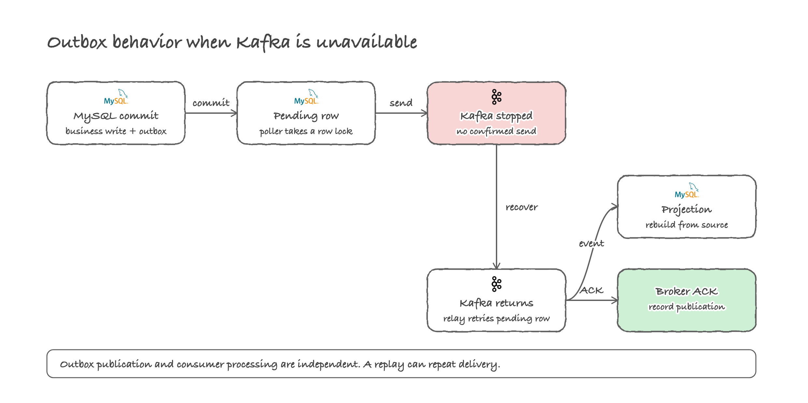

# Publishing Board Events with a Transactional Outbox

게시글과 반응을 저장하는 MySQL 트랜잭션 안에 발행할 변경을 함께 기록한다. 별도 릴레이가 커밋된 아웃박스를 읽어 Kafka로 보내고, 소비자가 읽기 모델을 갱신한다. [AWS · Transactional Outbox](https://docs.aws.amazon.com/prescriptive-guidance/latest/cloud-design-patterns/transactional-outbox.html)

그림의 근거 · [AWS · Transactional Outbox](https://docs.aws.amazon.com/prescriptive-guidance/latest/cloud-design-patterns/transactional-outbox.html)

## 1. 원본과 발행 대기 행을 함께 커밋한다

게시글 추가·편집·삭제와 좋아요·댓글 수를 바꾸는 트랜잭션이 `board_outbox`에 아웃박스 행을 넣는다. 원본 트랜잭션이 롤백되면 아웃박스 행도 같이 사라진다. 멱등 요청을 다시 받아 실제 상태 변경이 없다면 발행 행도 그대로 유지한다. [AWS · Transactional Outbox](https://docs.aws.amazon.com/prescriptive-guidance/latest/cloud-design-patterns/transactional-outbox.html) · [Spring Framework 6.2 · Transaction Propagation](https://docs.spring.io/spring-framework/reference/6.2/data-access/transaction/declarative/tx-propagation.html)

## 2. 발행 확인 뒤 대기 상태를 끝낸다

릴레이가 `published_at IS NULL`인 행을 소량 선택하며, 여러 릴레이가 있으면 `FOR UPDATE SKIP LOCKED`로 다른 릴레이가 처리 중인 행을 건너뛴다. 실습 릴레이는 `READ COMMITTED`를 사용해 선택 범위의 갭 락을 줄인다. Kafka 전송 결과가 성공으로 반환되면 해당 행의 `published_at`을 기록한다. [MySQL 8.4 · Locking Reads](https://dev.mysql.com/doc/refman/8.4/en/innodb-locking-reads.html) · [MySQL 8.4 · Transaction Isolation Levels](https://dev.mysql.com/doc/refman/8.4/en/innodb-transaction-isolation-levels.html) · [Spring for Apache Kafka 3.3 · Sending Messages](https://docs.spring.io/spring-kafka/reference/3.3/kafka/sending-messages.html)

## 3. 재발행 중복과 브로커 중단을 확인한다

브로커가 메시지를 받았으나 발행 상태를 커밋하기 전에 릴레이가 중단되면 같은 이벤트를 다시 보낼 수 있다. 실습 소비자는 원본의 현재 상태를 다시 읽어 읽기 모델의 행을 덮어쓴다. 실패 검증은 브로커 중단 상태에서 쓰기 결과와 미발행 행을 확인한 뒤, 재시작·재전송으로 발행 상태와 읽기 모델이 수렴하는지 확인한다. [AWS · Transactional Outbox](https://docs.aws.amazon.com/prescriptive-guidance/latest/cloud-design-patterns/transactional-outbox.html) · [Spring for Apache Kafka 3.3 · Committing Offsets](https://docs.spring.io/spring-kafka/reference/3.3/kafka/receiving-messages/message-listener-container.html)
