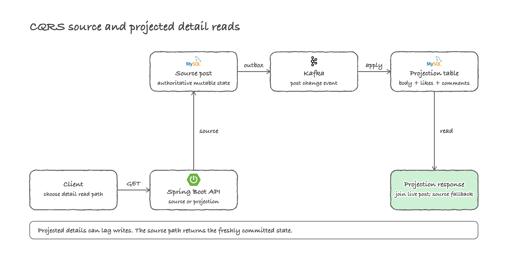

# Optimizing Post Details with CQRS

상세 조회용 모델에서 제목·본문과 좋아요·댓글의 현재 투영값을 함께 읽는다. 쓰기 경로는 게시글 원본에 책임을 두고, 조회 모델의 최적화와 갱신 정책을 따로 설계한다. 학습 범위는 강의 54~60이다. [Microsoft · CQRS](https://learn.microsoft.com/en-us/azure/architecture/patterns/cqrs)

그림의 근거 · [Microsoft · CQRS](https://learn.microsoft.com/en-us/azure/architecture/patterns/cqrs)

## 1. 명령의 원본과 상세 조회 모델을 나눈다

쓰기 경로는 MySQL `posts`와 도메인 테이블을 갱신한다. `post_projection`에는 게시물별로 상세 조회 필드와 반응 집계값을 저장한다. 실습에서는 쓰기·읽기 모델이 같은 MySQL을 공유한다. 분리 배포 시에는 조회 부하와 갱신 비용, 장애 시 재구축 시간을 함께 비교한다. [Microsoft · CQRS](https://learn.microsoft.com/en-us/azure/architecture/patterns/cqrs) · [Microsoft · Materialized View](https://learn.microsoft.com/en-us/azure/architecture/patterns/materialized-view)

## 2. 이벤트를 받으면 현재 상태로 투영을 갱신한다

소비자가 게시물 원본 행을 잠근 뒤 현재 상태를 읽고, 상세 조회 행을 삽입하거나 갱신한다. 삭제된 게시물은 투영에서도 제거한다. 이벤트가 반복되거나 도착 순서가 뒤집혀도 이미 지난 값을 덧셈하지 않으며, 읽은 원본으로 해당 행 전체를 갱신한다. Kafka의 레코드 단위 오프셋 커밋은 리스너 처리 후 진행한다. [MySQL 8.4 · Locking Reads](https://dev.mysql.com/doc/refman/8.4/en/innodb-locking-reads.html) · [MySQL 8.4 · INSERT ON DUPLICATE KEY UPDATE](https://dev.mysql.com/doc/refman/8.4/en/insert-on-duplicate.html) · [Spring for Apache Kafka 3.3 · Committing Offsets](https://docs.spring.io/spring-kafka/reference/3.3/kafka/receiving-messages/message-listener-container.html)

## 3. 조회 시점과 갱신 시점의 차이를 확인한다

투영이 늦으면 상세 조회에서 최근 편집이나 반응 변화가 지연될 수 있다. 신규 작성 직후에 필요한 읽기 일관성과 캐시 갱신 정책을 별도로 정한다. 삭제 반영, 투영 미생성, 지연된 Kafka 소비, 조회수의 Redis 저장 정책은 독립된 시험으로 확인한다. [Microsoft · CQRS](https://learn.microsoft.com/en-us/azure/architecture/patterns/cqrs) · [Microsoft · Cache-Aside](https://learn.microsoft.com/en-us/azure/architecture/patterns/cache-aside)
