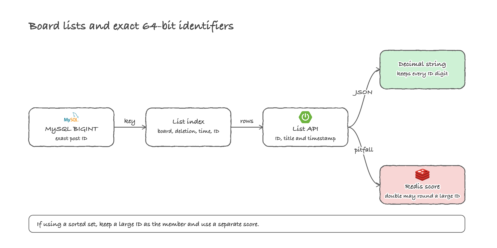

# Optimizing Board Lists and Preserving ID Precision

그림의 근거 · [MySQL 8.4 · ORDER BY Optimization](https://dev.mysql.com/doc/refman/8.4/en/order-by-optimization.html) · [MySQL 8.4 · EXPLAIN ANALYZE](https://dev.mysql.com/doc/refman/8.4/en/explain.html#explain-analyze)

## 1. 목록 조회의 정렬과 반환 필드를 좁힌다

목록은 게시판과 삭제 상태를 필터링하고, 제목·작성 시각·ID만 내려준다. 본문은 상세 조회에서 가져온다. 번호 방식과 커서 방식의 반환 행이 같은지 확인한 뒤, 실행 계획으로 인덱스 범위 탐색·건너뛴 행·정렬 비용을 비교한다. [MySQL 8.4 · ORDER BY Optimization](https://dev.mysql.com/doc/refman/8.4/en/order-by-optimization.html) · [MySQL 8.4 · EXPLAIN ANALYZE](https://dev.mysql.com/doc/refman/8.4/en/explain.html#explain-analyze)

## 2. 64비트 ID와 Redis 점수의 자료형을 구분한다

Redis 정렬 집합 점수는 IEEE 754 배정밀도 숫자이므로 `2^53`을 넘는 연속 정수 ID를 모두 표현할 수 없다. Snowflake는 멤버 문자열에 보존하고, 점수에는 시간 버킷·인기도 등 의미가 분명한 값을 사용한다. 같은 점수 안의 정렬 정책도 명시한다. 실습은 목록과 인기글을 MySQL에 저장해 ID 정렬을 처리한다. [Redis · ZADD Score Precision](https://redis.io/docs/latest/commands/zadd/) · [Redis · ZRANGE Ordering](https://redis.io/docs/latest/commands/zrange/)

## 3. 페이지 계약을 API와 테스트에서 고정한다

번호 기반 API는 총건수와 항목을, 커서 기반 API는 항목과 다음 커서를 반환한다. 브라우저의 숫자 변환에서 정확성을 잃지 않도록 ID를 문자열로 받아 비교한다. API 테스트에는 다른 게시판의 데이터, 같은 시각의 정렬 경계, 잘못된 커서, 삭제된 항목 제외를 포함한다. [MySQL 8.4 · LIMIT Query Optimization](https://dev.mysql.com/doc/refman/8.4/en/limit-optimization.html) · [ECMAScript · Number.MAX_SAFE_INTEGER](https://tc39.es/ecma262/multipage/numbers-and-dates.html#sec-number.max_safe_integer)
