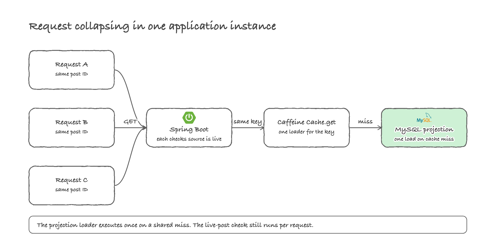

# Collapsing Concurrent Post Cache Misses

그림의 근거 · [Cloudflare · Request Collapsing](https://developers.cloudflare.com/cache/concepts/default-cache-behavior/#request-collapsing) · [Caffeine · Population](https://github.com/ben-manes/caffeine/wiki/Population)

## 1. 같은 키의 동시 캐시 미스를 합친다

만료된 게시물에 요청이 동시에 들어오면 원본 조회가 겹친다. 요청 합치기는 같은 키의 로더가 진행 중일 때 후속 요청이 그 로더의 결과를 기다리도록 한다. 키가 다르면 각 요청은 자신의 로더를 사용한다. [Cloudflare · Request Collapsing](https://developers.cloudflare.com/cache/concepts/default-cache-behavior/#request-collapsing) · [Caffeine · Population](https://github.com/ben-manes/caffeine/wiki/Population)

## 2. TTL과 삭제 확인의 경계를 둔다

실습은 단일 JVM에서 Caffeine `Cache.get(key, loader)`로 로딩을 합친다. 최대 10,000개, 쓰기 후 5초 만료를 적용하고, 삭제된 게시물이 캐시에서 반환되지 않도록 캐시 조회 전에 MySQL 원본의 존재와 삭제 상태를 확인한다. 내용 갱신은 조회 투영과 TTL의 영향을 받으며, 여러 복제본에는 각자의 JVM 캐시가 있다. [Caffeine · Population](https://github.com/ben-manes/caffeine/wiki/Population) · [Caffeine · Eviction](https://github.com/ben-manes/caffeine/wiki/Eviction)

## 3. 동시 로더 수와 실제 부하를 각각 측정한다

캐시가 비었을 때 같은 키로 16개 호출을 겹치고 로더가 한 번만 실행되는지 단위 테스트로 확인한다. HTTP 부하에서는 같은 게시글의 직접 투영 조회와 캐시 경로를 비교해 지연과 투영 로더 호출 수를 기록한다. 캐시 경로도 매 요청 원본 게시글의 활성 상태를 조회하므로 투영 호출 감소율의 분모는 전체 MySQL 쿼리와 다르다. [Caffeine · Population](https://github.com/ben-manes/caffeine/wiki/Population) · [Spring Boot 3.5 · Metrics](https://docs.spring.io/spring-boot/3.5/reference/actuator/metrics.html)
