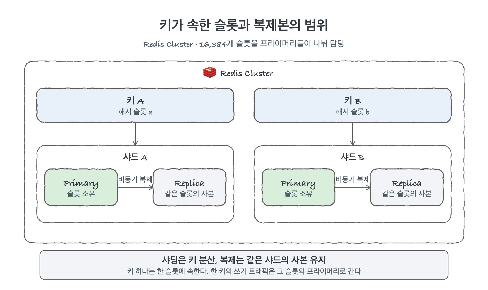

# Cache Fundamentals and Redis Cluster

캐시는 자주 읽는 데이터나 비용이 큰 연산 결과를 빠른 저장소에 보관해 응답 시간을 줄이고 원본 데이터 소스의 부하를 낮춘다. 여러 애플리케이션 인스턴스가 공유하는 캐시에는 Redis를 사용할 수 있고, 데이터량과 트래픽이 커지면 Redis Cluster로 수평 확장할 수 있다.

## 저장소 계층과 캐시의 역할

- 원본 데이터 소스에는 데이터베이스, 외부 API, CPU나 메모리를 많이 쓰는 연산이 포함된다. 해당 결과를 캐시에서 반환하면 원본 조회나 연산을 줄일 수 있다.
- 메모리는 디스크보다 빠르지만 용량당 비용이 높고 휘발성이 있다. 파레토 법칙의 예처럼 소수의 최신·인기·공통 데이터에 요청이 집중된다면, 그 데이터를 먼저 캐시해 메모리를 효율적으로 쓸 수 있다.
- 캐시는 서버 애플리케이션 외에도 CPU와 메모리 사이의 저장 계층, DNS, CDN 등 여러 구간에서 활용된다.

| 구분 | 접근 방식 | 장점 | 고려할 점 |
| --- | --- | --- | --- |
| Local Cache | 애플리케이션 인스턴스 내부 메모리 | 네트워크 호출이 없어 빠름 | 인스턴스별 메모리 사용, 재시작 시 소실, 인스턴스 간 동기화 |
| Remote Cache | 별도 캐시 서버에 네트워크로 접속 | 여러 인스턴스가 동일한 캐시를 공유 | 네트워크 지연과 별도 서버 운영 |

## Redis를 Remote Cache로 쓰는 이유

- Redis는 메모리 기반 키-값 저장소다. String, List, Set, Sorted Set, Hash 등 여러 자료구조를 지원한다.
- TTL(Time To Live)을 지정하면 일정 시간이 지난 키가 만료된다. TTL은 값을 캐시에 보관할 기간을 정하고 캐시가 차지하는 공간을 관리하는 데 쓰인다.
- 한 Redis 인스턴스에서 데이터에 접근하는 명령은 순서대로 실행된다. 개별 명령은 원자적으로 처리된다. AOF와 RDB를 통한 디스크 영속화와 Pub/Sub도 지원한다.

## Redis Cluster의 Sharding과 Replication

| 방식 | 동작 | 효과와 한계 |
| --- | --- | --- |
| Sharding | 키를 해시해 16,384개 hash slot 중 하나를 구하고, 그 slot을 맡은 shard로 요청을 보낸다. | 데이터와 읽기·쓰기 부하를 여러 master에 분산해 용량과 처리량을 확장한다. |
| Replication | 각 master의 데이터를 replica에 비동기로 복제한다. master 장애 시 replica가 새 master로 승격될 수 있다. | 가용성을 높이고 일부 읽기를 분산할 수 있다. 복제 지연 때문에 최신 값이 필요한 읽기는 master로 보내야 할 수 있다. |

단일 master에 replica를 추가해도 모든 쓰기는 master가 처리하고, 전체 데이터가 master의 메모리에 들어가야 한다. Redis Cluster에서는 slot을 여러 master에 할당해 수평 확장하고, 각 shard에 replica를 두어 장애에 대응할 수 있다.

그림의 근거 · [Redis Cluster 사양](https://redis.io/docs/latest/operate/oss_and_stack/reference/cluster-spec/)

## 적용 기준

- 인스턴스 내부에서 낮은 지연이 중요하고 재시작 시 소실과 인스턴스별 사본을 감당할 수 있으면 Local Cache가 적합하다. 여러 인스턴스가 같은 캐시를 사용해야 하면 Remote Cache를 고려한다.
- 장애 대응이나 읽기 분산이 필요하면 Replication을 고려한다. 쓰기 처리량이나 메모리 용량이 단일 master의 한계에 닿으면 Sharding으로 분산한다.
- 분산 캐시 전략은 Redis Cluster를 전제로 한다. Docker 실습은 단일 Redis에서 캐시 동작을 확인하는 구성이다.

## 공식 문서

- 해시 슬롯, 샤딩, 복제와 장애 조치의 동작을 설명한다. [Redis Cluster 확장](https://redis.io/docs/latest/operate/oss_and_stack/management/scaling/)
- 키의 만료 시간을 설정하고 변경할 때의 동작을 확인할 수 있다. [Redis EXPIRE](https://redis.io/docs/latest/commands/expire/)
